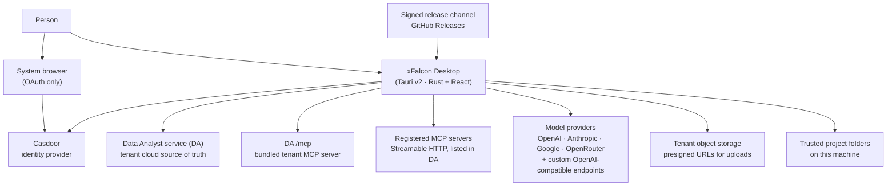
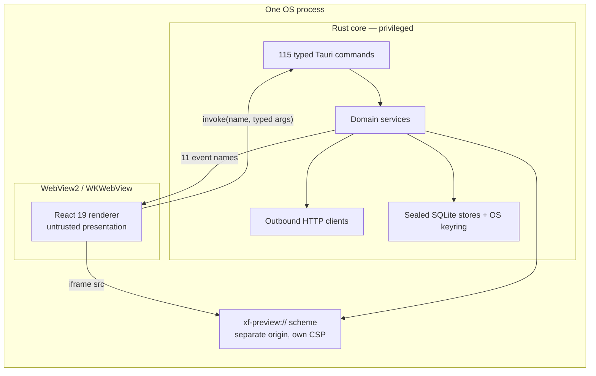

# Architecture

Version 0.5.50 · reviewed 2026-10-28 · **Understanding** · audience: any engineer

Describes the 0.5.50 working tree. Explicit UNVERIFIED labels mark behavior not
confirmed on a real supported platform.

What this system is, how it is divided, and where the boundaries fall. For the
step-by-step behaviour inside a boundary see [runtime-flows.md](runtime-flows.md);
for why a boundary is drawn where it is see [decisions.md](decisions.md). For
lookup tables see [ipc-reference.md](ipc-reference.md) (commands, events),
[configuration.md](configuration.md) (environment, on-disk layout), and
[agent-runtime-reference.md](agent-runtime-reference.md) (tools, limits).

## What this product is

xFalcon Desktop is a chat-first analytics workspace. A person asks a question in
natural language; the app runs a bounded agent turn against a model provider,
lets that turn read a folder the person explicitly trusted and call tools an MCP
server publishes, and renders the answer as prose, a table, a chart, or a saved
report. The person can also upload data files as datasets, browse and edit files
in a trusted project, and attach files to a message.

It is **not** a coding agent. The model has no shell, general process-spawn, or
web-fetch tool; the command allowlist excludes `run_shell` and the other
filesystem/network escape commands. Native Rust does spawn the fixed reset
helper and app relaunch through `security/device_purge.rs`; the model cannot
choose that executable or its arguments. Persistent user content is written
only inside a trusted project folder or to a location the person picks in a
save dialog; bounded transient dataset and upload files use app-owned staging
directories managed by `TempCleanup`. The
complete tool surface a model ever sees is eight built-in tools plus whatever a
registered MCP server publishes
([agent-runtime-reference.md](agent-runtime-reference.md);
`tools/registry.rs`, `tools/dispatch.rs`). Six of the eight are `project.*`
tools. One of them, `project.propose_patch`, writes inside the trusted project
without a review prompt (ADR-043 in [decisions.md](decisions.md); applied
through `ApprovalsService::apply`). Every file that write overwrites or deletes
is kept as a revision first.

Support targets: CI and release builds run on macOS and Windows only
(`.github/workflows/desktop-build.yml`). `README.md` lists Windows 11 23H2+
(x64/ARM64) and macOS 13+ (Apple Silicon/Intel) as supported, and Ubuntu 22.04+
and Debian 12+ as claimed without CI coverage. No code enforces those OS version
floors (unverified). Linux has platform-specific code paths
(`projects/platform.rs`, `uploads/clipboard.rs`), but PDF export is Windows-only
(`export/mod.rs`; other platforms return `PrintViaDialog`). See
[status.md](status.md).

## Level 1 — system context



There is no xFalcon Desktop gateway, backend, inference proxy, or credential
proxy. The desktop talks to each dependency directly; the company LLM endpoint is
reached as a private model, like any other custom endpoint. `xfalcon-web` is an
engineering reference for contracts and behaviour; it is never a runtime
dependency. It shares DA rows with the desktop (conversations, the MCP server
registry, MCP OAuth grants), so a record created in one client shows in the
other (`clients/da/mcp_servers.rs`, `clients/da/mcp_oauth_grants.rs`).

DA is the cloud source of truth for conversations, messages, runs, tool-call
records, the model catalogue (including custom models), DA-encrypted provider
keys, the shared MCP server registry, saved reports and their artifacts, dataset
and attachment metadata, and server-side audit (`clients/da/`). DA is a data
plane: it stores runs and calls no model provider. This desktop executes the
runs it starts, in this process, with a provider key that DA resolves only for
its authenticated tenant/user owner and that the desktop holds in zeroizing
memory for the bounded run. xFalcon Web runs its own engine against the same
conversations, so this desktop is not the only run executor in the system
(`chat/service.rs`, `inference_credential`).

Uploads go in two steps. DA issues a presigned URL, and the desktop sends the
bytes to object storage with a client that attaches no `Authorization` header
and refuses redirects (`uploads/transfer.rs`).

## Level 2 — containers



| Container           | Technology                                 | Owns                                                                                            |
| ------------------- | ------------------------------------------ | ----------------------------------------------------------------------------------------------- |
| React renderer      | React 19, TypeScript 5, Vite 6, Tailwind 4 | Presentation and user intent. Holds no authority.                                               |
| Rust core           | Rust 2021, tokio, reqwest, rusqlite, rmcp  | Identity, credentials, policy, filesystem, network, inference, persistence.                     |
| `xf-preview` origin | Tauri URI scheme handler                   | Rendering model-produced HTML/SVG in an origin that cannot reach the network or the app origin. |

The Rust core and the renderer share one process but not one trust level. The
window is created hidden from `tauri.conf.json` and shown only after the startup
web-storage migration page hands over to the app page (`lib.rs`,
`security/browsing_data.rs`).

### The boundary rule

React is an **untrusted presentation boundary**. It submits typed intent and
renders typed, redacted projections. It is never an authority for identity,
tenant, filesystem paths, network destinations, tool selection, or approval.

This is enforced, not asserted:

- The renderer's only route into privilege is `src/lib/native.ts`. It is the
  only production file that imports `invoke`. It wraps 114 of the 115 commands;
  `chat_conversation_archive` is registered and allowed but has no renderer
  wrapper. Other files import only `listen` from `@tauri-apps/api/event`.
- `src-tauri/src/security/capabilities.rs` owns `APP_COMMANDS`. Tests parse
  `src-tauri/src/lib.rs`, `src-tauri/build.rs`, and
  `src-tauri/capabilities/default.json` and assert they match that list, that
  every command has a generated permission, that the window capability admits
  every command and nothing more, and that a named forbidden set
  (`FORBIDDEN_COMMANDS`: `fetch_url`, `get_credential`, `read_file`,
  `read_text_file`, `run_shell`, `upload_file_chunk`, `write_file`,
  `write_text_file`) never appears. The window capability also grants four
  plugin permissions: `opener:allow-open-url`, `opener:allow-default-urls`,
  `core:event:allow-listen` and `core:event:allow-unlisten` (`PLUGIN_PERMISSIONS`).
  On macOS only, `capabilities/macos-window.json` grants two more window permissions:
  `core:window:allow-start-dragging` and `core:window:allow-internal-toggle-maximize`
  (`MACOS_WINDOW_PERMISSIONS`). They let the header and the sidebar brand drag and
  zoom the window, where the macOS title bar is an overlay. The dialog permission was
  removed, because Rust now opens every folder and file dialog.
- `src/security/frontend-boundary.test.ts` scans every production source file
  and fails on `fetch(`, `localStorage`, `sessionStorage`, `setInterval(`, and
  the forbidden command names. Three files are excluded, each with a narrow
  test for its required browser API: `src/security/storage-migration.ts`,
  `src/features/chat/thinkingPhrase.ts`, and `src/app/useIdleSignOut.ts`.
- The production CSP has no `unsafe-inline` or `unsafe-eval`. The development
  CSP pins the exact SHA-256 of Vite's React Refresh preamble, asserted by test.

See [security.md](security.md) for the full enforcement map.

## Level 3 — components of the Rust core

`src-tauri/src/` holds 26 module directories, six single-file modules
(`desktop_update.rs`, `update_schedule.rs`, `work_barrier.rs`, `path_grants.rs`,
`window_chrome.rs`, and `prompt_scan.rs`, which compiles only under `cfg(test)`),
`lib.rs` (the composition root), and `main.rs`. Hand-written Rust there
is 168,318 lines. Of those, 60,378 lines sit in dedicated test files (`tests/`
directories, `tests.rs`, `*_tests.rs`). Inline `#[cfg(test)]` modules are counted
in the module totals below, not in that figure. `clients/da/generated.rs` adds
33,662 generated lines. `src-tauri` and `crates/contracts` together have 2,571
`#[test]` and `#[tokio::test]` attributes. These figures were counted on
2026-10-13 with the same method as the module table.

The **Lines** column counts every `.rs` file in the module, tests included.

### Agent and chat

| Module       | Lines  | Responsibility                                                                                                                                                                                                                                                                             |
| ------------ | ------ | ------------------------------------------------------------------------------------------------------------------------------------------------------------------------------------------------------------------------------------------------------------------------------------------ |
| `agent/`     | 22,723 | Run state machine, bounded tool loop, turn driver, local executor, context builder, token budget, client-side context compaction (`summary.rs`), system-prompt assembly, crash recovery.                                                                                                   |
| `chat/`      | 21,374 | Conversation service, encrypted local projection, cloud reconcile (`sync.rs`), titling, tool-round persistence, attachments and history projected into model context, follow-up suggestions, message feedback, custom-model and default-model commands, run journals, cold-start recovery. |
| `providers/` | 10,806 | Four first-party adapters (OpenAI, Anthropic, Google, OpenRouter) over one normalised stream event shape, a guarded adapter for DA-validated custom OpenAI-compatible endpoints, a retry wrapper, and fixed-origin key verification.                                                       |
| `tools/`     | 8,232  | Tool registry, policy engine, invocation journal, standing approvals and the auto-approve default, result budget, exact-result access, dispatch to project tools.                                                                                                                          |

`agent/` is the heart. `agent::engine::run_with_tool_loop` is the orchestrator;
`agent::turn_driver::LocalTurnDriver` streams one provider turn per round
through `agent::local_executor`; `agent::tool_loop::ToolLoop` owns policy,
budgets, journaling, and approval for every call regardless of where the tool
came from. `agent::tool_session::build_tool_session` assembles the tools one run
gets. `chat/service.rs` drives a session and assembles nothing itself.

### Plan providers

Two providers run chats on the person's own plan: `claude_code` and `chatgpt_plan`. Both implement the existing `ProviderAdapter` contract, so the tool loop, tool policy, approvals, budgets and DA events do not change for them. Desktop still runs the model loop. DA stores the chat rows and runs no inference. The line counts below were taken on 2026-10-16 and include tests.

| Module              | Lines | Responsibility                                                                                                                                                                                                                                                                                                                                                              |
| ------------------- | ----- | --------------------------------------------------------------------------------------------------------------------------------------------------------------------------------------------------------------------------------------------------------------------------- |
| `plan_providers/`   | 2,381 | The device switch (`settings.rs`), the catalog rows for plan models (`models.rs`), the `PlanProviders` service (`service.rs`), and the adapters the chat path receives (`adapters.rs`). `LimitedAdapter` allows two Claude turns at once. `SessionBackedChatgptAdapter` takes the current ChatGPT access token for each call. |
| `providers/claude_runtime/` | 4,980 | Finds the person's `claude` program, reads its version and sign-in state, runs one `claude -p` per model turn, maps its stream to provider events, and runs the loopback declaration server that declares Desktop's tools. |
| `providers/chatgpt_plan/` | 6,759 | OpenAI's Sign in with ChatGPT flow (discovery, PKCE, loopback callback, ID token check), the sealed token store, refresh and revocation, the Responses API request and stream mapping, and the model list. |

**A Claude turn.**

1. The tool loop calls the adapter's `stream`. `LimitedAdapter` waits for one of two process-wide permits. A cancel ends the wait.
2. `ClaudeRuntimeAdapter` starts a declaration server on `127.0.0.1` when the turn has tools. It renders the history as text, writes `system.txt` and `mcp.json` into a new `turn-<uuid>` directory, and starts `claude -p` in that directory.
3. The rendered prompt goes to stdin. Stream-json lines map to text and thinking deltas, usage, and `ToolCallRequested` for each completed `tool_use` block.
4. When the stream mapper reports the turn stopped, the adapter emits `Stopped` and `Completed`. It then kills the process tree, shuts the declaration server down, and removes the turn directory. Silence for 60 s before the first line, or for 10 minutes after one, ends the turn as `RuntimeUnavailable`, which is never retried.
5. The tool loop runs the requested tools in its own process, then calls `stream` again with the results in the history.

**A ChatGPT turn.**

1. `SessionBackedChatgptAdapter` asks the session for an access token. The session refreshes a token that is close to expiry, one refresh at a time.
2. `ChatgptPlanAdapter` builds the Responses body: `store: false`, `stream: true`, the system text as a developer item, and function tools only. It sends `POST https://api.openai.com/v1/responses` with the token.
3. Stream events map to text deltas and function calls. A function call is emitted when its output item is done.
4. `response.completed` ends the turn. The stream mapper decides the outcome, not the way the connection closed. A stream that ends without `response.completed` is a failure.
5. The tool loop runs the function calls and calls `stream` again with `function_call_output` items.

**Files they write.** `plan-providers.json` in app local data holds the Claude switch and the reasoning level for new chats. Each Claude turn uses `claude-turns/turn-<uuid>/`, which is removed when the turn ends. `PlanProviders::new` removes stale `turn-*` directories at start-up. The ChatGPT sign-in is in `accounts/acct-<hash>/chatgpt-plan/`, as `meta.json` and `session-<digest>.bin`. Each Claude chat's reasoning level is in `accounts/acct-<hash>/claude-chat-effort.json`. [configuration.md](configuration.md#on-disk-layout) lists every path.

**Environment.** The plan providers add no `XFALCON_` variable. See [configuration.md](configuration.md#where-configuration-comes-from).

**Integration.** Title upgrades and follow-up suggestions are skipped for plan models, because they would spend plan quota that the person did not ask for. The workspace refresh waits at most 4 s for the plan model refresh. Enabling, disabling and sign-out take `refresh_lock`, so they do not race. The Claude probe answer is cached for 30 s, and the plan rows built from it expire with it. The usage-limit message differs by provider: ChatGPT's points to "Manage usage" on its card, and Claude's has its own text. The plan commands that reach the keychain are async, so they run off the main thread, and `chatgpt_plan_welcome_ack` moves its session work to the blocking pool.

> **Status.** `AppRuntimeState::new` (`app/commands.rs`) builds `PlanProviders`. `chat/service.rs` sends both plan providers to its `credential` and `adapter` methods. `providers/registry.rs` maps both plan ids to a placeholder that fails closed. The chat path builds the plan adapters through `PlanProviders` and does not reach it. The eight commands in [ipc-reference.md](ipc-reference.md#plan-providers--8) are registered.

### Capability surfaces

| Module       | Lines  | Responsibility                                                                                                                                                                                                                                                                                                                                                |
| ------------ | ------ | ------------------------------------------------------------------------------------------------------------------------------------------------------------------------------------------------------------------------------------------------------------------------------------------------------------------------------------------------------------- |
| `projects/`  | 21,576 | Project trust, `cap-std` path containment, incremental index, search, sensitive-file classification, file read, table and schema viewers, mutation planning, atomic writer, shadow backups, revision diff.                                                                                                                                                    |
| `mcp/`       | 20,295 | Streamable-HTTP MCP client, endpoint validation, tool catalogue, session pool, per-server per-device OAuth with dynamic client registration, sealed credential store, server management commands. `mcp/dns.rs` contains resolve-and-pin support; registered-server public-host enforcement is currently disabled by the on-prem policy constant. |
| `skills/`    | 6,008  | `SKILL.md` parsing, import from a file, archive, or folder, per-account store, discovery, registry, policy that can only narrow tools, lazy instruction dispatch. `skills/drop.rs` handles window skill drops as grant-id events; the renderer does not receive paths.                                                    |
| `approvals/` | 3,598  | The one decision path for project file mutations (plan, store, apply), the viewer save command, and file-revision list, diff, and restore.                                                                                                                                                                                                                    |
| `reports/`   | 5,189  | Saved reports are DA report kits: list, open, rename, pin, hide, share, delete, and refresh them over DA's REST API with no local copy, export one to a file the reader names, and save an HTML answer or a library report into a project folder.                                                                                                             |
| `datasets/`  | 5,274  | The Datasets destination: pick or drop, validate, stage, preview, cleanup recipe, upload start, and list, detail, delete, download through DA.                                                                                                                                                                                                                |
| `uploads/`   | 6,105  | Upload runtime shared by chat attachments and datasets: native picker, clipboard paste, presigned object-storage transfer, queue snapshots.                                                                                                                                                                                                                   |
| `preview/`   | 779    | The `xf-preview` scheme, its per-document CSP, and a bounded in-memory document store.                                                                                                                                                                                                                                                                        |
| `export/`    | 920    | Native save dialog for every exported file, and WebView2 `PrintToPdf` on Windows.                                                                                                                                                                                                                                                                             |

The `approvals/` module name is historical. Its mutation path no longer waits
for a person: trusting the folder is the consent, and the revision history is
how a change is undone (`approvals/mod.rs`, `approvals/commands.rs`, ADR-043).
Tool-call approval for MCP tools is separate. `chat_tool_approval_resolve`
resolves it, and `tools/standing.rs` holds the standing grants.

### Platform and cross-cutting

| Module                                               | Lines                  | Responsibility                                                                                                                                                                                                                                                   |
| ---------------------------------------------------- | ---------------------- | ---------------------------------------------------------------------------------------------------------------------------------------------------------------------------------------------------------------------------------------------------------------- |
| `clients/da/`                                        | 12,890                 | DA REST client. 33,529 further lines in `generated.rs` are generated from the OpenAPI snapshot in `contracts/da/`; the rest are hand-written typed adapters (chat, report kits, MCP servers, MCP OAuth grants, provider keys, audit, model catalogue, identity). |
| `auth/`                                              | 4,102                  | Casdoor discovery, PKCE, loopback listener, token validation, in-memory session store, coordinated renewal, tenant config.                                                                                                                                       |
| `credentials/`                                       | 3,088                  | Provider-key commands over DA-owned keys, fixed-origin verification, and the AES-256-GCM device envelope and vault. The vault also seals MCP credentials and opens legacy `xfdc:v1` provider envelopes.                                                          |
| `persistence/`                                       | 2,391                  | AES-256-GCM sealing with per-table associated data, keyring-backed `SecretStore`, the encrypted event journal, SQL migrations.                                                                                                                                   |
| `security/`                                          | 5,032                  | Command allowlist and navigation guard, redacted panic hook, account cleanup state machine, WebView storage migration, device purge, and `TempCleanup` for app-owned temporary files.                                                                                                                     |
| `audit/`                                             | 3,461                  | Content-free audit events, the chained local log (`local.rs`), the in-process hub, the report section, and a bounded DA-bound queue and publisher. The local log is written. The DA sink is not wired. See [audit-log.md](audit-log.md).             |
| `diagnostics/`                                       | 1,307                  | Zero-egress diagnostics bundle with central redaction and renderer error log command. `diagnostics/redacting_writer.rs` redacts log events before they reach file/stderr and redacts active log files at startup.                                                 |
| `desktop_update.rs`                                  | 821                    | Signed-update check, bounded download, minisign verification, install, restart.                                                                                                                                                                                  |
| `work_barrier.rs`, `update_schedule.rs`              | 102, 29                | The barrier stops new chat sends, retries, edits, regenerations, uploads, and dataset uploads while an update installs. The schedule emits an update-check event every 4 hours.                                                                                  |
| `window_chrome.rs`                                   | 92                     | Places the macOS overlay title bar's window buttons in the app's header row when the window is created and after resize, focus and scale-factor events (`WebviewWindow::on_window_event`). A no-op on Windows and Linux. The AppKit calls run on the main thread and use two `unsafe` blocks, each with a safety note.                                                                 |
| `path_grants.rs`                                     | 296                    | Opaque, expiring grant ids for folder and skill-file choices made in Rust dialogs. The renderer never gets a path back. See [ipc-reference.md](ipc-reference.md) § Path grants.                                                                      |
| `app/` `workspace/` `settings/` `delight/` `domain/` | 574, 229, 239, 258, 67 | Bootstrap state and project commands, DA workspace status, appearance persistence, local keepsakes (greeting day, sent-message count), shared error type.                                                                                                        |

The local audit trail is written in production. `lib.rs` opens it in
`.setup()` with `audit::open_hub`, after the account is known. It passes its publisher to
`ProjectsService::with_audit`, `ApprovalsService::with_audit` and the chat service,
which installs it on each tool loop (`ToolLoop::with_audit`). The DA audit sink
is not wired, by decision. Central publication is DA's scope.

### Startup

`run()` in `lib.rs` checks for `--purge-local-data` before anything else. If the
flag is present, `security::device_purge::purge_exit_code()` runs and the process
exits with its code. No Tauri builder, window, log file or keyring is created.
Otherwise `run()` installs the redacted panic hook, loads `.env` in debug builds
and builds the Tauri app. `.setup()` then opens the log (`init_logging`), the audit
hub, and the managed state. See [configuration.md](configuration.md) § Command-line
flags.

Managed state is built in `lib.rs` `.setup()`: `AppRuntimeState` (auth, chat,
workspace, credentials, projects, reports), `ApprovalsService`,
`McpServerRuntime`, `UploadService`, dataset `Staging`, `PreviewDocumentStore`,
`TempCleanup` for dataset staging and upload snapshots, `WorkBarrier`, and
`DesktopUpdateService`. `TempCleanup` runs no startup sweep; its first background
pass begins after 30 minutes and later passes use the same interval. Two keyring
services back the local stores ([configuration.md](configuration.md) § OS keyring
entries).

### Contracts

`crates/contracts/` (5,159 lines in `src/`, plus a 1,774-line snapshot test) is
the single source of truth for every type that crosses the IPC boundary. It has
19 source files, one per domain (`app`, `auth`, `chat`, `credentials`,
`custom_models`, `datasets`, `diagnostics`, `export`, `inference`, `mcp`,
`projects`, `reports`, `settings`, `skills`, `tools`, `update`, `uploads`,
`workspace`, plus `lib.rs`). Rust types carry `serde`, `schemars`, and `ts-rs`
derives. `src/lib/generated/contracts.ts` is generated from them.
`schemas_pin_version_one_and_typescript_is_checked_in_without_drift`
(`crates/contracts/tests/contract_snapshots.rs`) fails if the checked-in
TypeScript differs from the Rust-derived output. Running the tests with
`XFALCON_WRITE_CONTRACTS=1` rewrites the file. That file holds 36 tests in all;
the others pin wire shapes, field sets, and closed enums.

The crate has **no runtime `serde_json` dependency** (it appears only under
`[dev-dependencies]` in `crates/contracts/Cargo.toml`). Raw tool descriptions,
advertised JSON Schemas, invocation arguments, and structured tool output
therefore cannot cross the boundary — the renderer receives bounded, versioned
projections only.

## Level 4 — the frontend

`src/` holds 151 test files (about 1,750 `it(`/`test(` declarations, not recounted on
2026-10-13). Vitest reports 2,492 tests across 163 files, counting parametrized cases
and the benchmark files (the 2026-10-13 run recorded in the status figures).
It has 42,289 lines of production TypeScript and TSX (generated contracts
excluded; `src/lib/generated/contracts.ts` is 799 lines) and 34,968 lines of test
code.

```text
src/
  main.tsx, App.tsx   entry; App wraps AppShell in AuthGate
  app/          shell, sidebar nav, command palette, shortcut help, appearance, layout, idle sign-out hook
  features/     one directory per product surface
    approvals  auth  canvas  chat  datasets  delight  export
    mcp  models  projects  reports  settings  uploads  workspace
  ui/           48 component files over a token sheet
  components/   ai-elements (collapsible, tool)
  config/       agentIdentity.ts
  lib/          native.ts (the IPC wrapper), generated/contracts.ts, formatters, helpers
  security/     frontend-boundary test, WebView storage migration
  styles/       tokens.css
  test/         vitest setup
```

`src/app/destinations.ts` defines five workspace views: `chat`, `projects`,
`datasets`, `reports`, and `settings`.

### Settings

The Settings page (`src/features/settings/`) is one page with four sections. Each
section is one bordered box with hairline-separated blocks:

- **Appearance**: theme and reading size.
- **Models & connections**: default model, private models, model providers, and MCP
  servers.
- **Agent capabilities**: model reasoning and next-suggestion switches, then skills.
- **Application**: software updates, support (diagnostics export and the security
  report row), and Data & reset (Reset xFalcon).

Release notes are rendered as passive sanitized Markdown only while an update is
installing or ready to restart. The Settings reader does not register assistant
HTML/SVG previews; see [runtime-flows.md](runtime-flows.md) § 13.

The idle sign-out hook (`src/app/useIdleSignOut.ts`) is mounted by `AppShell.tsx`.
See [runtime-flows.md](runtime-flows.md#inactivity-sign-out).

| Feature     | What it holds                                                                                                                                                                                                                                             |
| ----------- | --------------------------------------------------------------------------------------------------------------------------------------------------------------------------------------------------------------------------------------------------------- |
| `auth`      | Sign-in gate, login view, session store.                                                                                                                                                                                                                  |
| `chat`      | Chat surface, composer, message list, conversation list, rich-content cards, live run timeline, follow-up chips, message feedback, chat store and reducer.                                                                                                |
| `projects`  | Project explorer, file tree and viewers (text, rich, table, schema, diff), create sheet.                                                                                                                                                                  |
| `approvals` | `ToolApprovalPrompt`, the prompt for a tool call that needs approval.                                                                                                                                                                                     |
| `canvas`    | Side panel with table, chart, and HTML artifact tabs.                                                                                                                                                                                                     |
| `datasets`  | Datasets view, upload dialog, preview, cleanup editor, schema drawer, drop handling.                                                                                                                                                                      |
| `reports`   | Reports list and viewer. The schedule, email, and export actions in `ReportTools.tsx` are a demo for capabilities DA is expected to expose (scheduled refresh, sharing, export): the form says "Demo mode · No changes are applied" and calls no command. |
| `settings`  | The four sections described under [Settings](#settings).                                                                                                                                                               |
| `export`    | Export document dialog and print sheet.                                                                                                                                                                                                                   |
| `mcp`       | MCP re-authentication prompt and OAuth client details dialog.                                                                                                                                                                                             |
| `models`    | Model catalogue hook and native wrappers.                                                                                                                                                                                                                 |
| `uploads`   | Composer attachment queue store (listens to `xfalcon://upload-queue`).                                                                                                                                                                                    |
| `delight`   | Daily greeting and message milestones.                                                                                                                                                                                                                    |
| `workspace` | `useWorkspaceConnection` hook over `workspace_status`.                                                                                                                                                                                                    |

**State model.** Module stores using `useSyncExternalStore` plus plain module
state — not Redux, not Zustand (neither is in `package.json`).
`src/features/chat/chatStore.ts` is the pattern; `canvasStore`, `composerStore`,
`uploadQueueStore`, and `appearance.ts` follow it. The transcript, the file
tree, the data grid, and the diff and line viewers use `@tanstack/react-virtual`.
Chat benchmarks, including a 10,000-message fixture, live in `benchmarks/chat/`.

**Design system.** `src/ui/` has 48 component files, 33 of which contain `aria-`
attributes. The CSS under `src/` declares 188 distinct custom properties (279
declarations); `src/styles/tokens.css` is the token sheet. There are 10
`prefers-reduced-motion` media blocks (8 in `src/index.css`, 2 in
`src/features/reports/reports.css`). Playwright visual specs (`tests/visual/`, 15
files, 163 baseline files) cover the shell, chat, approval activity, datasets
and reports, dialogs, MCP re-authentication, projects, settings, and the
primitives.

## Data stores

Each account has its own directory under Tauri's `app_local_data_dir()`. The
files are named in [configuration.md](configuration.md) § On-disk layout. By
purpose:

| Store                          | Code                                                                                   | Holds                                                                                       |
| ------------------------------ | -------------------------------------------------------------------------------------- | ------------------------------------------------------------------------------------------- |
| Chat projection                | `chat/local_projection.rs`                                                             | Sealed conversations, messages, drafts, runs.                                               |
| Run journals                   | `chat/run_journal_store.rs`                                                            | Per-run transition logs used for crash recovery.                                            |
| Project stores                 | `projects/trust.rs`, `projects/index.rs`, `projects/backup.rs`, `approvals/service.rs` | Trusted roots and bindings, file index, revisions, mutation plans and history.              |
| MCP credentials                | `mcp/credential_store.rs`                                                              | Per-device MCP credentials, OAuth clients, grants.                                          |
| Skills                         | `skills/store.rs`                                                                      | Imported skill folders and enabled state.                                                   |
| Device files                   | `settings/`, `delight/`, `tools/standing.rs`                                           | Appearance, keepsakes, standing tool approvals.                                             |
| Plan provider switch           | `plan_providers/settings.rs`                                                           | Device-wide `plan-providers.json`: the Claude switch and reasoning level.                   |
| Claude chat reasoning level    | `plan_providers/chat_effort.rs`                                                        | Per account `claude-chat-effort.json`: the level each Claude chat keeps.                    |
| ChatGPT plan sign-in           | `providers/chatgpt_plan/store.rs`                                                      | Per account `chatgpt-plan/`: plain `meta.json` and sealed `session-*.bin`.                  |
| Claude turn files              | `providers/claude_runtime/adapter.rs`                                                  | Per turn `turn-<uuid>/` under `claude-turns/`: the system prompt and the MCP configuration with the bearer token. Removed when the turn ends. |
| Local audit trail              | `audit/local.rs`                                                                       | Chained, content-free audit records and the device id. The chain key is in the OS keyring.  |
| OS keyring                     | `persistence/secret_store.rs`                                                          | Per-account database keys and the device key.                                               |
| Memory only                    | `preview/store.rs`, `datasets/staging.rs`, `auth/session.rs`                           | Preview documents, staged dataset paths, the signed-in session including the refresh token. |

## Data flows and trust boundaries

| #   | Flow                                | Class                                                              | Boundary controls                                                                                                                                                                                                                                                                                                                                                                                                                                                                |
| --- | ----------------------------------- | ------------------------------------------------------------------ | -------------------------------------------------------------------------------------------------------------------------------------------------------------------------------------------------------------------------------------------------------------------------------------------------------------------------------------------------------------------------------------------------------------------------------------------------------------------------------- |
| 1   | React intent ↔ Rust projection      | Internal / Confidential; one transient Restricted credential entry | Typed commands only; Rust re-authorises identity, tenant, path, tool, schema, budget, approval at time of use. Projections are minimised and redacted.                                                                                                                                                                                                                                                                                                                           |
| 2   | Casdoor Authorization Code + PKCE   | Restricted                                                         | System browser, exact loopback redirect (`http://127.0.0.1:<port>/callback`), cryptographic state, PKCE verifier, one-use callback, 300 s timeout (`LOGIN_TIMEOUT`), the discovered issuer must equal the configured `casdoor_issuer` (`auth/discovery.rs`). Public client, no secret. A release build reads only the tenant config bundled at compile time (`auth/config.rs`).                                                                                                  |
| 3   | Rust ↔ DA REST                      | Confidential records, Restricted bearer and ciphertext             | Bearer sent per request; the account id is `<tenant_id>:<user_id>` from the validated session, never from the renderer (`auth/account.rs`); contract pinned to the SHA-256 snapshot in `contracts/da/`; identifiers treated as attacker-controlled.                                                                                                                                                                                                                              |
| 4   | Rust ↔ MCP (bundled and registered) | Confidential; Restricted if a result carries secrets               | Public-host DNS enforcement is disabled in this build for on-prem/private deployments; registered MCP endpoints can target private/local addresses, and plain-HTTP allowances follow the current endpoint policy. Protocol revision is pinned to `2025-11-25`; endpoint syntax is checked, redirects are refused, and responses are capped at 8 MiB independent of `Content-Length`. Results are data, never authority.                                                                                                                                                                     |
| 5   | Rust ↔ model provider               | Confidential context, Restricted plaintext key                     | The four first-party adapters use fixed HTTPS endpoints compiled in. The custom adapter dials a DA-stored URL and repeats the syntax checks: `http` or `https` on any host (ADR-061). The host is resolved for every request, and the answers are pinned into that request's client (`providers/custom_openai.rs`). Redirects are refused. Timeouts are bounded (`providers/http.rs`: connect 10 s, idle read 90 s, total 3,600 s; private models idle read 240 s). Plaintext is held in `Zeroizing` for one call.                                           |
| 6   | Rust ↔ local stores                 | Restricted keys, Restricted ciphertext                             | OS vault via one `SecretStore` trait; AES-256-GCM with per-table associated data; cryptographic per-account separation; no Web Storage; no plaintext fallback when a vault is unavailable (`.setup()` fails if the keyring store cannot open).                                                                                                                                                                                                                                   |
| 7   | Rust ↔ trusted project              | Confidential, Restricted when a secret rule matches                | `cap-std` handle-relative resolution against a revalidated stable root identity; symlink, junction, reparse-point, `..`, and absolute-path rejection; sensitive-file deny rules; every mutation planned and recorded in the encrypted approval store, containment re-checked by `projects::execute`, and each overwritten or deleted file kept as a revision first (ADR-043). Project actions are written to the local audit trail; DA publication is not wired. |
| 8   | Document export                     | Confidential                                                       | No path parameter exists. The native save dialog opens in Rust; the renderer supplies a suggested filename and content only.                                                                                                                                                                                                                                                                                                                                                     |
| 9   | Preview / artifact rendering        | Confidential, untrusted                                            | Separate `xf-preview` origin, per-document CSP, `connect-src 'none'`, `img-src data: blob:`, pinned `frame-ancestors`.                                                                                                                                                                                                                                                                                                                                                           |
| 10  | Signed update                       | Integrity-critical                                                 | Fixed HTTPS endpoint and minisign public key pinned in `tauri.conf.json`; the same public key is compiled into `desktop_update.rs`, which verifies the downloaded bytes. A test asserts the pin.                                                                                                                                                                                                                                                                                 |
| 11  | File picked or dropped for upload   | Confidential                                                       | The webview never names a path. The picker opens in Rust and copies the file to an app-owned snapshot (`uploads/service.rs`). Dataset drops are staged in Rust. Project-folder and skill-file choices use Rust dialogs or native drop handling and opaque grants; the renderer receives a grant id or outcome, not an authoritative path (`path_grants.rs`, `skills/drop.rs`).                                                                  |
| 12  | Rust ↔ `claude` program (local child process) | Confidential prompt; Restricted bearer token in a turn file | Only the person's installed program, found by fixed rules. No bundling. Fixed flags and a turn directory of its own. Output is capped. The process tree is killed at the end of the turn. Tool requests return to the tool loop. ([security.md](security.md#claude-child-process)) |
| 13  | Rust ↔ Claude declaration server (loopback) | Restricted bearer token | `127.0.0.1`, random port, one server per turn. Host, Origin and bearer checks. It declares tools and never executes them. ([security.md](security.md#claude-declaration-server)) |
| 14  | Rust ↔ OpenAI for the ChatGPT plan (`auth.openai.com`, `api.openai.com`) | Restricted tokens; Confidential prompts and results | Official sign-in with PKCE and a loopback callback. The ID token is verified. Tokens are sealed per account. `store: false`. No `codex` process and no `backend-api` call. ([security.md](security.md#chatgpt-sign-in-callback)) |

The governing invariant across all of them: **content is untrusted data, never
authority.** React state, prompts, model output, MCP responses, skill bodies,
project files, and uploads cannot select an identity or tenant, widen a
permission, approve an action, change an origin, grant project trust, or bypass
Rust policy.

## Build and test layout

| Piece               | Where                                                                                                                                                                                                                          |
| ------------------- | ------------------------------------------------------------------------------------------------------------------------------------------------------------------------------------------------------------------------------ |
| Cargo workspace     | `Cargo.toml` — members `crates/contracts` and `src-tauri` (library `xfalcon_desktop_lib`).                                                                                                                                     |
| Frontend build      | `npm run build` — typecheck, `vite build`, `check:styles`, `check:tooltips`.                                                                                                                                                   |
| Frontend unit tests | Vitest (`vitest.config.ts`, jsdom, `src/**` and `benchmarks/**`).                                                                                                                                                              |
| Browser tests       | Playwright: `tests/visual/` (`npm run test:visual`) and `tests/e2e/` (`npm run test:e2e:chat`, 7 specs, native boundary mocked).                                                                                               |
| Rust tests          | `cargo test --workspace --locked`.                                                                                                                                                                                             |
| Local gate          | `npm run gate` runs `scripts/gate.sh`: format check, lint, tests, `cargo fmt`, clippy, test, `cargo deny`.                                                                                                                     |
| GitHub workflows    | `ci.yml` and `chat-slice-e2e.yml` say in their headers that they are disabled in Actions. `desktop-build.yml` is a manual release build on macOS and Windows runners. `desktop-promote-staging.yml` promotes a staging update. |
| DA contract         | `contracts/da/` (OpenAPI snapshot, `provenance.json`, `SHA256SUMS`) and `scripts/sync-da-contract.ps1`.                                                                                                                        |
| Update artefacts    | `infrastructure/desktop-updates-staging.json`, `scripts/prepare-desktop-release.mjs`, `scripts/publish-desktop-staging.mjs`.                                                                                                   |

See [contributing.md](contributing.md) and [operations.md](operations.md) for
the commands.

## Coupling and change surfaces

| Surface                      | Blast radius                                 | Note                                                                                                                                                                                                               |
| ---------------------------- | -------------------------------------------- | ------------------------------------------------------------------------------------------------------------------------------------------------------------------------------------------------------------------ |
| `chat/service.rs`            | 5,624 lines                                  | `ChatService` has 36 `pub` or `pub(crate)` methods (33 async). The largest single change surface in the repo; most chat behaviour lands here.                                                                      |
| `crates/contracts`           | Both languages                               | Change a Rust type and the checked-in TypeScript drift test fails until `contracts.ts` is regenerated.                                                                                                             |
| `clients/da/generated.rs`    | External                                     | Pinned to the DA OpenAPI snapshot in `contracts/da/` (API version 0.1.10, fetched from the staging DA). A new DA field requires a DA merge and deploy first, then a pin advance in `scripts/sync-da-contract.ps1`. |
| `projects::TrustedRoot`      | Named in 24 non-test files (code or comment) | 15 in `projects/`, 3 in `tools/`, 2 each in `approvals/` and `skills/`, 1 each in `agent/` and `reports/`.                                                                                                         |
| `agent::tool_loop::ToolLoop` | Named in 18 non-test files (code or comment) | Spread over `agent/`, `chat/`, `tools/`, `projects/`, `approvals/`, `audit/`, and `mcp/`.                                                                                                                          |

## Related reading

- [runtime-flows.md](runtime-flows.md) — what actually happens, step by step
- [decisions.md](decisions.md) — why each boundary is where it is
- [security.md](security.md) — the enforcement map
- [ipc-reference.md](ipc-reference.md), [configuration.md](configuration.md),
  [agent-runtime-reference.md](agent-runtime-reference.md) — lookup tables
- `openspec/specs/` — the requirements these components satisfy
