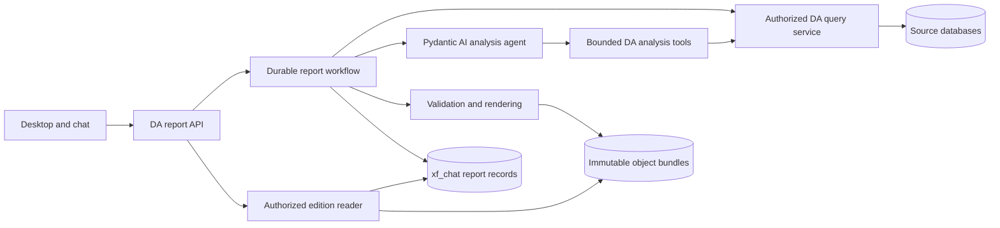
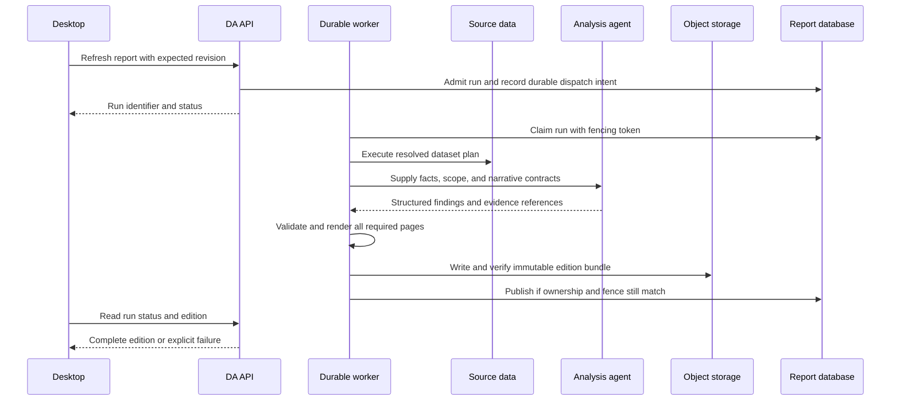
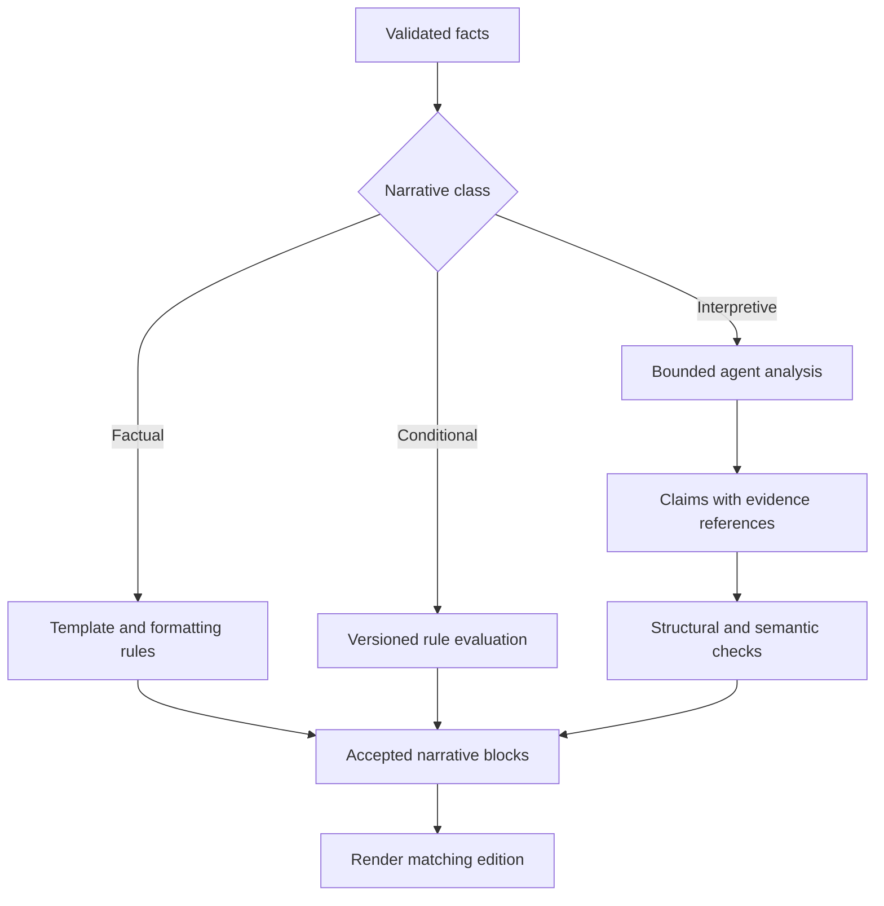
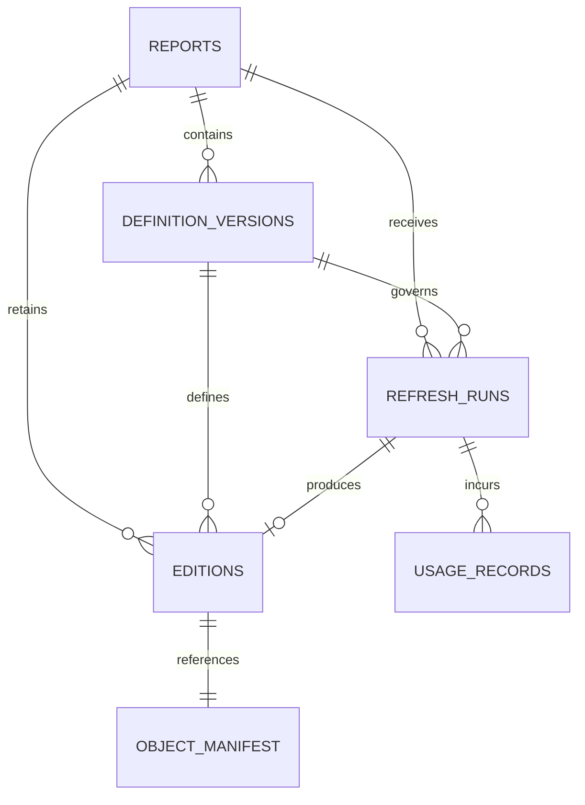
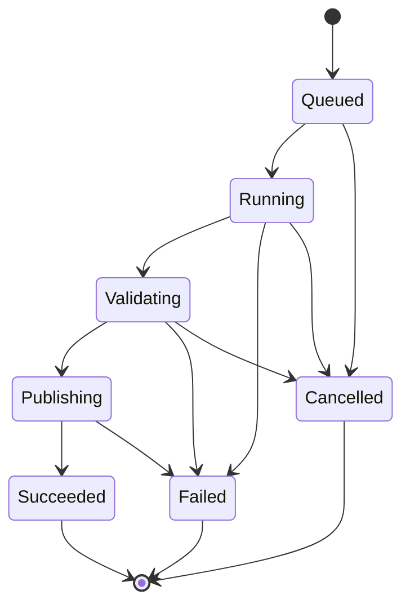

# DA-owned refreshable reports

**Status:** Proposed architecture; implementation is not complete. Desktop's reports now follow the report-kit model (see the note in section 2); the sections below that describe `xf_chat.reports` and a desktop "Save as report" describe the proposal as written on 2026-09-08, not what desktop does.

**Revision:** 1.0 · 2026-09-08

**Canonical location:** `data-analyst/docs/refreshable-reports-architecture.md`

**Mirror:** `xfalcon-desktop/docs/refreshable-reports-architecture.md`

This is one design, maintained as identical files in both repositories. Changes originate in DA and update both copies together. It is the design source of truth for this initiative, not a statement of deployed behavior. Implementation OpenSpec changes must trace to this document. Conflicts with existing specifications require explicit migration before release.

## 1. Decision and scope

DA owns report authoring, definitions, data execution, interpretation, rendering, storage, and publication. Desktop starts operations and displays DA results. Use **Pydantic AI as the preferred agent layer**, subject to the acceptance gates below. Select a durable workflow backend before implementation; Temporal is the leading candidate, not an installed dependency or settled infrastructure commitment.

The first release supports creating, saving, opening, and manually refreshing sophisticated multi-page dashboards. It includes narrative analysis and preserves visual design. PDF delivery, email, scheduled refresh, shared ownership, and autonomous business actions are deferred. Do not build their execution paths now.

**Core invariant:** A published edition contains mutually consistent data, facts, narratives, and pages. A failed refresh never replaces the last successful edition.

Determinism applies to metric semantics, query parameters, validated transformations, rendering inputs, and publication. LLM wording is not deterministic. Retaining accepted outputs makes an edition reproducible without rerunning inference; rerunning a model does not promise identical prose.

## 2. Existing foundation and gaps

Evidence is from local source inspection on 2026-09-08, not a production readiness certification.

| Existing capability | Reuse | Required change |
| --- | --- | --- |
| `xf_chat.reports` | Catalog, ownership, provenance, archive state, optimistic version | Separate immutable definitions from editions and introduce fenced refresh runs. |
| Report definition v2 | Dataset, source, parameter, and output concepts | Versioned contracts for pages, bindings, calculations, narratives, and dependencies. |
| Internal report query endpoint | DA query execution and parameter binding | A complete report orchestration service; this endpoint alone does not refresh a report. |
| Report-kit save/recall/list/delete/refresh tools | Storage and artifact access primitives | Typed results and versioned bundles; current payload replacement is not an atomic edition. |
| `opas` metadata and data sources | Source discovery, semantics, annotations | Pin relevant semantic inputs and recheck authorization at execution. |
| Provider keys, model catalog, budgets, audit | Existing security and accounting contracts | Production report-agent integration and report-run accounting. |
| Process-local background job manager | Existing unrelated work | It is not a durable report execution engine. |

The supplied references include Vuori executive dashboards, CFO briefs, business reviews and exploratory analyses; RetailEdge report suites and refresh logs; and defense report examples. The earlier inventory found 130 HTML files across three collections. Representative files were sampled, not individually certified. They demonstrate static prose, numerical sentences, conditional insights, multi-page layouts, filters, and changing source freshness.

Desktop's earlier client-led kit refresh draft was not the target architecture and has been removed. Desktop now follows the server-led kit model: the assistant saves and refreshes kits with DA's tools, and desktop lists, opens, renames, pins, deletes, and refreshes them over REST (`openspec/changes/migrate-reports-to-report-kits/`).

## 3. Ownership and execution

| Location | Authority |
| --- | --- |
| Source database or warehouse | Business source records. Report storage does not replace the warehouse. |
| `opas` or configured metadata schema | Source registry, discovered schemas, annotations, query knowledge, existing kits. |
| `xf_chat` | Report identity, ownership, definition revisions, refresh runs, editions, and accounting links. The schema name does not limit these records to interactive chat. |
| DA-managed object storage | Immutable templates, assets, dataset snapshots, evidence, narrative outputs, and rendered pages. Reuse the S3/local storage abstraction with new immutable keys. |
| DA worker | Model calls, tool execution, validation, and rendering. Credentials resolve server-side. |
| Desktop cache | Optional copy of a specific authorized edition; never the report authority. |

Do not move business tables into `xf_chat`, store report grammar in agent memory, or create synthetic chat conversations for background refresh. The existing desktop-only chat execution invariant must be narrowed explicitly for DA report jobs; this proposal does not migrate general chat execution.

## 4. Creation, save, and refresh

**Creation:** Chat supplies the report request and relevant authorized context to DA. DA produces a structured draft, data bindings, an immutable template bundle, and a validated preview. The agent can explore and design during this phase. DA reserves an owner-scoped report row with `lifecycle=draft` and a definition revision with `status=draft`. Draft reports are excluded from the saved-report catalog. Save changes the lifecycle to `saved`; abandoned drafts and their artifacts have bounded retention.

**Save as report:** Send a DA draft definition identifier and expected revision. DA validates ownership, dependencies, and the preview, then promotes the draft and publishes its first complete edition. Preview generation uses a tracked `author_preview` run and produces a complete immutable but unpublished edition. Idempotent save publishes that exact edition after rechecking its definition hash, access, and freshness policy. If its inputs are no longer acceptable, regenerate and validate a new preview explicitly. Save does not scrape HTML. A chat artifact not authored through this path needs an explicit conversion step before it can be saved as refreshable.

**Refresh:** Pin an approved definition, resolve dates once, execute its dependency graph, compute facts, refresh narrative blocks, validate all required outputs, render, and atomically publish. Repeated clicks with the same idempotency key return the same run. A conflicting request receives the active run and an explicit conflict result.

A refresh is not necessarily one SQL call followed by one LLM call. Preview runs use the same validation and immutable bundle steps but leave the catalog edition pointer unchanged until save. Independent datasets can run in parallel; calculations and dependent analyses follow their declared dependencies. Simple reports may need no inference. Complex reports may require several bounded investigative calls. No agent controls the publication transaction.

## 5. Every sentence has a refresh policy

| Content class | Example | Refresh mechanism |
| --- | --- | --- |
| Static explanation | “Net sales exclude returns.” | Approved definition text. Revise when semantics change. |
| Factual sentence | “Sales increased 8.0% over the previous complete week.” | Deterministic template bound to a validated fact. No LLM required. |
| Conditional statement | “Stock cover is below the target.” | Versioned rule with explicit threshold and missing-data behavior. |
| Interpretation | “The decline was concentrated in the wholesale channel.” | Agent evaluates evidence and returns structured claims. |
| Hypothesis or recommendation | “Review promotion intensity in the affected stores.” | Agent labels inference, limits certainty, and cites supporting observations. No automatic action. |
| Human commentary | “Management expects a recovery.” | Retained as attributed commentary with its original date; never presented as refreshed analysis. |

Each narrative block declares its class, input facts, filter scope, output shape, length limit, required status, and missing-data policy. Static headers containing dates or values are still data-dependent bindings. Tooltips, captions, chart annotations, accessibility text, and hidden print sections follow the same rule.

**Numerical example:** Current complete-week sales = 108,000; comparable previous week = 100,000. DA computes `(108000 - 100000) / 100000 = 0.08`. The formatter renders “Sales increased 8.0%.” The agent may explain the movement but cannot supply a conflicting percentage.

If the baseline is zero or missing, the comparison is unavailable; the sentence must change. Negative baselines need an explicitly approved metric rule. A percentage-point change is distinct from percent growth. Formatting must use unrounded inputs and an explicit precision policy; tiny changes must not produce “increased 0.0%.”

Agent prose uses typed fact references for numerical spans, dates, entities, and comparisons. The renderer inserts their formatted values. Unsupported free-form numerical claims fail validation. Claims also carry typed predicates for direction, comparison, entity, and period: a valid negative delta cannot accompany “increased.” Validate these predicates against the referenced facts before accepting prose. Free interpretation still requires semantic evaluation; structured output alone cannot prove it true. Evidence references alone do not prove causality: causal wording requires a supported analytical method; otherwise use descriptive or qualified language.

## 6. Definition grammar and presentation

The grammar is a versioned JSON document in `report_definition_versions.definition`. DA owns its Pydantic models and exported JSON Schema. Clients consume generated contracts. Schema version, definition revision, report row version, and edition identifier are separate concepts.

| Grammar section | Required content |
| --- | --- |
| Identity and compatibility | Schema version, report purpose, locale, renderer version, required capabilities. |
| Sources and semantics | Stable source IDs, referenced semantic revisions, metric units, grain, joins, aggregation rules, currencies. |
| Parameters and time | Typed filters, defaults, calendar, timezone, complete-period rule, as-of policy, comparison logic. |
| Datasets | Validated query plan or SQL, parameter bindings, expected columns/types, keys, grain, ordering, row limits, freshness requirements. |
| Calculations | Versioned expressions or approved transformation IDs, input references, units, null/zero rules, dependencies. |
| Pages and bindings | Stable page and component IDs, navigation, template references, chart/table/text bindings, filter propagation. |
| Narratives | Content class, evidence dependencies, analysis instructions, output schema, missing-data policy, text limits. |
| Execution policy | Required/optional outputs, quality checks, consistency tolerance, runtime and cost limits, allowed diagnostic scope. |

Keep sophisticated layouts as versioned HTML/CSS/assets with explicit bindings; do not force every page into a generic chart grid. Bindings consume structured JSON, not executable data JavaScript. Existing custom JavaScript requires migration into reviewed, versioned renderer modules or isolation with restricted capabilities. Arbitrary LLM-generated code does not become trusted because it is saved.

One shared fact can feed the executive summary, detailed chart, and narrative across multiple pages. The dependency graph must be acyclic, typed, and complete. Reject unresolved bindings before saving. Use exact decimal arithmetic where monetary precision requires it; use explicit units and deterministic sorting for ties.

Filter changes must not leave a global narrative appearing to describe filtered data. Each control declares one behavior: local recomputation over a complete snapshot; clearly labeled global narrative; or an explicit DA regeneration request. What-if results remain labeled simulations. V1 requires explicit regeneration for interpretation affected by server-side filters; it does not silently run an agent on every slider movement.

## 7. Pydantic AI contract

Use one bounded analysis agent initially. Planner, analyst, and verifier are responsibilities, not a requirement for a multi-agent swarm. Deterministic checks remain outside the LLM. An optional model reviewer cannot replace them or guarantee truth.

**Inputs:** pinned definition and prompt versions; resolved parameters and periods; authorized semantic context; current facts and bounded evidence tables; source watermarks; compatible prior-edition facts; allowed tools; output schema; remaining budget. Supply large results through authorized handles and pagination. Do not send credentials, unrestricted schema dumps, or unrelated chat history.

**Tools:** read permitted evidence, retrieve compatible prior facts, and run bounded diagnostics through DA. Enforce source, row/column scope, read-only SQL, timeout, result-size, and cost limits in the service. SQL validation supplements database permissions; a read-only transaction alone is insufficient for unrestricted functions or external access. No shell, arbitrary network access, unrestricted file access, email, or business mutations.

**Outputs:** stable block ID; structured observations; fact references; scope and period; hypothesis/observation classification; limitations; narrative segments; explicit insufficient-evidence status. Persist accepted outputs and the evidence used, not private model reasoning.

Model choice comes from DA's authorized catalog and provider-key contracts. Pin the selected model, settings, prompts, tools, and renderer for each run. Set explicit tool-call, token, monetary, retry, and wall-time budgets. Fallback models require an approved policy, recorded provenance, and the same validation; never silently change provider or data residency.

Pydantic AI supports [structured outputs and output validators](https://pydantic.dev/docs/ai/core-concepts/output/) and [durable execution through Temporal](https://pydantic.dev/docs/ai/capabilities/durable_execution/temporal/). These are framework capabilities, not guarantees of factual correctness, tenant isolation, or exactly-once external calls. Pin and test the selected package version before adoption.

## 8. Persistence changes

All names below are proposed logical contracts, not applied migrations. Every new table carries `tenant_id`, `user_id`, timestamps, and owner-scoped access. Child relationships must enforce the same tenant, owner, and report identity with composite constraints or equivalent checked invariants. Do not rely on UUID uniqueness as authorization.

| New table in `xf_chat` | Fields beyond ownership and timestamps |
| --- | --- |
| `report_definition_versions` | `id`, `report_id`, `revision`, `schema_version`, `status`, `definition` JSONB, `template_manifest_ref`, `content_hash`, `created_by`, `approved_at`. Unique report/revision; approved content immutable. |
| `report_refresh_runs` | `id`, `report_id`, `definition_id`, `base_edition_id`, `idempotency_key`, `request_hash`, `operation` (`author_preview` or `manual_refresh`), `status`, `workflow_id`, `fencing_token`, `resolved_parameters` JSONB, `execution_policy` JSONB, `requested_by`, `started_at`, `finished_at`, `cancel_requested_at`, `error_code`, `error_detail_ref`, `usage_summary` JSONB. |
| `report_editions` | `id`, `report_id`, `definition_id`, `refresh_run_id`, `manifest_ref`, `content_hash`, `source_watermarks` JSONB, `quality_summary` JSONB, `provenance` JSONB, `completed_at`, `published_at`. One edition per successful run. |
| `report_refresh_steps` — conditional | `id`, `refresh_run_id`, `step_key`, `attempt`, `status`, `input_hash`, `output_ref`, `error_code`, `started_at`, `finished_at`, `usage` JSONB. Create only if the workflow backend cannot provide retained application-level step evidence. |

`report_refresh_runs` also records durable dispatch intent. Admission commits the run before dispatch. A reconciler repeatedly starts unsubmitted work with a stable workflow ID; duplicate starts must not produce duplicate runs. The workflow backend owns its own checkpoints, retries, and worker leases. Do not create a second scheduler. A DA fencing token protects report publication independently of worker leases.

| Existing table | Add or change | Reuse or retire |
| --- | --- | --- |
| `xf_chat.reports` | Add `current_definition_id`, `active_refresh_run_id`, `report_kind` (`legacy_snapshot` or `refreshable`), and `lifecycle` (`draft` or `saved`; existing rows default to `saved`). | Reuse `current_version_id` as the edition pointer after auditing existing writers; add same-report FK enforcement. Reuse `version` for optimistic updates and existing title, ownership, provenance, archive fields. |
| `xf_chat.reports` | Keep `refresh_status` as a coarse compatibility projection; detailed states live on runs. | `definition`, `definition_ref`, `definition_version`, `cached_html`, `cached_at` remain legacy-only during migration, then retire after client cutover. Never maintain two writable definition authorities. |
| `xf_chat.token_budget_usage` | Add nullable `report_refresh_run_id`; permit nullable existing `run_id`; enforce exactly one run reference and separate uniqueness per budget/run type. | Reuse budgets and accounting; audit all consumers of the existing mandatory chat-run association. Attempt-level actual usage must aggregate without double-counting retries. |
| `xf_chat.audit_events` | No new report-specific columns proposed. | Reuse resource identity fields and record definition changes, refresh admission, failures, publication, cancellation, and deletion. |
| `xf_chat.models`, provider keys, source registry | No report-specific columns proposed. | Reuse current authority; recheck availability, residency, and access at execution. |
| `opas._REPORT_KIT_*` | No new authoritative report columns proposed. | Keep legacy kits; reuse storage infrastructure, not mutable payload rows as edition history. |

The existing `schedule` and `next_refresh_at` columns remain inactive for this feature. Existing chat `runs`, messages, and artifacts remain provenance references, not the report execution ledger.

Object keys include tenant, report, and immutable definition/edition IDs. Manifests reference content hashes, sizes, media types, pages, dataset partitions, evidence, and narratives. Persist stable object references, never expiring signed URLs. Check access before issuing short-lived retrieval handles. Publication must verify that every referenced object exists and matches its manifest.

## 9. Data correctness and interpretation rules

| Condition | Required behavior |
| --- | --- |
| Partial week, fiscal calendar, timezone, daylight-saving change | Resolve explicit time boundaries once; compare equivalent periods and label incomplete periods. |
| Source not updated, late arrivals, historical corrections | Track source watermark separately from query and publication time. Recompute affected facts; never claim freshness from job success alone. |
| Retries and additional diagnostic queries | Reuse the original snapshot or enforceable cutoff, including within one source. Reuse persisted evidence where possible. If updates cannot be excluded, restart the affected dependency set or reject the interpretation; a timestamp alone does not freeze mutable records. |
| Multiple sources without a shared snapshot | Record per-source cutoffs and apply a declared skew tolerance. Fail required consistency checks or label permitted skew; do not invent cross-source atomicity. |
| Zero, missing, negative, or tiny baseline | Apply metric-specific comparison rules; never divide blindly or convert missing values to zero. |
| Grain mismatch, fan-out joins, duplicate keys | Validate keys, relationship expectations, and reconciled totals before calculating conclusions. |
| Weighted measures, ratios, distinct counts | Recompute from valid sufficient statistics or source data. Never sum percentages or distinct counts across overlapping groups. |
| Currency, tax, returns, FX, units | Pin metric semantics, conversion source/date, and units. Gross and net definitions must not interchange. |
| Ranking, ties, new or disappearing entities | Stable ordering and explicit inclusion rules; preserve entity IDs, not position-based bindings. |
| Sampled, truncated, paginated, or approximate results | Record coverage. Never present a subset as a full total. Required complete results must finish retrieval or fail. |
| Sparse data, outliers, seasonality, multiple hypotheses | Apply sample-size and comparison checks. Distinguish descriptive findings from statistical or causal claims; do not report model confidence as measured probability. |
| Prior edition has different filters or semantics | Compare only compatible facts. “New” or “resolved” findings require stable finding keys and compatible evidence windows. |
| No meaningful change | Refresh provenance and watermarks. Reuse narrative only when its full dependency hash, policy, model/prompt version, and prior-state inputs match. |

## 10. Failure, concurrency, and recovery

Publication is a short transaction. Cancellation before it prevents publication; cancellation racing with an already committed publication returns the completed result. Retries are bounded attempts within a run, not silent success. A user retry after terminal failure creates a new run and preserves the previous evidence.

| Failure or race | Required response |
| --- | --- |
| Duplicate click, client disconnect, closed desktop | Return/resume the same admitted run; server work does not depend on an open client. |
| Crash before workflow dispatch | Reconcile the persisted queued run and dispatch with its stable identity. |
| Crash after query or model completion | Resume from durable accepted outputs. External calls can repeat after ambiguous failures; account for possible duplicate cost. |
| Old worker finishes after replacement | Reject publication through run identity, fencing token, and expected report/definition checks. |
| Definition edited, report archived/deleted, or access revoked mid-run | Recheck before sensitive steps and publication; fail or cancel obsolete work. |
| Source or provider timeout, rate limit, expired credentials | Classify, apply bounded backoff when retryable, and expose a stable error code. Authorization failures do not retry indefinitely. |
| Schema drift, missing column, changed metric semantics | Fail with affected dependency; require a new validated definition revision. Do not let the agent silently rewrite the report. |
| Malformed or unsupported model claim | Bounded repair attempt using specific validation errors; fail required analysis when repair is exhausted. |
| No rows or insufficient evidence | Render an explicit empty state if the contract allows it; otherwise fail. No invented narrative. |
| Optional dataset or narrative fails | Only a predeclared optional block may display an explicit unavailable state. Never insert old content among fresh blocks. |
| Required narrative unavailable | Keep the prior complete edition and show refresh failure. An LLM-free fallback requires a preapproved factual template for that block. |
| Object write succeeds but DB commit fails | Keep objects unpublished; reconcile DB outcome before retry or cleanup. Never delete a possibly published bundle on an ambiguous timeout. |
| Missing asset, invalid navigation, chart error, text overflow | Fail render validation for required output; keep the prior edition. |
| Budget exceeded, pathological query, agent loop | Stop within enforced limits; retain diagnostics and the prior edition. |

Atomic publication updates the report edition pointer and run result in the same database transaction, guarded by active run identity, fencing token, current definition, ownership, and archive state. Immutable bundles are written beforehand. Cross-store atomic transactions are not assumed.

## 11. Security, retention, and operations

- Apply tenant and owner scope to definitions, runs, editions, tool calls, caches, objects, and status endpoints. Workers restore an authorized execution context; do not bypass forced RLS with a broad service role.
- Treat database strings, imported HTML, recalled reports, and tool responses as untrusted data. They cannot change system instructions, tools, source scope, or publication rules.
- Execute rendering without database credentials or unrestricted network access. Isolate untrusted templates, restrict scripts and assets, block unsafe URLs/path traversal, and enforce CPU, memory, and output limits.
- Bound and redact model inputs and traces. Apply data classification and provider residency policy before transmission. Store operational evidence and accepted results; do not require private chain-of-thought storage.
- Reauthorize historical edition access. Data snapshots can outlive warehouse permissions; revocation must prevent future reads, including cached access according to the product's offline policy.
- Encrypt stored artifacts; audit access. Define separate retention for drafts, failed-run evidence, published editions, and workflow history. Garbage collection must respect active runs, retained editions, and recovery windows.
- Test backup and restore across database records and referenced objects. Missing bundles after restore are an explicit availability failure, never an empty successful report.
- Observe queue age, stage latency, query volume, source freshness, validation failures, retries, tokens, cost, and publication conflicts. Correlate report/run/edition IDs without logging secrets or unnecessary source rows.
- Apply tenant quotas and fair concurrency. Shared pools must not let one expensive report starve other tenants. Numeric limits and retention periods are deployment decisions, not hidden defaults.

## 12. DA and desktop contract changes

Expose typed operations for draft creation/read, validation, save/promotion, definition revision, refresh admission, run status, cancellation, edition listing/read, and authorized bundle retrieval. These are proposed operations; final routes must follow DA conventions and appear in generated OpenAPI before client integration.

Mutation requests carry an idempotency key and expected revision where relevant. The same key with different input is a conflict. Status includes run ID, stage, timestamps, stable error code, retryability, and the published edition ID when successful. Do not stream partial HTML as the current report.

Desktop shows `Refreshing`, the last successful edition, source freshness, and any failure separately. On success it swaps the complete bundle. It can reconnect to a run after restart and preserves page/filter state only when compatible. Offline viewing identifies the cached edition and last-known freshness; refresh requires DA.

Update typed Rust/TypeScript IPC contracts, pinned DA OpenAPI, report store, save action, viewer, cache identity, and error handling together. Other deployed clients must not keep writing the legacy definition fields for refreshable reports. DA rejects those writes after cutover rather than silently diverging.

## 13. Migration and delivery gates

1. **Contract:** Reconcile DA and desktop OpenSpec changes with this design. Freeze grammar, API payloads, ownership, model policy, and runtime choice.
2. **Persistence and execution:** Add idempotent migrations, constraints, RLS, immutable storage, durable admission/recovery, fenced publication, and accounting. Test fresh installs and existing tenants.
3. **Representative vertical slice:** Author and refresh a multi-page Vuori report containing factual sentences, rules, agent interpretation, filters, and shared metrics.
4. **Client cutover:** Save DA drafts, show durable status, and load immutable editions. Keep legacy reports readable and clearly non-refreshable until converted.
5. **Broader acceptance:** Run the scenario matrix across Vuori, RetailEdge, and defense examples. Validate every migrated report's dynamic bindings; sampled inspection is not migration acceptance.
6. **Release:** Deploy DA contracts first, synchronize generated clients, then enable the desktop path. Rollback can disable new admission while preserving readable published editions; it must not restore obsolete writers.

Legacy HTML conversion is assisted re-authoring, not guaranteed automatic recovery. Extract candidate queries, metrics, bindings, and narrative policies, then validate them against a baseline. Reports without recoverable semantics remain snapshots. Do not infer correctness from visual similarity alone.

| Acceptance area | Required evidence before completion |
| --- | --- |
| Facts and prose | Fixed fixtures for growth, decline, zero/missing baseline, negative values, percent versus points, rounding, and stale periods; exact numeric/evidence agreement, including direction, entity, comparison, and period predicates. |
| Complex reports | Multi-page navigation, shared totals, filter scope, long text, Unicode, chart edge cases, pagination, and no stale hidden annotations. |
| Agent quality | Adversarial unsupported claims, causal overreach, insufficient evidence, prompt injection, tool denial, and bounded-loop tests. Human review of representative interpretation. |
| Durability | Worker termination at each boundary, duplicate delivery, ambiguous model completion, dispatch recovery, snapshot-consistent diagnostics, cancellation races, and stale-worker fencing. |
| Isolation | Cross-tenant/owner denial for all operations, object access, cache keys, queued jobs, and historical editions; mid-run access revocation. |
| Publication | Required-step failure preserves the old edition; object/DB failure injection; one complete published edition per successful run. |
| Accounting and scale | Retry accounting, concurrent budget admission, large results, tenant fairness, resource limits, and agreed latency/cost targets. |
| Migration and compatibility | Existing snapshots still open; old writers cannot corrupt new reports; rollback and backup/restore exercises pass. |

These are release gates, not completed test claims. No design can enumerate every future defect; new failures must become regression fixtures without weakening the invariants.

## 14. Decisions to close before implementation

| Decision | Proposed position |
| --- | --- |
| Agent SDK | Pydantic AI; pin the version after the representative slice passes. |
| Durable backend | Evaluate Temporal against deployment/on-prem constraints. Require durable admission, replay, bounded retries, and operational ownership. |
| Model and data policy | Use DA-authorized models; confirm tenant residency and budget rules. |
| Limits and retention | Set measurable latency/cost/concurrency limits and draft/edition/evidence retention with product and operations owners. |
| Advanced presentation | Preserve layouts through explicit bindings and reviewed renderer modules; inventory unsupported custom scripts before conversion. |
| Initial benchmark | Select one Vuori report with interpretation and multi-page dependencies, then validate the other reference families. |

## 15. Source map

Paths below are relative to the named repository. They document inspected foundations, not completed implementation of this proposal.

| Repository | Source |
| --- | --- |
| DA | `infra/docker/xf_chat/02_tables.sql`, `07_policies.sql` in the same directory: report catalog, accounting, ownership policies. |
| DA | `mcp_server/reports/schema/report_definition.v2.json`, `definition.py`, `query_runner.py`: current grammar and query primitives. |
| DA | `mcp_server/api/v1/chat/reports.py`, `mcp_server/protocol/tools.py`: report API and kit tools. |
| DA | `mcp_server/services/report_kit_service.py`, `report_kit_storage.py`, `mcp_server/repositories/report_kit_repository.py`: kit persistence. |
| DA | `shared/postgres_ddl.py`, `shared/postgres_config.py`, `mcp_server/background/jobs.py`: metadata storage and current background execution. |
| DA OpenSpec | `openspec/changes/add-report-definition-refresh/`, `add-report-parameters/`, `add-report-kit-storage/`, `add-xf-chat-reports-table/`: existing design inputs. |
| Desktop | `openspec/specs/reports/spec.md`, `openspec/project.md`, `openspec/changes/migrate-reports-to-report-kits/`: current contracts and the change that moved desktop onto report kits. |
| References | `D:/work/xfalcon/reports/`: Vuori, RetailEdge, and defense samples supplied for analysis. |
