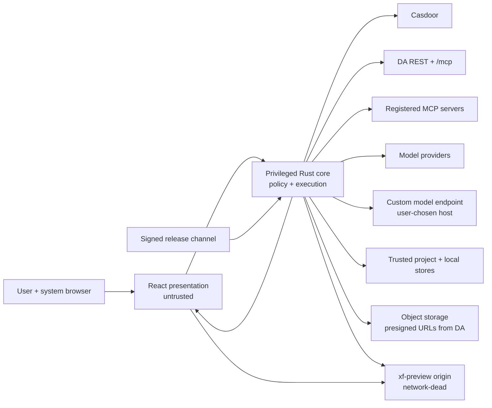

# Threat model

Version 0.5.42 · reviewed 2026-10-15 · **Reference** · audience: security reviewers, engineers

> Describes the v0.5.42 source. Automated evidence is listed in [assurance-plan.md](assurance-plan.md#staging-validation-evidence-2026-10-15); it does not establish release publication, production operation, or SOC 2 effectiveness.

Assets, actors, and enumerated abuse cases with their **current implementation
status**. The defensive architecture is explained in [security.md](security.md);
framework mapping is in [compliance.md](compliance.md).

> `TM-###` identifiers are cited from source comments (TM-005, TM-006, TM-007,
> TM-008, TM-009, TM-010, and TM-011 are cited today). They are **stable** — an entry is
> retired in place, never renumbered or reused. TM-019 to TM-022 are newer
> entries; no source comment cites them yet.

**Status vocabulary**

| Status                             | Meaning                                                                          |
| ---------------------------------- | -------------------------------------------------------------------------------- |
| **Implemented**                    | Mitigations are in the codebase with test evidence named.                        |
| **Implemented, residual accepted** | Mitigations exist; a named gap is knowingly accepted.                            |
| **Partial**                        | Some mitigations exist; a specific one is missing.                               |
| **Design-time**                    | The mitigation is specified but the surface is not implemented or not reachable. |

Scope: [README.md](../README.md) lists Windows 11 23H2+ and macOS 13+ as
supported targets, and Ubuntu 22.04+ and Debian 12+ as claimed with no CI
coverage. `tauri.conf.json` lists the bundle targets `nsis`, `msi`, `app`, and
`dmg`, so the app builds no Linux package. The `unix-rust` job in
`chat-slice-e2e.yml` runs the Rust suite on ubuntu-22.04, but that workflow is
disabled in GitHub Actions. This is a maintained working document, refined
alongside the system — not a design-time artifact frozen at approval. Final
staging test results are in [assurance-plan.md](assurance-plan.md#staging-validation-evidence-2026-10-15). They do not establish live or real-platform behavior.

---

## Assets

| Asset                                                                                              | Objective                                                               |
| -------------------------------------------------------------------------------------------------- | ----------------------------------------------------------------------- |
| Casdoor session (access and refresh token), OAuth code/verifier/state, DA and MCP bearers          | Confidentiality and integrity; audience-, user-, and tenant-correct use |
| Provider plaintext, DA envelope ciphertext, device keys that seal MCP credentials and local SQLite | Plaintext non-persistence; cryptographic account and device separation  |
| Messages, prompts, attachments, datasets, reports, artifacts, local project content                | Tenant and user confidentiality, integrity, deletion, availability      |
| Trusted-root identity, approvals, tool policy, run journal, audit events                           | Non-bypassable authorization and replay-safe integrity                  |
| Custom model endpoint URL and key, MCP server URLs, MCP credentials and grants                     | Audience-correct use; no use against internal hosts                     |
| Provider and MCP budgets, local compute                                                            | Bounded availability and cost                                           |
| Binaries, dependencies, updater manifests, signing material                                        | Authenticity, provenance, rollback resistance, recoverability           |

## Actors and assumed capabilities

- A **remote unauthenticated attacker** can influence OAuth navigation and network
  responses only where an upstream origin, DNS, TLS, redirect, or content surface
  is compromised.
- An **authenticated malicious or confused user** controls prompts, uploads,
  project contents, filenames, skill bodies, provider selection, custom model
  endpoints, and UI intent.
- A **malicious tenant peer** can guess or replay DA resource identifiers and
  probe for missing object-level authorization.
- **Model providers, MCP servers, parsers, and storage** can return malformed or
  adversarial content.
- **Local malware or a stolen unlocked device** can inspect the user's processes,
  files, IPC, and platform vault subject to OS protections. A fully compromised
  OS is not containable by an application.
- A **compromised renderer** (React is untrusted, [decisions.md](decisions.md)
  ADR-001) can call every allowlisted command with attacker-chosen arguments.
- A **compromised dependency, CI identity, signing service, or update channel**
  can attempt to distribute privileged code.

Attackers are **not** assumed to hold signing, notarization, or packaging keys;
break modern TLS or AES-256-GCM; compromise an otherwise locked OS account and
vault; or administer DA, Casdoor, provider, or storage infrastructure. Those
remain residual and inherited risks.

## Trust boundaries

---

## Abuse cases

### TM-001 — Cross-tenant object access (BOLA)

**Path.** A tenant peer substitutes a conversation, provider-key, upload, report,
dataset, or artifact id and DA returns another tenant's record.

**Likelihood / impact.** Medium / High. Identifiers are network-controlled and DA
is multi-tenant.

**Mitigations.** Rust derives tenant and user scope from the validated session,
never from the renderer. `auth/token.rs` verifies the access token. DA's identity
for the bearer must name the same user and the configured tenant
(`clients/da/identity.rs`: `TenantMismatch`). The account id is
`<tenant_id>:<user_id>` (`auth/account.rs`). Local stores and keys are scoped to
that account, and commands that serve device data require a session that owns the
bound account (`AuthSessionStore::owns_bound_account`). DA must authorize every
object against the validated caller.

**Status: Partial.** Desktop-side scope derivation is implemented. Tests cover the
local scope: `auth::tests` (`a_session_for_another_account_does_not_own_the_bound_one`),
`security::tests::sign_in_gate`, `projects::tests::backup`
(`another_account_cannot_list_or_open_a_revision`), `reports::kit_flow`
(`a_malformed_id_is_not_found_without_a_request`),
`clients/da/tests/mcp_servers_wire.rs` (`a_row_belonging_to_another_tenant_is_rejected`),
and the test `rejects_identity_with_different_tenant_slug` in `clients/da/identity.rs`.
The cross-tenant negative-test matrix against caller-controlled DA identifiers is
not written, and DA-side enforcement is an inherited control with no linked
operational evidence.

---

### TM-002 — OAuth interception, replay, or wrong-issuer login

**Path.** An attacker intercepts or injects the loopback callback, replays a code,
or causes login to the wrong issuer or account.

**Likelihood / impact.** Medium / High. Loopback and navigation are exposed,
though PKCE is designed for public clients.

**Mitigations.** Cryptographic state compared in constant time
(`auth/pkce.rs`, `auth/loopback.rs`); PKCE `S256`; exact loopback listener and
redirect binding; discovery issuer cross-checked against the configured issuer
(`IssuerMismatch`) with the authorization, token, and JWKS endpoints on the
issuer's origin (`auth/discovery.rs`); one-use callback; 300 s timeout
(`LOGIN_TIMEOUT`); 8 KiB request cap (`MAX_REQUEST_BYTES`); system browser only;
the app's own navigation guard would refuse an in-app auth page; access-token
signature, issuer, audience, owner, and time checks before the session exists
(`auth/token.rs`); the `nonce` claim of the signed access token checked at sign-in, in constant time, failing closed on a wrong or empty claim (`auth/service.rs`); renewal serialised on one lock (`auth/renewal.rs`);
a generation counter on the session store, so a refresh that finishes after sign-out, a renewed token for another subject, or a sign-in cancelled after the callback writes nothing and never completes (`auth/session.rs`); after 12 hours without input the app signs the person out (24 hours at most with a dialog open; ADR-058; see [compliance.md](compliance.md) CM-034);
fixed-origin provider verification for credential mutation. The configured issuer
itself cannot be redirected. `build.rs` pins the bundled tenant config to the
binary by SHA-256, and a release build has no environment fallback
(`PROCESS_ENV_FALLBACK` is `cfg!(debug_assertions)`). An edited file or
`XFALCON_*` variables cannot name an issuer the user runs.

**Status: Implemented.** `auth::tests`, `auth::token_tests` (including
`reads_the_nonce_claim_when_the_tenant_token_carries_one`), `auth::config::tests`,
and the tests in `auth/loopback.rs` and `auth/pkce.rs` (including
`nonce_matches_truth_table`).

**Residual.** The desktop requests no ID token; the nonce is compared on the access
token. An absent claim is accepted, so for tenants that omit it the check adds
nothing beyond PKCE and `state`. Refresh responses are not checked. `state` and PKCE
remain the main protection against a replayed callback.
A session left on an unattended, unlocked machine stays signed in for up to 12 hours
of no input (24 hours while a dialog is open). The inactivity sign-out is a
renderer-side timer, so it does not run if the webview is not alive, and its real-machine
behaviour is **UNVERIFIED**. Known session races, accepted and unchanged by the guard:
an `invalid_grant` or identity-mismatch clear can remove a newer session in a very narrow
race; two concurrent `auth_login` calls can supersede each other; and a cancel between
the final session write and the account and audit bind can still bind. Local malware can race or observe an unlocked session. Issuer compromise is
inherited. The device owner can still intercept sign-in with a root certificate
they install and a proxy — TLS trusts the OS store, which corporate TLS
inspection needs — or patch the binary. Either yields a local session DA does not
accept, so tenant data and model access stay server-gated; only local-only
commands are reachable, over data that owner already holds. The sessions and
refresh tokens live in memory only (`auth/session.rs`, `auth/renewal.rs`), so the
refresh token never reaches disk or the vault.

---

### TM-003 — Local secret extraction

**Path.** Local malware, an unlocked stolen device, a second local account, or an
untrusted session-bus peer extracts tokens, provider plaintext, database keys, or
cached content.

**Likelihood / impact.** Medium / High.

**Mitigations.** One `SecretStore` over Windows Credential Manager, macOS
Keychain, or freedesktop Secret Service (`persistence/secret_store.rs`) in two
keyring services; per-account keys, versioned up to `MAX_KEY_VERSIONS` (64);
AES-256-GCM SQLite payloads with a per-table associated-data domain; session and
refresh tokens held only in `Zeroizing` buffers in memory; `Zeroizing` buffers for
keys and resolved provider keys; no Web Storage; content-free diagnostics. A
keyring error other than "no entry" becomes `PersistenceKeyUnavailable` and the
operation fails. There is no plaintext fallback. Sign-out clears the in-memory
session only. Reset xFalcon deletes the keys (TM-013).

**Status: Implemented, residual accepted.** `credentials::tests`
(`credential_vault_creates_once_then_fails_closed_without_the_device_key`),
`persistence::tests`, `security::tests::account_cleanup`.

**Residual.** A compromised same-user process or OS can read live memory and
user-readable files. Keychain ACL policy, or a compromised Linux desktop session,
can weaken isolation. Headless or missing Linux keyrings are unavailable rather
than silently degraded — and have **no CI evidence**. No production code rotates
a key. The tenant config can carry an MCP OAuth client secret that any copy of the
build exposes (TM-021).

---

### TM-004 — Secret disclosure through logs, crashes, or UI state

**Path.** Logs, crash reports, clipboard or UI state, retry queues, or DA records
disclose credentials or ciphertext; a ciphertext is used under the wrong account,
provider, or origin.

**Likelihood / impact.** Medium / High.

**Mitigations.** Central deny-list redaction (`diagnostics::sanitize_diagnostics_text`:
bearer tokens, `Authorization` headers, `sk-`/`ida_sk_` keys, the query parameters
`access_token`, `api_key`, `token`, `key`, `secret`, `password`, JSON fields with
secret-like names, user home paths, MCP `peer_info`) applied to bundle log tails
and renderer error reports; no command returns a token, key, or ciphertext
(`crates/contracts/tests/contract_snapshots.rs`); DA-owned encryption scoped to
tenant, user, and provider; legacy `xfdc:v1` envelopes authenticated with product,
tenant, user, scope, device key id, and envelope id as associated data
(`credentials/envelope.rs`), with strict prefix and version parsing and a 32 KiB
cap; `Debug` implementations that print no secret (`Presigned`, `McpAuth`,
`EncryptedCredential`); `Zeroizing` secret and bearer containers; a panic hook that
discards the payload entirely (CWE-532); secret-bearing failure tests.

**Status: Implemented.** `security::panic_boundary`, `diagnostics`,
`credentials::tests`.

**Residual.** Runtime, TLS, and library copies can frustrate complete
zeroization. DA ciphertext remains Restricted. Log lines are redacted as they are
written, by pattern (TM-012).

---

### TM-005 — SSRF and credential misdirection

**Path.** A provider URL, custom model endpoint, presigned URL, redirect, or MCP
endpoint is manipulated to scan internal services or forward credentials to the
wrong origin.

**Likelihood / impact.** Medium / High. Privileged Rust performs outbound HTTP.

**Mitigations.**

- _Built-in providers._ OpenAI, Anthropic, Google, and OpenRouter use
  compile-time origin constants in `providers/`. A DA bearer never reaches a
  provider or object storage.
- _Plan providers._ Claude (`claude_code`) and ChatGPT (`chatgpt_plan`) run on the
  person's own plan. The Claude runtime starts only the person's installed `claude`
  program, found by fixed rules, and gives it a loopback declaration server that
  never runs a tool. The ChatGPT sign-in uses the fixed origins `auth.openai.com`
  and `api.openai.com`, a loopback callback, and sealed tokens. Tool requests from
  both providers return to the tool loop. Details are in
  [security.md](security.md#plan-providers-on-the-device). The ChatGPT plan request
  sends the conversation id in its `session-id`, `thread-id` and `x-client-request-id`
  headers, so OpenAI can route its prompt cache. The id is an opaque identifier with no
  content. The Claude runtime withholds `CLAUDE_CODE_EFFORT_LEVEL` from the `claude`
  process, because `claude` ranks it with `--effort`, so a value the person set could
  override a chat's level.
- _Custom model endpoints._ DA stores the base URL. `providers/custom_openai.rs`
  validates it again for every request, by syntax only: `http` or `https`; a host
  that is a DNS name (single-label names and names ending `.local`, `.internal`
  or `.localhost` included), `localhost`, an IPv4 literal or a bracketed IPv6
  literal, on any address class; a port from 1 to 65535; at most 2,048 bytes;
  ASCII; no whitespace or control characters; no userinfo, query, fragment,
  backslash, dot segment, or percent-encoding in the authority. A URL without
  `http://` or `https://` is refused, and the stored value is normalized to one
  form. It resolves the host on every request and pins the answered addresses into
  that request's client. It uses no proxy and no redirect, and bounds connect (10 s),
  read (240 s), and total (3,600 s) time with no retry. The company gateway is the
  exception: read and total 3,660 s, and up to three retries on a connection failure,
  502 or 503 before any output. Tests: the `tests` module in `custom_openai.rs`,
  including `hostname_is_resolved_again_for_every_request` and
  `redirect_to_an_unchecked_host_is_not_followed`. The policy is ADR-061.
  A private model URL can now send requests, including the key, to any host the
  device can reach. Saving one needs a DA that carries the matching change
  (data-analyst branch `feature/private-model-local-endpoints`); an older DA refuses
  it (ADR-061).
- _Registered MCP servers._ `mcp::registry::validate_endpoint` parses before
  connecting. Userinfo, any query or fragment, a missing host, and a non-web scheme
  are refused in both modes. Plain `http` is accepted only in a debug build or when
  the host looks private (`host_looks_private`: `localhost`, a loopback, private,
  link-local, CGNAT or unique-local IP literal, a single-label name, or a name ending
  `.local`, `.internal`, `.lan`, `.corp`, `.intranet`, `.localdomain`, `.home.arpa` or
  `.localhost`). While `ENFORCE_PUBLIC_MCP_HOSTS` is `true`, HTTPS is required outside
  debug builds, and a private, link-local, shared, unspecified, multicast,
  unique-local, NAT64, or loopback IP literal is refused (an IPv4-mapped IPv6 literal
  is folded first). Loopback and `localhost` pass only in a debug build. Discovered
  OAuth endpoints use `mcp::oauth::endpoint_is_usable` with the same host rule. Tests:
  `mcp::tests::registry`, `mcp::tests::security`.
- _Registered MCP servers, DNS names._ While
  `ENFORCE_PUBLIC_MCP_HOSTS` is `true`, a DNS name is resolved at connection time by
  `mcp/dns.rs` (`PublicOnlyResolver`). If any answer is non-public, the whole name is
  refused. reqwest connects only to the checked addresses, so the check and the
  connection use the same answer. The same resolver serves the discovered OAuth
  endpoints. The bundled tenant server is excluded on purpose: its origin is the
  tenant's DA origin, which on-prem may be a private name (ADR-047). IPv6 forms that
  carry an IPv4 address are judged by that IPv4 address (ADR-054). Tests:
  `mcp::dns::tests` (`one_non_public_address_refuses_the_whole_name`,
  `loopback_is_refused_unless_allowed`, `failed_or_empty_lookup_is_refused`),
  `mcp::tests::registry::a_registered_server_requires_public_hosts_and_the_bundled_one_does_not`.
- _Private-host switches (accepted residual)._ Two
  constants, both `false` in the current code, switch off the public-host rules for
  on-prem and private deployments: `ENFORCE_PUBLIC_MCP_HOSTS` (`mcp/registry.rs`) and
  `ENFORCE_HTTPS_PRESIGNED_URLS` (`uploads/da_repository.rs`). With the MCP switch off,
  a registered server or OAuth endpoint may be on a private address or on a name that
  resolves to one, and the resolver is not installed. With the presigned switch off,
  plain `http` is accepted to any host. Setting either to `true` restores the earlier
  rule in one edit. The enforcement code is kept and tested in both positions
  (`validate_endpoint_with`, `host_is_dialable_with`, `endpoint_is_usable_with`,
  `validate_presigned_url_with`). Custom model endpoints are not changed by these
  switches. The decision is ADR-057.
- _Redirects._ `Policy::none()` on the clients in `auth/`, `providers/`, `mcp/`,
  `clients/da/mapping.rs`, `uploads/transfer.rs`, and `datasets/catalog.rs`. The
  update downloader follows at most five redirects and only to allowed delivery
  hosts (`desktop_update.rs`).
- _Credentials._ The object-storage clients attach no `Authorization` header
  (`uploads/transfer.rs`, `datasets/catalog.rs`). `McpAuth::bind` refuses to
  attach the session bearer to the bundled MCP server unless the discovered
  resource matches.
- _Presigned URLs._ Before any upload or download
  request, a URL from DA is checked (`validate_presigned_url`,
  `uploads/da_repository.rs`). Userinfo, a scheme other than `http` or `https`, and a
  missing host are always rejected. `https` is accepted. While
  `ENFORCE_HTTPS_PRESIGNED_URLS` is `true`, plain `http` is accepted in debug builds,
  and in release builds only toward a host that is not on the public internet, judged
  by spelling and not by resolution: a loopback, private or link-local IP literal, a
  single-label name, or a name ending `.local`, `.internal`, `.lan`, `.corp`,
  `.intranet`, `.localdomain` or `.home.arpa`. Plain `http` to a public host is
  refused. While the constant is `false` (the current setting, ADR-057), plain `http`
  is accepted to any host. The check covers the single-URL and multipart plans, the
  attachment presign, the re-sign path (`uploads/transfer.rs`), the dataset download,
  and the attachment GET. The host is not otherwise restricted, because on-prem
  tenants may use private object storage, sometimes without TLS (ADR-048). Tests:
  `uploads::tests::da_repository`.
- _Workspace discovery._ `WorkspaceService` uses
  `auth::build_discovery_client()`: no redirects, and bounded timeouts. Test:
  `workspace::service::the_workspace_discovery_client_does_not_follow_redirects`.
- _Bounds._ Connect, read, and total timeouts on the clients in `providers/`,
  `mcp/`, `auth/discovery.rs`, `clients/da/mapping.rs`, and `uploads/transfer.rs`
  (connect and total only on the last). A dataset download sets connect (15 s) and
  read (120 s) timeouts and no total timeout, by design. The MCP client (8 MiB),
  the MCP OAuth metadata reader (64 KiB), and the update downloader (512 MiB)
  count bytes as they stream.

**Status: Implemented, residual accepted.** `mcp::tests::registry`,
`mcp::tests::security`, `providers::tests`, `providers/custom_openai.rs` tests.

**Residual.**

- The bundled tenant MCP server is not DNS-pinned, by design (ADR-047). While
  `ENFORCE_PUBLIC_MCP_HOSTS` is `false` (the current setting), a registered server on a
  private name or address connects, and no DNS pin is installed. That is the accepted
  on-prem residual (ADR-057): a registration can point the app's MCP and OAuth requests
  at the person's own network. The remaining mitigations are that redirects are not
  followed, the registered server receives only its own credential, and an OAuth server
  still needs sign-in. While the switch is `true`, a registered server on a private DNS
  name fails at connect in release builds. Behind a system or environment HTTPS proxy
  the proxy resolves the name and the resolver does not run. The app does not force
  direct connections, because that would break users who reach the internet only
  through a proxy.
- Presigned object-storage URLs come from DA. The desktop checks the scheme, the host
  presence and the userinfo. While `ENFORCE_HTTPS_PRESIGNED_URLS` is `false` (the
  current setting), plain `http` is accepted to any host, so a presigned URL can travel
  unencrypted to an on-prem store or to any address, and anyone on that path can use it
  until it expires. With the constant `true`, plain `http` is accepted only toward a
  host that does not look public (judged by spelling, not resolution). The URL is itself
  the credential. A compromised DA could aim an upload or download at any host the
  desktop can reach (ADR-048, ADR-057).
- The issuer and endpoint origin checks still apply to the discovery documents
  that `WorkspaceService` returns.
- Auth discovery documents are parsed with `Response::json()` and no byte cap
  (`auth/discovery.rs`).
- A custom model endpoint receives the conversation and the user's key for that
  endpoint by design. The check is syntax only and says nothing about the host
  (ADR-061).
- Only the custom endpoint client disables proxies (`no_proxy()`) and pins the
  addresses answered for each request. Its test `hostname_is_resolved_again_for_every_request`
  proves a fresh lookup per request; it does not refuse a changed answer. The MCP
  resolver has unit tests only, and no live rebinding test exists. No test covers
  proxy policy for the other clients. For the MCP resolver, while the switch is `true`, a system or environment
  proxy resolves the name itself, so the check does not run for users behind one. That
  is deliberate, so that proxy-only users keep working.

---

### TM-006 — Prompt injection driving privileged action

**Path.** Injected instructions in a project file, upload, model response, MCP
result, or skill body ask the agent to disclose data or invoke a privileged tool.

**Likelihood / impact.** High / High. Hostile content is a core input.

**Mitigations.** Content is data, never authority. A Rust-owned effective tool
registry composed per run (`agent::tool_loop::effective_registry_for_run`); JSON
Schema validation before the invocation is opened; a `PolicyRequest` whose fields
come from run-scoped Rust state or the current call's own `tool_id` — the one
value derived from `arguments` is the requested `path`, which can only cause a
refusal — and never from a prior result; namespaced tool ids so a
server cannot shadow a built-in; skills that can only narrow; server annotations
that are not authority; bounded rounds, parallel calls, timeouts, and result sizes
(TM-011); sensitive-file deny rules (`projects/sensitive.rs`, no production path
issues an override grant); visible activity and stable invocation ids.

**Status: Implemented, residual accepted by design.**
`agent::tests::tool_loop::prompt_injected_tool_result_cannot_alter_a_later_policy_decision`
proves policy immunity directly; `tools::tests::policy` covers the decision
matrix; `skills::tests` covers manifest and scope narrowing
(`skill_tool_scope_narrows_but_never_expands`); `mcp::tests::runtime`
(`a_server_cannot_shadow_an_internal_tool_by_publishing_its_name`) covers
namespacing.

**Residual — accepted by design, and material.** The product default auto-approves
tool calls, so an MCP-sourced `Mutating` tool runs without a human prompt
([decisions.md](decisions.md) ADR-008). Compensating controls: policy still
evaluates each call; each approval, denial and execution is recorded in the local
audit trail (TM-015); the budgets in TM-011 bound
the run; and `XFALCON_REQUIRE_TOOL_APPROVALS=1` restores a prompt. Project file
changes also apply without a prompt (TM-020). Beyond that: a person can approve a deceptive action, and
semantic attacks cannot be eliminated by parsing.

These controls do not make prompt-only instructions a security boundary or prove
jailbreak immunity. Untrusted content must remain data, and evaluations across
supported model versions are still needed. A passing prompt-injection test is
evidence for that case only, not a guarantee against new attacks.

---

### TM-007 — Trusted-root escape or lost-update overwrite

**Path.** A crafted path, symlink, junction, reparse point, bind mount, Unicode or
case alias, hard link, changed root identity, or concurrent rename escapes the
trusted project or overwrites a newer file.

**Likelihood / impact.** Medium / High. Path identity and atomicity differ by OS
and filesystem.

**Mitigations.** One platform-neutral policy with tested adapters: canonical and
stable root identity (Windows: volume serial and file index; Linux and macOS: a
hash of device, inode, and birth time; Linux refuses a filesystem that reports no
birth time); `cap-std` handle-relative containment; rejection of **any** symlink or
reparse point on the path; a canonical in-root parent for creates; blake3 base
hashes; immediate pre-use identity revalidation; same-filesystem temporary writes;
atomic rename/replace; file `fsync` and, on Unix, parent-directory `fsync`;
conflict failure without mutation; an approval proof bound to the plan id, a plan
expiry (15 minutes, `DEFAULT_PLAN_TTL`), and containment re-validated by
`projects::execute` before any byte lands; propose-then-revalidate for the
directory walker. A hard link inside the root counts as an ordinary file.

**Status: Implemented.** `projects::tests::path_policy`,
`projects::tests::platform_conformance` (distinct-identity, reparse-point escape,
case-insensitive volume lookup, Unicode normalization variant, non-UTF-8 sibling),
`projects::tests::writer`, `projects::tests::writer_platform_conformance`.

**Residual — one named weakness, plus the general ones.**

_Delete-and-recreate is not reliably detected on Linux._ The inode is reused
immediately after `rmdir` — reproduced on ext4, identical inode both times — so
the whole distinction rests on `statx`'s `STATX_BTIME`. `projects::platform`
refuses to build an identity at all when the filesystem does not report birth
time, so it fails closed there; but where birth time IS reported with coarse
granularity, a delete-and-recreate inside one tick is indistinguishable from an
untouched root. Windows is unaffected (volume serial + file index) and macOS is
not exposed in practice (APFS does not immediately reuse inode numbers). The two
tests asserting this guarantee
(`reopen_rejects_a_root_deleted_and_recreated_at_the_same_path` and
`a_root_deleted_and_recreated_since_propose_is_rejected_regardless_of_second_confirmation`)
are therefore scoped to Windows and macOS. Closing it on Linux needs an identity
that does not depend on timestamp granularity — a token file under the root, or
detecting the unlinked-directory case — which is an unstarted change, not a
shipped control.

Generally: filesystem races, unusual normalization, network and removable
filesystems, and platform API limits can weaken identity or durability;
unsupported cases fail without mutating. The Linux adapters run only when the
`unix-rust` job runs, and that workflow is disabled in GitHub Actions. The
`XFALCON_REQUIRE_PRIVILEGED_TESTS=1` variable controls a skip that exists only in
the Windows symlink tests (`projects/tests/commands.rs`,
`projects/tests/platform_conformance.rs`). No workflow sets it.

---

### TM-008 — Malicious or oversized file input

**Path.** A malicious attachment, dataset, skill archive, image, document, or
oversized parser input causes code execution, resource exhaustion, or stored
malicious content.

**Likelihood / impact.** Medium / High.

**Mitigations.**

- _Chat attachments_ (`upload_choose`, `upload_paste`; `uploads/`). Rust opens the
  picker. The renderer may send bytes and a name through `upload_paste`, never a
  path. The file type comes from an allowlist of extensions
  (`uploads/kind.rs`). Content must agree with the extension: image signature and
  dimensions (at most 16,384 per side and 40,000,000 pixels), an OOXML package of
  at most 2,048 entries and 128 MiB expanded with no `vbaProject.bin` and no
  encrypted entry, valid JSON, or UTF-8 text without NUL bytes. A snapshot read is
  capped at 10 MiB (`MAX_CHAT_ATTACHMENT_BYTES`), refuses non-regular files, and
  lands in `upload-snapshots/`. Three uploads run at once.
- _Datasets_ (`dataset_pick`, drag-drop; `datasets/`). `.csv` and `.xlsx` only,
  at most 2 GiB (`MAX_UPLOAD_BYTES`), at most 8 staged at once, content verified
  before staging (`datasets/validate.rs`: zip structure scan of at most 4,096
  entries, encrypted-workbook detection). A drop is staged in Rust and the webview
  never receives its path (`datasets/drop.rs`). Preview and recipes are bounded:
  50 preview rows, 1,024 columns, preview cells cut at 16,384 characters and a record with a field over 10,485,760 characters refused, a 50 MiB workbook and recipe
  full-read ceiling, 32 recipe steps (`datasets/preview.rs`, `datasets/recipe.rs`).
  A download is capped at the upload ceiling and counted while it streams
  (`datasets/catalog.rs`).
- _Transfers._ DA picks the transfer plan. A multipart plan holds at most three
  parts in memory (`MAX_CONCURRENT_PARTS`). A single-PUT plan reads the whole file
  into memory (`uploads/transfer.rs`).
- _Skills_ (`skill_import`; `skills/package.rs`). Archive reading is deflate-only
  and read-only. Entry paths never reach disk as destinations: a candidate is
  parsed in memory and stored under its own manifest slug, so zip-slip is
  structurally absent. Limits: 4,096 entries and 512 candidates per source, 512
  bundled files and 32 MiB per skill, 256 MiB per source, one level of archive
  nesting, and no followed symlink. The parser checks size ceilings before
  allocating (`skills/manifest.rs`). a picked selection of more
  than 4,096 paths is refused whole with `selection_too_large`; a rejected drop emits
  `xfalcon://skill-sources-rejected`; a failed source is named by its file name only
  (`SkillImportFailure.path`); and a deleted skill is audited by a 12-character digest of its
  name. Imported skills are still not signed.
- _Project files._ Type, size, and count limits on reads, search, tables, and
  schema extraction (`projects/read.rs`, `projects/search.rs`,
  `projects/table.rs`, `projects/schema.rs`); search streams line by line rather
  than loading a file whole.

**Status: Partial.** The upload, dataset, and skill paths are implemented and
reachable (the commands above are registered). Tests: `skills::tests`,
`uploads/kind.rs` tests, `datasets` tests, `projects::tests`. DA parses attachments
and datasets as the authority. Desktop checks are narrow signature and structure
checks, not a full parse.

**Residual.** A polyglot that passes the signature and structure check reaches
DA and the model providers. Staged files and cleaned CSVs are ordinary unsealed
files in app-local `staging/` and `upload-snapshots/`. Direct transfer cleanup
and a delayed 30-minute best-effort background sweep remove app-owned UUID
directories; active and retry leases protect in-use files. There is no startup
sweep. Legacy shared-temp `xfalcon-upload-snapshots` directories are left
untouched because ownership cannot be proved.

---

### TM-009 — Active content exfiltration through the WebView

**Path.** A model or DA payload injects active HTML, JavaScript, scripted SVG, or
remote URLs into a rendered artifact and exfiltrates data through the WebView.

**Likelihood / impact.** Medium / High.

**Mitigations.** A separate `xf-preview` origin with a per-document CSP:
`default-src 'none'`, `connect-src 'none'`, `img-src data: blob:`,
`base-uri 'none'`, `form-action 'none'`, `frame-ancestors` pinned to the app
origins; `script-src 'none'` for SVG. Every preview iframe uses
`sandbox="allow-scripts"` without `allow-same-origin`. Content-addressed,
in-memory documents (2 MiB from a chat card, 32 MiB from a project file, 256 MiB
in the store); a project report save takes identity, not bytes; no ambient tokens in
React; a strict app-origin CSP; CSV export neutralises formulas
(`src/features/canvas/tabularExport.ts`).

**Status: Implemented, residual accepted.** `preview::tests::protocol`,
`preview::tests::store`.

**Residual — accepted.** HTML documents **do** get `script-src 'unsafe-inline'`,
because self-contained model-produced dashboards are a product requirement. The
accurate claim is _"artifacts execute in an origin with no network access and no
access to app state"_, not _"artifacts are non-executable"_
([decisions.md](decisions.md) ADR-010). Renderer or library flaws and visually
deceptive content remain. A report saved into a project leaves that origin
(TM-022).

---

### TM-010 — Malicious or wrong-target release

**Path.** A compromised dependency, CI identity, manifest, signing key, release
host, or target-selection rule ships malicious or wrong-architecture privileged
code.

**Likelihood / impact.** Low–Medium / High. Compromise affects every installed
client.

**Mitigations.** `cargo deny check` over `deny.toml` in `scripts/gate.sh` and in
`ci.yml` (that workflow is disabled in GitHub Actions); committed lockfiles;
`npm ci`; `cargo fmt --check`, `cargo clippy -D warnings`, and
`cargo test --workspace --locked` on each release platform before packaging
(`desktop-build.yml`); minisign updater signatures with the public key pinned in
configuration and asserted by test; a mandatory updater signing key; native
runners per target; actions pinned by commit; a CycloneDX SBOM; build provenance
attestation; and a separate publish job with no access to signing secrets that
refuses an existing tag and creates a draft release. The release workflow runs
only from the `staging` ref, and `release_workflow_fails_closed_and_separates_signing_from_publication`
asserts that.

**Status: Partial.** Updater signing, dependency policy, SBOM generation, and
immutable release publication are implemented. Apple platform signing is **mandatory**
in the current workflow: the job fails unless every Apple secret is set, and
notarization and the Gatekeeper check run on every macOS build. Windows
platform signing stays **optional**: an absent certificate gives an unsigned build and
a warning. The current macOS signing configuration is implemented; later packaged candidates still require real-binary verification. The provenance step runs with `continue-on-error: true`, so a
failure does not stop a release. `cargo deny` is not part of the release workflow.
Native package-and-launch verification per operating system and architecture
remains release-operations work. The workflow verifies the macOS disk image with
Gatekeeper on every macOS build.

**Residual.** A signing, notarization, package-channel, or protected CI identity
compromise can produce apparently valid releases. The manifest request has a
total timeout (`CHECK_TIMEOUT`, 30 s) but the pinned `tauri-plugin-updater` 2.10.1
reads the manifest with `Response::json()` and no size limit. The signed artifact
fetch is separately limited to 512 MiB.

---

### TM-011 — Resource and cost exhaustion

**Path.** Large prompts or files, recursive agents, retry storms, slow streams,
MCP fan-out, or costly model calls exhaust memory, disk, network, provider quota,
or user budget.

**Likelihood / impact.** High / Medium.

**Mitigations.** Hard size, time, concurrency, token, and cost limits throughout.
**TM-011 originally set "maximum three workers".** The code raised it
(`agent/tool_loop.rs`): 256 rounds, 8 parallel calls per round, 2,048 calls per run
(256 × 8, shared by all tools), 120 s per call, 300 s per round, 3,600 s per run (2 hours on the company gateway model)
(`chat::service::RUN_WALL_CLOCK`), 8 concurrent runs
(`chat::service::MAX_IN_FLIGHT_RUNS`), 32 MCP server sessions
(`mcp::runtime::MAX_CONCURRENT_SERVER_SESSIONS`), 512 tools per catalogue
(`mcp::catalog::MAX_TOOLS`), 256 KiB of tool arguments, 8 MiB per MCP response, 8
MiB of exact tool result, 256 KiB per streamed delta, a provider SSE line bound
of 6 MiB plus 16 KiB and a 16 MiB stream bound (`providers/http.rs`), 3 concurrent
uploads, 3 upload parts at once. Cancellation is checked before every network
wait; provider retries stop at 3 attempts with 500 ms base backoff and a 15 s
ceiling (`providers/retry.rs`); logs rotate daily and keep 7 files. The complete
table is in [agent-runtime-reference.md](agent-runtime-reference.md).

**Status: Implemented.** `agent::tests::tool_loop`, the tests in
`providers/retry.rs`, `mcp::tests::runtime`.

**Residual.** Authorised workloads can still consume paid quota. **No disk-quota
enforcement exists** beyond the named caps (for example 512 MiB of revisions per
account). The app shows no spend or quota state; a search of `src/` found none.
Both are named requirements without implementation.

---

### TM-012 — Sensitive content persisted in logs

**Path.** Sensitive content enters application, DA, provider, MCP, updater, audit,
or crash logs and persists beyond user expectation.

**Likelihood / impact.** Medium / High.

**Mitigations.** The logging policy in `init_logging` (`lib.rs`) is error kinds,
ids, and step outcomes, never tokens, secrets, message text, or user project
paths. Daily rotation with 7 files retained; a panic hook that discards payloads;
`Debug` wrappers that hide presigned URLs and credentials; centralised redaction
regexes applied to diagnostics bundles and renderer error reports, and on each
log line as it is written (`diagnostics/redacting_writer.rs`). Existing active log files of any size are rewritten
redacted at start-up, streamed in bounded memory, and rewritten only when something changed. Every line starts with an
RFC 3339 UTC timestamp. **No remote
diagnostics sink exists at all**, so diagnostics are opt-in by construction
(`diagnostics_bundle_generate` returns text and writes nothing).

**Status: Partial.** `diagnostics`, `diagnostics::redacting_writer::tests`,
`security::panic_boundary`, `security::tests`. Redaction is pattern-based and runs
as each line is written. The logging policy itself, meaning what a call site passes
in, is enforced by review, and no test scans arbitrary content. Some lines carry
app-owned paths
(`auth/config.rs` logs the bundled tenant config path; `uploads/service.rs` logs a
cleaned upload file's path), and a failed sign-in logs the configured issuer,
organization, and the token's claimed issuer and audience (`auth/service.rs`).

**Residual.** Upstream services control their own logs, backups, legal holds, and
erasure schedules. An adversarial-logging test corpus is not written. Logs are
shared by every account on the device. The account clear does not remove them; the
full purge and Reset xFalcon do. Redaction misses a secret in a shape that no pattern
matches. Some shapes that were gaps earlier are now covered (`DB_PASSWORD=`-style
names, `Debug`-wrapped values, JSON `cookie`, `id_token` and `authorization` fields,
`authorization=Basic xyz`). Raw truncation now drops an incomplete final line at
the 1 MiB event, renderer raw-work and export-reader boundaries; startup rewrite
replaces an oversized line while retaining adjacent lines. Complete values are
redacted before smaller output caps. Remaining limits include camelCase names,
unquoted values with spaces, escaped backslashes, a password containing a raw
`@`, and the 3-3-4 phone form matching identifiers. Arbitrary sensitive text
that matches no pattern can remain. See
[security.md](security.md#log-content-and-redaction).

---

### TM-013 — Incomplete sign-out or local wipe

**Path.** A person believes sign-out or Reset xFalcon removed their data while
provider, MCP, tool, or upload work continues, or vault keys, encrypted SQLite,
journals, project indexes, skills, or temporaries remain recoverable. A later local
user, process, or restored session obtains data or continues under stale
authority.

**Likelihood / impact.** Medium / High. Cleanup spans asynchronous work, platform
vaults, and OS-specific locations.

**Mitigations.**

- _Sign-out_ (`auth_logout`) clears the in-memory session, the upload and
  dataset-staging scope, and the model catalogue cache, and unbinds the account
  scope. It deletes no file and no vault key. The sealed data stays and opens
  again when the same account signs in.
- _Account clear_ (`clear_account_state`, the first step of Reset xFalcon; the separate
  `local_data_clear` command was removed). It cancels
  uploads and clears dataset staging, then runs `AccountCleanup`
  (`security/account_cleanup.rs`): one worker at a time (a second request gets
  `Busy`), a frozen registry of handlers run in a fixed order, failures collected
  per resource with a retry policy, and the account kept bound until every handler
  succeeds. Handlers refuse a symlink or reparse point on the account path. The
  sealed MCP rows and the ChatGPT plan folder go before the keys that open them, and both keyring services are
  cleared. The project handler signals cancellation (a generation counter) before
  it removes `project-data/`. The final step removes the account directory only
  when it is empty, so a leftover file turns into a visible, retryable failure.
  the named handlers also cover `chat-model.json`,
  `custom-model-settings.json`, `claude-chat-effort.json`, and the account `skills/` and `.skills-staging/`
  folders. A device sweep removes loose device items after the account is gone
  (`keepsakes.json`, `settings.json`, `plan-providers.json`, `claude-turns/`, `standing-tool-approvals.json`, the device
  `skills/` library, `desktop-updates/`, `.skills-staging/`, `staging/`,
  `upload-snapshots/`). It leaves shared system-temp paths untouched because it
  cannot prove ownership. A linked item is
  refused and reported under `UploadTemporary`.
  SQLite connections are opened per operation so a held handle cannot block
  deletion on Windows.

**Status: Partial.** `security::tests::account_cleanup` (including the device
sweep and per-account file tests), `security::tests::browsing_data`. Known gaps,
verified in code:

- The account skill library, its staging folder, `chat-model.json` and
  `custom-model-settings.json` now have named handlers (present in v0.5.42 source).
  The account folder is removed only when it is empty, so an unknown
  file fails the account clear, which is deliberate.
- `UploadTemporary` has no handler of its own. It is the attribution for
  device-sweep failures.
- The account clear cancels project work only. It does not cancel chat runs or MCP sessions,
  and it does not end the in-memory session. It keeps `logs/`, `audit/`,
  `EBWebView/` and `migrations/`. The full purge removes them (TM-014).
- The Clear local data action and `local_data_clear` were removed (present in
  v0.5.42 source). Settings > Data & reset has one erase row, **Reset xFalcon**, in
  `src/features/settings/DataResetSection.tsx`. The account clear runs only as the first
  step of Reset xFalcon.
- _Reset xFalcon_ (`app_reset`) is the destructive
  command for the whole device. It starts a detached helper that runs the full purge
  after the app exits, then relaunches the app (ADR-051, ADR-056). A compromised webview
  can reach it only through the pinned capability, and the account clear runs only
  inside it. The typed `RESET` confirmation is a usability guard in the webview, not a
  security control. The attempt writes a `data.erase` audit event (resource type
  `local_data`, resource id `device`); the purge then erases the local audit log with
  everything else.

**Residual.** Locked or in-use files, keyring availability, crashes, snapshots,
or same-user malware can prevent complete local erasure; recovery retries without
claiming success. Local journals are recovery aids, never the compliance system
of record. Interruption and retry behaviour is not exercised against a real
keyring on Linux: a headless runner has no freedesktop Secret Service. Reset
xFalcon has not been run on a real Windows or macOS machine (**UNVERIFIED**; see TM-014).

---

### TM-014 — Overclaimed or misdirected deletion

**Path.** UI or documentation claims account, backup, or complete cloud erasure
the desktop cannot perform; or attacker-controlled ids cause deletion of another
user's or tenant's DA object.

**Likelihood / impact.** Medium / High.

**Mitigations.** Expose only deletion operations present in the pinned DA
contract (for example `chat_conversation_delete`, `credential_delete`,
`report_delete` (DA's report-kit delete), `dataset_delete`); derive actor and tenant from the validated
session; reject caller-supplied ownership; require appropriate confirmation;
distinguish local wipe from cloud deletion in both UI copy and documentation;
state inherited backup and legal-hold behaviour accurately.

**Status: Partial.** Reset xFalcon is explicitly local-only: its dialog lists what it erases and what stays (`src/features/settings/DataResetSection.tsx`), and the documentation says so. Object-level DA authorization for delete is inherited with no linked evidence, and the cross-tenant delete negative tests are not written.

The headless full purge (`xfalcon-desktop
--purge-local-data`) deletes the credential-store entries of both app services
first, then fixed app folders. It refuses any path that is not absolute, contains
`..`, or does not end in an app name, and it unlinks links without following them.
Reset xFalcon runs the same purge in a helper after the app exits, and relaunches the
app; it is the in-app route for a complete reset (ADR-051, ADR-056). The Windows NSIS
uninstall hook (`src-tauri/windows/hooks.nsh`) runs the same purge on a real uninstall,
without the "Delete the application data" box (ADR-055, which supersedes the box rule
of ADR-053). It is skipped when the uninstall is an update (`$UpdateMode` is 1, set by
the silent updater's `/UPDATE`), and when the old uninstaller runs in place during a
manual upgrade (`$EXEDIR` equals `$INSTDIR`; a real uninstall runs from a temporary
copy), so a manual upgrade keeps sign-in and history. Ticking the box also runs the
purge in that in-place case. A silent `/S` uninstall run directly is a real uninstall
and purges. A failure does not stop the uninstall. The MSI installer does not run the
purge. The macOS script `scripts/uninstall-macos.sh` runs it before removing a bundle;
the script is not bundled into the app. Exit codes: 0 clean, 2 residue, 1 refused or
error, and 3 (parent did not exit) only for the helper started by Reset xFalcon. Tests:
`security::device_purge::tests`, `security::tests::uninstall_hooks`.

**Known purge limits.** A missing required root is recorded as unresolved and
the result is incomplete; unresolved roots no longer read as clean. The purge
does not target the legacy shared-temp `xfalcon-upload-snapshots` folder because
ownership cannot be proved; if present, a person must verify and remove it
manually. A script that runs `uninstall.exe _?=<dir>` is treated as an upgrade
step and does not purge. The credential purge reports incomplete when the store
is missing or cannot be searched, and retries while a credential error remains.

**Verification status.** The NSIS hook's guard lines are pinned by `security::tests::uninstall_hooks`, and its `$EXEDIR` signal was checked with a throwaway NSIS installer on Windows (the hook compiles with `makensis`). The purge and the device sweep are
unit-tested with mock credential stores and temporary directories. Credential-store
enumeration and deletion on Windows, macOS and Linux, the NSIS install,
upgrade and uninstall (including the `/UPDATE` and `$EXEDIR` rules, ADR-055), Reset xFalcon's hand-off,
end-of-file trigger and relaunch, and the macOS script are **UNVERIFIED** on real systems. Residue that the
app cannot remove (crash dumps, Prefetch and Recent files, Spotlight and QuickLook
caches, backups, exported files, project contents, and server-side data) is listed
in [data-lifecycle.md](data-lifecycle.md). This document makes no "no residue"
claim.

---

### TM-015 — Audit loss, forgery, or tampering

**Path.** Security events are dropped through queue overflow, crash, replay or
idempotency failure, or tampering; an unauthorized caller publishes forged DA
audit events; or DA audit records are altered, withheld, or retained
incorrectly — defeating detection and accountability.

**Likelihood / impact.** Medium / High. Offline desktop operation plus an external
sink create loss and trust boundaries.

**Mitigations.** A local audit trail in `audit/`
records content-free events, identifiers only and never an email address or
display name, in JSON Lines segments. Each record carries a keyed BLAKE3 MAC over
its format version, sequence, timestamp, the MAC of the record before it, and the
canonical event. The key is 32 random bytes in the OS keychain. `verify` parses
every line and stops at the first problem, naming the record by sequence. Each
append is written, flushed and synced under one lock. A torn final line is repaired
at open and reported. A failed append never blocks the user action: it is counted
as dropped and shown in the diagnostics report. A log directory that cannot be read
is set aside (three are kept), and a new chain starts. Segments are capped at 4 MiB,
kept for 400 days, and capped at 128 MiB in total. Recorded events cover sign-in,
credentials, MCP servers, tool approval, denial and execution, project trust and
revoke, skills, export, the Reset xFalcon erase (`data.erase`), update install and diagnostics export
(`audit/event.rs`). Actor and tenant come from the validated session, as before.
Tests: `audit::tests_local` (`an_edited_byte_in_the_middle_is_named_by_sequence`,
`a_deleted_middle_line_fails`, `swapped_lines_fail`,
`a_truncated_last_line_is_repaired_on_reopen_and_the_chain_continues`,
`retention_prunes_the_oldest_segment_and_reports_the_anchor`,
`a_damaged_log_is_set_aside_and_a_fresh_chain_starts`,
`a_failed_append_is_counted_as_dropped_and_does_not_panic`), `audit::tests_open_hub`,
`audit::tests`.

**Status: Partial.** The desktop side is implemented and tested. Central shipping,
alerting and monitoring do not exist. The DA audit transport (`audit/da_sink.rs`,
`clients/da/audit.rs`) exists but is not wired, by design: server-side retention and
monitoring are DA's scope. Local journals are not the compliance system of record.
DA audit immutability, durability, alerting and retention are inherited controls
without evidence.

**Residual.** The log detects an edit, a reordering, or a removal in the middle of
the log, for anyone without the keychain key. It cannot detect removal of the newest
records, because there is no external anchor. It cannot detect a log rebuilt by a
holder of the key. Whole old segments removed by retention are reported as an
anchored prune, not as tampering. `verify()` also requires each segment's first `seq` to
match its file name and a first record with an all-zero `prev` to be record 1, so removing
the head of the oldest segment now fails verification. Deleting whole oldest segments still
verifies and is reported as pruning; that case is a known limit. Local malware or a same-user process can read the
key. Opening the log does not verify MACs; `verify()` does, at export. A storage I/O
error never moves the log aside (only structural damage is quarantined). The account clear keeps the trail, and it now runs only as the first step of Reset xFalcon; the full purge and Reset xFalcon remove it (ADR-050, ADR-051).

---

### TM-016 — Document export as an arbitrary local write

**Path.** A renderer under attacker control, or model output reaching it, turns
document export or dataset download into an arbitrary local write — choosing the
destination, overwriting an unrelated file, or planting content outside
trusted-project policy.

**Likelihood / impact.** Low–Medium / High / Medium priority. These are the only
writers outside app-local data and trusted roots, and a write leaves no trace
inside the app.

**Mitigations.** Keep the destination out of the contract. `document_export_save`,
`document_export_pdf`, `dataset_download`, and `report_export` accept no path. The native save
dialog opens in privileged Rust, so every path originates from the OS after a
person named the file. Repeated calls cannot accumulate into a silent write. For
export, the suggested name is reduced to a plain base component (28 reserved
Windows names fall back), the format's own extension is re-asserted, the size is
capped at 8 MiB (`MAX_DOCUMENT_BYTES`), an empty body is refused, and a temporary
file beside the destination is replaced atomically (`export/mod.rs`). A dataset
download writes through a `.xfalcon-download-*` temporary file and stops at the
upload ceiling (`datasets/catalog.rs`). A report export writes the same way
(`reports/kit_flow.rs`): a dashboard page is written whole, and a workbook or deck is
streamed into a temporary file beside the destination and stops at 256 MiB. The file
comes from a redirect DA answers with, so the backend follows exactly one hop, only to
`https`, refuses a target with credentials, and never sends the bearer to it. The
webview holds no dialog permission, and every native dialog runs in Rust.
`write_file` and
`write_text_file` are pinned in a forbidden-command set with an asserted
cardinality (8). PDF export is Windows only; other platforms return a fallback to
the print dialog.

**Status: Implemented.** `security::tests` and the tests in `export/mod.rs`.

**Residual.** A person can still be persuaded to save something somewhere
harmful. Overwrite confirmation and per-directory permission prompts are the OS's
to enforce. Every native dialog runs in Rust, and the renderer receives
only grant ids for the paths the person chose (TM-019).

---

### TM-017 — Release signing key compromise

**Path.** An attacker who obtains the release signing private key signs arbitrary
malicious update payloads that already-installed copies accept.

**Likelihood / impact.** Low / Critical.

**Mitigations.** The public key and the HTTPS endpoint are compiled into the app
(`tauri.conf.json`, `desktop_update.rs`). The default endpoint is the GitHub
Releases `latest.json`. A build from the `staging` ref — the only ref the release
workflow accepts — swaps in one CloudFront endpoint through
`tauri.staging.conf.json`. The private key is never stored in the repository. The
release workflow fails before packaging when the updater signing key is absent;
Apple platform signing is mandatory there and Windows platform signing is optional (TM-010). The native update
service verifies each updater artifact against the compiled public key, both
after download and again before install. It accepts a download URL only on an
allowed HTTPS host (`github.com`, `objects.githubusercontent.com`,
`release-assets.githubusercontent.com`, `d3rdmiksm582v0.cloudfront.net`), on port
443, without credentials. It sets no version comparator, so the Tauri updater
applies its newer-only default, and the renderer has no raw updater permission.
A future CDN must serve the same signed artifacts and be added as a reviewed
compile-time endpoint; an MDM policy and renderer code cannot supply a new host.

**Status: Partial.** Updater signing, endpoint pinning, and build provenance
attestation (best effort, TM-010) are implemented. Tests:
`updater_configuration_uses_https_and_pinned_public_key`, and the tests in
`desktop_update.rs`. Hardware-backed custody and an exercised recovery runbook
remain release-operations work.

**Residual.** Key rotation is **not retroactive** — it requires shipping a new
public key inside an update accepted before revocation
([decisions.md](decisions.md) ADR-042). A compromised key cannot be revoked for
already-installed copies that never update. Custody and channel integrity are the
primary defence.

---

### TM-018 — Update disruption, stale binary, or crash loop

**Path.** An update restarts during a model run or file transfer, a client
stages a downgrade, or a newly installed binary repeatedly exits at startup.

**Likelihood / impact.** Not rated.

**Mitigations.** A native scheduler asks the renderer for a silent update check
at startup and every four hours (`update_schedule.rs`, `updateStore.ts`). When a
check finds a newer version, the renderer downloads, verifies, and stages the
package without installing it (`update_install`). Staging uses
`app_cache_dir()/desktop-updates/`, a private file mode (`0600`) on Unix, and
removal of obsolete packages. Installation needs an explicit restart action
(`update_restart`). A native admission barrier (`work_barrier.rs`) refuses the
restart while a chat run or upload is active, and it blocks new runs and uploads
after installation until restart. On macOS the service first checks that the bundle
location is safe to replace. The native service rejects non-newer versions through
the Tauri default, bounds network use, and verifies the artifact signature before
installer execution. The renderer has no raw updater or process permission.

**Status: Partial.** Native discovery, staging, work-aware restart, and restart
guards are implemented and tested (`desktop_update.rs` tests, `work_barrier.rs`
tests, `update_schedule.rs`). Encrypted session handoff, managed policy readers,
critical-update policy enforcement, a health gate, and crash-loop recovery are not
implemented. The session is memory-only, so a restart ends it.

**Residual.** A forced OS shutdown can prevent a natural restart. A signed but
faulty release can still reach clients until a health gate and a tested
operational rollback process exist.

---

### TM-019 — Renderer-named path trusted or imported

**Path.** A compromised renderer tries to make the app trust a directory the person
never picked, probe which directories are trusted, or import a skill from a path
they never chose. Before the path-grant change, `project_create`,
`project_find_by_folder` and `skill_import` accepted any path the renderer named.
Now they accept only a grant id, which Rust issues for a dialog or drop the person
used.

**Likelihood / impact.** Low–Medium / High. React is untrusted by design, and a
trusted folder lets the agent write there (TM-020).

**Mitigations.** Rust opens every folder and skill
picker and handles every skill drop. Each choice is stored in `path_grants.rs` as an
opaque 128-bit id. A grant is kind-checked, valid for 15 minutes, and held at most
16 live per kind (the oldest of that kind is evicted, so dropped files cannot evict the
folder a project sheet is using), with at most 4,096 paths per grant. Grants carry no
account id, so a picker still open during sign-out can issue a grant that lives until it
expires or the next clear. Grants are cleared at sign-out and by the account clear, which is the first step of Reset xFalcon. Unknown, expired and wrong-kind ids
are refused. The dialog permission is removed from the capability, so the webview
cannot open a dialog. A skill drop is handled in Rust (`skills/drop.rs`), and the
webview receives only a grant view. The earlier trust rules still apply:
`TrustedRoot::establish` canonicalises the path and opens it through `cap-std`, and
it rejects a root that is not a plain directory (`projects/domain.rs`).
`find_by_folder` grants no trust. `skills/package.rs` bounds what import reads
(TM-008), names the folder by the parsed slug, and never follows a symlink.
Sensitive-file rules, containment, and the write-tool refusals still apply inside a
trusted folder. Attachment and dataset paths are Rust-picked, and a dataset drop
never reaches the webview (`datasets/drop.rs`). Tests: `path_grants::tests`
(including `a_grant_resolves_only_for_the_kind_it_was_issued_as` and
`the_project_sheet_shows_the_same_expired_choice_text_as_the_backend`),
`projects::tests::path_policy`, `skills::tests`.

**Status: Implemented, residual accepted.** The backend records a dialog or drop
choice before it accepts a path. It still does not refuse a broad root such as a
home directory. A trust sheet in the UI is the person's consent
(`ProjectCreateSheet.tsx`), but the backend does not require it. The native dialogs
and real drag events are **UNVERIFIED** end to end, because no window was run.

**Residual.** The renderer still receives path **text** for display: a chosen
folder's display path, and the path of a skill file that failed to import. Display
text carries no authority, because no command acts on it. The native dialogs and
drag events are unverified end to end, as above.

---

### TM-020 — Agent edits applied without review

**Path.** Prompt injection or a model error makes `project.propose_patch` modify,
rename, or delete files in a trusted folder with no human decision.

**Likelihood / impact.** Medium / Medium. Trusting a folder is the only consent
([decisions.md](decisions.md) ADR-043).

**Mitigations.** The tool dispatcher applies the plan through
`ApprovalsService::apply` (`tools/dispatch.rs`). The plan is proposed against the
revalidated root, journaled, expiry-checked, base-hash checked, and re-validated
for containment by `projects::execute` before any byte lands. The write tool
refuses credential and key paths, any path with a `.git` or `.xfalcon` component,
and a rename that moves a secret to an allowed name. A plan holds at most 200
operations and 128 MiB. Every file a plan modifies, deletes, or replaces by rename
is captured as a revision first (50 per file, 512 MiB per account), and the
viewer restores revisions. A delete or replacement of a file over 64 MiB is
refused. A cancelled run stops before apply starts; once apply starts it
finishes.

**Status: Implemented, residual accepted by design (ADR-043).**
`tools::tests::dispatch::propose_patch_writes_the_file_within_the_same_tool_call`,
`tools::tests::dispatch::a_credential_file_cannot_be_written_renamed_or_deleted_by_the_model`,
`approvals::tests`, `projects::tests::writer`, `projects::tests::backup`.

**Residual — accepted by design.** No setting restores a review. Compensating
controls: an unwanted change is undone from the revision history (50 per file, 512
MiB per account), not prevented, and retention bounds how far back that reaches; a
file over 64 MiB is refused. Each executed tool call in the chat loop is recorded as `tool.execute`
with the tool id in the local audit trail (TM-015). Plans applied through the approvals service carry the plan id, not the tool id.
A person's own save in the file viewer is exempt from the protected-path rule.

---

### TM-021 — Shared MCP grant mode and packaged MCP client secret

**Path.** An operator who sets a grant key, or a build that packages an MCP client
secret, exposes tenant-wide MCP credentials to anyone who can read a copy of the
build or the environment.

**Likelihood / impact.** Low / High.

**Mitigations.** A registered server's credential, OAuth client, and grant are
sealed on this device by default and never sent to DA (`mcp/credential_store.rs`,
`mcp/oauth/store.rs`). Shared mode is opt-in: it needs `XFALCON_MCP_GRANT_KEK` or
`PROVIDER_KEYS_ENCRYPTION_KEY` in the environment, and no build bundles that key
(`mcp/oauth/envelope.rs`). A 10 s refresh lease serialises renewal between clients
(`mcp/oauth/shared_grant.rs`). A changed resource never receives the shared
bearer. The tenant config is pinned by digest, so the file cannot be swapped.

**Status: Partial.** Tests: `mcp::tests::shared_grant`, `mcp::tests::oauth`,
`mcp::tests::credential_store`, `auth::config::tests`. Gaps:

- The tenant config can carry `mcp_client_secret`. The file is plain JSON beside
  the binary, and `auth/config.rs` calls a bundled secret "extractable from any
  copy of the build". The release workflow writes it from a repository secret
  when one is set (`desktop-build.yml`). The digest pin stops replacement, not
  reading.
- The grant key decrypts every stored grant in the tenant. A device that holds it
  can read them all.
- The `enc:v1` reader passes a value without the prefix through unchanged, to
  match web's handling of older plaintext rows.

**Residual.** Settle a production MCP client and rotate any bundled secret before
a production release. The workflow comments name this as an open item for the
staging arrangement.

---

### TM-022 — Model-authored HTML saved into a project leaves the preview sandbox

**Path.** `report_save_to_project` writes a model-produced HTML document into
`<trusted-root>/reports/`. A person later opens that file with the operating
system, outside `xf-preview`, where scripts and remote requests may run.

**Likelihood / impact.** Low–Medium / Medium.

**Mitigations.** The command takes the conversation, message, and document
ordinal, and no project id or path. The backend resolves the project from the
conversation's own binding and the document from stored chat content
(`reports/project.rs`). The file name comes from the title, with a stem cap, a
numbered suffix, and a duplicate check. The write goes through the approvals
`save_for_account` path, so containment, base-hash, and revision rules apply. The
document is capped at the project write limit (64 MiB). The result flags a script
or stylesheet reference that cannot load (`external_reference`, advisory
only).

**Status: Partial.** Tests: the tests in `reports/project.rs`, `reports::tests`.
Nothing strips active content from the saved file.

**Residual.** The OS decides how the file opens. The saved file freezes whatever
the document rendered, scripts included.

**Assistant-driven path.** The assistant can also write a recalled DA report into
a project folder, and upload a project file to DA, optionally shared with the
whole organization (`scope: "global"`). Both are ordinary tool calls: project
writes go through the same approvals and containment rules, the prompt tells the
model to share globally only when the user asks and to treat recalled pages and
project files as data, and DA validates the save and owns who may read it.
Residual: a hostile page recalled from DA is written to disk as sent, and an HTML
file a person uploads is shown to colleagues by their own clients, each inside
its own preview sandbox.

---

## Security requirements

The eleven requirements this model exists to serve, each with its honest status.

| #   | Requirement                                                                                                                                                                           | Status                                                                                                                                                                                                                                                                                                                                                                                                                                                                              |
| --- | ------------------------------------------------------------------------------------------------------------------------------------------------------------------------------------- | ----------------------------------------------------------------------------------------------------------------------------------------------------------------------------------------------------------------------------------------------------------------------------------------------------------------------------------------------------------------------------------------------------------------------------------------------------------------------------------- |
| 1   | React receives typed, redacted projections and exposes no generic shell, filesystem, network, token, ciphertext, or approval authority.                                               | **Met** in code and unit tests. Shell, network, token, ciphertext and path authority are asserted by `security::tests` and `src/security/frontend-boundary.test.ts`. The renderer keeps path text for display only. The native dialogs and drag events are unverified end to end (TM-019).                                                                                                                                                                                          |
| 2   | Rust validates and authorizes every privileged operation at time of use; a content value may narrow behaviour but never grant authority.                                              | **Met.**                                                                                                                                                                                                                                                                                                                                                                                                                                                                            |
| 3   | All remote origins are fixed or policy-allowlisted, use validated TLS, have bounded redirects, responses, and timeouts, and receive only audience-appropriate credentials.            | **Partial.** Presigned URLs are checked for scheme, host presence and userinfo. Plain `http` is accepted to any host while `ENFORCE_HTTPS_PRESIGNED_URLS` is `false` (on-prem switch, ADR-057), and the host is not otherwise restricted, by design. Registered MCP server DNS names are resolved and pinned only while `ENFORCE_PUBLIC_MCP_HOSTS` is `true`; it is `false`, so private names are accepted (ADR-057). The bundled server is excluded, by design. `WorkspaceService` uses the hardened discovery client. Auth discovery bodies have no size cap, and the pinned Tauri updater reads its manifest with no size limit (TM-005, TM-010). The artifact fetch has host, redirect, time, and 512 MiB limits. |
| 4   | Tenant and user identity come only from validated Casdoor/DA context; object-level authorization is tested for every caller-controlled identifier.                                    | **Partial.** Derivation met; the negative-test matrix is not written and DA enforcement is inherited (TM-001).                                                                                                                                                                                                                                                                                                                                                                      |
| 5   | Provider plaintext never persists; Restricted local material uses the OS vault; Confidential SQLite uses authenticated encryption with cryptographic account separation.              | **Met.**                                                                                                                                                                                                                                                                                                                                                                                                                                                                            |
| 6   | Project operations are canonical-root confined, sensitive-file aware, race-resistant, bounded, journaled, and require explicit user approval for every mutation.                      | **Partial, by accepted design.** Containment, bounds, and journaling met. Mutations do not prompt by default: project changes apply once the folder is trusted, with every overwritten or deleted file kept as a revision (TM-020, ADR-043); other mutating tools auto-approve (TM-006, ADR-008). Both are accepted by design, with the compensating controls named in those entries.                                                                                               |
| 7   | Model, MCP, skill, upload, parser, and artifact inputs are size-bounded, schema-validated hostile data; artifacts are non-executable.                                                 | **Partial.** Bounding and validation met. Artifacts execute inline script in a network-dead origin — the requirement as written is not met (TM-009, ADR-010). Attachment and dataset checks are narrow signature and structure checks (TM-008).                                                                                                                                                                                                                                     |
| 8   | Runs, tools, uploads, parsing, logging, and retries have resource and cost limits, cancellation, safe degraded behaviour, and content-free audit outcomes.                            | **Partial.** Limits, cancellation, and degradation met. Content-free audit outcomes are recorded on the device (TM-015) but not shipped centrally. No disk quota, no spend or quota state (TM-011). Log redaction is pattern-based and has stated gaps (TM-012).                                                                                                                                                                                                                                                                                 |
| 9   | Production updates require authenticated metadata and signed artifacts with protected signing, provenance, rollback, and incident response.                                           | **Partial.** Updater artifact signing, SBOM, and best-effort provenance are present. The current macOS release process requires signing and notarization; Windows Authenticode signing is not configured (the v0.5.37 artifact evidence is historical). Rollback and a health gate do not exist, and a response exercise and real packaged-binary verification remain missing (TM-010, TM-017, TM-018).                                                                                                                                           |
| 10  | Sign-out and local wipe cancel active work and verify deletion of all enumerated local secrets, stores, journals, indexes, and temporaries; partial failure is visible and retryable. | **Partial.** Sign-out deletes nothing by design, and the 12-hour inactivity sign-out (ADR-058) is a sign-out too. The wipe now covers the skill library, its staging folder and the model settings files, and a device sweep follows. Reset xFalcon runs the wipe and then the full purge in a helper. It still does not cancel chat runs, and its real-system behaviour is **UNVERIFIED** (TM-013, TM-014). Linux is unevidenced.                                                                                                                                                    |
| 11  | Product surfaces distinguish local wipe, object deletion, and inherited account or backup erasure; local journals never substitute for the compliance system of record.               | **Met** in code and documentation. The audit half is recorded on the device and not shipped centrally (TM-015).                                                                                                                                                                                                                                                                                                                                                                     |

---

## Maintaining this document

Update it in the same change that alters a mitigation, not afterwards. A status
that contradicts the code is a defect of the same severity as a failing test.

When adding an entry, take the next free `TM-###` (the next one is TM-023). When
a threat no longer applies, mark it retired in place with the reason and the date;
do not delete or renumber it, because source comments cite these identifiers.
