# The xFalcon Platform — Technical Reference

**Scope.** The complete xFalcon platform: the `data-analyst` backend, the
`xfalcon-web` and `xfalcon-desktop` clients, the `xfalcon-admin` console, the
`xfalcon-landing` site, and the AWS infrastructure that runs them. No prior
knowledge of the system is assumed.

**Audience.** Engineering, infrastructure, and security staff. Internal.

**Basis.** Derived from the source of those five repositories. Pre-existing prose
documentation within them was not used as a source. Where this document and a
repository README disagree, this document reflects the code.

**Version.** Written against the working trees of 17 September 2026:
`ida-mcp-server` 0.1.6, `xfalcon-web` 0.1.5, `xfalcon-desktop` 0.5.15,
`xfalcon-admin` 0.3.2. Part V (`xfalcon-desktop`, sections 33 to 40) was re-read
against `xfalcon-desktop` 0.5.42 on 2026-10-15. Its reports section (40.3),
command counts, diagrams, walkthroughs, and data-layout tables were updated for
the move to DA report kits on 2026-10-09. The other parts were not re-read and
remain based on the 2026-09-17 working trees.

---

## Using this document

| Objective                                     | Section       |
| --------------------------------------------- | ------------- |
| Acquire the system model                      | Part I        |
| Study a subsystem                             | Parts II–VIII |
| Trace an end-to-end request path              | Part IX       |
| Perform an operational task                   | Part X        |
| Look up a route, table, limit, or variable    | Part XI       |
| Review the rationale behind a design decision | Part XII      |

Part I establishes the terminology used throughout — in particular _tenant_,
_DA_, _MCP_, _control plane_, _data plane_, _Path A / Path B_, and _kit_. Each
term has a precise meaning in this system.

### Conventions

- Backticked text is a literal identifier from the source: a file, symbol,
  environment variable, HTTP route, database table, or column.
- Paths are relative to their repository root and prefixed with the repository
  name on first use in a section, for example `data-analyst/mcp_server/app.py`.
- _Tenant_ denotes a customer organisation, never a database schema.
- Quoted limits and defaults are the values present in the code; the symbol
  carrying each value is named so it can be verified at the source.
- Diagrams summarise; the accompanying prose is normative.

---

## Table of contents

- **Part I — Orientation**
  - 1. What xFalcon is
  - 2. The four repositories
  - 3. System model
  - 4. System map
  - 5. Vocabulary
- **Part II — The core: `data-analyst`**
  - 6. Scope of the component
  - 7. Process anatomy: one ASGI app, four API surfaces
  - 8. The middleware chain
  - 9. The MCP tool surface
  - 10. The metadata database (`opas` schema)
  - 11. Data sources and the connector layer
  - 12. Uploads: files to Parquet to DuckDB
  - 13. The knowledge system
  - 14. Report kits (saved dashboards)
  - 15. Metadata pipelines and discovery
  - 16. The chat data plane (`xf_chat`)
  - 17. The admin, user, and internal REST APIs
  - 18. Background workers, health, and telemetry
- **Part III — Identity, tenancy, and authorization**
  - 19. Casdoor, the identity provider
  - 20. Tenant resolution
  - 21. The four credential families
  - 22. Casbin RBAC
  - 23. Row-level security and the `opas` role
  - 24. Audit
- **Part IV — `xfalcon-web`**
  - 25. Shape and responsibilities
  - 26. Authentication and tenant binding
  - 27. The run engine
  - 28. Streaming and resumability
  - 29. Tools, approvals, and MCP
  - 30. Skills, agents, slash commands, hooks
  - 31. Artifacts, charts, reports, datasets
  - 32. The OpenAI-compatible API
- **Part V — `xfalcon-desktop`**
  - 33. Shape and responsibilities
  - 34. The Rust core
  - 35. Path A and Path B
  - 36. Authentication on the desktop
  - 37. Projects, trust, and the patch pipeline
  - 38. MCP on the desktop
  - 39. Local persistence and secrets
  - 40. Uploads, datasets, reports, export, updates
- **Part VI — `xfalcon-admin`**
  - 41. Navigation model
  - 42. Authentication
  - 43. The platform proxy
  - 44. The environment registry
  - 45. Additional implementation notes
- **Part VII — `xfalcon-landing`**
- **Part VIII — AWS, deployment, and delivery**
  - 46. The landing zone
  - 47. Cells
  - 48. Rate limits in the production cell
  - 49. Release engineering
  - 50. Container images
  - 51. On-premises deployment
- **Part IX — End-to-end walkthroughs**
  - 52. Walkthrough A — a question answered in the browser
  - 53. Walkthrough B — the same question on the desktop
  - 54. Walkthrough C — onboarding a tenant
  - 55. Walkthrough D — a user uploads a spreadsheet
  - 56. Walkthrough E — a saved dashboard is refreshed
- **Part X — Operational procedures**
  - 57. Running the platform locally
  - 58. Adding an MCP tool
  - 59. Adding a chat data-plane endpoint
  - 60. Adding a desktop Tauri command
  - 61. Rotating a credential
  - 62. Diagnosing failures
  - 63. Cutting and shipping a platform release
  - 64. Building a tenant-specific desktop installer
- **Part XI — Reference**
  - 65. Component and port map
  - 66. The 20 MCP tools
  - 67. HTTP surface index (DA)
  - 68. Postgres object index
  - 69. Run event vocabulary
  - 70. Environment variables
  - 71. Casbin roles and resources
  - 72. Supporting tooling in `data-analyst`
  - 73. Where the source of truth lives
- **Part XII — Design decisions**
  - 74. Architecture
  - 75. Security and tenancy
  - 76. Data and storage
  - 77. Infrastructure and delivery

---

# Part I — Orientation

This part establishes the system model and the terminology the remainder of the
document depends on.

## 1. What xFalcon is

xFalcon is a multi-tenant, agent-driven business-intelligence platform that
operates against a customer's existing data warehouse. The system comprises five
functions:

1. A customer connects one or more of their existing databases — PostgreSQL,
   Snowflake, Databricks (Unity Catalog), or Microsoft SQL Server — to xFalcon.
   They may also upload flat files (CSV/TSV/Excel/Parquet), which xFalcon
   converts to Parquet and exposes through an embedded DuckDB engine.
2. xFalcon crawls those sources and builds a **semantic layer**: a registry of
   tables and columns, inferred relationships, generated descriptions, and
   human-curated _annotations_ and _memories_ that record the business meaning,
   caveats, and required filters that the raw schema cannot express.
3. A large language model is given access to that semantic layer and to a
   read-only SQL execution tool, over the **Model Context Protocol (MCP)**.
   The model is not asked to guess: it is required by the tool contract to read
   the memories and annotations for a table before querying it, and a
   self-correction layer re-injects context and diagnostics around every query.
4. Users interact with that model through one of three first-party clients — a
   web application, a desktop application, or any third-party MCP client such as
   Claude Desktop or the hosted Claude connector — and receive answers, charts,
   artifacts, and saveable, refreshable dashboards.
5. Operators administer tenants, users, data sources, permissions, the semantic
   layer, and usage through an administration console.

Two properties govern the majority of design decisions in the codebase:

- **Tenant isolation is structural.** A tenant is an isolation boundary enforced
  independently at the DNS layer, the JWT audience, the authorization policy, the
  database row-level-security policy, and the object-storage key prefix. Each
  mechanism must independently permit access before a row is returned.
- **Customer data remains in place.** xFalcon queries the warehouse read-only and
  caches only metadata. The sole exception is tenant file uploads, which have no
  warehouse of origin; these are stored as Parquet under a tenant-scoped,
  KMS-encrypted S3 prefix.

## 2. The four repositories

xFalcon comprises four production repositories and a marketing site. Each is
independently versioned and deployed; they are coupled only by HTTP contracts.

| Repository        | Package name      | Version | Language / framework                          | Role                                                                      |
| ----------------- | ----------------- | ------- | --------------------------------------------- | ------------------------------------------------------------------------- |
| `data-analyst`    | `ida-mcp-server`  | 0.1.6   | Python 3.11+, FastAPI + FastMCP               | Platform core: MCP server, semantic layer, control plane, chat data plane |
| `xfalcon-web`     | `xfalcon-web`     | 0.1.5   | TypeScript, Next.js 16 (App Router), React 19 | Browser client and server-side agent runtime                              |
| `xfalcon-desktop` | `xfalcon-desktop` | 0.5.42  | Rust (Tauri v2) + TypeScript / React 19       | Local-first desktop client with an in-process agent runtime               |
| `xfalcon-admin`   | `xfalcon-admin`   | 0.3.2   | TypeScript, Next.js 16, React 19              | Operator console for tenants, users, policies, and the semantic layer     |
| `xfalcon-landing` | —                 | —       | TypeScript, Next.js, TinaCMS                  | Public marketing site (`xfalcon.ai`)                                      |

### Nomenclature

The core repository is named `data-analyst`; its Python package is `mcp_server`;
its distribution name is `ida-mcp-server`; the desktop client's Rust source
refers to it as `DA`. All four denote the same component. `IDA` expands to
_Intelligent Data Agent_ and predates the xFalcon brand. This document uses **DA**
when referring to the running service and `data-analyst` when referring to the
repository.

The same lineage accounts for `IDA_MCP_URL`, `IDA_MCP_ADMIN_API_KEY`, and the
`ida` Postgres database name.

## 3. System model

DA holds all durable state and is the only component with credentials for
customer data sources. It exposes four API surfaces from a single process:

| Surface           | Purpose                                                                                                                                |
| ----------------- | -------------------------------------------------------------------------------------------------------------------------------------- |
| `/mcp`            | MCP tool server consumed by language-model clients                                                                                     |
| `/api/v1/admin/*` | Control plane: tenants, users, policies, data sources, semantic layer                                                                  |
| `/api/v1/user/*`  | Tenant-user self-service: uploads, attachments                                                                                         |
| `/api/v1/chat/*`  | Chat data plane: REST façade over the `xf_chat` schema holding conversations, runs, messages, tool calls, artifacts, reports, and keys |

`xfalcon-web` and `xfalcon-desktop` occupy two roles simultaneously. Each is a
**client** of the chat data plane, and each is a **host of the agent loop** —
driving the model, invoking MCP tools, streaming output to its own interface, and
mirroring every durable fact back into DA through `/api/v1/chat/*`.
`xfalcon-admin` is a gated proxy in front of `/api/v1/admin/*`. Casdoor is the
OIDC identity provider that issues every token in the system.

Because both clients write to the same `xf_chat` tables through the same
contract, a conversation created in the browser is readable and resumable in the
desktop application, and the reverse.

Summarised: DA is the system of record and the only component that reaches the
warehouse; the clients are agent runtimes that render it.

## 4. System map

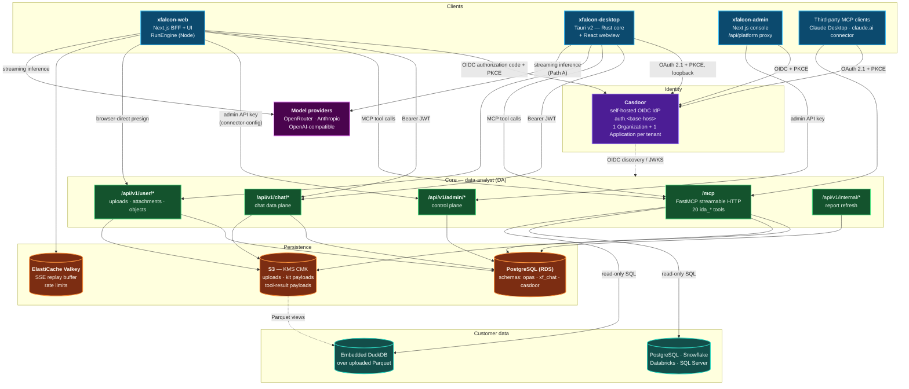

The map divides into four bands:

- **Identity.** Casdoor is the sole issuer. Every other component validates
  tokens; none mints them.
- **Clients.** `xfalcon-web` and `xfalcon-desktop` run agent loops and call model
  providers directly. `xfalcon-admin` is a control-plane console only.
  Third-party MCP clients consume `/mcp` without any xFalcon client involved.
- **Core.** All durable state passes through DA. There is no second write path to
  the warehouse and no second write path to `xf_chat`.
- **Persistence and sources.** One Postgres instance holds three schemas; S3
  holds uploaded Parquet and payload objects; customer sources are read in place.

### Request addressing

Every DA request is addressed per tenant. The host determines the tenant, and the
tenant determines the JWT audience:

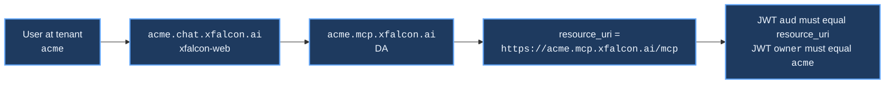

## 5. Vocabulary

The following terms carry precise meanings throughout this document and in the
source.

**Tenant.** A customer organisation. It has: a UUID and a URL-safe _slug_; a row
in `opas._TENANTS`; a Casdoor Organization and Application named for the slug; a
DNS label (`<slug>.<MCP_BASE_HOST>`); a Casbin domain; and it is the value of
`tenant_id` on essentially every row in both Postgres schemas.

**Slug.** The tenant's DNS-safe lowercase label, RFC 1035 syntax
(`^[a-z0-9]([a-z0-9-]{0,61}[a-z0-9])?$`). It is simultaneously the subdomain
label, the Casdoor organization name, and the Casbin domain. The grammar is
enforced identically in `data-analyst/mcp_server/services/slug.py` and
`xfalcon-web/src/lib/auth/tenant.ts`.

**DA / IDA / `data-analyst` / `ida-mcp-server`.** The core service. See §2.

**MCP — Model Context Protocol.** The open protocol by which a language model
client discovers and calls tools on a server. DA implements the _streamable
HTTP_ transport at `/mcp` using FastMCP 3.2. MCP is also how the xFalcon clients
consume _third-party_ tool servers on behalf of users.

**Control plane vs. data plane.** The _control plane_ is
`/api/v1/admin/*`: operator actions that change configuration — tenants, users,
roles, data sources, semantic-layer content. The _chat data plane_ is
`/api/v1/chat/*`: high-volume, per-user CRUD over conversation state. They have
different auth models, different rate limits, different error envelopes, and
different database connection pools.

**`opas` schema vs. `xf_chat` schema.** Two schemas in the same Postgres
database, separated by design. `opas` holds the semantic layer and the control
plane's tables (uppercase, underscore-prefixed names such as `_CACHE_REGISTRY`).
`xf_chat` holds conversation state (lowercase names such as `conversations`,
`runs`). `xf_chat` is protected by `FORCE ROW LEVEL SECURITY` and accessed
through the least-privilege role `xf_chat_app`; `opas` is accessed by
`opas_app`, which owns no relations, and is protected by query-level tenant
scoping. The enclosing database is conventionally named `ida`.

**Path A / Path B.** Two execution modes for a run; the distinction applies only
to the desktop client. Under **Path A** the desktop's Rust core streams the model
provider directly and mirrors the resulting events into DA. Under **Path B** the
run executes elsewhere — in `xfalcon-web`'s `RunEngine` — and the desktop observes
it by reading DA's run-event log. Both emit the same `run.*` event vocabulary, so
a run is resumable and observable from any device irrespective of where it ran.

**Run.** One user turn executed by the agent: a row in `xf_chat.runs`, an
append-only sequence of rows in `xf_chat.run_events`, zero or more rows in
`xf_chat.tool_calls`, and a terminal status. A run may span many provider round
trips ("rounds") because tool calls loop.

**Kit / report kit / dashboard.** A saved, refreshable analytical artifact
consisting of one or more HTML pages, JSON data payloads, and a manifest
describing how to re-execute the SQL that produced the data. Stored in the
`opas._REPORT_KIT*` tables and accessed through five MCP tools
(`ida_save_dashboard`, `ida_recall_dashboard`, `ida_list_dashboards`,
`ida_delete_dashboard`, `ida_refresh_dashboard`). Distinct from a **report**,
which is an `xf_chat.reports` row captured by a client from a conversation.

**Memory.** A durable natural-language statement about the data, written by the
agent or an operator, scoped to a user or to the tenant, and retrieved before
queries. Tables `opas._AGENT_MEMORY_USER` and `opas._AGENT_MEMORY_GLOBAL`.

**Annotation.** An operator-curated statement attached to a table or column: a
known data-quality defect, a required filter, or a definition. Table
`opas._TABLE_ANNOTATIONS`. Annotations are authored through the admin API or CLI,
never by the model; the model may only record feedback on them.

**Casdoor.** The open-source OIDC identity provider that xFalcon self-hosts. One
Casdoor _Organization_ and one _Application_ per tenant. It also owns its own
Postgres database alongside `ida` and `xf_chat`.

**Casbin.** The policy engine used for authorization. xFalcon uses the
`rbac_with_domains` model where the _domain_ is the tenant slug, so a role grant
is always tenant-scoped unless the domain is the wildcard `*`.

**BFF — backend for frontend.** `xfalcon-web` in its server-side role. The
browser never holds a DA credential; it calls the Next.js server, which holds
the session and calls DA.

**Cell.** One complete, isolated production deployment of the platform in one
AWS account: network, compute, data, and observability stacks. The shared
multi-tenant SaaS is the `pool` cell; enterprise customers who require isolation
get their own account and their own cell.

---

# Part II — The core: `data-analyst`

`data-analyst` holds all durable state and is the only component with access to
customer data sources. The remaining components are clients of the interfaces
described here.

## 6. Scope of the component

`data-analyst` is a single Python ASGI application, distribution name
`ida-mcp-server`, version 0.1.6, requiring Python 3.11 or later. It is built on
FastAPI for REST and FastMCP 3.2 for the MCP protocol, composed into one ASGI
object exported as `mcp_server.app:app`.

**In scope for DA:**

| Responsibility     | Detail                                                                                              |
| ------------------ | --------------------------------------------------------------------------------------------------- |
| MCP tool server    | The interface language models use to inspect and query data                                         |
| Semantic layer     | Registry of tables, columns, relationships, descriptions, annotations, memories, and query patterns |
| Control plane      | Tenants, users, roles, API keys, data sources, audit                                                |
| Chat data plane    | REST interface over conversation state                                                              |
| Credential custody | The only component holding credentials for customer data sources                                    |
| Persistence        | The only component that writes to Postgres                                                          |

**Out of scope for DA:**

| Not a…         | Rationale                                                                                                                                                        |
| -------------- | ---------------------------------------------------------------------------------------------------------------------------------------------------------------- |
| Agent runtime  | DA never calls a model provider and has no concept of a turn. It stores runs and events produced by the clients.                                                 |
| User interface | DA serves a static landing page and an optional admin SPA. The operator console is `xfalcon-admin`; the user interfaces are `xfalcon-web` and `xfalcon-desktop`. |
| ETL tool       | DA reads customer warehouses; it does not load them.                                                                                                             |

### Runtime shape

One process, one ASGI application, `N` uvicorn workers
(`MCP_UVICORN_WORKERS`, default `2` in the container; one process per container
in the production cell). Sessions are not sticky: `MCP_STATELESS_HTTP=true` in
production removes the need for target-group stickiness, so any replica can serve
any request.

## 7. Process anatomy: one ASGI app, four API surfaces

`data-analyst/mcp_server/app.py` composes the service. Four of its mounts are API
surfaces with distinct authentication models — `/mcp`, `/api/v1/admin`,
`/api/v1/user`, and `/api/v1/chat`, alongside a server-to-server
`/api/v1/internal` sibling. The remainder are probes, documentation, and static
assets. In registration order:

| Mount / router    | Path                                                                                                       | What it serves                                                                                                                                                                                                                                                                                                                                                                                                                                                                                                                                                                           |
| ----------------- | ---------------------------------------------------------------------------------------------------------- | ---------------------------------------------------------------------------------------------------------------------------------------------------------------------------------------------------------------------------------------------------------------------------------------------------------------------------------------------------------------------------------------------------------------------------------------------------------------------------------------------------------------------------------------------------------------------------------------- |
| `health_router`   | `/health/live`, `/health/startup`, `/health/ready`, `/health/sources`, `/health/uploads`, `/health/status` | Liveness, readiness, dependency status. `/live` also answers `HEAD`.                                                                                                                                                                                                                                                                                                                                                                                                                                                                                                                     |
| `admin_router`    | `/api/v1/admin/*`                                                                                          | Control plane                                                                                                                                                                                                                                                                                                                                                                                                                                                                                                                                                                            |
| `user_router`     | `/api/v1/user/*`                                                                                           | Tenant-user self-service                                                                                                                                                                                                                                                                                                                                                                                                                                                                                                                                                                 |
| `internal_router` | `/api/v1/internal/*`                                                                                       | Server-to-server report refresh                                                                                                                                                                                                                                                                                                                                                                                                                                                                                                                                                          |
| `chat_router`     | `/api/v1/chat/*`                                                                                           | Chat data plane                                                                                                                                                                                                                                                                                                                                                                                                                                                                                                                                                                          |
| `mcp_app`         | `/mcp`                                                                                                     | FastMCP streamable HTTP                                                                                                                                                                                                                                                                                                                                                                                                                                                                                                                                                                  |
| dashboard SPA     | `/dashboard` + `/dashboard/config.json`                                                                    | Optional built-in admin SPA — the Vite + React + TanStack Router app in `apps/ida-dashboard`, whose `dist/` the Dockerfile copies to `/app/static/dashboard` (overridable with `MCP_DASHBOARD_DIR`). Absent in development, where contributors run `just dashboard dev` behind the Vite proxy, so the mount is a clean no-op. Serves `index.html` as an SPA fallback, immutable cache headers on hashed assets, `no-cache` on `index.html`. `config.json` is fetched pre-auth so the SPA can build its OIDC client at runtime rather than at build time — one image across environments. |
| `StaticFiles`     | `/`                                                                                                        | Landing page; **mounted last**, because a `/` mount is a catch-all that would shadow anything registered after it                                                                                                                                                                                                                                                                                                                                                                                                                                                                        |
| OAuth surface     | `/.well-known/oauth-protected-resource[/...]`, `/register`                                                 | RFC 9728 protected-resource metadata; dynamic client registration returns `405` by design                                                                                                                                                                                                                                                                                                                                                                                                                                                                                                |

Two absences are intentional and may otherwise be mistaken for defects:

- **`/.well-known/oauth-authorization-server` and
  `/.well-known/openid-configuration` are not routed**; they return `404`.
  Casdoor owns authorization-server metadata at `OIDC_ISSUER_URL`, and RFC 8414 §3
  requires issuer equality, so proxying the document from DA would be incorrect.
  MCP clients follow the `authorization_servers` array in the protected-resource
  metadata document instead. The early middleware layers consult
  `PUBLIC_NOT_FOUND_PATHS` so an unauthenticated probe of those paths receives the
  `404` rather than a `401`, `429`, or `500`.
- **Dynamic Client Registration is disabled.** `POST /register` returns `405`
  with a pointer to `GET /api/v1/admin/tenants/{id}/connector-config`, which
  supplies a pre-provisioned `client_id` and `client_secret`. Per-tenant Casdoor
  applications carry `dcrPolicy: disabled`.

`redirect_slashes=False` is set on the FastAPI application, and an ASGI wrapper
rewrites `/mcp` to `/mcp/` internally rather than by redirect. A `307` breaks MCP
clients for two reasons: the `Location` header may be emitted as `http://` behind
a TLS-terminating proxy, and HTTP clients drop the `Authorization` header across a
redirect (RFC 7235 §4.2).

### Lifespan

`app_lifespan` (FastAPI) and a second `app_lifespan` (FastMCP, in
`protocol/tools.py`) both run. The FastMCP one builds the `AppContext` that every
tool receives: the metadata client, the optional legacy data client, the four
repositories (memory, annotation, query history, knowledge), the
`MetadataRepository`, a session tracker, and — when credential encryption is
configured — the multi-source stack (`DataSourceRepository`, `ConnectionManager`,
`SessionStore`, `SourceResolver`) plus the `ReportKitService`.

Two boot-time reconciliations run in the FastAPI lifespan. Together they make the
DuckDB volume disposable:

- `_reconcile_existing_tenants` rebuilds each user scope's DuckDB views from
  `_DATASET_FILES` + S3. A fresh EBS volume can attach and the catalog
  re-derives with no operator action.
- `_reconcile_duckdb_registry` re-upserts `_CACHE_REGISTRY` / `_TABLE_SCHEMAS`
  rows for every ready upload, so uploads that predate the registry write-through
  become visible to MCP tools, and a metadata-DB restore regenerates them.

Both are per-tenant fault-isolated: a failure is logged and boot continues.

## 8. The middleware chain

The ordering below is significant. Outermost layer first:

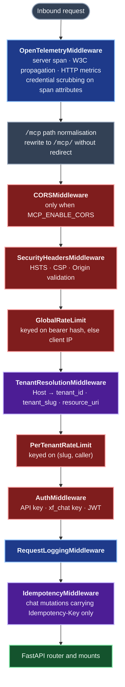

The ordering is determined by the following constraints:

- **CORS outermost** so preflight `OPTIONS` pays no auth or tenant cost.
- **Security headers before any per-tenant logic** so even an unresolved host
  gets HSTS and CSP.
- **Global rate limit before tenant resolution** so a flood from one caller is
  rejected _before_ a database lookup against the hostnames table — otherwise
  tenant resolution is an amplification vector.
- **Tenant resolution before the per-tenant limiter and before auth**, because
  the limiter keys on the slug and `AuthMiddleware` reads
  `request.state.resource_uri` (set here) as the expected JWT audience.
- **Idempotency innermost** so it sits inside auth and can read the validated
  principal. It is path-gated and pure ASGI: a request that is not a chat
  mutation carrying an `Idempotency-Key` header is forwarded untouched, so
  `/mcp`, uploads, and SSE pay nothing.

Two limiters that are _not_ in this chain:

- `CasbinToolMiddleware` is registered on the FastMCP sub-app
  (`mcp.add_middleware(...)`), so it runs per **tool call**, not per HTTP
  request.
- `enforce_principal_rate_limit` is a FastAPI dependency on every chat
  sub-router, backed by the shared `xf_chat.rate_limit_buckets` table so the
  ceiling holds across workers and replicas.

**Rate limiting is caller-keyed, not IP-keyed** — the bearer token's SHA-256
prefix when present, client IP otherwise. This is not a stylistic choice: in the
production cell, `xfalcon-web` and `xfalcon-admin` run _inside the same VPC_ and
their calls to the tenant hosts hairpin out through NAT gateways and back in via
the ALB, so every request from every user of every tenant arrives from a handful
of NAT elastic IPs. An IP-keyed bucket would collapse the entire fleet onto one
counter.

### Error envelopes

Each surface maintains its own error contract. Handlers are registered
accordingly:

- `PoolExhaustedError` → `503` with a structured body, so clients can distinguish
  metadata-pool starvation from a generic `500`.
- `UploadErrorResponseException` → a pre-built flat `{code, detail, issues}`
  body, because the upload client cannot parse FastAPI's nested
  `{"detail": {...}}`.
- `RequestValidationError` → re-flattened to `{code, detail, issues}` **for
  upload routes only**; every other path reproduces FastAPI's default exactly.
- `StarletteHTTPException` → the admin `AdminErrorEnvelope` for paths under
  `/api/v1/admin`, FastAPI's default elsewhere.
- Any unhandled `asyncpg.PostgresError` on a chat route → mapped to the uniform
  `ChatError` contract (RLS violation → `403`, constraint → `4xx`, timeout →
  `504`) by a router-level dependency, so a raw Postgres error can never surface
  as an opaque `500`.

## 9. The MCP tool surface

`data-analyst/mcp_server/protocol/tools.py` registers 20 tools, each prefixed
`ida_`. The module docstring states 11; that figure is stale and the
`@mcp.tool()` decorators are authoritative. The tools group into six families.

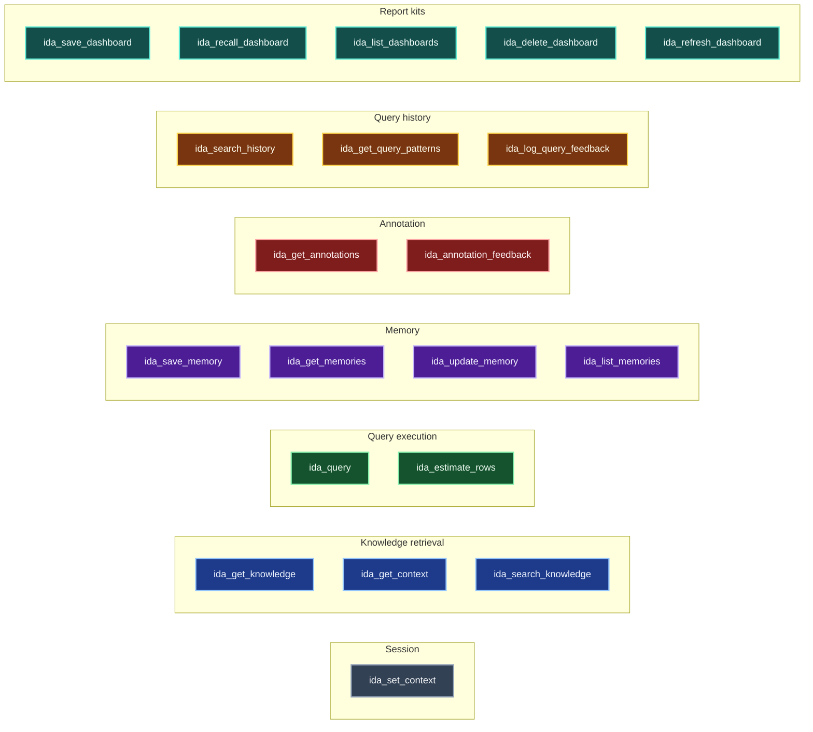

### 9.1 Session and source selection

| Tool                                               | Purpose                                                                                                                 |
| -------------------------------------------------- | ----------------------------------------------------------------------------------------------------------------------- |
| `ida_set_context(data_source, save_default=False)` | Bind the MCP session to a registered data source; optionally persist it as the caller's default in `_USER_PREFERENCES`. |

Source resolution order, implemented by `SourceResolver`: explicit
`data_source=` argument on the call → session binding set by `ida_set_context` →
the user's saved default → the tenant's default source.

### 9.2 Knowledge retrieval

| Tool                                  | Purpose                                                                                                                                                                                                            |
| ------------------------------------- | ------------------------------------------------------------------------------------------------------------------------------------------------------------------------------------------------------------------ |
| `ida_get_knowledge(knowledge_type=…)` | The primary discovery tool. `knowledge_type` selects `sources`, `tables`, `schema`, `sample`, or `relationships`; supports `detail_level`, filters, pagination, and optional inlining of memories and annotations. |
| `ida_get_context(tables, question=…)` | Assemble everything relevant for a set of tables in one call — schema, annotations, memories, patterns.                                                                                                            |
| `ida_search_knowledge(query, …)`      | Free-text search across the unified knowledge store (`_UNIFIED_KNOWLEDGE`).                                                                                                                                        |

### 9.3 Query execution

| Tool                                           | Purpose                                                          |
| ---------------------------------------------- | ---------------------------------------------------------------- |
| `ida_query(sql, limit=…, structured=False, …)` | Execute a **SELECT-only** statement against the resolved source. |
| `ida_estimate_rows(sql, method="auto")`        | Estimate result cardinality before executing the query.          |

`ida_query` carries the most prescriptive contract of any tool in the system. Its
docstring requires the model to have called `ida_get_memories` and
`ida_get_annotations` for each referenced table, and to have run
`ida_estimate_rows`, before issuing the query. The rationale recorded in the code
is that the self-correction layer appends context after execution, at which point
an incorrect query has already produced a result.

Execution sequence:

1. Resolve the data client for the target source (`_resolve_data_client_safe`).
2. Length-check the SQL against `MAX_SQL_LENGTH`, clamp `limit` to
   `MAX_QUERY_LIMIT = 500`.
3. `data_client.validate_sql(sql)` — dialect-aware parse that rejects anything
   that is not a single read-only `SELECT`.
4. Fetch the allowed table names and source paths from the metadata registry —
   **the data client never touches the registry**; table allowlisting is a
   metadata operation.
5. Unless `skip_context=True`, retrieve pre-query context (annotations +
   memories + session history) and prepend it. This step is fault-isolated: a
   failure logs and the query still runs.
6. Execute with `allowed_tables` and `table_paths` enforced by the client.
7. Log the query (when `LOG_QUERIES=true`) on a bounded two-thread pool, never
   inline.
8. Validate the results and append diagnostics — truncation, empty result,
   aggregation over truncated data.
9. On an unknown-table failure, `_build_cross_source_hint` searches the caller's
   other active sources for the missing table and replaces the terminal error with
   a directive naming the correct source, for example: _table `jira` lives in
   source `duckdb_local` — call `ida_set_context(source='duckdb_local')`_. This
   applies principally to tenants holding both a warehouse and DuckDB uploads.

Passing `structured=True` additionally returns a machine-readable
`{columns: [{name, type}], rows, row_count, truncated}` object in MCP's
`structuredContent` field, leaving the markdown byte-identical. The dataset
carriers of a saved report are built from this form.

The full call path:

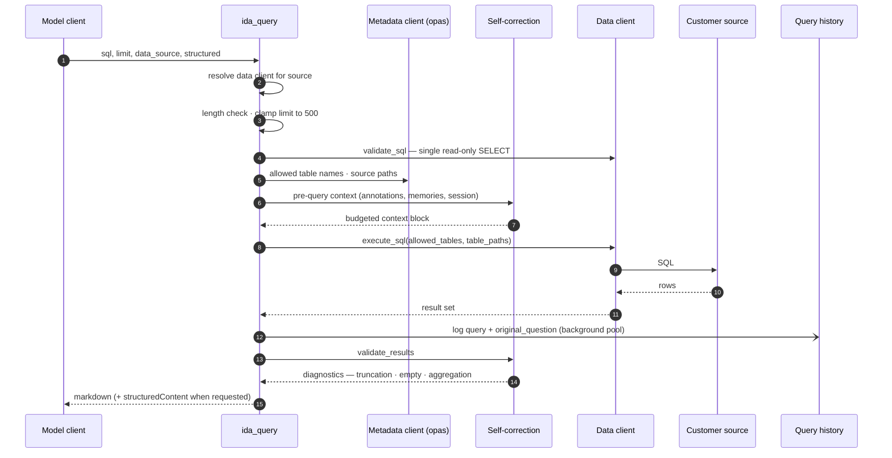

### 9.4 Memories

| Tool                                                                  | Purpose                           |
| --------------------------------------------------------------------- | --------------------------------- |
| `ida_save_memory(content, title, category=…, tables=…, supersedes=…)` | Write a user-scoped memory.       |
| `ida_get_memories(query=…, tables=…, category=…, scope="both")`       | Retrieve by relevance.            |
| `ida_update_memory(memory_id, …)`                                     | Edit content/title or deactivate. |
| `ida_list_memories(scope="both", …)`                                  | Paginated listing.                |

Memories constitute the agent's durable learning surface. Scope is `user` or
`global`; the model may write only user-scoped memories. Global memories are
created by operators through the admin API or the `memory_cli`. A memory carries a
category (`filter`, `caveat`, `general`, and others), optional table bindings,
keywords, and an optional `supersedes` reference that retires an earlier memory.

Input caps are explicit constants: `MAX_MEMORY_CONTENT_LENGTH = 10_000`,
`MAX_MEMORY_TITLE_LENGTH = 200`, `MAX_MEMORY_LIMIT = 100`.

### 9.5 Annotations

| Tool                                                             | Purpose                              |
| ---------------------------------------------------------------- | ------------------------------------ |
| `ida_get_annotations(table_name=…, column_name=…, severity=…)`   | Read curated caveats.                |
| `ida_annotation_feedback(annotation_id, was_helpful, comment=…)` | Record whether an annotation helped. |

Annotations are read-only to the model; creation and editing are operator
actions. The asymmetry with memories is deliberate. An annotation is an assertion
about business truth, and the system does not permit a model to originate such an
assertion.

### 9.6 Query history and patterns

| Tool                                                    | Purpose                                                                                      |
| ------------------------------------------------------- | -------------------------------------------------------------------------------------------- |
| `ida_search_history(question, …)`                       | Find past queries by natural-language similarity to the current question.                    |
| `ida_get_query_patterns(tables=…, pattern_type=…)`      | Retrieve reusable SQL patterns mined from history.                                           |
| `ida_log_query_feedback(query_id, feedback, comment=…)` | Record whether a generated query was right; a negative signal can create a draft correction. |

### 9.7 Dashboards (report kits)

| Tool                                                                   | Purpose                                                                                                                 |
| ---------------------------------------------------------------------- | ----------------------------------------------------------------------------------------------------------------------- |
| `ida_save_dashboard(name, manifest, pages, payloads, scope="user", …)` | Create or redefine a kit. Supports chunked transfer via `transfer_id` / `part_index` / `part_count` / `content_sha256`. |
| `ida_recall_dashboard(kit_id)`                                         | Fetch a kit's manifest and pages back.                                                                                  |
| `ida_list_dashboards()`                                                | List kits visible to the caller.                                                                                        |
| `ida_delete_dashboard(kit_id)`                                         | Owner-only delete.                                                                                                      |
| `ida_refresh_dashboard(kit_id, payloads, …)`                           | Replace a kit's data payloads with freshly-queried results.                                                             |

These are MCP tools rather than REST endpoints because the model constructs the
dashboard. Server-side guidance is appended unconditionally to the MCP
instructions by `_enrich_instructions_with_report_kits`; without it, a client that
has not been told kits are stored server-side will answer kit questions from its
local filesystem.

### 9.8 Server instructions

Two functions amend the MCP server's instruction text at boot:

| Function                                | Condition               | Effect                                                                                                                                     |
| --------------------------------------- | ----------------------- | ------------------------------------------------------------------------------------------------------------------------------------------ |
| `_enrich_instructions_with_sources`     | Multi-source configured | Directs the model to discover sources dynamically rather than from a static list, so a newly registered source is usable without a restart |
| `_enrich_instructions_with_report_kits` | Always                  | States that report kits are stored server-side                                                                                             |

## 10. The metadata database (`opas` schema)

One PostgreSQL database (`PG_DATABASE`, conventionally `ida`) holds three
schemas, created by `infra/docker/init-schemas.sql`:

```sql
CREATE SCHEMA IF NOT EXISTS casdoor;   -- the identity provider's own tables
CREATE SCHEMA IF NOT EXISTS opas;      -- the semantic layer + control plane
CREATE SCHEMA IF NOT EXISTS xf_chat;   -- conversation state (Part II §16)
```

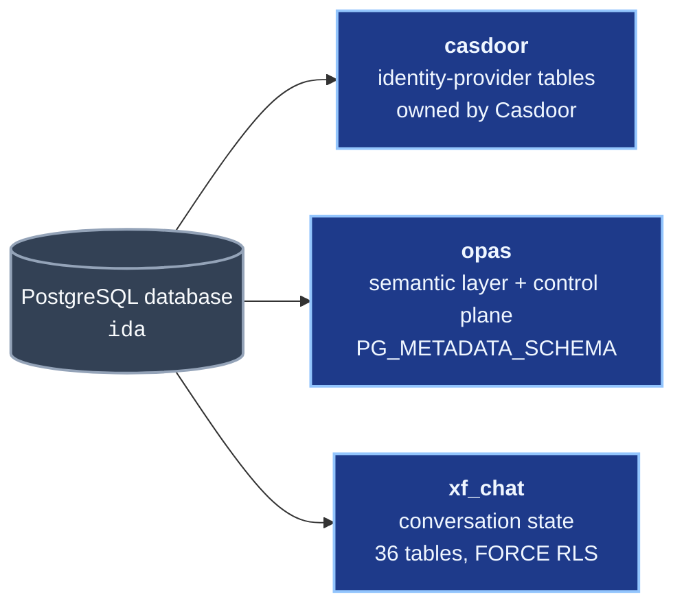

The metadata schema is `opas` (`PG_METADATA_SCHEMA`, default `opas`). Its table
names are declared once in `data-analyst/shared/postgres_config.py` and are
uppercase with a leading underscore. PostgreSQL folds the unquoted identifiers
used at `CREATE TABLE` time to lower case, so the physical relation names are
`opas._cache_registry` and so on; the constants below are the names the code uses.

| Constant                      | Table                        | Holds                                                                                     |
| ----------------------------- | ---------------------------- | ----------------------------------------------------------------------------------------- |
| `REGISTRY_TABLE`              | `_CACHE_REGISTRY`            | One row per discovered table: name, source, type (fact/dimension/…), row count, freshness |
| `SCHEMAS_TABLE`               | `_TABLE_SCHEMAS`             | One row per column: type, nullability, description, classification                        |
| `RELATIONSHIPS_TABLE`         | `_TABLE_RELATIONSHIPS`       | Discovered / curated joins with confidence and status                                     |
| `MEMORY_GLOBAL_TABLE`         | `_AGENT_MEMORY_GLOBAL`       | Tenant-wide memories (operator-authored)                                                  |
| `MEMORY_USER_TABLE`           | `_AGENT_MEMORY_USER`         | Per-user memories (agent-authored)                                                        |
| `MEMORY_EMBEDDINGS_TABLE`     | `_AGENT_MEMORY_EMBEDDINGS`   | Vector embeddings for memory retrieval                                                    |
| `ANNOTATION_TABLE`            | `_TABLE_ANNOTATIONS`         | Curated caveats on tables/columns                                                         |
| `ANNOTATION_FEEDBACK_TABLE`   | `_ANNOTATION_FEEDBACK`       | Helpfulness signals from the model                                                        |
| `QUERY_HISTORY_TABLE`         | `_QUERY_HISTORY`             | Every executed query, its tables, timing, success, and originating question               |
| `QUERY_PATTERNS_TABLE`        | `_QUERY_PATTERNS`            | Patterns mined from history                                                               |
| `UNIFIED_KNOWLEDGE_TABLE`     | `_UNIFIED_KNOWLEDGE`         | Denormalised search surface across memories + annotations                                 |
| `REPORT_KIT_TABLE`            | `_REPORT_KITS`               | Saved dashboards                                                                          |
| `REPORT_KIT_PAGE_TABLE`       | `_REPORT_KIT_PAGES`          | Their HTML pages                                                                          |
| `REPORT_KIT_PAYLOAD_TABLE`    | `_REPORT_KIT_PAYLOADS`       | Their data payload descriptors                                                            |
| `REPORT_KIT_CHUNK_TABLE`      | `_REPORT_KIT_PAYLOAD_CHUNKS` | In-flight chunked payload transfers                                                       |
| `REPORT_KIT_SAVE_CHUNK_TABLE` | `_REPORT_KIT_SAVE_CHUNKS`    | In-flight chunked kit saves                                                               |
| `TENANTS_TABLE`               | `_TENANTS`                   | Tenant registry: id, slug, name, active                                                   |
| `TENANT_HOSTNAMES_TABLE`      | `_TENANT_HOSTNAMES`          | Custom-domain CNAME mappings                                                              |
| `TENANT_USERS_TABLE`          | `_TENANT_USERS`              | The user allowlist per tenant                                                             |
| `USER_PREFERENCES_TABLE`      | `_USER_PREFERENCES`          | Per-user defaults (e.g. default data source)                                              |
| `DATA_SOURCES_TABLE`          | `_DATA_SOURCES`              | Registered sources + encrypted credentials                                                |
| `API_KEYS_TABLE`              | `_API_KEYS`                  | Platform API keys (hashed)                                                                |
| `DATASETS_TABLE`              | `_DATASETS`                  | Uploaded datasets                                                                         |
| `DATASET_FILES_TABLE`         | `_DATASET_FILES`             | Their files, raw + Parquet keys, schema JSON                                              |
| `USAGE_EVENTS_TABLE`          | `_MCP_USAGE_EVENTS`          | Per-call usage telemetry                                                                  |
| `AUDIT_LOG_TABLE`             | `_SYNC_AUDIT_LOG`            | Pipeline run history                                                                      |
| `AUTH_AUDIT_LOG_TABLE`        | `_AUTH_AUDIT_LOG`            | Security-relevant events                                                                  |

Grouped by function:

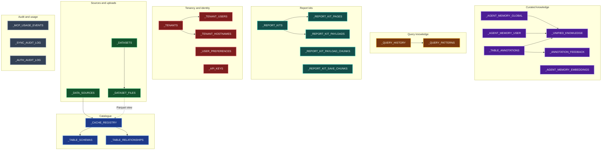

Access is through `PostgresMetadataClient` — a pooled psycopg2 client governed by
`PG_POOL_MIN` / `PG_POOL_MAX` with `pre_ping`, raising `PoolExhaustedError` which
surfaces as `503` — and a repository layer comprising `MemoryRepository`,
`AnnotationRepository`, `QueryHistoryRepository`, `KnowledgeRepository`,
`MetadataRepository`, `DataSourceRepository`, `DatasetRepository`,
`ReportKitRepository`, `TenantRepository`, `ApiKeyRepository`,
`AuditLogRepository`, and others. The memory and annotation repositories
dual-write a mirror into `KnowledgeRepository`, keeping `_UNIFIED_KNOWLEDGE`
searchable without a join.

## 11. Data sources and the connector layer

### 11.1 Two connection paths

Two paths coexist. The legacy single-warehouse path selects one Postgres or
Snowflake connection for the whole process through the `DATA_DB_BACKEND`
environment variable. The current multi-source path uses rows in `_DATA_SOURCES`,
one or more per tenant. The legacy path is optional; when `DATA_DB_BACKEND` is
empty the boot log records that data queries route through `_DATA_SOURCES`. New
deployments use registered sources exclusively.

### 11.2 Supported backends

Declared in `mcp_server/services/connector_spec.py` and
`shared/data_db/`:

| Backend key  | Label                      | Credential types accepted                                           |
| ------------ | -------------------------- | ------------------------------------------------------------------- |
| `postgres`   | PostgreSQL                 | `password`                                                          |
| `snowflake`  | Snowflake                  | `password`, `private_key` (key-pair auth)                           |
| `databricks` | Databricks (Unity Catalog) | `access_token` (PAT), `client_secret` (OAuth M2M service principal) |
| `mssql`      | Microsoft SQL Server       | `password` (SQL auth), `client_secret` (Entra ID service principal) |
| `duckdb`     | DuckDB (uploads)           | `none` — binds to tenant/user identity, no stored credential        |

Two properties of this registry:

- **Expiring credentials are excluded by design.** A registered source stores a
  durable credential; expiring access tokens and certificates are not accepted for
  SQL Server.
- **The published connector descriptor is derived rather than duplicated.**
  `GET /api/v1/admin/datasources/backends` builds its field list from each
  backend's Pydantic model via `model_json_schema(by_alias=True)`, and its
  authentication methods from the same registry that registration-time validation
  enforces. The contract a client reads and the rules the server applies therefore
  cannot diverge. A test asserts the alignment.

### 11.3 Credential storage

Secrets are encrypted at rest with a pluggable `SecretEncryptor`:

- **Fernet** (symmetric, from `DATA_SOURCE_ENCRYPTION_KEY`) for local and
  on-prem.
- **AWS KMS envelope encryption** (from `DATA_SOURCE_KMS_KEY_ID`) in the cloud,
  using a dedicated per-class customer-managed key.

`SecretType.NONE` pairs with a `NULL` `encrypted_secret` at the schema level (a
`CHECK` constraint in `shared/postgres_ddl.py`), so credential-free backends do
not have to invent placeholder ciphertext. The encryptor refuses empty plaintext
explicitly, which keeps that invariant from being violated by accident.

If neither `DATA_SOURCE_ENCRYPTION_KEY` nor `DATA_SOURCE_KMS_KEY_ID` is set, the
multi-source stack is not initialised and the server logs
`Multi-DB support not available`. This is the most frequent cause of registered
data sources appearing to be absent.

### 11.4 Connection management

`ConnectionManager` owns a bounded pool of live source connections
(`MAX_DATA_CONNECTIONS`, default `20`; `CONNECTION_IDLE_TIMEOUT_SECONDS`, default
`1800`), dispatches by `backend`, applies `MAX_QUERY_ROWS` (default `500`) and
`QUERY_TIMEOUT_SECONDS` (default `30`), and optionally pre-pings. DuckDB sources
are dispatched to the shared per-tenant `DuckDBManager` rather than to a
connection of their own. `MAX_SOURCES_PER_TENANT` defaults to `10`.

## 12. Uploads: files to Parquet to DuckDB

The upload path admits data that does not reside in a warehouse. Because it
accepts untrusted files, it carries the most extensive input validation in the
repository.

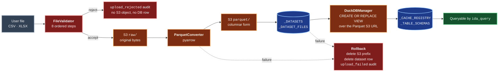

### 12.1 Validation pipeline

`mcp_server/services/file_validator.py` runs an ordered, fail-fast pipeline. The
order is normative; each step depends on guarantees established by its
predecessors.

1. Extension allowlist (`UPLOAD_ALLOWED_EXTENSIONS`, default `.csv,.xlsx`).
2. Size cap, enforced while streaming (`UPLOAD_MAX_BYTES`).
3. Magic-byte MIME sniff via `filetype` — the extension is not trusted.
4. Filename sanitisation: NFKC normalise, allowlist, UUID-safe.
5. Format-specific parse.
   - XLSX: `openpyxl` in `read_only=True, data_only=True` mode, with explicit
     zip-bomb defence (`UPLOAD_DECOMPRESSED_MAX_BYTES`, default 50 GiB) and
     `defusedxml` for the direct OOXML parsing used to read merged ranges —
     an XXE / billion-laughs defence.
   - CSV: encoding detection via `charset-normalizer` and dialect detection via
     `clevercsv`, selected for its consistency-based detector, which is more
     reliable than `csv.Sniffer` on exports from systems such as Jira, Salesforce,
     and HubSpot.
6. Header normalisation: trim, NFKC, lowercase, snake_case, de-duplicate.
7. Row and column caps (`UPLOAD_MAX_ROWS`, `UPLOAD_MAX_COLUMNS` default `1024`).
8. Control-character scrub.

Every rejection carries a stable `UploadErrorCode`; the API layer maps code to
HTTP status without adding string cases.

### 12.2 Orchestration

`UploadService` composes storage, repository, and audit. It is synchronous; the
API layer invokes it through `run_in_threadpool`. Its failure policy:

| Failure point                                  | Effect                                                                                                                          |
| ---------------------------------------------- | ------------------------------------------------------------------------------------------------------------------------------- |
| Validator rejection                            | No S3 object and no database row are created; an `upload_rejected` audit event is emitted                                       |
| S3 put, Parquet conversion, or database insert | Full rollback: the dataset prefix is removed from S3, the dataset row is deleted, and an `upload_failed` audit event is emitted |

### 12.3 Object layout

Keys are composed under a validated tenant prefix. `S3Client` rejects any suffix
capable of escaping that prefix — leading `/`, `..` components, empty segments,
and absolute paths:

```
[<base-prefix>/]tenants/<tenant_id>/users/<user_id>/datasets/<dataset_id>/
        raw/source<ext>              ← the original bytes
        raw/<filename>               ← additional raw members
        parquet/<table_name>.parquet ← the converted columnar form
```

The bucket is set by `UPLOAD_RAW_STORAGE_URI` (an `s3://bucket/prefix` URI). A
local filesystem backend exists for on-prem and development, selected by the same
setting; `LOCAL_URL_SIGNING_KEY` then signs download URLs with a TTL
(`LOCAL_URL_SIGNING_TTL_SECONDS`, default `300`).

Large uploads use S3 multipart with presigned part URLs:
`UPLOAD_MULTIPART_THRESHOLD_BYTES` (default 64 MiB),
`UPLOAD_MULTIPART_PART_BYTES` (64 MiB),
`UPLOAD_MULTIPART_PRESIGN_TTL_SECONDS` (6 h), versus the single-shot
`UPLOAD_PRESIGN_TTL_SECONDS` (5 min). `UPLOAD_MAX_INFLIGHT` (default `4`) bounds
concurrent uploads per caller. Abandoned `uploading` rows are swept by the
orphan reaper (§18) and, at boot, any `uploading` row older than 30 minutes is
flipped to `failed`.

### 12.4 DuckDB

`DuckDBManager` is the **only** writer of `user.duckdb` files. Each
`(tenant_id, user_id)` scope gets:

```
<DUCKDB_DATA_DIR>/tenants/<tenant_id>/users/<sha256(user_id)[:32]>/user.duckdb
```

Five design constraints determine its shape:

| Constraint               | Implementation                                                                                                                                                                                                                              | Reason                                                                                                                                                                                              |
| ------------------------ | ------------------------------------------------------------------------------------------------------------------------------------------------------------------------------------------------------------------------------------------- | --------------------------------------------------------------------------------------------------------------------------------------------------------------------------------------------------- |
| Connection lifetime      | Opened per operation, closed immediately, with bounded retry-and-backoff on lock contention                                                                                                                                                 | DuckDB takes an exclusive, per-process POSIX file lock on read-write open. The lock cannot be shared across uvicorn workers, so a long-lived handle deadlocks sibling workers permanently.          |
| In-process serialisation | A `threading.RLock` per scope, not an `asyncio.Lock`                                                                                                                                                                                        | `UploadService` runs in FastAPI's thread pool; psycopg2, pyarrow, and openpyxl are all blocking.                                                                                                    |
| Catalogue objects        | Views, not tables. `register_view` issues `CREATE OR REPLACE VIEW` over the Parquet object's S3 URL; `drop_view` drops by name; `reconcile` computes the symmetric difference against `_DATASET_FILES` and issues the minimum statement set | All three operations are idempotent and retry-safe.                                                                                                                                                 |
| S3 credentials           | `PROVIDER credential_chain` on the `httpfs` extension                                                                                                                                                                                       | One code path resolves the EC2 instance profile via IMDS in the cloud, the local AWS configuration on a workstation, and explicit environment variables on-premises, without environment branching. |
| Durability               | Parquet objects plus the metadata database are authoritative; every DuckDB write method fails soft and the caller logs and continues                                                                                                        | Upload durability never depends on DuckDB availability.                                                                                                                                             |

Memory is bounded explicitly. `DUCKDB_MEMORY_LIMIT` (`auto` by default) derives
its budget from `MCP_MEM_LIMIT`, which must equal the container's ECS `memory`
value. If `MCP_MEM_LIMIT` is unset, DuckDB reads `/proc/meminfo` — host RAM — and
overcommits the container. Both are `1400` in the production task definition.

Query concurrency is admission-controlled by `DUCKDB_MAX_CONCURRENT_QUERIES`
(`0` derives a value), a ceiling of `8`, a queue depth of `16`, and a 30-second
admission timeout.

DuckDB is disabled unless `DUCKDB_ENABLED=true`, and may additionally be enabled
or disabled per tenant through
`POST /api/v1/admin/tenants/{id}/duckdb/{enable|disable}`.

## 13. The knowledge system

The knowledge system supplies the business context that a raw schema cannot
express. It comprises four stores and one runtime loop.

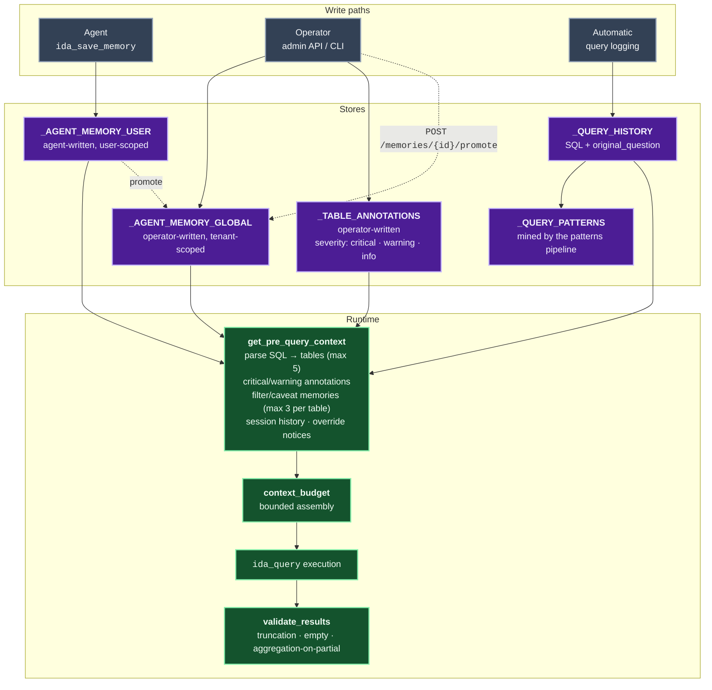

### 13.1 Memories

Natural-language statements, user- or tenant-scoped, categorised (`filter`,
`caveat`, `general`, and others), optionally bound to tables and keywords, with an
explicit supersession chain. Written by the agent at user scope or by an operator
at either scope. Retrieved by relevance to the current question and to the tables
referenced in the query.

### 13.2 Annotations

Operator-curated statements about a table or column, carrying a type and a
severity (`critical`, `warning`, `info`). The self-correction layer injects
annotations of severity `critical` and `warning`. The model may read annotations
and record feedback on them; it may not create or edit them.

### 13.3 Query history and mined patterns

When `LOG_QUERIES=true`, every query is recorded with its parsed table and column
sets, execution time, row count, success flag, and the `original_question` that
produced it. That final field is what allows `ida_search_history` to perform a
question-to-SQL nearest-neighbour lookup over the tenant's own history.

The `patterns` pipeline then walks `_QUERY_HISTORY` with `sqlglot`, extracts
recurring JOIN / filter / aggregation / metric shapes, and writes them to
`_QUERY_PATTERNS` with an occurrence threshold (`PATTERN_MIN_OCCURRENCE`, default
`2`) and a staleness horizon (`PATTERN_STALE_DAYS`, default `90`).

### 13.4 The self-correction loop

`mcp_server/self_correction.py` wraps every `ida_query`:

**Before** the query — `get_pre_query_context` parses the SQL, extracts the
referenced tables (capped at `MAX_CONTEXT_TABLES = 5`), and retrieves:

- annotations of severity `CRITICAL` or `WARNING` for those tables,
- memories in the `FILTER` or `CAVEAT` categories (`MAX_MEMORIES_PER_TABLE = 3`),
- the session's own recent query history,
- **override notices** — cases where a memory contradicts an annotation, surfaced
  explicitly rather than silently resolved.

The assembled context is budgeted (`context_budget.assemble_context`) so it
cannot crowd out the answer, then formatted into a "Pre-Query Context" section.

**After** the query, `validate_results` emits diagnostics for three failure modes:

| Diagnostic    | Condition                                                                  | Significance                                                                           |
| ------------- | -------------------------------------------------------------------------- | -------------------------------------------------------------------------------------- |
| `truncation`  | The result reached the row cap                                             | Any total computed from the result is understated                                      |
| `empty`       | Zero rows returned                                                         | Ordinarily indicates an incorrect filter rather than a genuine zero                    |
| `aggregation` | The SQL contains aggregate functions and the underlying scan was truncated | Produces a confident, incorrect number; the highest-severity combination in the system |

Two further services participate: `fact_checker` classifies a new memory against
existing knowledge as `CONFLICT`, `REDUNDANT`, `NOVEL`, or `CONSISTENT` using a
keyword and Jaccard-overlap heuristic; `claim_extractor` isolates narrative claims
for checking against query results.

## 14. Report kits (saved dashboards)

A kit is a saved, refreshable analytical artifact composed of three parts:

| Part     | Format | Contents                                                        |
| -------- | ------ | --------------------------------------------------------------- |
| Manifest | JSON   | Datasets, the SQL producing each, and the source each came from |
| Pages    | HTML   | One or more rendered pages                                      |
| Payloads | JSON   | The query results themselves; zero or more                      |

`ReportKitService` sequences validation, quota check, object storage, and
repository write, and enforces three rules spanning those layers:

1. **Nothing is written until everything validates and fits.** A save that would
   exceed the tenant quota (`REPORT_KIT_STORAGE_QUOTA_MB`, default `100`) stores
   no part of itself.
2. **Objects precede rows, on write and on delete.** No transaction spans
   Postgres and object storage. This ordering makes the failure mode an
   unreferenced object, which is sweepable, rather than a row referencing a
   missing object, which presents to the user as a broken kit.
3. **Definition and data have different authorisation.** Creating, redefining,
   and deleting a kit are owner-only. Refreshing is permitted to any user
   entitled to view the kit, so a shared kit does not become stale in its owner's
   absence.

Kits built on a user-private backend (`duckdb`) may be shared but can be
refreshed only by their owner, because no other session can reach the source data.

Large payloads transfer in parts, staged in `_REPORT_KIT_PAYLOAD_CHUNKS` and swept
after `CHUNK_STAGING_TTL_HOURS = 24`. Parts are not counted against the quota until
assembled, so the TTL is the bound on them.

Every kit mutation emits an audit event.

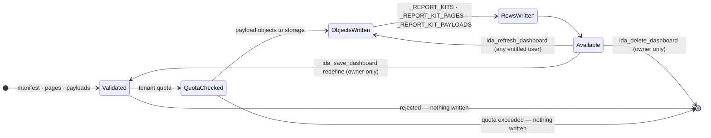

## 15. Metadata pipelines and discovery

Four pipelines implement a common `Pipeline` protocol providing dry-run support,
progress callbacks, and audit. They are triggered from the control plane through
`POST /api/v1/admin/sync/{tables|descriptions|relationships|patterns|all}` and run
as background jobs whose status is polled at `GET /api/v1/admin/sync/{job_id}`.

| Pipeline        | What it does                                                                                                                |
| --------------- | --------------------------------------------------------------------------------------------------------------------------- |
| `table_sync`    | Discovers tables and columns from a source and registers them in `_CACHE_REGISTRY` / `_TABLE_SCHEMAS`                       |
| `descriptions`  | Extracts native descriptions (`pg_description` on PostgreSQL, `COMMENT` on Snowflake, etc.) and writes them to the registry |
| `relationships` | Builds `_TABLE_RELATIONSHIPS`                                                                                               |
| `patterns`      | Mines `_QUERY_HISTORY` into `_QUERY_PATTERNS`                                                                               |

The relationships pipeline runs five phases in descending order of confidence and
records the confidence value on each row:

| Phase | Source of evidence                                         | Confidence           | Status         |
| ----- | ---------------------------------------------------------- | -------------------- | -------------- |
| 1     | Catalog foreign keys                                       | 1.0                  | auto-confirmed |
| 2     | Query-history mining (how often the join actually appears) | 0.5–0.9 by frequency | suggested      |
| 3     | Schema-pack matching (shipped templates for known models)  | 0.6                  | suggested      |
| 4     | SQL file scanning via `sqlglot`                            | 0.7                  | suggested      |
| 5     | Common-column heuristic                                    | 0.3                  | suggested      |

Suggested relationships are visible to operators, who confirm or reject them
through `PATCH /api/v1/admin/relationships`.

Discovery is implemented per backend in
`services/discovery/{postgres,snowflake,databricks,mssql,duckdb}.py`, each
conforming to `DiscoveryProtocol`. A shared `base.py` classifies columns and
tables using explicit regular-expression families: measure-like and temporal
column suffixes indicate a fact table; key-like and descriptive suffixes indicate
a dimension. This classification enables `ida_get_knowledge` to present a
warehouse as a star schema without external configuration.

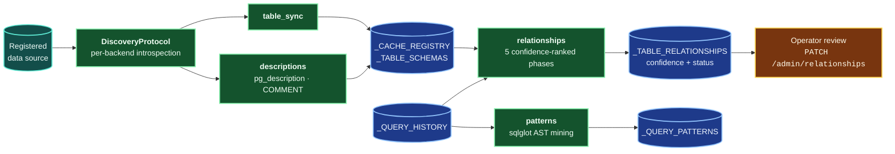

## 16. The chat data plane (`xf_chat`)

### 16.1 Purpose

`/api/v1/chat/*` is a contract-first REST surface over the `xf_chat` Postgres
schema. `xfalcon-web` previously connected to that schema directly over Postgres;
the data plane replaced that connection. The database-level
`FORCE ROW LEVEL SECURITY` is unchanged by the move — the enforcement point
relocated, the enforcement did not.

Every operation runs through a dedicated `xf_chat_app` executor pool under
per-request RLS GUCs derived solely from the validated principal. A handler
therefore cannot widen its own scope: the tenant and user it can observe are set
from the token, inside the transaction, before the query executes.

Two router-level dependencies apply to the whole family:

- `audit_chat_mutation` — uniform mutation audit (reads are a no-op);
- `translate_db_errors` — innermost, so it converts `asyncpg` errors to the
  uniform `ChatError` contract at the source and the audit layer only ever sees
  `ChatError`.

Every sub-router additionally carries `enforce_principal_rate_limit`
(`XF_CHAT_RATE_LIMIT_RPM`, default `600` per principal). No route is registered
directly on the parent `chat_router`, so no route can bypass it.

```mermaid
flowchart LR
    REQ(["Chat request<br/>Bearer JWT or xf_* key"]) --> AUTH["AuthMiddleware<br/>validated principal"]
    AUTH --> IDEM["IdempotencyMiddleware<br/>PgIdempotencyStore"]
    IDEM --> RTR["chat_router<br/>audit_chat_mutation<br/>translate_db_errors"]
    RTR --> SUB["Sub-router<br/>enforce_principal_rate_limit"]
    SUB --> EXEC["XfChatExecutor<br/>xf_chat_app pool"]
    EXEC --> GUC["BEGIN<br/>SET LOCAL app.tenant_id<br/>SET LOCAL app.user_id"]
    GUC --> RLS["RLS policies evaluate<br/>current_app_tenant_id()<br/>current_app_user_id()"]
    RLS --> ROWS[("Rows visible to<br/>this principal only")]

    classDef sec fill:#7F1D1D,stroke:#FCA5A5,stroke-width:2px,color:#FEF2F2
    classDef app fill:#14532D,stroke:#86EFAC,stroke-width:2px,color:#F0FDF4
    classDef db  fill:#1E3A8A,stroke:#93C5FD,stroke-width:2px,color:#EFF6FF
    classDef io  fill:#334155,stroke:#94A3B8,stroke-width:2px,color:#F8FAFC
    class AUTH,SUB,RLS sec
    class IDEM,RTR,EXEC app
    class GUC,ROWS db
    class REQ io
```

### 16.2 The schema

`data-analyst/infra/docker/xf_chat/` is the source of truth for the schema: DDL,
roles, grants, indexes, constraints, RLS enablement, policies, functions,
triggers, and RPCs, applied by `init_postgres.py` from ordered files `00` through
`12`. `xfalcon-web/src/lib/db` (Drizzle) mirrors it for query typing and is
synchronised **to** it, never from it.

The schema contains 36 tables in four functional groups:

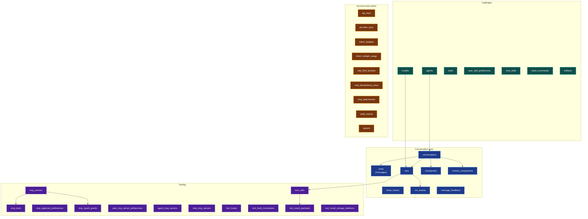

Constraints that govern client behaviour:

- `models` carries pricing (`input_price_per_m`, `output_price_per_m`), context
  window, capability flags (`supports_tools`, `supports_vision`,
  `supports_reasoning`, `supports_extended_thinking`), and a
  `reasoning_param_style` constrained to `none | anthropic_thinking |
openai_effort`. Unique on `(tenant_id, model_id)`.
- `agents` carries a system prompt, default model/provider, a `tool_allowlist`,
  presets, and a `visibility` of `tenant | private`.
- `mcp_servers` constrains `transport` to `http | sse | stdio`, `auth_type` to
  `none | api_key | bearer | oauth`, `permission_mode` to `allow | ask | deny`,
  and `status` to `connecting | connected | error | disconnected`.
- `conversations` carries `active_head_sequence_no` and
  `last_restored_checkpoint_id`, which together implement rewind and branching.

### 16.3 The endpoint families

| Family        | Prefix                                                                                                                                                                                                                            | Shape                                                                                              |
| ------------- | --------------------------------------------------------------------------------------------------------------------------------------------------------------------------------------------------------------------------------- | -------------------------------------------------------------------------------------------------- |
| Identity      | `/chat/identity`                                                                                                                                                                                                                  | `GET` — resolve principal → tenant/user/role/status                                                |
| Bootstrap     | `/chat/bootstrap/workspace`, `/chat/bootstrap/conversations/{id}`                                                                                                                                                                 | Single-round-trip workspace and conversation hydration                                             |
| Conversations | `/chat/conversations…`                                                                                                                                                                                                            | CRUD, `:rewind`, `:truncate`, messages (with FTS `messages:search`), `history`                     |
| Context       | `/chat/conversations/{id}/context`, `…/context-compactions…`, `…/tool-result-payloads…`                                                                                                                                           | Inference context assembly, compaction lifecycle, exact tool-result payload store                  |
| Runs          | `/chat/runs…`, `…/checkpoints…`                                                                                                                                                                                                   | Create, status, progress, `events:batch`, `:finalize`, event read-back, checkpoint capture/restore |
| MCP           | `/chat/tool-calls`, `/chat/mcp-servers`, `…/tools`, preferences, `/chat/mcp-oauth-grants`                                                                                                                                         | Everything about tool servers, tools, approvals, and OAuth grants                                  |
| Catalog       | `/chat/models`, `/agents`, `/skills`, `/skill-preferences`, `/chat-skills`, `/slash-commands`, `/artifacts`                                                                                                                       | Full CRUD                                                                                          |
| Reports       | `/chat/reports…`                                                                                                                                                                                                                  | CRUD, `refresh-lock:acquire`/`:release`, `refresh-conversation`, `content`, `reports:capture`      |
| Account       | `/chat/provider-keys`, `/api-keys`, `/token-budgets`, `/token-budget-usage`, `/message-feedback`, `/chat-attachments`, `/audit-events`, `/tool-hooks`, `/tool-hook-invocations`, `/rate-limits:consume`, `/analytics/token-usage` | Everything per-account                                                                             |

Non-CRUD actions use a `:verb` suffix — `:rewind`, `:finalize`, `:capture`,
`:acquire-refresh-lease` — applied consistently across the family.

`POST /chat/provider-keys/{id}:resolve` returns a cleartext provider credential
and carries a separate, stricter limit: `XF_CHAT_SECRET_RESOLVE_RPM`, default
`60`, where `0` disables the endpoint entirely.

### 16.4 Exact tool-result payloads

A tool may return more data than belongs in a model's context or in a Postgres
row. The data plane stores such results out of line:

- results below `XF_CHAT_TOOL_PAYLOAD_INLINE_BYTES` (64 KiB) stay inline;
- larger ones are uploaded through `…:prepare` → `PUT …/content` → `…:finalize`,
  capped at `XF_CHAT_TOOL_PAYLOAD_MAX_BYTES` (8 MiB), with a per-owner quota of
  `XF_CHAT_TOOL_PAYLOAD_QUOTA_MB` (512 MiB);
- pending reservations expire after
  `XF_CHAT_TOOL_PAYLOAD_PENDING_TTL_SECONDS` (15 min);
- reads are via signed URLs valid at most
  `XF_CHAT_TOOL_PAYLOAD_SIGNED_READ_TTL_SECONDS` (5 min, hard-capped);
- a reaper reconciles pending expiry and deletion retries every
  `…_REAPER_INTERVAL_SECONDS` (60 s) and performs full row/object reconciliation
  every `…_RECONCILE_INTERVAL_SECONDS` (1 h).

### 16.5 Idempotency

`IdempotencyMiddleware` is backed by `PgIdempotencyStore` over
`xf_chat.chat_idempotency_keys`, accessed through the async chat executor rather
than an in-process cache. A retry arriving at a different worker or replica
therefore replays the stored response instead of re-executing the mutation. The
store resolves the executor lazily per request and fails open when the executor is
absent, so an idempotency outage degrades to at-least-once delivery rather than to
a service outage.

### 16.6 The model catalogue is seeded by DA, per tenant

`mcp_server/services/chat_model_catalog.py` holds `CHAT_MODEL_CATALOG`, the
authoritative seed for `xf_chat.models`. Every tenant gets the same three rows,
all routed through **OpenRouter** (`provider = provider_parent = "openrouter"`):

| `model_id`                        | Display | Context   | Max output | In / out $ per 1M | Reasoning style                          |
| --------------------------------- | ------- | --------- | ---------- | ----------------- | ---------------------------------------- |
| `~x-ai/grok-latest`               | Grok    | 500 000   | 450 000    | 2.00 / 6.00       | `openai_effort`                          |
| `~anthropic/claude-sonnet-latest` | Sonnet  | 1 000 000 | 128 000    | 2.00 / 10.00      | `anthropic_thinking` (extended thinking) |
| `openai/gpt-5.6-luna`             | Luna    | 1 050 000 | 128 000    | 0.20 / 1.20       | `openai_effort`                          |

The leading `~` denotes an OpenRouter "latest alias" identifier; the desktop
OpenRouter adapter strips the prefix when it builds the upstream request. The seeding statement is a single
`INSERT … SELECT FROM unnest($1::text[])` across every supplied tenant. The
catalogue arrives as parallel bound arrays rather than interpolated `VALUES`, so
no part of the statement is built by string concatenation, and the `metadata`
JSONB is assembled by the database from the same bound scalars, preventing the
mirrored capacity figures from diverging from the columns.

The prices in this table are the multipliers `computeRunCost` in `xfalcon-web`
applies to token counts, and the basis on which token budgets are charged.

## 17. The admin, user, and internal REST APIs

### 17.1 Control plane — `/api/v1/admin/*`

| Group            | Endpoints                                                                                                                                                                        |
| ---------------- | -------------------------------------------------------------------------------------------------------------------------------------------------------------------------------- |
| Tenants          | `GET/POST /tenants`, `GET/PATCH /tenants/{id}`, `POST /tenants/{id}/{enable\|disable}`, `GET /tenants/{id}/connector-config`, `GET/POST /tenants/{id}/duckdb[/enable\|/disable]` |
| Users            | `GET/POST /users`, `GET/PATCH/DELETE /users/{id}`, `POST /users/provision`, `GET/PATCH /users/{id}/preferences`                                                                  |
| Policies         | `GET /policies`, `POST /policies/{assign-role\|remove-role\|add\|remove\|test}`                                                                                                  |
| Keys             | `POST/GET /keys`, `GET/PATCH/DELETE /keys/{id}`, `POST /keys/{id}/revoke`, `POST /chat-api-keys:verify`                                                                          |
| Data sources     | `POST/GET /datasources`, `GET /datasources/backends`, `GET/PATCH/DELETE /datasources/{id}`, `POST /datasources/{id}/test`, `POST /datasources/{id}/reactivate`, `POST /validate` |
| Registry         | `GET /registry`, `GET/PATCH/DELETE /registry/{name}`, `PATCH /registry/{name}/columns/{column}`, `POST /registry/prune`                                                          |
| Pipelines        | `POST /sync/{tables\|descriptions\|relationships\|patterns\|all}`, `GET /sync/{job_id}`, `GET /sync/history[/{log_id}]`, `GET/PATCH /relationships`                              |
| Semantic content | `/memories` (incl. `restore`, `activate`, `promote`), `/annotations`, `/query-patterns`                                                                                          |
| Observability    | `GET /audit/events`, `GET /audit/event-types`, `GET /usage`, `GET /usage/summary`                                                                                                |
| System           | `GET /config`, `GET /migrations`, `GET /identity`, `POST /system/rotate-encryption`                                                                                              |

`POST /memories/{id}/promote` converts a user-scoped memory written by the agent
into a tenant-wide memory approved by an operator. It is the defined path from an
agent-derived observation to tenant-level knowledge.

### 17.2 User plane — `/api/v1/user/*`

- `POST/GET /uploads`, `GET /uploads/{dataset_id}`,
  `GET /uploads/{dataset_id}/files/{file_id}/download`,
  `DELETE /uploads/{dataset_id}`;
- presigned flow: `POST /uploads/presign`, `POST /uploads/finalize`,
  `POST /uploads/{upload_id}/abort`, `POST /uploads/{upload_id}/resign`;
- `POST /chat-attachments/{presign|finalize|upload}`,
  `GET /chat-attachments/{sign-get|content}`, `DELETE /chat-attachments/object`;
- `/report-kits`, the report-kit library (JWT only; an API key is refused):
  `GET` (list), `GET`, `PATCH`, and `DELETE /{kit_id}`, `GET /{kit_id}/pages`,
  `GET /{kit_id}/file`, `POST /{kit_id}/refresh`, `POST /capture`,
  `POST /{kit_id}/capture`, `GET /captures/{artifact_id}`, and upload tickets
  (`POST /uploads`, `PUT /uploads/{upload_id}`, `POST /uploads/{upload_id}/save`).
  Desktop calls only the list, get, pages, file, refresh, thumbnail (`PUT`), `PATCH`,
  and `DELETE` routes (`clients/da/kits_api.rs`);
- `GET /objects` — signed-object retrieval. This is the only path in
  `PUBLIC_PATHS` that serves tenant data without a bearer token; the query-string
  signature is the credential.

These endpoints run under user-level Casbin permissions (`uploads:*`,
`datasets:*`), not `admin:*`.

### 17.3 Internal plane — `/api/v1/internal/*`

One endpoint: `POST /reports/refresh`. It is stateless and sits off the
session-stateful MCP path, so a scheduled refresh requires no MCP session.

## 18. Background workers, health, and telemetry

### 18.1 Background workers

| Worker                | Schedule                                                                                                                    | Function                                                                                                                                                                      |
| --------------------- | --------------------------------------------------------------------------------------------------------------------------- | ----------------------------------------------------------------------------------------------------------------------------------------------------------------------------- |
| `background/jobs.py`  | On demand                                                                                                                   | In-memory async job manager (submit, status, cleanup) with a 24-hour TTL on completed jobs. Backs the sync-pipeline endpoints.                                                |
| Orphan reaper         | Daily at a configured UTC hour, under a PostgreSQL session-level advisory lock so exactly one worker in the cluster runs it | Prunes abandoned `uploading` datasets past `UPLOAD_ORPHAN_TTL_SECONDS` (default 1 h) and sweeps orphaned chat attachments in two classes                                      |
| Tool-result reaper    | `XF_CHAT_TOOL_PAYLOAD_REAPER_INTERVAL_SECONDS` (60 s); reconciliation every `…_RECONCILE_INTERVAL_SECONDS` (1 h)            | Expires pending payload reservations, claims deletion work under a lease (`CLAIM_LEASE_SECONDS = 300`, `MAX_ATTEMPTS = 10`), and reconciles ready rows against stored objects |
| Usage drain           | Every `USAGE_DRAIN_INTERVAL_SECONDS` (0.25 s)                                                                               | Drains a bounded in-memory queue (`USAGE_QUEUE_MAX = 1024`) in batches of `USAGE_DRAIN_BATCH_SIZE = 64` into `_MCP_USAGE_EVENTS`; enabled by `USAGE_EVENTS_ENABLED`           |
| Usage retention prune | Daily at `USAGE_RETENTION_PRUNE_HOUR_UTC` (04:00)                                                                           | Removes usage events older than `USAGE_RETENTION_DAYS` (90)                                                                                                                   |

The orphan reaper's two attachment classes:

| Class             | Predicate                                                                    | Rationale                                                                                                                                  |
| ----------------- | ---------------------------------------------------------------------------- | ------------------------------------------------------------------------------------------------------------------------------------------ |
| Never finalised   | `status <> 'ready'` and older than the stale TTL                             | A presigned `PUT` cannot carry a content-length range, and the 10 MiB cap is enforced only at `/finalize`, which a client can skip         |
| Ready but unbound | `status = 'ready' AND message_id IS NULL`, older than a 24-hour grace window | `xfalcon-web` does not persist pending attachments across a page reload, so an attached-but-unsent file would otherwise orphan permanently |

A second usage surface reads CloudWatch Logs Insights over the MCP request log to
populate the admin Usage screen.

### 18.2 Health endpoints

`/health/live` (also answering `HEAD`), `/health/startup`, `/health/ready`,
`/health/sources` (admin-authenticated), `/health/uploads`, `/health/status`.

### 18.3 Telemetry

OpenTelemetry is initialised in the lifespan. The ASGI instrumentation sits at the
outermost layer, so every log-emitting layer beneath it — rate limiting, tenant
resolution, request logging, authentication rejections — executes inside an active
span and carries a `trace_id`. FastAPI's route-level instrumentor is not used; it
would begin the span too deep in the stack.

A `server_request_hook` removes credentials from span attributes. Spans are
exported to a third-party backend, so a token surviving into a span outlives every
other control applied to it, and the structlog redactor does not reach span
attributes. The hook overwrites every candidate attribute — `http.url`,
`url.full`, `http.target`, `url.query` — rather than the single attribute the
current instrumentation version happens to set. An earlier implementation masked
only two of the four and therefore masked nothing, while `http.url` transmitted
live signed-URL tokens to the tracing backend.

---

# Part III — Identity, tenancy, and authorization

This part describes the security model: how a caller is identified, bound to a
tenant, authorised, and constrained at the database layer.

Tenant isolation is enforced at six independent layers. A request that returns a
row has satisfied all six.

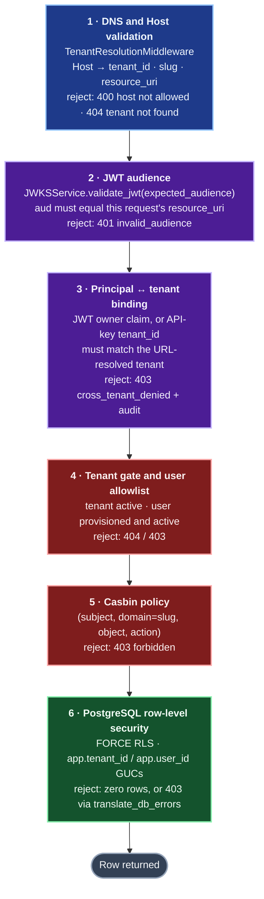

The sections below follow that order.

## 19. Casdoor, the identity provider

xFalcon self-hosts Casdoor — upstream `casbin/casdoor`, pinned at 2.404.0 in the
production image — as its OIDC provider. It runs as its own ECS service, stores
state in the same RDS instance under the `casdoor` schema, and is served at
`auth.<base-host>`.

### 19.1 The per-tenant model

Each tenant has one Casdoor Organization and one Application, both named for the
tenant slug and rendered from `config/casdoor/tenant_template.json` by
`mcp_server/services/tenant_template.py`. The template substitutes `{{slug}}`,
`{{MCP_BASE_HOST}}`, `{{MCP_PUBLIC_SCHEME}}`, and a port suffix.

Two callers share the renderer — `CasdoorClient` at runtime when
`POST /api/v1/admin/tenants` provisions a tenant, and
`scripts/casdoor/seed_casdoor.py` for the development fixture — so redirect-URI
rendering cannot diverge between them.

One redirect URI is non-overridable, and the renderer raises if it is absent
after substitution: `https://claude.ai/api/mcp/auth_callback`. This is the hosted
Claude web-connector callback; its absence would silently prevent every tenant
from adding xFalcon as a Claude connector.

### 19.2 Server-to-server authentication

Calls from DA to Casdoor use HTTP Basic authentication with the application's
client id and secret, rather than `client_credentials` bearer tokens, which lack
permission for admin user CRUD operations.

Credentials never travel as query parameters. `httpx` error messages embed the
full request URL, so a query-string secret would leak into tracebacks and into
every log line carrying them, and the keyword-based log redactor cannot scrub
inside traceback text.

### 19.3 Claims

Configurable, with the following defaults:

| Setting                | Default              | Meaning                                                    |
| ---------------------- | -------------------- | ---------------------------------------------------------- |
| `OIDC_USER_ID_CLAIM`   | `preferred_username` | The user identity used everywhere downstream               |
| `OIDC_TENANT_ID_CLAIM` | `owner`              | Casdoor's organization name — **equal to the tenant slug** |
| `OIDC_ROLE_CLAIM`      | _(empty)_            | Optional; for IdPs that embed roles in the token           |

The identity `owner == slug` is an invariant on which the authorization path
depends. Casdoor does not emit a
role in its OAuth access token; roles are mirrored into Casbin `g`-rules, and
Casbin is the runtime source of truth for authorization.

Scopes declared on the per-tenant Casdoor application must match the
`scopes_supported` list DA advertises in its protected-resource metadata:
`openid`, `profile`, `email`, `mcp:tools:read`, `mcp:tools:write`,
`mcp:admin:read`, `mcp:admin:write`, `mcp:admin`. Divergence breaks the consent
screen.

## 20. Tenant resolution

`mcp_server/middleware/tenant_resolution.py` converts a `Host` header into a bound
tenant through a two-stage algorithm.

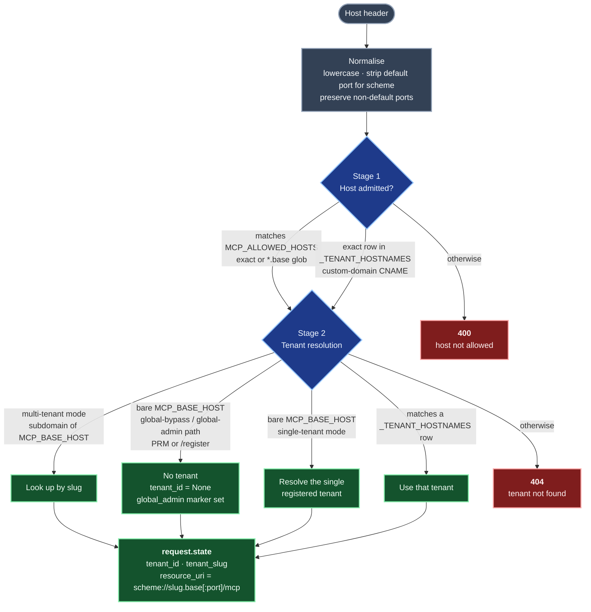

The `resource_uri` written to `request.state` is the per-tenant RFC 8707 resource
identifier and is the value the JWT `aud` claim must equal.

**Caching.** TTL-based, keyed by normalised host: 60 seconds positive, 30 seconds
negative. A negative entry stores the rejection status and reason rather than a
sentinel. An earlier implementation stored only a marker and therefore collapsed a
Stage-1 `400` and a Stage-2 `404` into the same response on the second request.
Mutating tenant operations call `resolver.invalidate(...)` and broadcast a
cache-invalidation message so other workers drop the entry.

**Scope of enforcement.** This middleware does not evaluate whether a tenant is
active; that is `TenantGate`'s responsibility, with a separate cache and a
separate invalidation path. The separation allows routing to respond coherently
for a disabled tenant: a `404` from the gate is more actionable than the absence
of a route.

## 21. The four credential families

`AuthMiddleware` accepts four distinct credential families, evaluated in a fixed
order.

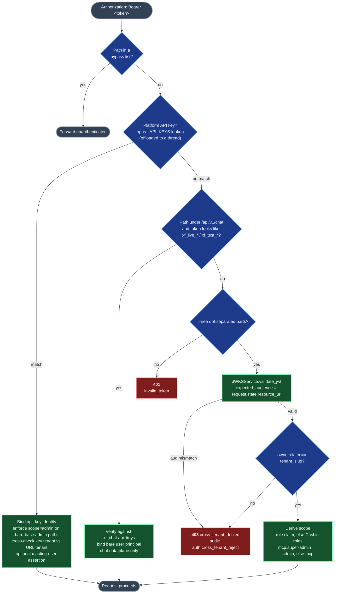

### 21.1 Platform API keys

Rows in `opas._API_KEYS`, stored hashed, resolved through `ApiKeyService` with a
cache. A key carries a `scope` (`admin` or a tenant scope), a bound
`tenant_id`, a `created_by`, and a `can_assert_actor` capability.

Three rules govern platform API keys:

| Rule                                            | Behaviour                                                                                                                                                                                                                                                                                                                                                      |
| ----------------------------------------------- | -------------------------------------------------------------------------------------------------------------------------------------------------------------------------------------------------------------------------------------------------------------------------------------------------------------------------------------------------------------- |
| Bare-base admin paths require `scope="admin"`   | When the request resolves to the bare `MCP_BASE_HOST` and the path is an admin path, a key without `scope="admin"` receives `403 global_admin_requires_admin_scope`. An invalid bearer receives `401`; a valid JWT on that surface still receives `403`, because a JWT can never constitute a super-admin credential.                                          |
| Tenant binding is cross-checked against the URL | A key bound to tenant A used against tenant B's URL is rejected with `cross_tenant_api_key` and an `auth.cross_tenant_reject` audit event. Keys with `scope="admin"` are exempt, being cross-tenant by design.                                                                                                                                                 |
| Actor assertion is confined to logging          | A key carrying `can_assert_actor` may send `x-acting-user: <username>`. The validated value is bound to `auth_acting_user` and used solely for usage-log attribution. It is not used as `auth_user_id`, because that field is also the upload-ownership identity and a chat idempotency key; a client-supplied header must never become an ownership identity. |

The key-resolution database lookup is offloaded with `anyio.to_thread.run_sync`
so a slow psycopg2 call cannot stall the event loop — significant because
production runs one process per container.

### 21.2 `xf_chat` API keys

Tokens of the form `xf_live_*` and `xf_test_*`, stored in `xf_chat.api_keys` —
a separate table and a separate credential family. External clients present them
to `xfalcon-web`'s OpenAI-compatible completions endpoint, which forwards them to
DA so an API-key-authenticated run can use the chat data plane.

These keys are confined to the chat data plane. They carry no platform scope and
map to a bare user principal; admitting them on `/mcp` or the admin plane would
grant a chat credential access to surfaces it was not issued for.

They are evaluated before the JWT branch. An `xf_*` token is not a JWT, so
falling through would consume a JWKS validation round trip only to produce a
malformed-token error that obscures the actual cause of the `401`.

### 21.3 OIDC JWTs

Validated by `JWKSService` against the issuer's JWKS with a TTL cache
(`JWKS_CACHE_TTL`, default 3600 s). Three properties govern the implementation:

| Property                                                | Implementation                                                                                                                                                                                                                                                                                |
| ------------------------------------------------------- | --------------------------------------------------------------------------------------------------------------------------------------------------------------------------------------------------------------------------------------------------------------------------------------------- |
| The expected audience is per-request, never a singleton | `JWKSService` holds no `resource_uri` attribute; `validate_jwt` accepts `expected_audience` as an argument and `AuthMiddleware` passes `request.state.resource_uri`. A regression test asserts the absence of the singleton attribute.                                                        |
| Key rotation heals on first miss                        | A forced JWKS refetch is triggered by an unknown `kid`, subject to a 60-second cooldown (`_FORCED_REFETCH_COOLDOWN_SEC`) so a flood of tokens bearing invalid `kid` values cannot turn the IdP into a denial-of-service amplifier.                                                            |
| `InvalidAudienceError` carries verified claims          | Signature, issuer, and expiry have already passed; the audience is the only failing predicate. The error carries the re-decoded claims so the cross-tenant-reject audit row records genuine `jwt_owner`, `jwt_aud`, and `actor_user_id` values rather than empty or attacker-controlled ones. |

After signature validation the middleware cross-checks the `owner` claim against
`request.state.tenant_slug`. A mismatch yields `tenant_mismatch` and emits
`auth.cross_tenant_reject`.

**Scope derivation** (`_jwt_auth_scope`) reads the configured role claim when set
and otherwise queries Casbin's `get_roles_for_user_in_domain`. The result maps to
`admin` for `mcp:super-admin` and to `mcp` for everything else. When multiple
roles are returned, the highest privilege wins. Selecting `roles[0]` would be
load-order dependent, and the same multi-role user could resolve differently on
different workers.

### 21.4 Signed object URLs

`GET /api/v1/user/objects` appears in `PUBLIC_PATHS` and requires no bearer
token; the query-string signature is the credential. It is the only entry in that
list serving tenant data, and it is the reason the OpenTelemetry span scrubber
(§18.3) exists.

### 21.5 Public paths

The bypass lists in `mcp_server/middleware/bypass.py` are narrow by design:

- `GLOBAL_BYPASS_PATHS` / prefixes — health probes, the apex landing page, docs,
  static assets.
- `PUBLIC_NOT_FOUND_PATHS` — authorization-server metadata and OIDC discovery,
  so an unauthenticated probe gets a clean `404` instead of a `401`/`429`/`500`.
- `PUBLIC_PATHS` — `/dashboard/config.json`, protected-resource metadata,
  `/register`, and the signed-object path.
- The only `/.well-known/` prefix bypass is the protected-resource subpath. An
  arbitrary path such as `/.well-known/random` falls through to the authentication
  check and returns `401`.

## 22. Casbin RBAC

**Model** (`config/casbin/rbac_with_domains.conf`):

```
r = sub, dom, obj, act          # subject, domain(tenant), object, action
p = sub, dom, obj, act
g = _, _, _                     # role assignment, per-domain
e = some(where (p.eft == allow))
m = (g(r.sub, p.sub, r.dom) || g(r.sub, p.sub, "*"))
    && (r.dom == p.dom || p.dom == "*")
    && keyMatch(r.obj, p.obj)
    && (r.act == p.act || p.act == "*")
```

The domain is the tenant slug, so a role grant is tenant-scoped unless made in
the wildcard domain `*`.

**Roles** (from `config/casbin/casbin_seed.json`):

| Role               | Grants                                                                                                                                                                                                                       |
| ------------------ | ---------------------------------------------------------------------------------------------------------------------------------------------------------------------------------------------------------------------------- |
| `mcp:super-admin`  | `*` on `*` in domain `*` — cross-tenant, platform management                                                                                                                                                                 |
| `mcp:tenant-admin` | every `admin:*` resource (users, policies, usage, audit, registry, sync, config, validate, migrations, keys, memories, annotations, datasources) plus `mcp:tool:*` and upload/dataset permissions, all within its own domain |
| `mcp:developer`    | `mcp:tool:*` read+write, `uploads:create`, `uploads:read`, `datasets:read`                                                                                                                                                   |
| `mcp:read-only`    | `mcp:tool:*` read, `uploads:read`, `datasets:read`                                                                                                                                                                           |

Role hierarchy:

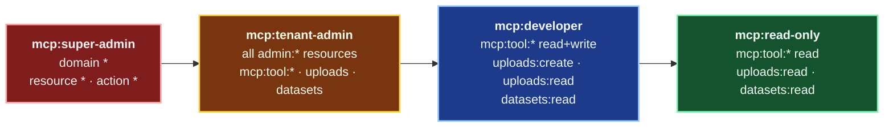

The seed file contains no user-to-role bindings. Bindings are created at runtime
only: `POST /api/v1/admin/users/provision` creates them for end users, and the
bootstrap routine creates the dynamic `apikey:<prefix>` subject for the
auto-generated admin key.

### Enforcement points

Two enforcement points exist, operating at different granularities:

| Point                                  | Location                                         | Granularity                                              |
| -------------------------------------- | ------------------------------------------------ | -------------------------------------------------------- |
| `require_permission(resource, action)` | FastAPI dependency on REST routes                | One HTTP request                                         |
| `CasbinToolMiddleware`                 | FastMCP middleware on the `/mcp` sub-application | One tool call, authorised against `mcp:tool:<tool_name>` |

`require_permission` evaluates four gates in order. Each can reach psycopg2 on a
cache miss, so all are offloaded with `anyio.to_thread.run_sync`:

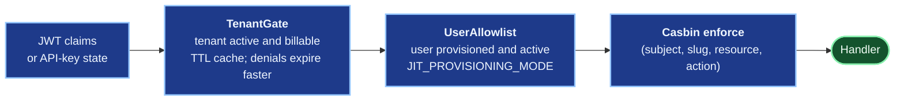

`TenantGate` applies a much shorter TTL to denials than to passes, so a freshly
provisioned or re-enabled tenant becomes servable within seconds.

`UserAllowlist` supports three just-in-time provisioning modes, selected by
`JIT_PROVISIONING_MODE`:

| Mode            | Behaviour for an unknown user                                               |
| --------------- | --------------------------------------------------------------------------- |
| `off` (default) | Rejected; only pre-provisioned users are admitted                           |
| `auto`          | Provisioned automatically with the default role                             |
| `approval`      | Provisioned but marked inactive; an administrator must activate the account |

## 23. Row-level security and the `opas` role

### 23.1 Roles

Provisioning (`infra/docker/init_postgres.py`) creates two role hierarchies.

**`opas` hierarchy:**

| Role            | Purpose                     | Constraints verified at provision time                                             |
| --------------- | --------------------------- | ---------------------------------------------------------------------------------- |
| `opas_owner`    | Owns the metadata relations | Must be `NOLOGIN`; an owner is never a login target                                |
| `opas_migrator` | Runs DDL and migrations     | Must `INHERIT` membership in `opas_owner`; granted `rds_iam` where RDS provides it |
| `opas_app`      | Runtime application role    | Must own zero relations, making it RLS-ready by construction                       |
| `casdoor_app`   | Casdoor's runtime role      | Must exist                                                                         |

**`xf_chat` hierarchy:**

| Role              | Purpose                                         |
| ----------------- | ----------------------------------------------- |
| `xf_chat_owner`   | `NOLOGIN` owner of the 36 tables                |
| `xf_chat_app`     | `LOGIN` runtime role the data plane connects as |
| `xf_chat_service` | `NOLOGIN` elevated service path                 |

All three are `NOSUPERUSER NOBYPASSRLS NOCREATEDB NOCREATEROLE`. No password
appears in the SQL: the applier sets `xf_chat_app`'s password from an environment
secret through a parameterised `ALTER ROLE` after role creation, or the role uses
RDS IAM tokens and carries no password.

### 23.2 How RLS decides

Two `STABLE` SQL functions are the entire bridge between HTTP identity and
database rows:

```sql
CREATE OR REPLACE FUNCTION xf_chat.current_app_tenant_id() RETURNS text
  AS $$ select nullif(current_setting('app.tenant_id', true), '') $$;

CREATE OR REPLACE FUNCTION xf_chat.current_app_user_id() RETURNS text
  AS $$ select nullif(current_setting('app.user_id', true), '') $$;
```

The data plane sets these GUCs per request, inside the transaction, from the
validated principal — never from a request body or header.

`nullif(..., '')` is the deny-by-default guard. `current_setting(name, true)`
returns the empty string when the GUC was never set; `nullif` maps that to `NULL`,
which fails every `tenant_id = current_app_tenant_id()` predicate closed.

Policies are declared `TO xf_chat_app`. The service path additionally admits
`xf_chat_service` and is gated on `current_setting('app.role', true) = 'service'`,
so the application elevates only when it explicitly sets that GUC.

Role checks inside policies read from `opas._tenant_users`, the database of record
for a member's role, rather than from any `xf_chat` table:

```sql
EXISTS (SELECT 1 FROM opas._tenant_users tu
        WHERE tu.user_id  = current_app_user_id()
          AND tu.tenant_id = current_app_tenant_id()
          AND tu.active
          AND tu.role = ANY (ARRAY['mcp:tenant-admin','mcp:super-admin']))
```

### 23.3 Why `FORCE`

`FORCE ROW LEVEL SECURITY` causes policies to apply to the table owner as well as
to other roles. `xf_chat_owner` owns these tables; without `FORCE`, any
maintenance path or `SECURITY DEFINER` routine running as the owner would bypass
every policy. The application path is already safe, connecting as the non-owner,
non-`BYPASSRLS` `xf_chat_app`, so `FORCE` exists specifically to close the
owner-bypass case.

No global `ddl_command_end` event trigger auto-enables RLS. RLS is enabled
explicitly, table by table, which is deterministic and reviewable.

### 23.4 Provisioning is fail-closed

`verify_xf_chat_security` runs inside the provisioning transaction, before
`COMMIT`. Any violation raises and rolls the entire bundle back, so an insecure
`xf_chat` is never left provisioned. Its assertions:

| #   | Assertion                                                                                                                                        | Failure it prevents                                                                                      |
| --- | ------------------------------------------------------------------------------------------------------------------------------------------------ | -------------------------------------------------------------------------------------------------------- |
| 1   | The three roles exist and are neither `SUPERUSER` nor `BYPASSRLS`                                                                                | Silent bypass of every policy                                                                            |
| 2   | Every base table both `ENABLE`s and `FORCE`s RLS                                                                                                 | Owner-path bypass                                                                                        |
| 3   | Every base table carries at least one policy                                                                                                     | `FORCE` with zero policies is a silent deny-all lockout                                                  |
| 4   | `xf_chat_owner` inherits membership in `xf_chat_app` and `xf_chat_service`                                                                       | `SECURITY DEFINER` RPCs running as owner under `FORCE` would be policy-denied rather than policy-covered |
| 5   | Ownership `UPDATE` policies lock `creator_user_id` in `WITH CHECK`, and bootstrap definer RPCs carry the parameter-equals-GUC cross-tenant guard | Regression to a prior, weaker bundle                                                                     |
| 6   | `xf_chat_app` can log in                                                                                                                         | Unusable runtime role                                                                                    |
| 7   | No active policy grants cross-user reads through `visibility = 'tenant'`                                                                         | Cross-user disclosure within a tenant                                                                    |
| 8   | Owner-scope predicates present on the leak-read policies                                                                                         | Same                                                                                                     |

`verify_opas_security` performs the equivalent check for the `opas` hierarchy.

The security posture is therefore asserted in code, at provision time, in every
environment — not only in CI.

## 24. Audit

Two audit surfaces exist:

| Table                  | Contents                          | Write path                                                                            | Read policy                                                                                                            |
| ---------------------- | --------------------------------- | ------------------------------------------------------------------------------------- | ---------------------------------------------------------------------------------------------------------------------- |
| `opas._AUTH_AUDIT_LOG` | Security-relevant platform events | `AuditLogRepository` via `emit_audit_event`                                           | Admin API                                                                                                              |
| `xf_chat.audit_events` | Chat-plane events                 | Router-level `audit_chat_mutation` dependency, plus handlers adding id-bearing detail | The only admin-gated read policy in `xf_chat` (SOC 2 CC7.2); every other `SELECT` policy in the schema is owner-scoped |

Audit emission is best-effort and fails open. An audit write must never break a
request, and in particular must never prevent a rejection from being returned.

`mcp_server/models/audit_event_types.py` is the canonical registry of event types,
exposed at `GET /api/v1/admin/audit/event-types` so UI filters cannot diverge from
it. Categories include `auth` (`login`, `login_failed`, `tenant_blocked`,
`user_blocked`, `tool_allowed`, `tool_denied`, `policy_changed`,
`user_provisioned`, `tenant_status_changed`, `dcr_attempted`, `api_key_*`,
`auth.cross_tenant_reject`), `annotation`, `connector`, `datasource`, `memory`,
and `tenant`.

`auth.cross_tenant_reject` is emitted on both `tenant_mismatch` and
`invalid_audience`, so cross-tenant replay attempts form a single queryable event
class. In the production cell a CloudWatch metric filter counts occurrences and an
alarm fires on the count (Part VIII §47).

---

# Part IV — `xfalcon-web`

## 25. Shape and responsibilities

`xfalcon-web` is a Next.js 16 App Router application on React 19, deployed either
to Vercel or as a container in the ECS cell. It performs two distinct roles:

| Role                       | Description                                                                                                                                                                                                        |
| -------------------------- | ------------------------------------------------------------------------------------------------------------------------------------------------------------------------------------------------------------------ |
| Backend for frontend (BFF) | The browser holds no DA credential. Every browser call reaches a Next.js route handler, which holds the Auth.js session and calls DA with the user's own bearer token.                                             |
| Server-side agent runtime  | `src/lib/server/run-engine.ts` — approximately 6,600 lines, the largest single file in the platform — drives the model, invokes MCP tools, enforces guardrails, streams tokens, and mirrors durable state into DA. |

One exception applies to the BFF rule: the datasets surface calls
`<slug>.<MCP_BASE_HOST>` directly from the browser, because uploads target
presigned S3 URLs and routing multi-gigabyte bodies through a serverless function
would be both slow and costly.

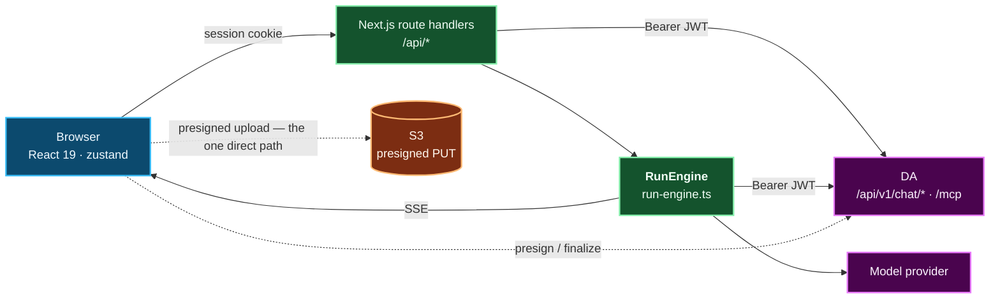

### Deployment shapes

`APP_SINGLE_HOST` selects between two topologies:

| Value             | Topology                                                    | Slug carried by                                                                      | Requires                                                                      |
| ----------------- | ----------------------------------------------------------- | ------------------------------------------------------------------------------------ | ----------------------------------------------------------------------------- |
| `false` (default) | Wildcard subdomain: each tenant at `<slug>.<APP_BASE_HOST>` | The `Host` header                                                                    | DNS wildcard and per-tenant Casdoor callback URLs                             |
| `true`            | Single host: one host serves every tenant                   | An HMAC-signed short-lived cookie during the auth handshake, then `session.tenantId` | Nothing additional; every tenant's Casdoor application registers one callback |

Production (`chat.xfalcon.ai`) uses whichever topology the cell is configured for.
Local development uses `app.lvh.me`, which wildcard-resolves to `127.0.0.1`, so
`http://acme.app.lvh.me:3000` reaches `http://acme.mcp.lvh.me:8000` without
`/etc/hosts` modification.

### Key libraries

`next-auth@5.0.0-beta` (Auth.js v5), `jose` (JWKS + JWT verification),
`drizzle-orm` (typing only — see below), `zustand` (client state), `ioredis`
(ElastiCache Valkey), `echarts` + `vega`/`vega-lite` (charts), `mermaid`
(diagrams), `react-markdown` + `rehype-highlight` + `dompurify` (rendering),
`papaparse` + `read-excel-file` (client-side dataset preview), `undici` (server
fetch), `adm-zip`/`fflate` (skill import).

Drizzle provides typing, not access. `src/lib/db` mirrors the `xf_chat` schema
for query typing; data access goes through `/api/v1/chat/*`. The `check:dataplane`
npm script (`scripts/check-dataplane-parity.mjs`) enforces this separation.

## 26. Authentication and tenant binding

`src/lib/auth/auth-config.ts` builds a per-request `NextAuthConfig`,
parameterised by the tenant slug (from `Host` or the signed cookie), the tenant's
Casdoor credentials, and the per-tenant MCP resource URI.

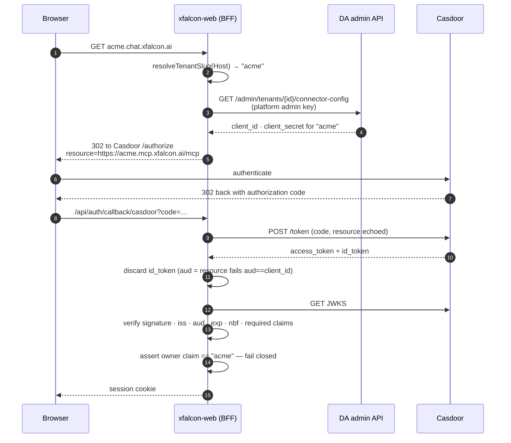

Security properties maintained by this configuration:

| Property                                                          | Detail                                                                                                                                                     |
| ----------------------------------------------------------------- | ---------------------------------------------------------------------------------------------------------------------------------------------------------- |
| Access token is JWKS-verified                                     | Signature, `iss`, `aud`, `exp`, `nbf`, and required claims                                                                                                 |
| `id_token` is discarded                                           | Casdoor mints `id_token.aud = <resource>` per RFC 8707, which fails `oauth4webapi`'s strict `aud == client_id` check; retaining it would break every login |
| RFC 8707 `resource` echoed on `/authorize`, `/token`, and refresh | Binds the issued token's audience to this tenant's MCP URI                                                                                                 |
| Refresh re-verifies                                               | The freshly issued access token is validated against the same audience                                                                                     |
| `AUTH_DEBUG` redacts                                              | All bearer-equivalent material is removed from logs                                                                                                        |
| `owner` claim asserted against the request slug                   | DA enforces this and emits `auth.cross_tenant_reject`; the BFF check is defence in depth that fails closed before the token is sent downstream             |

A missing `AUTH_CASDOOR_ISSUER` in production is a hard boot failure. Falling back
silently to `localhost:8001` would produce a provider that can never complete a
flow, with no visible diagnostic.

### Per-tenant Casdoor credentials

`src/lib/auth/tenant-creds.ts` resolves each tenant's `client_id` and
`client_secret` at runtime from DA's
`GET /api/v1/admin/tenants/{id}/connector-config`, keyed by slug, using the
canonical admin pair `IDA_MCP_URL` and `IDA_MCP_ADMIN_API_KEY`. This is what
allows a newly provisioned tenant to function without redeploying the web tier.
Static per-tenant `AUTH_CASDOOR_ID__<SLUG>` environment blocks exist only as an
offline fallback. Configuring one half of the canonical pair without the other
fails loudly rather than degrading silently.

### The edge middleware

`middleware.ts` performs host gating only; it does not check sessions. Auth.js
v5's factory form is incompatible with the `auth(req => …)` wrapper, and pages
guard themselves through `getPageAuthState`. Restricting the middleware to a host
decision means a stale wildcard DNS entry or a foreign `Host` header is rejected
with `400` before any page renders.

The middleware also builds the Content-Security-Policy: strict with a per-request
nonce in production, relaxed in development so HMR and `eval` function.

The CSP report endpoint URL is composed rather than derived from `req.nextUrl`. On
ECS, `req.nextUrl`'s host is the listen address (`0.0.0.0:3000`) and its scheme can
be `http:` behind the TLS-terminating ALB; either would silently disable the only
channel that reports a CSP outage. `x-forwarded-host` is not read, because the ALB
passes a client-supplied value through unvalidated.

`postbuild` runs `scripts/assert-prerender-nonce.mjs`, a build-time assertion that
the nonce discipline survived prerendering.

## 27. The run engine

`RunEngine` is instantiated once per run.

```mermaid
flowchart TB
    CR["<b>createRun()</b><br/>xf_chat.runs row · status 'queued'"]
    subgraph EX["execute()"]
        direction TB
        A1["loadActiveAgent · loadActiveModel<br/><code>/chat/agents</code> · <code>/chat/models</code>"]
        A2["evaluateRunBudgets<br/>per-tenant token budgets"]
        A3["buildCurrentUserContent<br/>text + file and image attachments"]
        A4["getConversationTools<br/>MCP tools + internal tools"]
        A5["buildToolAwareSystemPrompt<br/>+ skills · + chart contract"]
        A1 --> A2 --> A3 --> A4 --> A5
    end
    subgraph TL["executeToolLoop — up to maxToolRounds"]
        direction TB
        B1["executeStreamedLlmRound<br/>SSE deltas to the browser"]
        B2{"Tool calls<br/>requested?"}
        B3["Dispatch calls<br/>pre-hooks → MCP or internal → post-hooks"]
        B4["Persist assistant tool-call message<br/>+ one tool-result message per call"]
        B5["Fold results into loopMessages"]
        B1 --> B2
        B2 -->|yes| B3 --> B4 --> B5 --> B1
    end
    FS["executeFinalSynthesis<br/>tools disabled · reason stated in the prompt"]
    FIN["<b>finalizeRunCompletion()</b><br/>terminal status · cost · artifacts · checkpoint"]

    CR --> EX --> TL
    B2 -->|no| FIN
    TL -->|budget exceeded| FS --> FIN

    classDef setup fill:#1E3A8A,stroke:#93C5FD,stroke-width:2px,color:#EFF6FF
    classDef loop fill:#4C1D95,stroke:#C4B5FD,stroke-width:2px,color:#F5F3FF
    classDef term fill:#14532D,stroke:#86EFAC,stroke-width:2px,color:#F0FDF4
    classDef budget fill:#78350F,stroke:#FCD34D,stroke-width:2px,color:#FFFBEB
    class CR,A1,A2,A3,A4,A5 setup
    class B1,B2,B3,B4,B5 loop
    class FIN term
    class FS budget
```

### Guardrails

`src/lib/server/run-guardrails.ts` centralises the limits. Every one is
overridable by environment variable:

| Limit                   | Default    | Env var                               |
| ----------------------- | ---------- | ------------------------------------- |
| Max tool rounds         | 6          | `XFALCON_MAX_TOOL_ROUNDS`             |
| Max tool calls per run  | 24         | `XFALCON_MAX_TOOL_CALLS`              |
| Max total tokens        | 300 000    | `XFALCON_MAX_TOTAL_TOKENS`            |
| Max run duration        | 300 000 ms | `XFALCON_MAX_RUN_DURATION_MS`         |
| Stale-run timeout       | 480 000 ms | `XFALCON_STALE_RUN_TIMEOUT_MS`        |
| Stream idle timeout     | 45 000 ms  | `XFALCON_STREAM_IDLE_TIMEOUT_MS`      |
| Stream heartbeat        | 10 000 ms  | `XFALCON_STREAM_HEARTBEAT_MS`         |
| Final-synthesis retries | 2          | `XFALCON_FINAL_SYNTHESIS_MAX_RETRIES` |

Exceeding a budget does not produce an error. The engine performs a **final
synthesis**: one additional provider call with tools disabled and an explicit
instruction naming the reason. For `tool_budget_reached` the instruction is:

> Tool budget reached. Do NOT call any more tools. Synthesize the strongest
> complete answer from tool results already gathered. If some details remain
> unavailable, note that briefly and deliver the final answer — do not ask to
> continue.

The reasons form a closed set: `tool_budget_reached`, `tool_round_limit_reached`,
`empty_final_round`, `token_budget_reached`, `max_duration_reached`.

The 300,000-token default replaced an earlier 120,000-token cap that forced final
synthesis on round 1 whenever a schema dump or a large tool result arrived,
presenting to users as a 60-to-90-second stall.

### Run status machine

```mermaid
stateDiagram-v2
    [*] --> queued: createRun()
    queued --> running: execute()
    running --> streaming: first provider delta
    streaming --> awaiting_approval: tool requires human approval
    awaiting_approval --> streaming: POST /api/runs/{id}/approval
    streaming --> completed: stream_complete · model_stop
    streaming --> error: run_error
    streaming --> cancelled: client_abort · POST /api/runs/{id}/cancel
    running --> error
    running --> cancelled
    awaiting_approval --> cancelled
    streaming --> completed: budget reached → final synthesis
    completed --> [*]
    error --> [*]
    cancelled --> [*]

    note right of awaiting_approval
        Suspended, not terminal.
        Partial state flushed;
        AbortController dropped
        from the in-process registry.
    end note
```

Only `completed`, `error`, and `cancelled` are terminal.

Termination reasons are declared as a runtime array (`RUN_TERMINATION_REASONS`)
rather than a bare TypeScript union. When a peer writer wins the terminal race,
the winner's reason is read back from the free-form `runs.metadata` JSONB and must
be narrowed at runtime before it can be reported.

### Providers

`createProviderAdapter(providerId, modelId, options)` returns one of:
`OpenAIAdapter`, `OpenRouterChatCompletionsAdapter`, `OpenRouterAnthropicAdapter`
(used when the model supports OpenRouter's native compaction),
`AnthropicAdapter`, `GoogleGeminiAdapter`, `XaiGrokAdapter`, `MistralAdapter`.
Each adapter owns request construction and stream parsing for its wire format,
so the engine's loop is provider-agnostic.

**Reasoning** is normalised across providers: the model row carries
`reasoning_param_style` (`none` | `anthropic_thinking` | `openai_effort`) and
`default_thinking_budget_tokens`, and `resolveReasoningRequest` translates the
user's requested reasoning mode (`auto|off|low|medium|high|max`) into whatever
the provider expects.

### Context compaction

Long conversations exceed the model's context window. Two strategies coexist:

| Strategy                   | Applies to                                      | Mechanism                                                                                                                                                                                                                                                            |
| -------------------------- | ----------------------------------------------- | -------------------------------------------------------------------------------------------------------------------------------------------------------------------------------------------------------------------------------------------------------------------- |
| Native compaction          | Models supporting OpenRouter's native mechanism | The engine probes the capability (`openrouter-compaction-probe`), caches the result, and invalidates the cache on a capability error                                                                                                                                 |
| Durable compaction records | All models                                      | `xf_chat.context_compactions` rows created through `POST /chat/conversations/{id}/context-compactions:activate`, carrying a `contextFingerprint` so an incompatible active compaction is detected and invalidated rather than silently producing an incorrect prompt |

Thresholds live in the primary-agent module:
`PRIMARY_AGENT_COMPACTION_TRIGGER_TOKENS` and `primaryAgentHardInputTokens`.

### Cost and budgets

`computeRunCost` multiplies token usage by the model row's
`input_price_per_m` / `output_price_per_m`. `evaluateBudgetsViaApi` checks
`xf_chat.token_budgets` before a run starts and `recordRunUsageViaApi` writes
`token_budget_usage` after. Budgets are enforced by the data plane, not by the
client.

## 28. Streaming and resumability

The browser receives Server-Sent Events. The event vocabulary
(`PERSISTED_RUN_EVENT_TYPES`) is shared verbatim with the desktop client:

```
run.start · run.phase · run.stream_delta · run.stream_retract ·
run.thinking_step · approval_required · run.stream_end · run.complete ·
run.error · run.cancel · tool_call.start · tool_call.complete ·
tool_call.error · skill.loaded · artifact.create · chat.message.persisted
```

plus one transient type that is never persisted: `run.heartbeat`.

### Resumability

```mermaid
sequenceDiagram
    autonumber
    participant B as Browser
    participant S as GET /api/runs/{id}/stream
    participant R as Redis sorted set<br/>stream:{runId}:events
    participant DA as DA chat data plane

    Note over B: connection drops mid-run
    B->>S: reconnect, Last-Event-ID: 412
    S->>DA: authorise caller for this run
    S->>R: ZRANGEBYSCORE seq > 412
    R-->>S: buffered events
    S-->>B: replay (bounded by REPLAY_HARD_LIMIT = 10 000)
    loop while run active, TAIL_INTERVAL_MS = 100 ms
        S->>R: poll for new events
        R-->>S: events
        S-->>B: forward
        Note over S: run status polled every 20 tails (~2 s)
    end
    S-->>B: close on terminal event or 5-minute cap
```

`GET /api/runs/[id]/stream` accepts a `Last-Event-ID` header, which browsers set
automatically on `EventSource` reconnect, or a `?since=` query parameter.

`TAIL_INTERVAL_MS = 100` is set at the human-perceptual smoothness threshold; at
250 ms the resumed client visibly stutters. A resume connection is capped at five
minutes of wall-clock time.

The endpoint never restarts provider or tool work. After a process restart it can
terminalise a stale orphan through the shared status-guarded reconciliation path
and then replay that durable outcome.

The buffer is a Redis sorted set keyed `stream:<runId>:events`, scored by
monotonic `seq`, with a 600-second TTL refreshed on every append and a
`REPLAY_HARD_LIMIT` of 10,000 defending against `Last-Event-ID: 0` floods.

When `REDIS_URL` is unset every buffer call is a no-op: the live stream continues
to function, resumability is disabled, and rate limiting degrades to in-process.
This is the local-development configuration.

## 29. Tools, approvals, and MCP

### Tool catalogue assembly

For each conversation the engine assembles two tool sets:

| Set            | Source                                                                                                                                                   | Dispatch   |
| -------------- | -------------------------------------------------------------------------------------------------------------------------------------------------------- | ---------- |
| MCP tools      | Every enabled server the user may access — the tenant's xFalcon MCP server (DA itself) plus any third-party servers registered by the user or the tenant | Over MCP   |
| Internal tools | `src/lib/server/internal-tools.ts`                                                                                                                       | In-process |

Names are qualified by `qualifiedToolName`, so two servers may each expose a tool
named `search`. A `BareToolNameIndex` resolves an unqualified name emitted by the
model back to the correct server when the mapping is unambiguous.

```mermaid
flowchart LR
    subgraph SRC["Sources"]
        M1["xFalcon MCP server<br/>(DA) — 20 ida_* tools"]
        M2["Third-party MCP servers<br/>tenant- or user-registered"]
        M3["Internal tools<br/>_xfalcon_internal"]
    end
    Q["qualifiedToolName<br/>server::tool"] --> IDX["BareToolNameIndex<br/>unqualified-name resolution"]
    M1 --> Q
    M2 --> Q
    M3 --> Q
    IDX --> POL["Per-call authorisation<br/>server permission_mode<br/>per-tool override<br/>user approval preference"]
    POL -->|allow| EXEC["Execute"]
    POL -->|ask| APR["Emit approval_required<br/>suspend run"]
    POL -->|deny| REJ["Refuse"]
    EXEC --> SEC["secureToolResultForModel<br/>prompt-injection scan"]
    SEC --> CTX["Fold into model context"]

    classDef src fill:#1E3A8A,stroke:#93C5FD,stroke-width:2px,color:#EFF6FF
    classDef mid fill:#4C1D95,stroke:#C4B5FD,stroke-width:2px,color:#F5F3FF
    classDef sec fill:#7F1D1D,stroke:#FCA5A5,stroke-width:2px,color:#FEF2F2
    classDef ok  fill:#14532D,stroke:#86EFAC,stroke-width:2px,color:#F0FDF4
    class M1,M2,M3 src
    class Q,IDX mid
    class POL,APR,REJ,SEC sec
    class EXEC,CTX ok
```

### Internal tools

`src/lib/server/internal-tools.ts` registers three, under the pseudo-server
`_xfalcon_internal`:

| Tool               | Purpose                                                                                                                                                                                                                                                                                                                                                                                                                      |
| ------------------ | ---------------------------------------------------------------------------------------------------------------------------------------------------------------------------------------------------------------------------------------------------------------------------------------------------------------------------------------------------------------------------------------------------------------------------- |
| `get_skill`        | Progressive disclosure. The system prompt advertises each active skill by name and description only; the model calls this tool to retrieve the full instructions. This prevents a large skill library from consuming the context window.                                                                                                                                                                                     |
| `list_attachments` | Enumerates the files attached to the current conversation on demand, rather than including them in the prompt.                                                                                                                                                                                                                                                                                                               |
| `read_attachment`  | Reads a tabular or text attachment. CSV yields paginated rows; XLSX yields one sheet as CSV, with multi-sheet workbooks listing sheet names first and paginating a chosen sheet via `sheet=<name>`; every other text kind yields capped raw UTF-8. Bytes are retrieved from DA through a short-lived signed GET URL. Images are not read here; the engine inlines them into the user message when the model supports vision. |

All row reads from these tools pass through `/api/v1/chat/*` under the caller's
own principal, so they are scoped by that principal's RLS together with explicit
predicates re-applied in the tool. No Postgres transaction is opened.

### The outbound MCP client

`src/lib/mcp/client.ts` implements MCP protocol version `2025-03-26` over
HTTP/SSE, with a 30-second request timeout and a per-server circuit breaker.

Error bodies folded into model-visible or database-embedded messages are capped at
`MAX_ERROR_BODY_CHARS = 500`. Upstream MCP errors can carry verbose,
attacker-influenced, or secret-adjacent content — IdP `error_description` fields,
stack traces, internal hostnames — and would otherwise constitute a
data-exfiltration and prompt-injection channel.

Outbound URLs pass through `validateOutboundURL` and `safeFetch` as SSRF defence.

### Outbound OAuth

`src/lib/mcp/oauth.ts` implements the subset of the MCP authentication
specification required to reach servers that mandate OAuth:

| Specification | Use                                                         |
| ------------- | ----------------------------------------------------------- |
| RFC 9728      | Protected-resource metadata discovery                       |
| RFC 8414      | Authorization-server metadata discovery                     |
| RFC 6749      | `client_credentials` grant                                  |
| RFC 8707      | `resource` indicator on `/token`                            |
| RFC 6750      | `WWW-Authenticate` parsing to drive re-discovery on a `401` |

Discovery results are cached for five minutes — bounded so a Casdoor key rollover
is not masked — and tokens refresh 60 seconds before expiry so concurrent requests
do not race.

Per-user grants are stored in `xf_chat.mcp_oauth_grants` and refreshed under a
lease (`:acquire-refresh-lease` → `:commit-refresh` → `:release-refresh-lease`),
preventing two workers from consuming the same refresh token.

### Approvals

Server-level `permission_mode` (`allow` | `ask` | `deny`) and per-tool overrides,
plus per-user `mcp_approval_preferences`. When a call needs approval the engine
emits `approval_required`, persists a `PendingApprovalState`, and suspends the
run. Approval keys are **HMAC-signed** (`signApprovalKey` /
`getVerifiedApprovalContext`) so a client cannot forge an approval for a call it
was not offered.

### Prompt-injection defence

Every tool result passes through `secureToolResultForModel`
(`src/lib/security/prompt-injection.ts`) before entering the model's context. It
scans up to 20 000 characters against a pattern set covering the common
instruction-override shapes ("ignore all previous instructions", "you are now",
"reveal your system prompt", `eval(`, `exec(`, …). On a hit the result is wrapped
in an envelope that makes the detection explicit to the model:

```json
{ "security_warning": { "prompt_injection_detected": true,
                        "instruction": "…", "matched_patterns": ["…"] },
  "tool_output": <original> }
```

Content is framed rather than dropped. A false positive still allows the model to
see the data; a true positive informs the model of what it is reading.

### Tool hooks

`xf_chat.tool_hooks` allows a tenant to register pre- and post-execution hooks
that run around every tool call, with invocations recorded in
`tool_hook_invocations`. `hasRegisteredHooks` short-circuits the entire path when
no hooks are registered, so the common case incurs no cost.

## 30. Skills, agents, slash commands, hooks

**Skills** are named, versioned instruction bundles — frontmatter plus markdown,
optionally with bundled files — stored in `xf_chat.skills`. A skill may be
tenant-visible or private, enabled or disabled per user
(`user_skill_preferences`), and attached to a specific conversation
(`chat_skills`). Import accepts an uploaded archive
(`POST /api/skills/import/upload`, using `adm-zip`) or a path beneath
`SKILL_IMPORT_ROOT`. Content is sanitised by `src/lib/skills/sanitize.ts` before
storage.

Skill loading is cached per tenant with a generation counter, so
`invalidateSkillCache(tenantId)` invalidates every worker at low cost.

**Agents** (`xf_chat.agents`) bundle a system prompt, a default model and
provider, a reasoning mode, a `tool_allowlist`, presets, and MCP server bindings
(`agent_mcp_servers`). A conversation may be bound to an agent.

**Slash commands** (`xf_chat.slash_commands`) are tenant-defined shortcuts
presented in the composer and the command palette.

## 31. Artifacts, charts, reports, datasets

### Artifacts

`src/lib/artifacts/extract.ts` is the producer side of the artifact contract. It
is pure and isomorphic: the run engine persists what it returns and the chat
renderer displays what it finds, and the two must not diverge, so both use the
same module. The report-save path re-runs it server-side to back-fill an artifact
for a message whose run did not persist one.

Promotion rules:

| Content                      | Promoted                                                                                                     |
| ---------------------------- | ------------------------------------------------------------------------------------------------------------ |
| HTML document                | Always — an intentional renderable                                                                           |
| Mermaid diagram              | Always — an intentional renderable                                                                           |
| Code, markdown, or SVG block | Only when substantial: at least `ARTIFACT_MIN_LINES = 15` lines **or** `ARTIFACT_MIN_CHARS = 400` characters |

Without the substantiality gate the artifact panel fills with short inline
examples.

Artifacts carry lineage (`src/lib/artifacts/lineage.ts`), so an edited artifact
records its origin, and render in an isolated `/artifact-preview` route.

### Charts

In-chat charts are produced against an explicit **chart contract** injected into
the system prompt when the request looks visual
(`buildInChatChartContractPrompt`). Rendering is ECharts
(`ChatChartRenderer.tsx`) with Vega-Lite available for spec-driven charts.

### Reports (web)

A report is a declarative recipe rather than a captured rendering. On save, the
definition (`ReportDefinitionV2`) is assembled from structured producers:

- `datasets[]` and `dataModel.sources[]` from the source run's `ida_query` tool
  calls — the `input.sql` and `input.data_source`, with `columns[].type` taken
  from a captured `output.structuredContent` block **when present and never
  invented**;
- `visualizations`, `layout`, and `output.kind` from the report definition the
  generation path stamps onto `artifacts.metadata.definition`.

`cached_html` is snapshotted as the render source; the `definition` remains the
durable recipe. The viewer renders the snapshot on open.

**Report refresh is currently retired** in `xfalcon-web` — both the deterministic
dataset re-query and the model-driven rebuild. The recipe is still captured so
refresh can be reintroduced without requiring re-capture, but no code re-runs it
at present. Scheduling and email delivery are out of scope.

Validation is JSON-Schema based (`src/lib/reports/validate.ts`).

### Datasets

The `/datasets` surface is the browser-side of DA's upload pipeline (Part II
§12). It previews files client-side before upload (`papaparse` for CSV,
`read-excel-file` plus a fast XLSX path for spreadsheets), lets the user pick a
sheet and header row, offers a light wrangling editor, then drives DA's presigned
flow directly from the browser: `presign` → `PUT` to S3 (single or multipart) →
`finalize`, with `resign` and `abort` for recovery.

`UPLOAD_S3_ORIGIN` must be set and correct. It is added to the CSP `connect-src`
at build time and used as the strict origin allowlist for signed handles at
runtime. `connect-src` has no `default-src` fallback, so if the backend returns a
presigned URL for an origin the CSP does not name, the browser blocks the `PUT`
silently and the upload fails without an actionable error. A single-host
production build fails `next build` when the variable is unset.

## 32. The OpenAI-compatible API

`POST /api/v1/chat/completions` exposes the xFalcon agent through an
OpenAI-compatible interface, allowing external tools to drive it.

| Aspect              | Behaviour                                                                                                                                                          |
| ------------------- | ------------------------------------------------------------------------------------------------------------------------------------------------------------------ |
| Authentication      | An `xf_live_*` or `xf_test_*` API key from `xf_chat.api_keys`, verified through DA's `POST /api/v1/admin/chat-api-keys:verify`; the `chat:write` scope is required |
| Rate limiting       | Per key (`API_KEY_RATE_LIMIT`) and per session (`CHAT_RATE_LIMIT = 20` per 60 s)                                                                                   |
| Provider credential | Resolved through the chat data plane                                                                                                                               |
| Execution           | A `RunEngine` constructed exactly as on the browser path — identical guardrails, tools, and persistence — streamed in OpenAI SSE form                              |
| Errors              | OpenAI's `{ error: { message, type } }` envelope                                                                                                                   |

An external caller therefore reaches the complete agent, including the semantic
layer, rather than a model proxy.

---

# Part V — `xfalcon-desktop`

## 33. Shape and responsibilities

`xfalcon-desktop` is a Tauri v2 application: a Rust binary that performs all
privileged work, hosting a system WebView that renders a React 19 and Vite front
end. Product name `xFalcon`, bundle identifier `ai.xfalcon.desktop`, version
0.5.42. Bundle targets are `nsis` and `msi` on Windows and `app` and `dmg` on
macOS, the latter a universal binary covering Apple Silicon and Intel.

The architecture is described in the package metadata as "Model B, local-first".
Three properties follow from that:

| Property                                    | Consequence                                                                                                                                                                                                                    |
| ------------------------------------------- | ------------------------------------------------------------------------------------------------------------------------------------------------------------------------------------------------------------------------------ |
| The Rust core is the trust boundary         | The WebView renders untrusted model output, so it is granted no filesystem authority, no network authority to arbitrary origins, and no capability to name a path                                                              |
| DA remains the system of record             | The desktop maintains a local encrypted projection of chat state for offline reading and immediate startup, but the authoritative rows are in `xf_chat`, reached through the same `/api/v1/chat/*` contract `xfalcon-web` uses |
| A desktop-executed run is a first-class run | It mirrors the same `run.*` event vocabulary into DA, so DA holds its history. Following a run from another device is not implemented in the desktop (§35, Path B)                                                             |

```mermaid
flowchart TB
    subgraph WV["WebView — untrusted rendering surface"]
        UI["React 19 · Vite<br/>CSP: no https: in connect-src"]
        IFR["iframe<br/>xf-preview: origin<br/>sandbox=allow-scripts"]
    end
    subgraph RUST["Rust core — trust boundary"]
        CMD["115 allowlisted Tauri commands"]
        AG["agent — run state machine"]
        TOOLS["tools — policy engine · dispatch"]
        PROJ["projects — trust · containment · patch"]
        MCPM["mcp — runtime session set"]
        PERS["persistence — AES-256-GCM · keyring"]
        NET["clients::da — DA HTTP client"]
    end
    KC[("OS keychain<br/>per-account AES-256 key")]
    SQL[("Encrypted SQLite<br/>projection · trust · index<br/>approvals · backups")]
    FS[("Trusted project folder")]
    DA["DA — /api/v1/chat/* · /api/v1/user/report-kits · /mcp"]
    LLM["Model provider"]

    UI -->|"IPC — allowlisted commands only"| CMD
    CMD --> AG
    CMD --> PROJ
    AG --> TOOLS
    TOOLS --> PROJ
    TOOLS --> MCPM
    AG --> NET
    NET --> DA
    AG --> LLM
    PERS --> KC
    PERS --> SQL
    PROJ --> FS
    CMD -. "preview_document_register" .-> IFR

    classDef wv fill:#7F1D1D,stroke:#FCA5A5,stroke-width:2px,color:#FEF2F2
    classDef rs fill:#14532D,stroke:#86EFAC,stroke-width:2px,color:#F0FDF4
    classDef st fill:#7C2D12,stroke:#FDBA74,stroke-width:2px,color:#FFF7ED
    classDef ex fill:#4A044E,stroke:#E879F9,stroke-width:2px,color:#FDF4FF
    class UI,IFR wv
    class CMD,AG,TOOLS,PROJ,MCPM,PERS,NET rs
    class KC,SQL,FS st
    class DA,LLM ex
```

### Capabilities unavailable to the web client

| Capability              | Detail                                                                                                                                                                                        |
| ----------------------- | --------------------------------------------------------------------------------------------------------------------------------------------------------------------------------------------- |
| Projects                | Read and write files in a user-designated local folder. The assistant's edits apply without a review step, and each changed file is kept as a revision first (ADR-043 in `docs/decisions.md`) |
| Local secret storage    | OS keychain, plus local encrypted persistence                                                                                                                                                 |
| Private model endpoints | A user-owned OpenAI-compatible endpoint, called from this process after the address checks in `providers/custom_openai.rs`                                                                    |

The desktop does **not** launch `stdio` MCP servers. It refuses a `stdio` row and
lists it as unavailable (`mcp/registry.rs`).

## 34. The Rust core

`src-tauri/src/lib.rs` is the composition root. It registers 115 Tauri commands,
constituting the complete privileged surface the WebView may invoke, organised by
module:

| Module                                                       | Responsibility                                                                                                                               |
| ------------------------------------------------------------ | -------------------------------------------------------------------------------------------------------------------------------------------- |
| `app`                                                        | Bootstrap, health, local-data clear, and the event-name constants. The project commands live in `app/commands.rs` and `projects/commands.rs` |
| `agent`                                                      | The run state machine: engine, tool loop, turn driver, context, streaming, journal recovery                                                  |
| `approvals`                                                  | Mutation-plan approval, file save/restore/revisions                                                                                          |
| `audit`                                                      | The audit hub and the publisher that services call. The DA sink exists and is not wired.                                                     |
| `auth`                                                       | OAuth 2.1 + PKCE login, session store, token renewal, discovery                                                                              |
| `chat`                                                       | Conversations, messages, runs, sync, the encrypted local projection                                                                          |
| `clients::da`                                                | The generated DA client (32 000+ lines from the OpenAPI contract) plus hand-written wrappers                                                 |
| `credentials`                                                | Provider API keys                                                                                                                            |
| `datasets`                                                   | Staging, preview, recipe (cleanup), validation, upload                                                                                       |
| `diagnostics`                                                | Redacted diagnostics bundles, renderer error capture                                                                                         |
| `domain`                                                     | Shared error types                                                                                                                           |
| `export`                                                     | PDF and document export                                                                                                                      |
| `mcp`                                                        | MCP client, runtime session set, OAuth flow, server CRUD                                                                                     |
| `persistence`                                                | AES-256-GCM crypto, keyring secret store, journal, SQLite migrations                                                                         |
| `preview`                                                    | The sandboxed `xf-preview:` document origin                                                                                                  |
| `projects`                                                   | Trust store, containment, indexing, read, search, patch planning, writing                                                                    |
| `providers`                                                  | OpenAI, Anthropic, Google, OpenRouter and private OpenAI-compatible adapters. Chat reaches the OpenRouter and private-model adapters         |
| `reports`                                                    | DA report kits over REST (list, open, rename, pin, delete, refresh), save to a project folder                                                |
| `security`                                                   | Command allowlist, account cleanup, browsing-data migration, panic boundary                                                                  |
| `delight`                                                    | The two keepsakes (`keepsakes.json`): the greeting day and the sent-message count                                                            |
| `desktop_update.rs`, `update_schedule.rs`, `work_barrier.rs` | The signed updater, its 4-hour check, and the gate that keeps an install from overlapping running work                                       |
| `settings`, `skills`, `tools`, `uploads`, `workspace`        | As named                                                                                                                                     |

### Contracts

`crates/contracts` (`xfalcon_contracts`) is a shared Rust crate defining every
type that crosses the IPC boundary — `app`, `auth`, `chat`, `credentials`,
`custom_models`, `datasets`, `diagnostics`, `export`, `inference`, `mcp`,
`projects`, `reports`, `settings`, `skills`, `tools`, `update`, `uploads`,
`workspace`. TypeScript mirrors live in `src/lib/generated`.

`contracts/da/openapi.json` is a committed copy of DA's OpenAPI document (DA
version 0.1.9, pinned by SHA-256 in `contracts/da/SHA256SUMS` and
`scripts/sync-da-contract.ps1`), from which `src-tauri/src/clients/da/generated.rs`
is generated. This is what allows
the desktop to be type-safe against a service it does not build.

### The command allowlist

`src-tauri/src/security/capabilities.rs` declares `APP_COMMANDS: [&str; 115]`.
Three other artefacts must agree with it, and tests parse all three and assert
equality:

```mermaid
flowchart LR
    AL["<b>capabilities.rs</b><br/>APP_COMMANDS: [&str; 115]"]
    L["<b>lib.rs</b><br/>tauri::generate_handler![…]"]
    B["<b>build.rs</b><br/>permission generation"]
    C["<b>capabilities/default.json</b><br/>allow-&lt;command&gt; entries"]
    T{{"Tests parse the other three<br/>and assert they equal the allowlist"}}

    AL --- T
    L --- T
    B --- T
    C --- T

    classDef a fill:#14532D,stroke:#86EFAC,stroke-width:2px,color:#F0FDF4
    classDef t fill:#7F1D1D,stroke:#FCA5A5,stroke-width:2px,color:#FEF2F2
    class AL,L,B,C a
    class T t
```

A command therefore cannot reach the handler without appearing in the allowlist,
and cannot appear in the allowlist without being registered and admitted.

### Content-Security-Policy

The production CSP for the app window is tight:

```
default-src 'self'; script-src 'self'; style-src 'self';
connect-src 'self' ipc: http://ipc.localhost;
img-src 'self' data: blob:; font-src 'self' data:;
frame-src xf-preview: http://xf-preview.localhost;
object-src 'none'; base-uri 'none'; frame-ancestors 'none'; form-action 'none'
```

`connect-src` contains no `https:` entry. The WebView cannot make network calls;
all network I/O occurs in Rust.

## 35. Path A and Path B

```mermaid
flowchart TB
    subgraph PA["Path A — local execution"]
        direction TB
        A1["<b>LocalTurnDriver</b><br/>one provider turn per tool round"]
        A2["<b>stream_turn</b><br/>streaming core; finalises nothing"]
        A3["Unbounded channel<br/>provider callback enqueues only"]
        A4["Batched mirror to DA<br/>MAX_BATCH_RECORDS = 20<br/>MAX_BATCH_INTERVAL = 250 ms"]
        A1 --> A2 --> A3 --> A4
    end
    subgraph PB["Path B — observed execution"]
        direction TB
        B1["<b>DaPollingExecutor</b>"]
        B2["GET /api/v1/chat/runs/{id}/events"]
        B1 --> B2
    end
    LLM["Model provider"]
    WEBENG["xfalcon-web RunEngine"]
    DA[("DA · xf_chat.run_events<br/>shared run.* vocabulary")]
    UIJ["Desktop UI"]
    JRN["InvocationJournal<br/>tool activity · policy decisions · approvals"]

    A2 --> LLM
    A4 --> DA
    WEBENG --> DA
    DA --> B2
    B2 --> UIJ
    A2 --> UIJ
    A2 -. "tool_call.* NOT mirrored" .-> JRN
    JRN --> UIJ

    classDef pa fill:#14532D,stroke:#86EFAC,stroke-width:2px,color:#F0FDF4
    classDef pb fill:#1E3A8A,stroke:#93C5FD,stroke-width:2px,color:#EFF6FF
    classDef ex fill:#4A044E,stroke:#E879F9,stroke-width:2px,color:#FDF4FF
    classDef st fill:#7C2D12,stroke:#FDBA74,stroke-width:2px,color:#FFF7ED
    class A1,A2,A3,A4 pa
    class B1,B2 pb
    class LLM,WEBENG ex
    class DA,JRN,UIJ st
```

### Path A — local execution

Implemented in `src-tauri/src/agent/local_executor.rs` and `turn_driver.rs`. The
Rust core performs three functions:

1. Streams the model provider directly — OpenRouter, or a private
   OpenAI-compatible endpoint — using the account's own provider credential
   (§39.1).
2. Durably mirrors every delta into DA as it arrives, using the same `run.*`
   event vocabulary a server-executed run produces.
3. Runs the tool loop in process against local tools and MCP servers.

Deltas are decoupled from network I/O through an unbounded channel: the provider
adapter's synchronous callback only enqueues, while the executor drains, batches
(`MAX_BATCH_RECORDS = 20`, `MAX_BATCH_INTERVAL = 250 ms`), and flushes. A
mid-stream crash therefore loses at most one flush interval of durable history.

The streaming core, `stream_turn`, finalises nothing. Two callers add
finalisation: `LocalRunExecutor::run` executes exactly one turn and then
finalises, and `LocalTurnDriver` executes one turn per tool round and finalises
only on the turn that requests no tools. Only `LocalTurnDriver` runs in the shipped
app; `LocalRunExecutor::run` has no production caller. Sharing the core keeps the
two from diverging on delta batching, usage accounting, or provider-stream
cancellation.

Tool activity is not mirrored. `agent::da_events` maps any `tool_call.*` event to
`DaEventMapError::ToolsUnavailable`, so writing such events would cause Path B
observation of the run to fail. Tool activity instead reaches the desktop UI
through the local invocation journal
(`tools::invocation::InvocationJournal`), which is also the surface carrying
policy decisions and approvals.

### Path B — observed execution

Implemented in `agent::executor::DaPollingExecutor`, reached through
`RunEngine::poll_da_run`. The run would execute elsewhere — in `xfalcon-web`'s
`RunEngine` — and the desktop would observe it by reading
`GET /api/v1/chat/runs/{id}/events`. Because the event vocabularies are identical,
the UI code would be shared between both paths. **Nothing in the shipped app calls
`poll_da_run`.** A comment on `ChatService` records why: DA is a data plane, it
calls no model provider, and with no tenant-side executor there is nothing to
observe. The `add-cross-client-run-handover` change is the open work on it.

### Every dispatched tool call gets exactly one answer

Both OpenAI and Anthropic reject a request whose assistant turn requested tools
that no later message answers. `turn_driver.rs` closes the three paths by which a
call could otherwise remain unanswered:

| Case                        | Resolution                                                                                                                                                                                                                               |
| --------------------------- | ---------------------------------------------------------------------------------------------------------------------------------------------------------------------------------------------------------------------------------------- |
| A round paused for approval | `run_with_tool_loop` returns to its caller as soon as any call in the round requires approval, so the round's other outcomes never reach the next `next_turn` call. They arrive through `record_outcomes` instead.                       |
| Malformed arguments         | A call whose arguments are not valid JSON is never dispatched. It is answered in place with a fixed string that never echoes the offending payload, so the model cannot use its own output to inject content it did not already control. |
| Any remaining case          | Whatever is still unanswered when the next turn begins is back-filled with an explicit no-result message.                                                                                                                                |

### Tool-loop bounds

`agent::tool_loop` declares them as constants: `MAX_TOOL_ROUNDS`,
`MAX_TOOL_CALLS_PER_RUN`, `MAX_CALLS_PER_TOOL`, `MAX_PARALLEL_TOOL_CALLS`,
`ROUND_TIMEOUT`, `TOOL_CALL_TIMEOUT`. Run-level bounds:
`MAX_IN_FLIGHT_RUNS = 8` and `RUN_WALL_CLOCK = 60 min` (2 hours on the company gateway model). The values are in
`docs/agent-runtime-reference.md`.

### Model selection

The desktop supports a curated model set, validated against the DA catalogue at
selection time by `clients/da/chat_api.rs::select_model_by_id`. The default for a
new chat is the account's saved choice (`chat-model.json`) when the catalogue still
offers it, and otherwise the first eligible row in the table's order. A
conversation locks its model when it starts. Private models (`custom/<uuid>`) join
the list as bounded-context rows.

| Model id                          | Display | Execution mode     |
| --------------------------------- | ------- | ------------------ |
| `~anthropic/claude-haiku-latest`  | Haiku   | `BoundedContext`   |
| `~anthropic/claude-sonnet-latest` | Sonnet  | `NativeCompaction` |
| `~x-ai/grok-latest`               | Grok    | `BoundedContext`   |
| `~openai/gpt-luna-latest`         | Luna    | `BoundedContext`   |
| `~openai/gpt-sol-latest`          | Sol     | `BoundedContext`   |

A model is offered only when the tenant catalogue serves a valid row for its
exact id; DA's seed (Part II §16.6) must carry the Luna, Sol and Haiku aliases for
them to appear. `openai/gpt-5.6-luna` — Luna's id before it moved to the latest-family
alias — is never offered or defaulted, and a saved preference for it resolves to
`~openai/gpt-luna-latest`. It still runs a conversation already locked to it, for
as long as the catalogue serves that row. `NativeCompaction` requires
`MIN_NATIVE_CONTEXT_TOKENS = 1_000_000`; Grok runs on the bounded-context path. Haiku is first in the list, so it is the default for a
new chat with no stored preference. A conversation made before model locking stays on Sonnet.

Every catalogue field affecting routing, tools, or context capacity is validated
before a model is accepted. A model row claiming capabilities it cannot deliver is
refused rather than attempted.

## 36. Authentication on the desktop

`src-tauri/src/auth/` implements OAuth 2.1 authorization-code with PKCE over a
loopback redirect, per RFC 8252.

```mermaid
sequenceDiagram
    autonumber
    participant U as User
    participant D as Desktop (Rust core)
    participant LB as Loopback listener<br/>127.0.0.1:19847
    participant DA as DA
    participant C as Casdoor

    U->>D: auth_login
    D->>DA: GET /.well-known/oauth-protected-resource
    DA-->>D: resource · authorization_servers[0]
    D->>D: assert issuer is the configured one (allowlist)
    D->>C: GET /.well-known/openid-configuration
    C-->>D: authorize · token · jwks_uri
    D->>D: generate PKCE verifier + challenge
    D->>LB: bind 127.0.0.1:19847/callback
    D->>U: open system browser at /authorize<br/>(code_challenge, resource)
    U->>C: authenticate
    C-->>LB: 302 /callback?code=…&state=…
    LB-->>D: code
    D->>C: POST /token (code, code_verifier, resource)
    C-->>D: access_token · refresh_token
    D->>D: hold the session in memory only
    D-->>U: signed in
```

1. **Configuration** comes from one of two places:
   - a **bundled `resources/tenant-config.json`**, rendered by CI at build time
     from the `workflow_dispatch` inputs, carrying `da_base_url`,
     `casdoor_issuer`, `casdoor_client_id`, `casdoor_organization`, and
     optionally `mcp_client_id` / `mcp_client_secret`;
   - otherwise, in a debug build only, the process environment
     (`XFALCON_DA_BASE_URL`, `XFALCON_CASDOOR_ISSUER`,
     `XFALCON_CASDOOR_CLIENT_ID`, `XFALCON_CASDOOR_ORGANIZATION`). A release
     build has no fallback: without a usable bundled config it is not
     configured.

   The bundled file is accepted only if its SHA-256 matches the digest
   `build.rs` compiled into the binary, so an edited or replaced file cannot
   point an installed copy at another issuer or DA.

   `init_bundled_tenant_config` is called exactly once during `setup()` and logs
   which cause left it without a usable config: path not resolved, file
   unreadable, a file that is not this build's, or a parse failure. A
   distributed build has no other means of distinguishing them after the fact,
   and the first diagnostic question for a post-update configuration report is
   whether the bundled config was found at all.

2. **Discovery** (`auth/discovery.rs`) fetches DA's RFC 9728
   protected-resource metadata, takes `authorization_servers[0]`, checks it
   against the configured issuer (**allowlist — an unrecognised issuer is
   refused**), then fetches the issuer's OpenID configuration (`/.well-known/openid-configuration`, under the issuer path) for the
   authorize/token/JWKS endpoints. The HTTP client has redirects **disabled**
   and explicit connect/read timeouts.

3. **Loopback** (`auth/loopback.rs`) listens on
   `XFALCON_OAUTH_LOOPBACK_PORT`, default `19847`, at
   `http://127.0.0.1:19847/callback`. That URI must be registered on the tenant's
   Casdoor application. The MCP sign-in flow uses port + 1 (`19848`); that
   redirect must also be registered on any server matching redirect URIs
   literally.

4. **Session storage** — tokens are held by `AuthSessionStore` **in memory
   only**. Nothing about the session, including the refresh token, is written to
   disk or to the OS keychain (`auth/session.rs`, `auth/renewal.rs`), so a restart
   signs the person out. `ensure_fresh_session` refreshes before use.

### The MCP client-id problem

Casdoor in every Iseyon tenant refuses dynamic client registration, so an MCP
server sign-in requires a client id obtained by other means. Resolution order:

```mermaid
flowchart TB
    H{"Client sealed for this<br/>server on this device?"}
    H -->|yes| I["Use it, with its own optional secret<br/>resolved as ONE value in<br/>mcp::commands::device_path_client"]
    H -->|no| G{"Device grant already<br/>present for this server?"}
    G -->|yes| J["Reuse the client that grant<br/>was established with,<br/>if its issuer is unchanged"]
    G -->|no| S{"XFALCON_MCP_GRANT_KEK set<br/>AND the DA row's auth_config<br/>opens under it?"}
    S -->|yes| A["Client comes from the DA row<br/>and the grant covers the account"]
    S -->|no| B{"Bundled mcp_client_id,<br/>AND the discovered issuer<br/>is casdoor_issuer?"}
    B -->|yes| C["Use the bundled id and its<br/>optional secret, as ONE value"]
    B -->|no| E{"Issuer registers clients<br/>dynamically (RFC 7591)?"}
    E -->|yes| F["Register one automatically"]
    E -->|no| D["Ask for a client id,<br/>then seal it for next time"]

    classDef dec fill:#1E3A8A,stroke:#93C5FD,stroke-width:2px,color:#EFF6FF
    classDef ok fill:#14532D,stroke:#86EFAC,stroke-width:2px,color:#F0FDF4
    classDef man fill:#78350F,stroke:#FCD34D,stroke-width:2px,color:#FFFBEB
    class H,G,S,B,E dec
    class I,J,A,C,F ok
    class D man
```

The device-held client is checked **first**, ahead of the account-wide path: it
is an explicit statement about this machine, it is visible in Settings, and
clearing the field returns the row to automatic resolution. The bundled client
is offered **only** to the issuer it was registered with, so a third-party MCP
server never receives the tenant's pair — which is why a build that packages one
removes the paste for tenant servers and not for every server.

Resolving the id and secret as a single value ensures a user-pasted id can never
be transmitted with the packaged secret.

A bundled secret is extractable from any copy of the build and is therefore a
tenant-wide shared credential, not a per-device one. It is absent unless an
operator supplies it, and it is set in CI as an environment secret rather than a
`workflow_dispatch` input, because inputs are recorded in the run and readable by
anyone with Actions access. Both platforms package the client when the dispatch
supplies one; without it, each user supplies a client through Settings.

### The shared grant key

`XFALCON_MCP_GRANT_KEK`, when set to the same 32-byte value as `xfalcon-web`'s
`PROVIDER_KEYS_ENCRYPTION_KEY` (the desktop also reads that name directly, after
the first), causes an OAuth MCP server signed in on either
product to be signed in on both. The grant is stored in DA's
`xf_chat.mcp_oauth_grants` as AES-256-GCM ciphertext under that key; a client
without the key can neither read nor write it.

Unset — the default — each device retains its own sign-in in the OS keychain.

The key decrypts every stored MCP grant in the tenant and is therefore a
workspace-wide secret, appropriate only for managed machines.

**Session guard and inactivity sign-out.** `AuthSessionStore`
keeps a generation counter. A refresh writes only while the generation is unchanged, a
renewed token for a different subject is refused and clears the session, and a sign-in
cancelled after the callback or during discovery does not complete (`auth/session.rs`).
The renderer signs the person out after 12 hours without input through `auth_logout`
(`src/app/useIdleSignOut.ts`, ADR-058). The limit is a constant, and the sign-out deletes
no local data. Stated limits remain for an `invalid_grant` clear, concurrent sign-in calls
and a cancel during the account bind; see [security.md](security.md#identity-and-secrets).

## 37. Projects, trust, and the patch pipeline

A project is a user-designated local folder the agent may read and — through a
content-addressed plan the app applies without a review step — write.

### Trust

`projects/trust.rs`. A project's `TrustedRoot` is revalidated on every list and
every activate operation; a cached validity flag is never relied upon. Trust rows
are stored in an encrypted SQLite database at
`<account-root>/project-data/projects.sqlite3`, sealed per row with AES-256-GCM.

Containment is enforced structurally: a resolved path must lie inside the trusted
root, checked against the root's platform identity (`RootIdentity`), so neither a
symlink nor a re-mounted volume can escape it.

### Project selection is fixed before the run

`tools/registry.rs` and `tools/dispatch.rs` implement eight built-in tools:

| Wire name                      | Tool                                                                |
| ------------------------------ | ------------------------------------------------------------------- |
| `project_search_files`         | Find files by name/glob                                             |
| `project_search_text`          | Content search                                                      |
| `project_read_file`            | Read a file (line ranges; pages sized to the model's result budget) |
| `project_list_directory`       | List a directory (paged by `offset` and `limit`)                    |
| `project_update_plan`          | Keep the model's own checklist for a multi-step job                 |
| `project_propose_patch`        | Plan a mutation and apply it in the same call                       |
| `__internal__get_skill`        | Read a skill body or a bundled skill file                           |
| `__internal__read_tool_result` | Read a range of a stored tool result                                |

None of the six project tools' schemas accepts a `project_id`. The conversation's project
binding is resolved before the run starts and captured in `ProjectToolContext`.
The threat model states the rule directly: content is never authority.
Model-authored text cannot select filesystem authority.

No schema can express a sensitive-content override. A file classified sensitive by
the `SecretClassifier` returns as a request for human override, with no content
and no hash, and a sensitive candidate is always skipped by content search. No
shipped code path constructs a `SensitiveOverrideGrant` (it is documented as
standing in for a future override action), so a sensitive file's content is never
returned to the model.

The project tools perform synchronous filesystem and SQLite work and run on
`tokio::task::spawn_blocking`. Cancellation resolves the call immediately while
allowing already-started work to complete, which is safe because every operation
is bounded by the project layer's own byte, entry, and scan caps.

### Mutation plans

`projects/patch.rs`. `MutationPlan::propose` is the single entry point and does
not touch the filesystem: it reads, to capture base hashes and build a bounded
unified diff, and validates. The resulting plan is immutable — every
field is private and the type exposes no `&mut self` method.

The plan's `PlanId` is a BLAKE3 hash of its own canonical contents: project and
root identity, ordered operations, and every base and proposed hash. Two identical
proposals against the same root therefore collide onto the same id.

```mermaid
sequenceDiagram
    autonumber
    participant M as Model
    participant D as tools::dispatch
    participant P as MutationPlan::propose
    participant A as ApprovalsService
    participant W as projects::writer
    participant FS as Trusted root

    M->>D: project_propose_patch(operations)
    D->>P: propose(project bound by the run)
    P->>FS: read only — capture base hashes
    P->>P: build diff · validate · compute BLAKE3 PlanId
    P-->>A: immutable plan (encrypted approval row)
    A->>A: apply — approves its own plan (ADR-043)
    A->>A: reject if is_expired
    A->>W: execute(plan_id)
    W->>W: containment re-check — unconditional, before approval state
    W->>FS: re-derive EVERY base hash fresh
    W->>W: abort if any base hash differs
    W->>FS: keep a revision of every file it changes or deletes
    W->>FS: apply operations
    W-->>M: result
```

No person reviews the diff: since ADR-043, `ApprovalsService::apply` approves the
plan it just built and supplies the second-confirmation flag itself. Replay is
prevented by two independent mechanisms rather than by the identifier:
`approvals` rejects an expired plan through `is_expired`, and `projects::writer`
re-derives every base hash immediately before executing. The writer is the only
code path that writes, and it performs a non-confirmable containment re-check
unconditionally, before any approval state is consulted.

Bounds: `MAX_OPERATIONS_PER_PLAN = 200`, `MAX_TOTAL_PLAN_BYTES = 128 MiB`, and a
per-file in-memory read ceiling. The plan-bytes bound governs memory and durable
storage rather than model context: a plan holds all proposed content in memory and
is persisted whole into one encrypted approval row.

File revisions, revision diffs and restore are first-class operations —
`project_file_revisions`, `project_file_revision_diff` and `project_file_restore`
— backed by an encrypted backup store that keeps 50 revisions per file and 512 MiB
per account. A file viewer in the Projects destination previews, pages through,
edits and saves project files (`project_file_stat`, `project_file_read_bytes`,
`project_preview_register`, `project_table_rows`, `project_save_file`).

## 38. MCP on the desktop

`mcp/runtime.rs` holds **one lazily-established session per server per app**,
shared by every run, reconnected on demand when the transport dies, in a bounded
`McpRuntimeSet` (32 concurrent sessions) alongside the bundled tenant server (`BUNDLED_SERVER_ID` — DA
itself).

Sessions are held per server rather than per run because an MCP session is a real
connection with a handshake and a server-side session identifier. Opening one per
run would incur that cost on every message and multiply each server's session
count by the user's chat activity. Sharing is safe because the `rmcp` client
multiplexes concurrent requests over a single peer, and the only per-run state —
policy, budgets, the journal — resides in the tool loop rather than in the
session.

### Admission, not self-declaration

MCP tools carry no risk classification defined by xFalcon; the protocol offers
only an optional annotation block. Those annotations never decide anything on
their own. `ToolAdmission` combines them with the server's DA-registered
`permission_mode`, and the default in every direction is the outcome requiring
human approval — including for a tool declaring itself both read-only and
destructive. A server's self-declaration is not authority to mutate unreviewed.

### Policy engine

`tools/policy.rs`. Every invocation is decided by `PolicyEngine::authorize`,
never by the model's text or arguments. Evaluation proceeds from cheaper
structural checks to deeper contextual ones:

```mermaid
flowchart TB
    I(["Tool invocation"]) --> P1["<b>1 · Principal</b><br/>authenticated Actor, bounded subject"]
    P1 --> P2["<b>2 · Allowlist</b><br/>tool registered and permitted"]
    P2 --> P3["<b>3 · Schema</b><br/>arguments conform"]
    P3 --> P4["<b>4 · Budgets</b><br/>per-tool · per-run · parallelism"]
    P4 --> P5["<b>5 · Project context</b><br/>trusted root bound to the run"]
    P5 --> P6["<b>6 · Path policy</b><br/>containment · sensitivity"]
    P6 --> P7["<b>7 · Skill scope</b><br/>may only narrow the allowlist"]
    P7 --> P8["<b>8 · Approval</b><br/>permission_mode · admission · approval token"]
    P8 --> OK(["Dispatch"])

    classDef cheap fill:#1E3A8A,stroke:#93C5FD,stroke-width:2px,color:#EFF6FF
    classDef deep fill:#4C1D95,stroke:#C4B5FD,stroke-width:2px,color:#F5F3FF
    classDef ok fill:#14532D,stroke:#86EFAC,stroke-width:2px,color:#F0FDF4
    class P1,P2,P3,P4 cheap
    class P5,P6,P7,P8 deep
    class I,OK ok
```

Monotonicity rule: a skill or a project may only narrow what the allowlist
already permits; neither can expand it. In the shipped app no run passes a skill
scope. Whether a required approval becomes a prompt is set by standing consent,
which auto-approves by default (ADR-008); `XFALCON_REQUIRE_TOOL_APPROVALS=1`
restores ask-every-time.

### Server management

Commands: `mcp_server_list`, `mcp_server_create`, `mcp_server_update`,
`mcp_server_delete`, `mcp_server_restore_bundled`, `mcp_server_sign_in`,
`mcp_server_sign_out`, `mcp_server_test`. `restore_bundled` recreates the
tenant's own DA server row if a user deletes it. The OAuth flow is implemented in
`mcp/oauth/flow.rs` and uses the `19848` loopback.

## 39. Local persistence and secrets

### 39.1 Provider credentials: two owners, one row

A provider credential is always a row in DA's `xf_chat.provider_keys`; the
desktop maintains no private list. What differs is which party sealed the
ciphertext, indicated by the prefix:

| Prefix                                                     | Sealed by                                              | Opened by                                                              |
| ---------------------------------------------------------- | ------------------------------------------------------ | ---------------------------------------------------------------------- |
| `xfdc:v1:` (legacy)                                        | this device, AES-256-GCM under the keychain device key | the device, locally, until the desktop migrates it to DA after sign-in |
| `xfda:v1:` (with `metadata.secret_owner = "data-analyst"`) | DA                                                     | `POST /api/v1/chat/provider-keys/{id}:resolve`                         |

The device envelope's AAD binds `tenant_id`, `user_id`, `scope`, and
`device_key_id`. Scope identifies the value's purpose: a model provider's wire
name (`openai`, `anthropic`, `google`, `openrouter`, `custom_openai`) for a provider key, or
`<mcp-server-scope-prefix><server id>` for a registered MCP server's credential.
Because scope is inside the AAD, an envelope taken from a provider-key row cannot
be replayed as an MCP server credential, or the reverse.

The AAD field remains serialised under the name `provider` despite now carrying
non-provider scopes. Renaming it would change the AAD bytes and render every
already-sealed credential un-openable — a migration the generalisation did not
require.

One user-visible consequence: a device-sealed key under a rotated device secret
reads as absent. The "no usable key" message therefore names re-entering the key
as the corrective action rather than adding one.

### 39.2 Keys

`persistence/secret_store.rs`. `KeyringSecretStore` stores a per-account AES-256
key in the OS keychain — macOS Keychain, Windows Credential Manager, or a Secret
Service provider on Linux — versioned
(`MAX_KEY_VERSIONS = 64`) with an `active-version` pointer entry. Mutations take a
process-wide lock. Keys are held in `Zeroizing<[u8; 32]>` and wiped on drop.
`CachedSecretStore` wraps the store to avoid repeated keychain round trips.

### 39.3 Local-store encryption

`persistence/crypto.rs`. AES-256-GCM with a fresh random nonce per record and a
**domain-separated, versioned AAD** per store:

| Store                       | AAD domain tag                                            |
| --------------------------- | --------------------------------------------------------- |
| Chat projection             | `xfalcon-chat-projection-v1`                              |
| Project trust               | `xfalcon-project-trust-v1`                                |
| Project index               | `xfalcon-project-index-v1`                                |
| Project backups             | `xfalcon-project-backup-v1`                               |
| Project approvals and plans | `xfalcon-project-approval-v1`, `xfalcon-mutation-plan-v1` |
| Run journal                 | `xfalcon-journal-v1`                                      |

Tags differ per store because reusing another context's AAD domain tag would
allow a sealed row from one table to be accepted as if it belonged to another —
the domain-confusion class of defect that versioned, tagged AAD exists to
eliminate. The project-index AAD additionally incorporates the row's own
`path_key`, because that table holds many rows per project; without it a
ciphertext could be transposed between two rows of the same project.

### 39.4 Local stores

All SQLite, all under an account-scoped directory, each with its own migration
constant and `user_version`:

| File (under the account directory)             | Contents                                                                                     | Schema version |
| ---------------------------------------------- | -------------------------------------------------------------------------------------------- | -------------- |
| `local-projections/chat_projection.sqlite3`    | Conversations, messages, runs, sync cursors                                                  | 3              |
| `local-projections/reports_projection.sqlite3` | Written by earlier builds only; no longer read or written. Cleared with `local-projections/` | —              |
| `project-data/projects.sqlite3`                | Trusted projects, conversation bindings                                                      | 3              |
| `project-data/project-index.sqlite3`           | The file index                                                                               | 1              |
| `project-data/approvals.sqlite3`               | Mutation plans and history                                                                   | 2              |
| `project-data/shadow_backups.sqlite3`          | File revisions                                                                               | 1              |
| `mcp-data/server-credentials.sqlite3`          | Per-device MCP credentials, OAuth clients, grants                                            | —              |
| `reports/reports.sqlite3`                      | Written by earlier builds only; no longer read or written. Removed by Reset xFalcon     | —              |

Connections are opened per call rather than held across calls — the same idiom
the DuckDB manager applies server-side, for a related reason.

### 39.5 Account cleanup

`security/account_cleanup.rs` implements the account clear. Reset xFalcon runs it as its first step (`app_reset`); the separate `local_data_clear` command was removed (ADR-056). It runs
a registry of `CleanupHandler` implementations — active work, the session vault
entries, the run journal, the local database, local projections, the saved-report
cache, the export folder, project data, and decrypted working files — and exposes
a `ProjectCancellation` seam so trust can be revoked and in-flight project
operations cancelled without the `security` module depending on the concrete
types in `projects`. Failures are reported per resource with a retry policy
rather than suppressed.

The registry has handlers for `accounts/<id>/skills`, `.skills-staging`,
`chat-model.json` and `custom-model-settings.json`. Its last step removes the account
folder only when it is empty, so an unknown file leaves the folder behind and the
result is `partial` (or `failed` when nothing else was cleared). The device sweep also
removes `standing-tool-approvals.json` and the legacy root `skills/` library.
`LocalDataResource::UploadTemporary` has no handler of its own. It attributes
device-sweep failures. Reset xFalcon is the only in-app erase, in Settings > Data & reset.
The Account menu holds Sign out only, and
the old visibility flag is removed. Reset xFalcon runs the account clear, then the
full purge in a helper after the app exits (`app_reset`; **UNVERIFIED** on real machines). `auth_logout`
clears in-memory state and deletes no local data.

### Temporary staging and upload snapshots

`security/temp_cleanup.rs` owns cleanup for the app-local dataset-staging and
upload-snapshot roots. Setup registers the roots and starts a background worker;
it performs no startup sweep and waits 30 minutes before its first blocking
cleanup pass. Later passes run every 30 minutes. The cleaner claims only stale,
unleased UUID directories containing safe regular files and removes children
relative to an opened root handle. It does not scan shared system temporary
directories. Upload queue and active-operation leases protect snapshots through
retryable and in-flight reads. Eager cleanup is asynchronous and best effort;
cancel, queue removal, and account changes synchronize with start admission.

Skill import uses a separate one-hour staging cleanup. It recognizes only stale
`import-<32 lowercase hex>` and `obsolete-<32 lowercase hex>` directories with
regular-file contents. It preserves unrelated entries and all `replaced-*`
recovery copies, including a previous skill left behind after failed rollback
(`skills::store::staging_cleanup_tests`).

### 39.6 Browsing-data migration

`security/browsing_data.rs` performs a one-time WebView storage migration. The
application window is created pointing at `storage-migration.html` rather than
`index.html`; once the migration is acknowledged it navigates to the application.
If the entry document is not recognised within 30 seconds, the process logs the
reason and exits. A marker file records whether the development or packaged origin
was migrated.

### 39.7 Sandboxed previews

`preview/`. The chat interface previews assistant-authored HTML and SVG in an
iframe. Local-scheme frames — `data:`, `blob:`, `srcdoc` — inherit the
application's CSP in WebView2 under CSP3 local-scheme inheritance, which refuses
the document's own inline styles and scripts. That inheritance produced documents
rendered in a default serif face on white, without their authored styling.

Previews are therefore served from a real origin: a custom `xf-preview:` URI
scheme backed by a bounded, in-memory, content-addressed (SHA-256) store, serving
each document with its own response CSP.

| Control                 | Value                                                                                               |
| ----------------------- | --------------------------------------------------------------------------------------------------- |
| Inline style and script | Allowed, so the document renders as authored                                                        |
| Network                 | `default-src 'none'; connect-src 'none'` — a hostile document cannot exfiltrate over the network    |
| Origin                  | Distinct from the application origin, so the document cannot reach the app DOM, storage, or IPC     |
| Iframe attribute        | `sandbox="allow-scripts"`, never `allow-same-origin`                                                |
| Fonts                   | `font-src` names the preview origins and `data:`; the bundled faces are served over `/fonts/<file>` |

### 39.8 Panic boundary

`security/panic_boundary.rs` installs a redacted panic hook so a panic message
cannot leak secrets into logs or a diagnostics bundle.

## 40. Uploads, datasets, reports, export, updates

### 40.1 Uploads

`UploadService::choose` opens the native file picker in Rust and copies the
selected file into an application-owned snapshot. No `start(path)` command exists.
`upload_paste` takes pasted bytes and a display name. Attachments are images,
tabular files or text files of at most 10 MiB each, moved by presigned URL, and
`MAX_CONCURRENT_UPLOADS` is 3.

A command accepting a path would allow whatever runs in the WebView to name any
file on the user's disk and have the process upload it to tenant storage, and the
WebView is the process that renders untrusted model output. The distinction
between a file the user selected and a file something requested is therefore
enforced where the model cannot reach. The only routes by which an external path
enters the system are a person completing an OS dialog or dragging from the native
file manager. Clipboard uploads carry bounded bytes and a display name only, with
no path authority.

`MAX_CONCURRENT_UPLOADS` and `MAX_UPLOAD_BYTES` (2 GiB) fail fast, before any byte
is read or any DA call is made.

### 40.2 Datasets and the cleanup recipe

`datasets/recipe.rs` differs from the equivalent code in `xfalcon-web` in two
respects:

| Aspect                                                                 | `xfalcon-web`                                                                                                                                                                      | `xfalcon-desktop`                                                                                            |
| ---------------------------------------------------------------------- | ---------------------------------------------------------------------------------------------------------------------------------------------------------------------------------- | ------------------------------------------------------------------------------------------------------------ |
| Implementations                                                        | Two: `applyRecipe` over a 50-row sample for the preview, and `applyRecipeToFile` over the real file for the upload. The preview is only as accurate as the agreement between them. | One: `apply` serves both the preview command and the upload, so the preview cannot disagree with the result. |
| A step naming a missing column, an empty rename, or a colliding rename | Silently no-ops, uploading data that differs from the reviewed preview with no on-screen indication                                                                                | `validate` refuses and names the step's position                                                             |

A recipe has 12 step kinds and at most 32 steps. It always emits CSV, including
when the input was a workbook. A recipe that
renames, splits, or casts has already altered the column shape, and re-emitting a
workbook would introduce a second dialect for DA's reader to interpret.

### 40.3 Reports

`reports/` is the desktop side of DA's report kits. The assistant creates, changes,
refreshes, and deletes reports with DA's tools; the module lists them, opens their
assembled pages in the preview origin, renames, pins, hides, shares, deletes, and
refreshes them over DA's REST API (`report_list`, `report_open`, `report_rename`,
`report_set_pinned`, `report_set_hidden`, `report_set_scope`, `report_delete`,
`report_refresh`), exports them to a file the reader names (`report_export`), and copies
a dashboard's page into a project (`report_save_library_to_project`). It keeps no local
copy of a report. The one thing it keeps on the device is `origin.rs`: which project a
report was created in, recorded when a project chat's save call returns and stored in the
project trust database beside the conversation bindings, so the library can filter by
project.

The module is `kit_flow.rs` (the DA flows, export, and download), `kit_view.rs` (mapping a kit to a
view; name, description, id, and page-name checks; error mapping), `capture.rs`
(resolves the nth HTML document of a stored message, so the renderer sends no
markup), and `project.rs`. Every operation needs a signed-in session, and a read
that outlives its account is refused. The list holds every kind: a dashboard, a
workbook, or a presentation, with hidden kits flagged. It drains pages (100 per page,
at most 200, within 120 s), reads again when
a write moves a kit between two pages, and fails rather than return a short list.
An opened page over 2 MiB is refused (`too_large_to_open`), never truncated.
Refresh runs with a 180 s timeout and returns one outcome per dataset; a report with
no stored queries answers `not_refreshable`. The errors a surface can see are
`not_found`, `forbidden`, `invalid_title`, `storage_unavailable`, `too_large_to_open`,
and `not_refreshable`, plus the project-save outcomes.

The viewer shows Schedule a refresh and Share via email as labeled demo previews that
call nothing; DA has no endpoint for either. Export is real (§40.4).

A conversation bound to a project saves its dashboards into that project's folder
instead, through `report_save_to_project` (`reports/project.rs`). The command takes
an identity (conversation, message, ordinal) and no project id or path: the backend takes
the project from the conversation's binding, derives the file name, and writes
`reports/<name>.html` through the same journaled create a file-viewer save uses.

### 40.4 Export

`document_export_save` and `document_export_pdf` (and `dataset_download` for a
dataset file, and `report_export` for a saved report). None accepts a destination path;
the native save dialog supplies it. A document is capped at 8 MiB. `document_export_pdf` writes through WebView2
`PrintToPdf` on Windows only; other platforms return `PrintViaDialog` and the
renderer falls back to a native print panel.

### 40.5 Updates

`desktop_update.rs` together with the Tauri updater plugin. The base manifest is
`https://github.com/iSeyon-Analytics/xfalcon-desktop/releases/latest/download/latest.json`.
A staging build merges `tauri.staging.conf.json`, which names a single CloudFront
URL (`.../desktop/channels/staging/latest.json`). Artifacts are minisign-signed.
The public key is pinned in both `tauri.conf.json` and the Rust source
(`UPDATE_PUBLIC_KEY`).

After startup and then every 4 hours (`update_schedule.rs`), the app checks the
manifest. A newer version downloads in the background and is verified and staged
(`update_install`). `update_restart` re-verifies the staged package, refuses while
work is active, takes the work barrier, then installs and relaunches.

| Bound                     | Value            |
| ------------------------- | ---------------- |
| `CHECK_TIMEOUT`           | 30 s             |
| `CONNECT_TIMEOUT`         | 15 s             |
| `DOWNLOAD_TIMEOUT`        | 15 min           |
| `MAX_UPDATE_BYTES`        | 512 MiB          |
| `MAX_RELEASE_NOTES_CHARS` | 32 Ki characters |

The downloader accepts only `github.com`, `objects.githubusercontent.com`,
`release-assets.githubusercontent.com` and the staging CloudFront host. A
`WorkBarrier` prevents an update from installing while work — a run, an upload or
a dataset upload — is in flight.

A separate staging channel exists.
`infrastructure/desktop-updates-staging.json` is a CloudFormation template
creating a CloudFront distribution with Origin Access Control in front of the
staging artifact bucket, so staging builds update from CloudFront rather than from
public GitHub releases. See `docs/desktop-updates-staging.md`.

The updater returns release notes capped at 32 Ki characters. Settings displays
them only while an update is installing or ready to restart, through the shared
sanitized Markdown/GFM/highlight pipeline. The source and copy actions retain
the original notes. Code fences remain passive documentation; this view does
not register assistant HTML/SVG preview documents. Unsafe links are blocked and
remote images are omitted.

### 40.6 Release build

`.github/workflows/desktop-build.yml` is a manual `workflow_dispatch` executed
per tenant, and only for the `staging` ref.

```mermaid
flowchart LR
    D["workflow_dispatch (staging)<br/>version · da_base_url<br/>casdoor_issuer · casdoor_client_id<br/>casdoor_organization · mcp_client_id?"]
    D --> R["Render<br/>src-tauri/resources/tenant-config.json"]
    R --> G["Per platform, before packaging<br/>fmt · clippy -D warnings · cargo test"]
    G --> M1["macos-latest runner<br/>universal .app / .dmg"]
    G --> M2["windows-latest runner<br/>.exe (NSIS) / .msi"]
    M1 --> SG["minisign updater signature<br/>SBOM · provenance attestation"]
    M2 --> SG
    SG --> REL["publish job<br/>draft GitHub release<br/>latest.json manifest"]
    REL --> STG["stage-artifacts job<br/>candidate upload · CloudFront check<br/>staging channel pointer"]

    classDef in fill:#334155,stroke:#94A3B8,stroke-width:2px,color:#F8FAFC
    classDef gate fill:#7F1D1D,stroke:#FCA5A5,stroke-width:2px,color:#FEF2F2
    classDef build fill:#1E3A8A,stroke:#93C5FD,stroke-width:2px,color:#EFF6FF
    classDef out fill:#14532D,stroke:#86EFAC,stroke-width:2px,color:#F0FDF4
    class D,R in
    class G,SG gate
    class M1,M2 build
    class REL,STG out
```

The four tenant values are OAuth client-registration information rather than
secrets, so they are plain inputs. They are rendered into
`src-tauri/resources/tenant-config.json` before the build, so the resulting bundle
authenticates against that tenant without further configuration. The optional MCP
client id is an input; its secret is an environment secret.

macOS platform signing is mandatory: the run fails unless
all six Apple secrets and the updater key are set. Windows platform signing is optional:
with no certificate secret, the build is unsigned and the run warns. Before this change,
only the updater signing key was mandatory.
The workflow runs no frontend suite and no `cargo deny`. macOS and Windows build
on their own native runners; cross-compilation is not possible for these targets.
The provenance attestation step is `continue-on-error`, and attestations use
`id-token: write` and `attestations: write`. `docs/operations.md` has the full
sequence.

### 40.7 Settings page

Settings has four sections, each one bordered box:

| Section | Rows |
| --- | --- |
| Appearance | Theme, Reading size |
| Models & connections | Default model, Private models, Model providers, MCP servers |
| Agent capabilities | Model reasoning, Try next suggestions, Skills |
| Application | Software updates; Support (Export diagnostics report, Report a security issue); Data & reset (Reset xFalcon) |

Model reasoning and Try next suggestions moved from Appearance to Agent capabilities. The
Report a security issue row opens a prefilled `mailto:` link and calls no command
([security.md](security.md#security-issue-reports), ADR-059). Reset xFalcon is the only
erase row, in Application > Data & reset (ADR-056).

---

# Part VI — `xfalcon-admin`

`xfalcon-admin` is the operator console: a Next.js 16 and React 19 application,
version 0.3.2, deployed as `admin.<host>` in the cell or to Vercel. It renders
screens and proxies requests; it holds no business logic that DA does not also
enforce.

## 41. Navigation model

The console is one level deep, and every entry is a resource rather than a place:

| Screen                     | Backs onto                                 |
| -------------------------- | ------------------------------------------ |
| Dashboard                  | Aggregate                                  |
| Tenants (+ tenant profile) | `/api/v1/admin/tenants`                    |
| Users                      | `/api/v1/admin/users`                      |
| API keys                   | `/api/v1/admin/keys`                       |
| Data sources               | `/api/v1/admin/datasources`                |
| Registry                   | `/api/v1/admin/registry`, `/relationships` |
| Memories                   | `/api/v1/admin/memories`                   |
| Annotations                | `/api/v1/admin/annotations`                |
| Policies                   | `/api/v1/admin/policies`                   |
| Usage                      | `/api/v1/admin/usage`                      |
| Audit                      | `/api/v1/admin/audit/events`               |
| System                     | `/api/v1/admin/config`, `/migrations`      |
| Environments               | the environment registry (below)           |

The navigation rail selects the resource and the app bar's tenant selector
selects the scope; the two compose. Users across all tenants is `/admin/users`
with no tenant pinned; one tenant's users is the same page with that tenant
pinned.

```mermaid
flowchart LR
    RAIL["<b>Navigation rail</b><br/>selects the resource"] --> PAGE["Page"]
    SEL["<b>Tenant selector</b><br/>selects the scope<br/>xf_tenant_id cookie"] --> PAGE
    PAGE --> PROXY["/api/platform/*"]
    PROXY --> GATE{"Path in<br/>TENANT_ID_SCOPED_PATHS?<br/>(12 exact GET paths)"}
    GATE -->|yes| SCOPED["Append ?tenant_id=…"]
    GATE -->|no| WIDE["Platform-wide by construction"]
    SCOPED --> DA["DA /api/v1/admin/*"]
    WIDE --> DA

    classDef ui fill:#1E3A8A,stroke:#93C5FD,stroke-width:2px,color:#EFF6FF
    classDef px fill:#7F1D1D,stroke:#FCA5A5,stroke-width:2px,color:#FEF2F2
    classDef out fill:#14532D,stroke:#86EFAC,stroke-width:2px,color:#F0FDF4
    class RAIL,SEL,PAGE ui
    class PROXY,GATE px
    class SCOPED,WIDE,DA out
```

This design replaced an earlier tenant-hub arrangement (`/admin/tenants/[id]` with
a tab per resource) in which every resource had two homes requiring synchronisation
and the tenant selector had no effect on the active tab. The tenant page is now the
tenant's profile only.

Pages whose API accepts no `tenant_id` are marked `platformWide`, and the tenant
switcher disables itself on those pages rather than implying that a pin would
narrow the result.

## 42. Authentication

Casdoor OIDC with PKCE (`lib/auth/pkce.ts`), a signed session cookie, and a
separate viewer cookie carrying the resolved role.

```mermaid
flowchart TB
    O(["User opens the console"]) --> S{"Existing session?"}
    S -->|no| L["Login page"]
    L --> V["Casdoor verifies credentials"]
    V -->|invalid| L
    V -->|valid| R
    S -->|yes| R
    R{"Resolve role<br/>and workspace"}
    R -->|no workspace| AP["Access Pending<br/>contact your administrator"]
    R -->|super-admin| PD["Platform dashboard<br/>all tenants · policies · audit"]
    R -->|tenant-admin| TD["Tenant dashboard<br/>users · API keys · data sources"]
    R -->|no role| AD["Access Denied"]

    classDef io fill:#334155,stroke:#94A3B8,stroke-width:2px,color:#F8FAFC
    classDef dec fill:#1E3A8A,stroke:#93C5FD,stroke-width:2px,color:#EFF6FF
    classDef ok fill:#14532D,stroke:#86EFAC,stroke-width:2px,color:#F0FDF4
    classDef no fill:#7F1D1D,stroke:#FCA5A5,stroke-width:2px,color:#FEF2F2
    class O,L,V io
    class S,R dec
    class PD,TD ok
    class AP,AD no
```

The session token is JWT-verified against the active environment's Casdoor signing
certificate (`lib/casdoor/client.ts`).

## 43. The platform proxy

`app/api/platform/[...path]/route.ts` forwards requests to DA using the
privileged `IDA_MCP_ADMIN_API_KEY`. That credential is super-admin-grade, so the
route's own authorization constitutes the entire security boundary. Six rules
apply:

1. **A valid session is not sufficient.** The caller's resolved role must be
   `super-admin`; everyone else gets `403`, including users the UI merely hides
   admin screens from — because the API behind the screens has to enforce it
   too. (`xfalcon-web`'s own platform proxy uses a different, equally
   fail-closed gate: the `PLATFORM_ADMIN_USERS` allowlist, which denies
   everything when empty.) Defence-in-depth confinement for non-super-admins is
   still coded below that gate — path-addressed tenant ids, the `tenant_id`
   query parameter, the request body, and the sync slug are each checked against
   the caller's own tenant — so a future relaxation of the role check does not
   silently open cross-tenant access.
2. **Headers are forwarded by explicit allowlist, never wholesale.** Passing the
   caller's headers through would relay their cookies and `Authorization` to a
   privileged upstream.
3. **Conditional headers are renamed on the wire.** The client sends
   `x-if-unmodified-since` / `x-if-match`; this hop restores the reserved names
   `If-Unmodified-Since` / `If-Match`. The reason is concrete: Vercel's edge fronts
   this app and rewrites the route's `200` into `412 PRECONDITION_FAILED`
   **after the write has already committed upstream**. Under the `x-`-prefixed
   names the edge has nothing to act on, and this hop — app to backend, no CDN in
   front of it — puts the real names back. Without this, the memory and
   annotation edit flows sent a precondition the backend never saw, the `409`
   those clients handle could not fire, and two admins editing the same row
   silently overwrote each other.
4. **Tenant scoping is an allowlist, not a blocklist.** Only the twelve exact
   `GET` paths in `TENANT_ID_SCOPED_PATHS` get `?tenant_id=` appended. Anything
   unlisted stays platform-wide **by construction**. The earlier design scoped by
   rewriting the request _host_ to `<slug>.<host>`, which applied to every
   endpoint whether or not it could serve a tenant-scoped request — so every
   cross-tenant family had to be named and excluded, and each new endpoint was
   scoped by default until someone noticed. Paths are matched **exactly, never by
   prefix**: a prefix would also catch single-row routes like `/users/{id}`, which
   take no such filter, and FastAPI drops unknown query parameters silently — so
   the selection would _appear_ applied while the response stayed platform-wide.
5. **Cookie values are validated before use.** `TENANT_ID_RE`
   (`^[A-Za-z0-9_-]{1,64}$`) and `TENANT_SLUG_RE` are checked before anything is
   appended to a URL, so a tampered cookie cannot inject extra parameters or a
   fragment.
6. The sync action pipelines (`/sync/tables` and siblings) are always
   subdomain-routed through an explicit `?tenant_slug=`, independent of the global
   selector.

Memories are a documented exception. The backend authorises the memories family
against the credential's own bound tenant rather than the URL alone. On a tenant
subdomain the admin key is rejected, having no bound tenant, and a JWT is accepted
only when the caller's own tenant is the one addressed. No credential therefore
permits a super-admin to read another tenant's memories on that path, which is why
memories are proxied platform-wide.

## 44. The environment registry

`lib/environments.ts` allows one deployed console to address several independent
backends, each with its own DA URL, its own admin key, and its own Casdoor
instance carrying a different issuer and signing certificate. The client attaches
`x-xfalcon-env` to every proxied call; the server resolves it, falling back to the
`Referer`'s first path segment and then to the configured default.

Per-environment secrets are loaded from AWS Secrets Manager by
`lib/server/aws-secrets.ts` at server startup, invoked from `instrumentation.ts`.
The loader is zero-dependency: it signs the Secrets Manager REST API with SigV4
using Node's built-in `crypto` and global `fetch`, so no SDK is installed or
bundled. It never overwrites a value already present in `process.env`, so values
from `.env.local` or the Vercel environment take precedence and AWS fills only the
gaps. If no `AWS_SECRET_*` variable is set, the loader is a no-op.

Two Casdoor credential modes are supported per environment:

| Mode              | Behaviour                                                                                                                                                                                                                  |
| ----------------- | -------------------------------------------------------------------------------------------------------------------------------------------------------------------------------------------------------------------------- |
| A (direct)        | The configured `clientId` and `clientSecret` are the login application's own credentials                                                                                                                                   |
| B (admin-resolve) | The configured credentials are admin credentials; the login application's credentials are fetched from Casdoor at runtime, pinned by `resolveApp` or resolved as the application in the organisation named by `resolveOrg` |

## 45. Additional implementation notes

| Topic                  | Detail                                                                                                                                                                                                                                                                                                                                                                               |
| ---------------------- | ------------------------------------------------------------------------------------------------------------------------------------------------------------------------------------------------------------------------------------------------------------------------------------------------------------------------------------------------------------------------------------ |
| Legacy path redirects  | Routes formerly lived under `/<env>/…` (`/prod/admin`, `/staging/login`). A deployment now serves one environment, so the middleware strips the prefix with a `308`; bookmarks and shared links still carry it.                                                                                                                                                                      |
| CSP nonce              | Generated per request and forwarded as `x-nonce` so the App Router applies it to its own inline hydration scripts. One route, `/auth/sign-out/casdoor`, ships a tighter policy of its own because it must submit a form cross-origin to Casdoor's POST logout endpoint, which the app-wide `form-action 'self'` forbids. Widening `form-action` globally for one route was rejected. |
| Middleware and cookies | The middleware does not manipulate cookies. Doing so causes Next.js to propagate the deletion to server components within the same request, breaking authentication. Redirects and cookie validation are implemented in layouts and route handlers.                                                                                                                                  |
| Environment variables  | `CASDOOR_ENDPOINT`, `CASDOOR_CLIENT_ID`, `CASDOOR_CLIENT_SECRET`, `CASDOOR_REDIRECT_URI`, `DOMAIN_NAME` (the DA base URL), `IDA_MCP_ADMIN_API_KEY`. `CASDOOR_REDIRECT_URI` must be set in production: behind a proxy or ALB, the request origin inside the container is the listen address (`https://0.0.0.0:3000`) rather than the public URL.                                      |

---

# Part VII — `xfalcon-landing`

`xfalcon-landing` is the public site at `xfalcon.ai`: Next.js with TinaCMS for
content editing, Markdown demo content under `content/demos/`, and pages for
features, pricing, demos, security-and-trust, privacy, terms, about, contact, and
book-a-demo. It carries no platform logic and shares no code with the platform
repositories.

It is recorded here as the canonical statement of the product's external claims,
and therefore the reference point for questions about whether a described
capability exists.

Current homepage positioning: _xFalcon — business intelligence on your own
warehouse: ask your warehouse anything and get the answer, the why, and what to do
next._ The site-wide default metadata and the `/features` page retain the earlier
framing, _the control plane for AI agents on your data_. The source records this
as a deliberate scope decision rather than drift.

---

# Part VIII — AWS, deployment, and delivery

This part describes the AWS account topology, the infrastructure stacks, the
release process, and the on-premises deployment shape.

## 46. The landing zone

Production runs in an adopted AWS Organization — not created by this project —
governed by AWS Control Tower, in `us-east-1`, with FeatureSet ALL and SCPs
enabled.

```mermaid
flowchart TB
    ROOT["<b>Organization root</b><br/>Control Tower governed · us-east-1"]
    MGMT["<b>Management account</b><br/>iSeyon Analytics<br/>governance · billing · SCPs only"]
    subgraph SEC["Security OU"]
        LOG["<b>Log Archive</b><br/>org CloudTrail<br/>S3 Object Lock<br/>12 months online / 7 years cold"]
        AUD["<b>Audit / Security</b><br/>delegated admin:<br/>GuardDuty · Config · Inspector"]
    end
    subgraph WL["Workloads OU"]
        POOL["<b>prod-pool</b> — 461839758372<br/>shared multi-tenant SaaS cell"]
        STG["<b>staging</b> — 812546850013"]
        SILO["<b>enterprise silo</b><br/>one account per customer<br/>vended on demand"]
    end
    subgraph SB["Sandbox OU"]
        PRV["preview environments"]
    end

    ROOT --> MGMT
    ROOT --> SEC
    ROOT --> WL
    ROOT --> SB

    classDef root fill:#334155,stroke:#94A3B8,stroke-width:2px,color:#F8FAFC
    classDef sec fill:#7F1D1D,stroke:#FCA5A5,stroke-width:2px,color:#FEF2F2
    classDef wl fill:#14532D,stroke:#86EFAC,stroke-width:2px,color:#F0FDF4
    classDef sb fill:#1E3A8A,stroke:#93C5FD,stroke-width:2px,color:#EFF6FF
    class ROOT,MGMT root
    class LOG,AUD sec
    class POOL,STG,SILO wl
    class PRV sb
```

Human access is IAM Identity Center federated to Microsoft Entra ID over SAML and
SCIM, configured by an operator rather than by code.

The boundary between code and operator action:

| Concern                                             | Provisioned by                                                              |
| --------------------------------------------------- | --------------------------------------------------------------------------- |
| AWS Organization, Control Tower landing zone        | Operator, one-time console work                                             |
| Log Archive and Audit accounts, baseline guardrails | Control Tower (operator)                                                    |
| IAM Identity Center ↔ Entra ID (SAML + SCIM)        | Operator, console                                                           |
| Service Control Policies                            | Declarative JSON in `infra/production/scps/`, applied through Organizations |
| GitHub Actions OIDC deploy role                     | CloudFormation, `github-oidc-deploy.yaml`, deployed per workload account    |
| Network, ALB and WAF, ECS-on-EC2, RDS               | CloudFormation, deployed into the workload account                          |

## 47. Cells

A cell is one complete deployment — network, data, compute, and observability —
parameterised by `ProjectName` (`ida`) and `CellName` (`pool`). The shared SaaS
deployment is the `pool` cell; each enterprise silo occupies its own account and
its own cell, vended on demand.

```mermaid
flowchart TB
    OIDC["<b>github-oidc-deploy.yaml</b><br/>once per account · NOT CI-deployed<br/>OIDC deploy role · cfn-exec role<br/>permissions boundary"]
    NET["<b>network-stack</b><br/>2-AZ VPC · per-AZ NAT<br/>ALB + ACM · WAFv2 · Route 53"]
    DATA["<b>data-bootstrap-stack</b><br/>Postgres 16 RDS · 5 KMS CMKs<br/>upload bucket · generated secrets<br/>AWS Backup"]
    COMP["<b>compute-stack</b><br/>ECS-on-EC2 x86_64 · ECR<br/>MCP service (CODE_DEPLOY, blue/green)<br/>Casdoor task"]
    WEB["<b>compute-web-stack</b><br/>web + admin clusters<br/>ElastiCache Valkey<br/>blue/green target groups"]
    OBS["<b>observability-stack</b><br/>log-metric filters · alarms · SNS"]

    OIDC --> NET --> DATA --> COMP --> WEB --> OBS

    classDef boot fill:#7F1D1D,stroke:#FCA5A5,stroke-width:2px,color:#FEF2F2
    classDef net fill:#1E3A8A,stroke:#93C5FD,stroke-width:2px,color:#EFF6FF
    classDef data fill:#7C2D12,stroke:#FDBA74,stroke-width:2px,color:#FFF7ED
    classDef comp fill:#14532D,stroke:#86EFAC,stroke-width:2px,color:#F0FDF4
    classDef obs fill:#4C1D95,stroke:#C4B5FD,stroke-width:2px,color:#F5F3FF
    class OIDC boot
    class NET net
    class DATA data
    class COMP,WEB comp
    class OBS obs
```

`github-oidc-deploy.yaml` is the one stack CI does not deploy. It defines CI's own
identities, so having the CloudFormation execution role deploy it would constitute
self-escalation, and that role cannot manage the permissions boundary's managed
policy in any case.

The first `compute-stack` deploy should set `McpDesiredCount=0`. The same stack
creates the ECR repositories, so no image can exist at that point. Push images,
then scale up.

### `network-stack.yaml`

| Resource        | Configuration                                                                                                                                                                                |
| --------------- | -------------------------------------------------------------------------------------------------------------------------------------------------------------------------------------------- |
| VPC             | Two availability zones; three subnet tiers — public, private-app, private-data; default CIDR `10.42.0.0/16`                                                                                  |
| NAT             | One gateway per AZ, each with its own elastic IP (these EIPs govern the rate-limiting design in Part II §8)                                                                                  |
| Load balancer   | ALB with ACM TLS 1.2+, apex and wildcard certificates, HTTP→HTTPS redirect; the HTTPS listener's default action is a fixed `503`, and the compute stacks add host rules                      |
| WAF             | WAFv2 web ACL: AWS managed core rule set, known-bad-inputs, and a rate-based rule (`RatePerIp5Min`, default 2,000 requests per 5 minutes per IP, action Block), logging to its own log group |
| DNS             | Route 53 hosted zone plus apex and wildcard alias records; NS delegation from the parent zone is an operator step after the first deploy                                                     |
| Security groups | Least privilege: ALB to app, app to data                                                                                                                                                     |

No compute or data resource is internet-reachable; all ingress traverses WAF then
ALB.

```mermaid
flowchart LR
    NET(["Internet"]) --> WAF["<b>WAFv2 web ACL</b><br/>core · known-bad-inputs<br/>rate rule 2 000 / 5 min / IP"]
    WAF --> ALB["<b>ALB</b><br/>ACM TLS 1.2+<br/>apex + wildcard"]
    subgraph VPC["VPC — 2 AZs"]
        subgraph PUB["public subnets"]
            ALB
            NAT["NAT gateway per AZ<br/>elastic IPs"]
        end
        subgraph APP["private-app subnets"]
            MCP["MCP service"]
            CAS["Casdoor task"]
            WEBS["xf-web · xf-admin"]
        end
        subgraph DATAT["private-data subnets"]
            RDS[("RDS Postgres 16")]
            EC[("ElastiCache Valkey")]
        end
    end
    ALB --> MCP
    ALB --> CAS
    ALB --> WEBS
    MCP --> RDS
    CAS --> RDS
    WEBS --> EC
    WEBS -.->|"hairpin via NAT"| NAT
    NAT -.-> ALB

    classDef edge fill:#7F1D1D,stroke:#FCA5A5,stroke-width:2px,color:#FEF2F2
    classDef pub fill:#1E3A8A,stroke:#93C5FD,stroke-width:2px,color:#EFF6FF
    classDef app fill:#14532D,stroke:#86EFAC,stroke-width:2px,color:#F0FDF4
    classDef data fill:#7C2D12,stroke:#FDBA74,stroke-width:2px,color:#FFF7ED
    class NET,WAF edge
    class ALB,NAT pub
    class MCP,CAS,WEBS app
    class RDS,EC data
```

One accepted gap is documented rather than concealed. WAF rule priority 0,
`allow-cell-egress`, admits the cell's own NAT elastic IPs unconditionally and
terminates rule evaluation, so cell-internal BFF traffic is exempt from the WAF
rate rule. Application-layer caller keys close that gap for authenticated
requests; an unauthenticated flood against non-bypass paths still falls back to IP
keying.

### `data-bootstrap-stack.yaml`

| Resource          | Configuration                                                                                                                                                                                                                                          |
| ----------------- | ------------------------------------------------------------------------------------------------------------------------------------------------------------------------------------------------------------------------------------------------------ |
| Database          | PostgreSQL 16 on RDS, single-AZ at bootstrap, encrypted from creation                                                                                                                                                                                  |
| KMS               | Five separate customer-managed keys, one per data class: `RdsKmsKey`, `DataSourceKmsKey` (the credential envelope key, Part II §11.3), `SecretsKmsKey`, `LogsKmsKey`, `UploadsKmsKey`. Per-class keys confine a compromise or a rotation to one class. |
| Object storage    | The upload bucket with its bucket policy and `UploadsKmsKey`                                                                                                                                                                                           |
| Generated secrets | `MasterSecret` (RDS master, with a secret attachment), `BootstrapKeySecret` (the first admin API key), `CasdoorAdminSecret`, `CasdoorDbSecret`                                                                                                         |
| Backup            | AWS Backup vault, role, plan, and selection, governed by `BackupRetentionDays`, with an optional cross-account DR vault ARN                                                                                                                            |

### `compute-stack.yaml`

| Resource    | Configuration                                                                                                                                                                                                                                                      |
| ----------- | ------------------------------------------------------------------------------------------------------------------------------------------------------------------------------------------------------------------------------------------------------------------ |
| Cluster     | ECS on EC2, x86_64, across two AZs, with an auto-scaling group and a capacity provider. Graviton was evaluated and deferred: image parity with CI, staging, and on-premises customer hosts outweighs the cost advantage until CI builds multi-architecture images. |
| Registry    | ECR repositories with immutable tags and scan-on-push                                                                                                                                                                                                              |
| MCP service | One process per container, `MCP_STATELESS_HTTP=true`, no target-group stickiness, created with the `CODE_DEPLOY` deployment controller and a blue/green target-group pair                                                                                          |
| Casdoor     | A separate self-healing single task with all state in RDS                                                                                                                                                                                                          |
| IAM         | Task roles constrained by a permissions boundary                                                                                                                                                                                                                   |

The deployment controller is immutable after service creation, which is why it is
set at creation even before blue/green is exercised.

Because the controller is `CODE_DEPLOY`, application deploys flow through
CodeDeploy rather than through CloudFormation task-definition updates. Three
consequences follow:

1. `McpTaskDefinition` drift is expected.
2. The deploy workflow refuses a change set that would `Modify` or `Remove`
   `McpService` or `McpTaskDefinition`, and a golden-hash test
   (`tests/test_compute_mcp_taskdef_frozen.py`) guards the bootstrap definition.
3. IAM add-ons for the MCP task role live in a separate stack,
   `mcp-task-iam-addons.yaml`, so they never enter a compute change set.

### `compute-web-stack.yaml`

The web tier: its own ECS cluster and ASG, ECR repositories for `ida-xf-web` and
`ida-xf-admin`, blue/green target-group pairs for both, an ElastiCache (Valkey)
cache with its own KMS key for `xfalcon-web`'s Redis needs, per-app secrets
(`WebAuthSecret`, `WebProviderKeysKey`, `WebCasdoorSecret`, `WebMcpAdminKey`,
`AdminCasdoorSecret`, `AdminMcpAdminKey`, `AdminSessionSecret`), log groups, an
additional listener certificate for the `xfalcon.ai` names, and host-based
listener rules.

### `observability-stack.yaml`

A separate stack from `compute-web`. Alarms are read-only consumers of that
stack's log group and are retuned far more frequently than the ECS service
changes, so a threshold edit never touches a running front end.

The stack creates three CloudWatch log-metric filters over the `xf-admin` log
group, three alarms, and an SNS topic (SOC 2 CC7.2):

| Filter                  | Counts                                     | Parameter                  |
| ----------------------- | ------------------------------------------ | -------------------------- |
| `SharedKeyCallFilter`   | uses of the shared `IDA_MCP_ADMIN_API_KEY` | `SharedKeyCallThreshold`   |
| `CrossTenantCallFilter` | cross-tenant access                        | `CrossTenantCallThreshold` |
| `RejectedCallFilter`    | backend rejections                         | `RejectedCallThreshold`    |

Two operator steps are **required** after deploying: subscribe to the topic, and
tune the provisional thresholds against real traffic. The filter patterns assume
the raw-JSON shape the native `awslogs` driver produces and do **not** transfer to
a docker-compose stack, whose `json-file` driver wraps each event in an envelope.

## 48. Rate limits in the production cell

| Knob                              | Value          | Layer                                                          |
| --------------------------------- | -------------- | -------------------------------------------------------------- |
| `MCP_RATE_LIMIT_RPM`              | 600            | caller-keyed global **and** `(tenant_slug, caller)` per-tenant |
| `MCP_GLOBAL_ADMIN_RATE_LIMIT_RPM` | 60             | the `(__global_admin__, caller)` bucket                        |
| `XF_CHAT_RATE_LIMIT_RPM`          | 600            | per authenticated principal (`kind:tenant:user`)               |
| `XF_CHAT_SECRET_RESOLVE_RPM`      | 60             | cleartext provider-credential reads only                       |
| `LOG_LEVEL`                       | `INFO`         | not preview's `DEBUG`                                          |
| `MCP_ENABLE_DOCS`                 | unset → `true` | Swagger/ReDoc stay on unless explicitly disabled               |

The cell has no AppConfig or SSM live tunables by design. Changing any of these
values requires a gated task-definition deploy.

## 49. Release engineering

### The platform pin

`infra/releases/platform-v<version>.yaml` is a declarative **PlatformRelease**
pinning all three components to exact commits, tags, manifest versions, and
images. It also records contract hashes and deploy order:

```yaml
apiVersion: xfalcon.ai/v1
kind: PlatformRelease
metadata: { version: 0.5.4, channel: stable }
components:
  mcp:
    {
      gitTag: v0.1.6,
      gitSha: b7e0ecb…,
      manifestVersion: 0.1.6,
      image: …/ida-mcp-server:0.1.6,
      imageOnPrem: …/ida-mcp-server-onprem:0.1.6,
    }
  web: { gitTag: v0.1.5, gitSha: 8c2be48…, image: …/ida-xf-web:sha-8c2be48 }
  admin: { gitTag: v0.3.1, gitSha: da079aa…, image: …/ida-xf-admin:sha-da079aa }
contracts:
  chatOpenApiHash: sha256:70de1a30…
  adminOpenApiHash: sha256:30e5cbbd…
compatibility:
  deployOrder: [mcp, admin, web]
```

`infra/releases/channels/{stable,candidate}.yaml` point a channel at a pin file.

The contract hashes distinguish this from a version list. The OpenAPI documents
for the chat and admin planes are hashed, and
`.github/workflows/openapi-contract-check.yml` enforces agreement between clients
and server.

### Shipping a release

`deploy-production-cell.yml` is the single release workflow.

```mermaid
flowchart TB
    P["Platform pin<br/>infra/releases/platform-vX.Y.Z.yaml"] --> DSP["workflow_dispatch<br/>stacks=platform · platform_version=X.Y.Z"]
    DSP --> SHA["<b>Resolve source</b><br/>40-char SHA from the pin<br/>tags and branches refused<br/>pyproject version must match manifestVersion"]
    SHA --> TAGS{"ECR state for<br/>this SHA?"}
    TAGS -->|neither tag| BUILD["Build · Cosign sign<br/>syft SBOM attest"]
    TAGS -->|git-&lt;full sha&gt; present| REUSE["Reuse digest<br/>provenance proven"]
    TAGS -->|both, digests disagree| REF1["<b>Refused</b><br/>prefix collision"]
    TAGS -->|only sha-&lt;short&gt;| REF2["<b>Refused</b><br/>indistinguishable commit"]
    BUILD --> VER
    REUSE --> VER
    VER["<b>cosign verify --key cosign.pub</b><br/>fail-closed, before registration"]
    VER --> TD["Render task definition<br/>explicit envsubst variable list"]
    TD --> CD["CodeDeploy blue/green<br/>polled to a terminal state"]
    CD --> CONV["<b>verify-convergence</b><br/>read what each service is RUNNING<br/>compare image + PLATFORM_VERSION to the pin"]
    CD -->|green task set fails| BLUE["Blue keeps serving"]

    classDef pin fill:#334155,stroke:#94A3B8,stroke-width:2px,color:#F8FAFC
    classDef gate fill:#7F1D1D,stroke:#FCA5A5,stroke-width:2px,color:#FEF2F2
    classDef build fill:#1E3A8A,stroke:#93C5FD,stroke-width:2px,color:#EFF6FF
    classDef ok fill:#14532D,stroke:#86EFAC,stroke-width:2px,color:#F0FDF4
    class P,DSP pin
    class SHA,TAGS,VER,REF1,REF2 gate
    class BUILD,REUSE,TD build
    class CD,CONV,BLUE ok
```

`stacks=platform` with `platform_version=X.Y.Z` converges the whole cell on a pin,
in the order mcp → admin → web, and fails if any component is left behind.
`stacks=mcp` with an explicit 40-character SHA is the hotfix path. Rollback is the
same dispatch with the previous SHA.

Guarantees provided by each component release:

1. **Source is a 40-character SHA** — from the pin or the dispatch input. Tags
   and branches are refused. `pyproject.toml` at that SHA must equal the pin's
   `manifestVersion`.
2. **Two immutable ECR tags per image** — `<short-sha>` and
   `<manifest-version>` for MCP; for the apps, `sha-<short>` plus
   `git-<full sha>`. Reuse of an existing digest is allowed only when provenance
   is proven.
3. **Cosign signature + syft SBOM attestation**, then a **fail-closed
   `cosign verify --key cosign.pub` before `register-task-definition`**.
4. **Task definition rendered from a template** with an explicit `envsubst`
   variable list, pinned by a test to the template's placeholders (some
   placeholders are _runtime_ shell variables and must survive rendering).
5. **CodeDeploy blue/green**, polled to a terminal state; a failed green task set
   leaves blue serving.
6. **Convergence asserted after the roll** (`verify-convergence`): the job reads
   what each service is actually _running_ and compares image and
   `PLATFORM_VERSION` against the pin, printing a per-component table.

The short-prefix constraint accounts for the second tag on application images.
Seven hexadecimal characters is 2²⁸ — collidable by accident over a repository's
lifetime and inexpensive to grind deliberately — and `actions/checkout` clones at
depth 1, so git cannot disambiguate. Each application build therefore pushes a
`git-<full sha>` tag alongside `sha-<short>`, and reuse is decided as follows:

| ECR state for the pinned SHA   | Outcome                                                                |
| ------------------------------ | ---------------------------------------------------------------------- |
| neither tag present            | build, sign, SBOM, verify, roll                                        |
| `git-<full sha>` present       | reuse that digest (provenance proven)                                  |
| both present, digests disagree | **refused** — a prefix collision                                       |
| only `sha-<short>` present     | **refused** — indistinguishable from another commit sharing the prefix |

### Keyless CI

All deploys assume GitHub OIDC roles in the workload account:

| Role                           | Purpose                                  |
| ------------------------------ | ---------------------------------------- |
| `ida-production-mcp-deploy`    | Component-scoped MCP release             |
| `ida-production-cfn-exec`      | CloudFormation execution                 |
| `ida-production-advisory-read` | Read-only, used by the convergence check |

No long-lived AWS keys exist in CI, and no laptop step or operator-held signing
key appears on the MCP release path.

## 50. Container images

`data-analyst/Dockerfile` is a four-stage build:

| Stage                              | Purpose                                                   |
| ---------------------------------- | --------------------------------------------------------- |
| `builder` (`python:3.12-slim`)     | Resolve and install Python dependencies with `uv`         |
| `dashboard-build` (`node:22-slim`) | Build the optional admin SPA into `/app/static/dashboard` |
| `rds-ca` (`alpine:3.21`)           | Fetch and **SHA-256-pin** the RDS global CA bundle        |
| `runtime` (`python:3.12-slim`)     | The shipped image                                         |

The RDS CA bundle is baked at `/etc/ssl/rds/global-bundle.pem` so the database DSN
can use `sslmode=verify-full`. The Casdoor image
(`infra/production/casdoor/Dockerfile`) wraps a byte-exact copy of upstream
`casbin/casdoor:2.404.0` and bakes the same pinned bundle. The two SHA pins must
be updated together in any rotation change.

`Dockerfile.onprem` is a distinct build: it compiles the proprietary Python
modules to native `.so` extensions with Nuitka, so an on-premises customer
receives compiled objects rather than source for the core logic.

## 51. On-premises deployment

The pilot on-premises deployment is five containers on one Linux host under
Docker Compose. TLS termination and perimeter filtering are supplied by the
customer's own firewall and reverse proxy; no proxy container ships in the stack.
The release pin corroborates the five: it carries an `imageOnPrem` for each of the
three application components (`ida-mcp-server-onprem`, `ida-xf-web`,
`ida-xf-admin`), alongside the `casbin/casdoor` and `postgres` images the compose
files pull.

```mermaid
flowchart TB
    U(["Analysts and administrators"]) -->|HTTPS 443| FW["<b>Customer firewall + reverse proxy</b><br/>TLS termination · WAF · IP filtering<br/>(customer-operated, not shipped)"]
    subgraph HOST["Customer Linux host — Docker Compose"]
        direction TB
        WEB["<b>xf-web</b> :3000"]
        ADM["<b>xf-admin</b> :3000"]
        MCP["<b>mcp-server</b> :8000"]
        CAS["<b>casdoor</b> :8000"]
        PG[("<b>postgres</b> :5432<br/>schemas: opas · xf_chat · casdoor")]
        VOL[("Volumes<br/>pgdata · duckdb_data · uploads_data")]
    end
    WH[("Customer data warehouse")]

    FW --> WEB
    FW --> ADM
    FW --> CAS
    WEB --> MCP
    ADM --> MCP
    MCP --> PG
    CAS --> PG
    MCP --> VOL
    MCP -->|outbound 443| WH

    classDef ext fill:#7F1D1D,stroke:#FCA5A5,stroke-width:2px,color:#FEF2F2
    classDef app fill:#14532D,stroke:#86EFAC,stroke-width:2px,color:#F0FDF4
    classDef data fill:#7C2D12,stroke:#FDBA74,stroke-width:2px,color:#FFF7ED
    classDef io fill:#334155,stroke:#94A3B8,stroke-width:2px,color:#F8FAFC
    class FW,WH ext
    class WEB,ADM,MCP,CAS app
    class PG,VOL data
    class U io
```

All inter-container traffic remains on a private Docker bridge network; only the
ports the customer's proxy requires are published to the host.

Two subsystems fall back to non-AWS implementations:

| Subsystem             | Cloud                                       | On-premises                                                         |
| --------------------- | ------------------------------------------- | ------------------------------------------------------------------- |
| Object storage        | S3 with KMS CMK                             | Local filesystem backend with signed URLs (`LOCAL_URL_SIGNING_KEY`) |
| Credential encryption | AWS KMS envelope (`DATA_SOURCE_KMS_KEY_ID`) | Fernet (`DATA_SOURCE_ENCRYPTION_KEY`)                               |

The development stack (`docker-compose.dev.yml`) is the same shape minus the
front ends: `mcp-server` + `casdoor` + `postgres`, with `AUTO_INIT_DB=true` so
`init_postgres.py` provisions `opas`, `xf_chat`, and the roles on first boot.

---

# Part IX — End-to-end walkthroughs

Each walkthrough traces an actual code path across every layer involved. Section
references point to the explanatory material for each step.

## 52. Walkthrough A — a question answered in the browser

**Scenario.** A user at tenant `acme` opens `https://acme.chat.xfalcon.ai` and
submits the question _which regions missed their Q3 revenue target?_ The response
comprises prose and a chart.

```mermaid
sequenceDiagram
    autonumber
    participant B as Browser
    participant W as xfalcon-web
    participant C as Casdoor
    participant DA as DA
    participant SF as Snowflake (acme)
    participant P as Model provider
    participant R as Redis

    B->>W: GET acme.chat.xfalcon.ai
    W->>C: OIDC + PKCE, resource=…/mcp
    C-->>W: access_token (aud = resource, owner = acme)
    B->>W: GET /api/bootstrap/workspace
    W->>DA: GET /api/v1/chat/bootstrap/workspace
    DA-->>W: conversations · models · agents · skills · MCP servers
    B->>W: POST /api/chat
    W->>DA: POST /chat/conversations/{id}/messages
    W->>DA: POST /chat/runs (status queued)
    W->>DA: GET /mcp tools/list
    DA-->>W: 20 ida_* tools

    loop tool rounds (max 6)
        W->>P: stream completion
        P-->>W: deltas + tool calls
        W-)R: buffer run.stream_delta (seq)
        W-)DA: POST /chat/runs/{id}/events:batch
        W->>DA: MCP tools/call — ida_get_knowledge · ida_get_memories · ida_get_annotations
        W->>DA: MCP tools/call — ida_query(structured=true)
        DA->>SF: validated read-only SELECT
        SF-->>DA: rows
        DA-->>W: markdown + structuredContent + diagnostics
    end

    P-->>W: final prose + fenced HTML
    W->>DA: POST /chat/artifacts
    W->>DA: POST /chat/runs/{id}:finalize (completed · stream_complete)
    W-->>B: SSE run.complete
```

### A.1 Authentication

1. The browser requests `acme.chat.xfalcon.ai`. `xfalcon-web`'s edge middleware
   runs `decideHostGate`; the host is a valid tenant subdomain, so the request
   proceeds. The middleware attaches a strict CSP with a fresh nonce.
2. With no session present, the page redirects into Auth.js. `xfalcon-web`
   resolves the slug `acme` from the `Host`, fetches that tenant's Casdoor
   `client_id` and `client_secret` from DA's
   `GET /api/v1/admin/tenants/{id}/connector-config` using the platform admin
   key, and builds a per-request `NextAuthConfig`.
3. The `/authorize` request carries `resource=https://acme.mcp.xfalcon.ai/mcp`
   per RFC 8707. The user authenticates at `auth.xfalcon.ai` against the `acme`
   Casdoor Organization.
4. The `/token` exchange echoes the same `resource`. `xfalcon-web` discards the
   `id_token`, whose `aud` is the resource and would fail `oauth4webapi`'s check;
   JWKS-verifies the access token across signature, `iss`, `aud`, `exp`, `nbf`,
   and required claims; and asserts `owner === "acme"`. A mismatch fails closed
   before the token is sent downstream.

### A.2 Workspace bootstrap

5. The chat shell calls `GET /api/bootstrap/workspace`, which proxies DA's
   `GET /api/v1/chat/bootstrap/workspace` with Priya's bearer.
6. DA's middleware chain runs: OpenTelemetry span → CORS → security headers →
   global rate limit → **tenant resolution** (`Host: acme.mcp.xfalcon.ai` →
   tenant `acme`, `resource_uri` set) → per-tenant rate limit → **auth** (JWKS
   validation against that exact `resource_uri`, `owner` cross-check) → request
   logging.
7. The handler enters the `xf_chat_app` executor, sets
   `app.tenant_id` / `app.user_id` GUCs in the transaction from the validated
   principal, and every `SELECT` is filtered by RLS. One round trip returns
   conversations, models, agents, skills, MCP servers, and preferences.

### A.3 Sending the message

8. The composer `POST`s `/api/chat` with `conversation_id`, `message`, `model`,
   and any attachment ids. The route authenticates before reading the body, so an
   unauthenticated caller receives a uniform `401` rather than a `400` disclosing
   the expected body shape.
9. `persistUserChatMessage` writes the user turn through
   `POST /api/v1/chat/conversations/{id}/messages`.
10. A `RunEngine` is constructed. It:
    - resolves the model row (`/chat/models:resolve`) and the agent;
    - evaluates token budgets (`/chat/token-budgets`);
    - resolves the tenant's provider key
      (`POST /chat/provider-keys/{id}:resolve` — the separately rate-limited
      cleartext endpoint);
    - creates the run (`POST /chat/runs`), status `queued`;
    - assembles the tool catalogue.

### A.4 The tool catalogue

11. `getConversationToolsForTenant` lists the enabled MCP servers. For `acme`
    this includes the bundled xFalcon server — DA itself, at
    `https://acme.mcp.xfalcon.ai/mcp`. The engine connects with the MCP client
    (protocol `2025-03-26`), passing the user's bearer, and lists the 20 `ida_*`
    tools.
12. The three internal tools — `get_skill`, `list_attachments`,
    `read_attachment` — are appended.
13. The system prompt is assembled from the base prompt, skill names and
    descriptions only (progressive disclosure), the tool-aware section, and, since
    the question is visual in nature, the in-chat chart contract.

### A.5 The loop

14. **Round 1.** The provider streams back a call to
    `ida_get_knowledge(knowledge_type="tables")`. Each delta is emitted as a
    `run.stream_delta` SSE event, appended to the Redis buffer under a monotonic
    `seq`, and batched into `POST /chat/runs/{id}/events:batch`.
15. The tool call is authorised. The bundled server's `permission_mode` is
    `allow`, so no approval is required. `tool_call.start` is emitted and a row is
    written through `POST /chat/tool-calls`.
16. DA receives the MCP call. `CasbinToolMiddleware` evaluates
    `mcp:tool:ida_get_knowledge` with action `read` for the caller in domain
    `acme`; the `mcp:developer` role permits it. The tool reads `_CACHE_REGISTRY`
    and returns a table list.
17. The result passes through `secureToolResultForModel`; no injection patterns
    match, and it is folded into the loop messages. `tool_call.complete` is
    emitted.
18. **Round 2.** The model calls `ida_get_memories(tables="fact_revenue")` and
    `ida_get_annotations(table_name="fact_revenue")`, retrieving a `filter`-category
    memory stating that test rows must be excluded with `is_test = false` and a
    `warning` annotation stating that `revenue_usd` is null before 2023.
19. **Round 3.** `ida_estimate_rows` on the candidate SQL, then
    `ida_query(sql, structured=true, original_question="which regions missed…")`.
    - DA validates the SQL is a single read-only `SELECT`.
    - `_get_allowed_table_names` and `_get_table_source_paths` come from the
      **metadata** client — the data client never sees the registry.
    - Pre-query context (the memory and the annotation) is prepended.
    - The query runs against `acme`'s Snowflake source through the
      `ConnectionManager`, capped at `MAX_QUERY_ROWS`.
    - Post-query diagnostics run: the result is 12 rows, not truncated, not
      empty, so nothing is appended.
    - The query is logged to `_QUERY_HISTORY` on the background thread pool with
      its `original_question`.
    - `structuredContent` carries typed columns and rows.
20. **Round 4.** No tool calls. The model streams prose plus a fenced HTML
    document. `run.stream_end` is emitted.

### A.6 Finishing

21. `extractArtifacts` finds the HTML document — always promoted — and persists
    it via `POST /chat/artifacts`; `artifact.create` is emitted.
22. `finalizeRunCompletion` calls `POST /chat/runs/{id}:finalize` with the
    terminal status `completed` and reason `stream_complete`, records token
    usage and cost against `token_budget_usage`, and captures a checkpoint.
23. The browser renders the artifact in the canvas. Had the connection dropped
    mid-run, the client would reconnect to `GET /api/runs/{runId}/stream` with
    `Last-Event-ID`, replay from Redis, and tail until the terminal event. No
    provider or tool work is repeated.

### A.7 Capture as a report

24. Saving the result calls `createReport`, which assembles a
    `ReportDefinitionV2` from structured producers: `datasets[]` and
    `dataModel.sources[]` from the run's `ida_query` tool calls (`input.sql`,
    `input.data_source`, column types from the captured `structuredContent`),
    and `visualizations` / `layout` from the artifact's stamped definition. The
    rendered HTML is snapshotted as `cached_html`. It is persisted via
    `POST /chat/reports:capture`.

## 53. Walkthrough B — the same question on the desktop

The steps below record where the desktop path differs from Walkthrough A.

1. **Launch.** The Tauri window opens on `storage-migration.html`; once the
   WebView storage migration is acknowledged it navigates to `index.html`.
   `init_bundled_tenant_config` reads `resources/tenant-config.json` and logs
   which fall-through, if any, occurred.
2. **Sign-in.** `auth_login` fetches DA's protected-resource metadata, checks the
   advertised authorization server against the configured issuer allowlist,
   fetches authorization-server metadata, then runs OAuth 2.1 with PKCE over a
   loopback redirect at `http://127.0.0.1:19847/callback`. Tokens are held in
   memory only (`auth/session.rs`).
3. **Bootstrap.** `chat_workspace_bootstrap` calls the same
   `GET /api/v1/chat/bootstrap/workspace` and writes the result into the encrypted
   local SQLite projection, which provides immediate startup and offline reading.
4. **Submission.** `chat_message_send` enters `ChatService`, which builds the
   system prompt — including any active project, enabled skills, and the
   visualization contract that teaches the DA report tools (§40.3) — opens a tool
   session, and starts a Path A run. `LocalTurnDriver` streams the provider
   directly from Rust using the credential resolved per §39.1, while
   `local_executor::stream_turn` batches deltas at 20 records or 250 ms into
   `POST /chat/runs/{id}/events:batch`.
5. **Tool dispatch.** The tool loop dispatches through `PolicyEngine::authorize`:
   principal, allowlist, schema, budgets, then project, path, skill scope,
   approval. MCP calls use the shared per-server session in `McpRuntimeSet`.
   `ToolAdmission` combines the server's DA-registered `permission_mode` with the
   tool's own annotations, defaulting in every direction to requiring human
   approval.
6. **Tool activity is not mirrored to DA.** It is journaled locally in
   `InvocationJournal` and surfaced in the UI from there. Deltas, reasoning, and
   completion are mirrored, which is what renders the run observable elsewhere.
7. **A project-scoped question** would invoke `project_read_file`, whose schema
   contains no `project_id`; the binding was fixed before the run started. A file
   flagged by the `SecretClassifier` returns a human-override request with no
   content and no hash.
8. **A file change** invokes `project_propose_patch`, which builds an immutable
   `MutationPlan` with a BLAKE3 `PlanId` and applies it in the same call: trusting
   the folder is the consent (ADR-043). `projects::writer` re-derives every base
   hash and re-checks containment before writing, and the viewer offers each
   overwritten file as a revision to restore.
9. **Completion.** The run finalises through the same
   `POST /chat/runs/{id}:finalize` and the local projection is updated. The same
   conversation is readable in the browser afterwards, because the durable rows
   are identical.

## 54. Walkthrough C — onboarding a tenant

Performed by a platform admin in `xfalcon-admin`, which proxies DA.

```mermaid
flowchart TB
    T1["<b>1 · Create tenant</b><br/>POST /admin/tenants<br/>opas._TENANTS row<br/>Casdoor Organization + Application"]
    T2["<b>2 · DNS</b><br/>wildcard alias records — no per-tenant action<br/>custom domain → _TENANT_HOSTNAMES row"]
    T3["<b>3 · Provision users</b><br/>POST /admin/users/provision<br/>Casdoor properties · _TENANT_USERS · Casbin role"]
    T4["<b>4 · Register data source</b><br/>POST /admin/datasources<br/>POST /admin/datasources/{id}/test"]
    T5["<b>5 · Build semantic layer</b><br/>POST /admin/sync/all?tenant_slug=…<br/>poll GET /admin/sync/{job_id}"]
    T6["<b>6 · Curate knowledge</b><br/>annotations · global memories<br/>promote agent memories"]
    T7["<b>7 · Enable uploads (optional)</b><br/>POST /admin/tenants/{id}/duckdb/enable"]
    T8["<b>8 · Issue connector (optional)</b><br/>GET /admin/tenants/{id}/connector-config"]

    T1 --> T2 --> T3 --> T4 --> T5 --> T6
    T6 --> T7
    T6 --> T8

    classDef req fill:#14532D,stroke:#86EFAC,stroke-width:2px,color:#F0FDF4
    classDef opt fill:#1E3A8A,stroke:#93C5FD,stroke-width:2px,color:#EFF6FF
    class T1,T2,T3,T4,T5,T6 req
    class T7,T8 opt
```

1. **Create the tenant** — `POST /api/v1/admin/tenants` with a display name and
   optionally a slug. The handler:
   - derives a slug from the name only when the field was omitted entirely; an
     explicit empty string is treated as operator error and rejected, so the
     operator receives a specific validation message;
   - validates the slug against the RFC 1035 grammar and the reserved list;
   - pre-checks uniqueness so a collision returns `409` rather than a `500` from
     an `IntegrityError`;
   - inserts the `opas._TENANTS` row;
   - creates the Casdoor Organization from `tenant_template.json`;
   - creates the Casdoor Application `ida-mcp-<slug>` beneath it, with all
     redirect URIs rendered, including the non-overridable
     `https://claude.ai/api/mcp/auth_callback`;
   - rolls back in reverse order on partial failure.

   In multi-tenant OIDC mode the handler refuses to create a database-only tenant
   row. Without a Casdoor application and a persisted `client_id` plus encrypted
   `client_secret`, OAuth has nothing to mint a token against, connector-config
   returns `503`, and the tenant is unreachable without any visible error.

2. **DNS.** `<slug>.mcp.<base-host>` and `<slug>.chat.<base-host>` resolve via the
   wildcard alias records in `network-stack.yaml`. Nothing to do per tenant.
   A custom domain instead means a row in `_TENANT_HOSTNAMES`.

3. **Provision users** — `POST /api/v1/admin/users/provision`, a composite
   operation with three steps: update the Casdoor user's properties in the
   tenant's own organization, resolved from the slug; create the `_TENANT_USERS`
   allowlist entry; and assign the Casbin role. Steps are not rolled back on
   partial failure, and the response reports exactly which steps succeeded.

4. **Register a data source** — `POST /api/v1/admin/datasources` with a backend,
   a connection config validated against that backend's Pydantic model, and a
   credential whose `secret_type` must be one the backend accepts. The secret is
   encrypted (KMS in the cloud, Fernet on-prem) before storage. Then
   `POST /api/v1/admin/datasources/{id}/test` to verify connectivity.

5. **Build the semantic layer** — `POST /api/v1/admin/sync/all?tenant_slug=<slug>`
   runs table sync → descriptions → relationships → patterns as a background job;
   poll `GET /api/v1/admin/sync/{job_id}`. Review suggested relationships in the
   Registry screen and confirm or reject them via
   `PATCH /api/v1/admin/relationships`.

6. **Curate knowledge** — add annotations for constraints the schema cannot
   express — required filters, defective columns, definitions — through
   `POST /api/v1/admin/annotations`. Seed global memories, or promote
   agent-written user memories with `POST /api/v1/admin/memories/{id}/promote`.

7. **Enable uploads (optional)** —
   `POST /api/v1/admin/tenants/{id}/duckdb/enable`.

8. **Issue a connector (optional)** —
   `GET /api/v1/admin/tenants/{id}/connector-config` returns the `client_id` and
   `client_secret` for Claude Web's Advanced OAuth settings or for a desktop
   build's tenant configuration.

## 55. Walkthrough D — a user uploads a spreadsheet

1. In `/datasets`, the user selects `sales_q3.xlsx`. The browser previews it
   locally — sheet list, header-row detection, leading rows — and the user
   selects a sheet, a header row, and optionally a cleanup recipe.
2. `POST /api/v1/user/uploads/presign` → DA checks the caller's Casbin
   `uploads:create` permission, checks the DuckDB source is enabled for them,
   allocates a `dataset_id`, and returns either a single presigned `PUT` or a
   multipart plan (threshold 64 MiB, 64 MiB parts, 6-hour presign TTL).
3. The browser `PUT`s directly to S3. This succeeds only because
   `UPLOAD_S3_ORIGIN` appears in the CSP `connect-src`.
4. `POST /api/v1/user/uploads/finalize` → `UploadService` runs the eight-step
   validation pipeline (extension → size → magic bytes → filename → format parse
   with zip-bomb and XXE defences → header normalisation → row/column caps →
   control-character scrub), converts to Parquet with `pyarrow`, writes
   `tenants/<tid>/users/<uid>/datasets/<did>/parquet/<table>.parquet`, inserts
   `_DATASETS` / `_DATASET_FILES`, registers a DuckDB **view** over the Parquet
   S3 URL, upserts `_CACHE_REGISTRY` / `_TABLE_SCHEMAS`, and emits an audit
   event.
5. Any failure after validation rolls back: the S3 dataset prefix is removed, the
   dataset row is deleted, `upload_failed` is audited.
6. The user asks a question. `ida_query` resolves their DuckDB source, DuckDB
   opens `user.duckdb`, loads `httpfs` with `PROVIDER credential_chain`, and
   queries the Parquet in place.
7. If the session is still bound to a different source, the unknown-table error
   is converted by `_build_cross_source_hint` into a directive naming the correct
   source: _table `sales_q3` lives in source `duckdb` — call
   `ida_set_context(data_source='duckdb')`_.

## 56. Walkthrough E — a saved dashboard is refreshed

1. The model builds a dashboard and calls `ida_save_dashboard(name, manifest,
pages, payloads, scope)`. (Desktop's prompt has the model send `definitions`
   instead of `payloads` and call `ida_refresh_dashboard(kit_id)` once, so DA runs the
   SQL itself; see §40.3.) `ReportKitService` validates the manifest, the HTML,
   and each payload; checks the tenant quota; writes objects before rows; and
   emits an audit event. Large payloads transfer in parts, staged in
   `_REPORT_KIT_PAYLOAD_CHUNKS` with a 24-hour TTL (desktop cannot use this: each
   part carries a SHA-256 of the whole document, which the model cannot compute).
2. Subsequently, any user entitled to view the kit calls
   `ida_refresh_dashboard(kit_id, payloads)`. Refresh is not owner-only, so a
   shared kit does not become stale in its owner's absence. The model re-runs the
   manifest's SQL through `ida_query(structured=true)` and posts the new payloads.
3. A kit built on a DuckDB source can be refreshed only by its owner, because no
   other session can reach the data.
4. Redefinition and deletion remain owner-only.
5. A scheduled server-side refresh path exists off the MCP session at
   `POST /api/v1/internal/reports/refresh`.

---

# Part X — Operational procedures

Procedures for routine tasks. Each assumes familiarity with the corresponding
subsystem from Parts II–VIII.

## 57. Running the platform locally

### Backend and dependencies

```bash
cd data-analyst
just setup                     # uv deps + dashboard npm deps + git hooks
cp .env.example .env           # populate as required
just serve                     # Postgres + Casdoor in Docker, uvicorn native with reload
curl http://localhost:8000/health/live
```

`just serve` starts the `postgres` and `casdoor` sidecars from
`docker-compose.dev.yml` and runs uvicorn natively, providing auto-reload.
`AUTO_INIT_DB=true` causes `init_postgres.py` to create the `opas`, `xf_chat`, and
`casdoor` schemas, all roles, RLS, and policies on first boot, and to refuse to
commit if the security-posture check fails.

The fully containerised stack:

```bash
docker compose -f docker-compose.dev.yml up      # add -v on `down` to reset
```

Other `just` modules: `just dev`, `just db`, `just test`, `just quality`,
`just compose`, `just dashboard`, `just eval`, `just cloud`, `just connectors`,
`just skills`, `just arch`, `just graph`, `just util`. Run `just` alone to list
them.

### Admin SPA (optional; built into the DA image)

```bash
just dashboard dev             # Vite on http://localhost:5173
```

### Web application

```bash
cd xfalcon-web
cp .env.example .env.local     # see the host configuration below
npm run dev                    # http://app.lvh.me:3000
```

Local development uses `lvh.me`, which wildcard-resolves to `127.0.0.1`, so no
`/etc/hosts` modification is required:

```
APP_BASE_HOST=app.lvh.me      MCP_BASE_HOST=mcp.lvh.me
APP_PUBLIC_SCHEME=http        MCP_PUBLIC_SCHEME=http
APP_PUBLIC_PORT=3000          MCP_PUBLIC_PORT=8000
IDA_MCP_URL=http://mcp.lvh.me:8000
```

`IDA_MCP_URL` must not be `localhost`. DA resolves the tenant from the `Host`
header and returns `404 tenant not found` for an unrecognised host.

### Desktop application

```bash
cd xfalcon-desktop
cp .env.example .env           # XFALCON_DA_BASE_URL, XFALCON_CASDOOR_ISSUER, XFALCON_CASDOOR_CLIENT_ID, XFALCON_CASDOOR_ORGANIZATION
npm run dev:app                # Tauri dev
```

Register `http://127.0.0.1:19847/callback`, and `http://127.0.0.1:19848/callback`
for MCP sign-in, on the tenant's Casdoor application before first use.

### Admin console

```bash
cd xfalcon-admin
npm run dev                    # http://localhost:3000
```

## 58. Adding an MCP tool

1. Add an `@mcp.tool()` function in
   `data-analyst/mcp_server/protocol/tools.py`, accepting `ctx: Context = None`
   and reading repositories from `ctx.request_context.lifespan_context`.
2. Validate every string input against an explicit maximum length.
3. If the tool reaches data, resolve the client through
   `_resolve_data_client_safe` rather than directly.
4. Add a Casbin policy line for `mcp:tool:<name>` in
   `config/casbin/casbin_seed.json` where the existing `mcp:tool:*` wildcard is
   not the intended grant.
5. Write the docstring for the model rather than for a human reader. It is the
   tool description the model receives and the only place preconditions can be
   stated.

## 59. Adding a chat data-plane endpoint

1. Add the route to the appropriate module under
   `data-analyst/mcp_server/api/v1/chat/`, on a sub-router. A route registered on
   the parent `chat_router` bypasses `enforce_principal_rate_limit`.
2. Use the `:verb` convention for non-CRUD actions.
3. Define request/response models in `api/v1/chat/models/`.
4. Run every query through the chat executor with `with_tenant_context(...)`.
5. Regenerate the OpenAPI document and update the contract hash in the release
   pin; `openapi-contract-check.yml` enforces agreement.
6. Mirror the client in `xfalcon-web/src/lib/chat-api/` and, if the desktop needs
   it, regenerate `xfalcon-desktop/src-tauri/src/clients/da/generated.rs` from
   the committed `contracts/da/openapi.json`.

## 60. Adding a desktop Tauri command

Four files must change together; the tests fail otherwise:

1. `src-tauri/src/<module>/commands.rs` — the `#[tauri::command]` function.
2. `src-tauri/src/lib.rs` — add it to `tauri::generate_handler![…]`.
3. `src-tauri/src/security/capabilities.rs` — add it to `APP_COMMANDS` and bump
   the array length.
4. `src-tauri/capabilities/default.json` — add `allow-<command-name>`.

`build.rs` generates the permission; tests parse all four and assert equality.

## 61. Rotating a credential

| Credential                 | Procedure                                                                                                                                                                |
| -------------------------- | ------------------------------------------------------------------------------------------------------------------------------------------------------------------------ |
| Data-source secrets        | `POST /api/v1/admin/system/rotate-encryption` re-encrypts under the new key                                                                                              |
| Platform API key           | `POST /api/v1/admin/keys` to issue the replacement, then `POST /api/v1/admin/keys/{id}/revoke` for the previous key                                                      |
| Casdoor client secret      | Rotate in Casdoor, then update the tenant row. `xfalcon-web` picks up the change through connector-config; evict the cache or wait out `TENANT_CREDS_CACHE_TTL_SECONDS`. |
| RDS CA bundle              | Update the SHA pin in both `Dockerfile` (the `rds-ca` stage) and `infra/production/casdoor/Dockerfile` in the same change                                                |
| Desktop update signing key | Update `UPDATE_PUBLIC_KEY` in `desktop_update.rs` and `pubkey` in `tauri.conf.json`                                                                                      |

## 62. Diagnosing failures

| Symptom                                                                          | Probable cause                                                                                                                                                                                                                                                                  |
| -------------------------------------------------------------------------------- | ------------------------------------------------------------------------------------------------------------------------------------------------------------------------------------------------------------------------------------------------------------------------------- |
| `404 tenant not found`                                                           | The `Host` is neither a known subdomain of `MCP_BASE_HOST` nor present in `_TENANT_HOSTNAMES`. Confirm the request is not addressed to `localhost`.                                                                                                                             |
| `400 host not allowed`                                                           | The host failed Stage 1 of tenant resolution: absent from `MCP_ALLOWED_HOSTS` and from `_TENANT_HOSTNAMES`.                                                                                                                                                                     |
| `401` with `WWW-Authenticate` on `/mcp`                                          | JWT audience mismatch. The token's `aud` must equal `<scheme>://<slug>.<MCP_BASE_HOST>[:port]/mcp`; a residual `:8000` in a TLS deployment is a common cause.                                                                                                                   |
| `cross_tenant_api_key` or `auth.cross_tenant_reject`                             | A credential bound to one tenant used against another tenant's URL.                                                                                                                                                                                                             |
| `403 global_admin_requires_admin_scope`                                          | An admin path on the bare base host presented with a key whose scope is not `admin`.                                                                                                                                                                                            |
| `Multi-DB support not available` in the boot log; registered data sources absent | Neither `DATA_SOURCE_ENCRYPTION_KEY` nor `DATA_SOURCE_KMS_KEY_ID` is set.                                                                                                                                                                                                       |
| Browser uploads fail without an error                                            | `UPLOAD_S3_ORIGIN` unset or incorrect, so the presigned `PUT` is CSP-blocked. `connect-src` has no `default-src` fallback.                                                                                                                                                      |
| Stream resume and rate limiting behave inconsistently in development             | `REDIS_URL` unset; both degrade to in-process or no-op by design.                                                                                                                                                                                                               |
| Desktop configuration appears absent after an update                             | Read the startup log line from `init_bundled_tenant_config`, which names which of the four outcomes occurred.                                                                                                                                                                   |
| Desktop MCP sign-in requests a client id                                         | No client held for that server on this device, no shared grant key, no bundled `mcp_client_id` that matches the server's issuer, and the issuer refuses dynamic registration. A client entered once is sealed per device and reused.                                            |
| DuckDB queries exhaust container memory                                          | `MCP_MEM_LIMIT` does not equal the ECS task `memory` value, so DuckDB sized its budget from host RAM.                                                                                                                                                                           |
| `412 PRECONDITION_FAILED` from the admin console after the write committed       | Vercel's edge rewrote the response. The `x-if-*` header renaming in the platform proxy exists to prevent this; confirm it is present.                                                                                                                                           |
| Report refresh has no effect                                                     | In `xfalcon-web`, refresh is currently retired: the recipe is captured but nothing re-runs it. In desktop, Refresh is live (`report_refresh`): a report saved with no stored queries answers "cannot be refreshed", and a dataset whose source fails is named with DA's reason. |

Evidence sources: `GET /health/status`, `GET /api/v1/admin/migrations`,
`GET /api/v1/admin/audit/events`,
`aws logs tail /ecs/ida-pool/mcp-server --follow`, and the desktop's
`diagnostics_bundle_generate` command, which is redacted by construction.

## 63. Cutting and shipping a platform release

```bash
# 1. Cut the pin (workflow: cut-platform-release.yml) → infra/releases/platform-vX.Y.Z.yaml
# 2. Point the channel at it (channels/stable.yaml)
# 3. Converge the cell
gh workflow run deploy-production-cell.yml \
  -f stacks=platform -f platform_version=X.Y.Z \
  -f upload_s3_origin="https://$(aws cloudformation list-exports --profile prod-pool \
        --query "Exports[?Name=='ida-pool-upload-bucket-name'].Value" --output text).s3.us-east-1.amazonaws.com"
```

Hotfix one component:

```bash
gh workflow run deploy-production-cell.yml \
  -f stacks=mcp -f mcp_ref=<full 40-char sha> -f cell=pool -f domain=mcp.iseyon.com
```

Rollback is the same dispatch with the previous SHA. A configuration-only
redeploy is the same dispatch with the SHA currently running: the job locates the
existing signed digest, skips build and signing, and registers a new revision from
the current template.

Infrastructure changes use `stacks=compute`, which must never `Modify` or `Remove`
`McpService` or `McpTaskDefinition`, or `stacks=mcp-task-iam` for MCP task-role
IAM.

## 64. Building a tenant-specific desktop installer

```bash
gh workflow run desktop-build.yml --ref staging \
  -f version=v0.5.16 \
  -f da_base_url=https://acme.mcp.xfalcon.ai \
  -f casdoor_issuer=https://auth.xfalcon.ai \
  -f casdoor_client_id=<from connector-config> \
  -f casdoor_organization=acme
```

`--ref staging` is the only accepted ref: `main` is disabled while the tenant
MCP OAuth client is bundled (see
`openspec/changes/persist-mcp-oauth-client/tasks.md`).

`-f mcp_client_id=…` is optional and applies to both platforms. Where the tenant
issues a confidential client, the MCP client secret is supplied through the
`MCP_CLIENT_SECRET` environment secret and never as a dispatch input, because
inputs are recorded in the workflow run. Register
`http://127.0.0.1:19848/callback` on that Casdoor app before dispatching — the
MCP loopback is a separate registration from the login one, and nothing in the
build can verify it.

---

# Part XI — Reference

Lookup tables for identifiers, routes, schema objects, limits, and configuration.

## 65. Component and port map

| Component                     | Local                              | Cell                                              |
| ----------------------------- | ---------------------------------- | ------------------------------------------------- |
| DA (MCP + APIs)               | `http://<slug>.mcp.lvh.me:8000`    | `https://<slug>.mcp.<base-host>`                  |
| DA bare base (platform admin) | `http://mcp.lvh.me:8000`           | `https://mcp.<base-host>`                         |
| Casdoor                       | `http://localhost:8001`            | `https://auth.<base-host>`                        |
| `xfalcon-web`                 | `http://<slug>.app.lvh.me:3000`    | `https://chat.xfalcon.ai` (or `<slug>.` prefixed) |
| `xfalcon-admin`               | `http://localhost:3000`            | `https://admin.<host>`                            |
| Admin SPA (built into DA)     | `http://localhost:5173` (Vite dev) | `/dashboard`                                      |
| Postgres                      | `:5432`                            | RDS, private-data subnets                         |
| Redis / Valkey                | —                                  | ElastiCache, private                              |

## 66. The 20 MCP tools

| Tool                                                                                                                     | Family      |
| ------------------------------------------------------------------------------------------------------------------------ | ----------- |
| `ida_set_context`                                                                                                        | session     |
| `ida_get_knowledge` · `ida_get_context` · `ida_search_knowledge`                                                         | knowledge   |
| `ida_query` · `ida_estimate_rows`                                                                                        | query       |
| `ida_save_memory` · `ida_get_memories` · `ida_update_memory` · `ida_list_memories`                                       | memory      |
| `ida_get_annotations` · `ida_annotation_feedback`                                                                        | annotation  |
| `ida_search_history` · `ida_get_query_patterns` · `ida_log_query_feedback`                                               | history     |
| `ida_save_dashboard` · `ida_recall_dashboard` · `ida_list_dashboards` · `ida_delete_dashboard` · `ida_refresh_dashboard` | report kits |

Hard limits in `protocol/tools.py`: `MAX_QUERY_LIMIT = 500`,
`MAX_MEMORY_CONTENT_LENGTH = 10_000`, `MAX_MEMORY_TITLE_LENGTH = 200`,
`MAX_ANNOTATION_COMMENT_LENGTH = 1_000`, `MAX_SEARCH_QUERY_LENGTH = 500`,
`MAX_MEMORY_LIMIT = 100`.

## 67. HTTP surface index (DA)

```
/health/{live,startup,ready,sources,uploads,status}
/mcp                                             MCP streamable HTTP
/.well-known/oauth-protected-resource[/{path}]   RFC 9728
/register                                        405 (DCR disabled)
/docs /redoc /openapi.json                       when MCP_ENABLE_DOCS
/dashboard[/config.json]                         admin SPA
/api/v1/admin/…                                  control plane (Part II §17.1)
/api/v1/user/{uploads,chat-attachments,report-kits,objects}
/api/v1/internal/reports/refresh
/api/v1/chat/…                                   data plane (Part II §16.3)
```

## 68. Postgres object index

**Database** `ida` · **schemas** `opas`, `xf_chat`, `casdoor`.

**Roles** — `opas_owner` (NOLOGIN), `opas_migrator` (DDL, inherits owner),
`opas_app` (runtime, owns nothing), `casdoor_app`, `xf_chat_owner` (NOLOGIN),
`xf_chat_app` (LOGIN, runtime), `xf_chat_service` (NOLOGIN, elevated path). All
`NOSUPERUSER NOBYPASSRLS`.

**`opas` tables** — `_CACHE_REGISTRY`, `_TABLE_SCHEMAS`, `_TABLE_RELATIONSHIPS`,
`_AGENT_MEMORY_GLOBAL`, `_AGENT_MEMORY_USER`, `_AGENT_MEMORY_EMBEDDINGS`,
`_TABLE_ANNOTATIONS`, `_ANNOTATION_FEEDBACK`, `_QUERY_HISTORY`,
`_QUERY_PATTERNS`, `_UNIFIED_KNOWLEDGE`, `_REPORT_KITS`, `_REPORT_KIT_PAGES`,
`_REPORT_KIT_PAYLOADS`, `_REPORT_KIT_PAYLOAD_CHUNKS`, `_REPORT_KIT_SAVE_CHUNKS`,
`_TENANTS`, `_TENANT_HOSTNAMES`, `_TENANT_USERS`, `_USER_PREFERENCES`,
`_DATA_SOURCES`, `_API_KEYS`, `_DATASETS`, `_DATASET_FILES`,
`_MCP_USAGE_EVENTS`, `_SYNC_AUDIT_LOG`, `_AUTH_AUDIT_LOG`.

**`xf_chat` tables (36)** — `models`, `agents`, `mcp_servers`, `conversations`,
`runs`, `checkpoints`, `chats`, `agent_mcp_servers`, `chat_mcp_servers`,
`mcp_tools`, `mcp_approval_preferences`, `mcp_oauth_grants`,
`user_mcp_server_preferences`, `skills`, `user_skill_preferences`,
`chat_skills`, `api_keys`, `artifacts`, `audit_events`, `chats_history`,
`message_feedback`, `provider_keys`, `rate_limit_buckets`,
`chat_idempotency_keys`, `run_events`, `slash_commands`, `token_budgets`,
`token_budget_usage`, `tool_calls`, `tool_hooks`, `tool_hook_invocations`,
`chat_attachments`, `reports`, `context_compactions`, `tool_result_payloads`,
`tool_result_storage_deletions`.

**RLS bridge** — `xf_chat.current_app_tenant_id()` and
`xf_chat.current_app_user_id()` read the `app.tenant_id` / `app.user_id` GUCs;
`app.role = 'service'` selects the service path.

## 69. Run event vocabulary

Persisted: `run.start`, `run.phase`, `run.stream_delta`, `run.stream_retract`,
`run.thinking_step`, `approval_required`, `run.stream_end`, `run.complete`,
`run.error`, `run.cancel`, `tool_call.start`, `tool_call.complete`,
`tool_call.error`, `skill.loaded`, `artifact.create`, `chat.message.persisted`.
Transient: `run.heartbeat`.

Statuses: `queued`, `running`, `streaming`, `awaiting_approval`, `completed`,
`error`, `cancelled` (last three terminal).

Termination reasons: `stream_complete`, `model_stop`, `tool_budget_reached`,
`tool_round_limit_reached`, `empty_final_round`, `token_budget_reached`,
`max_duration_reached`, `client_abort`, `stale_run_reconciled`, `run_error`.

Run phases: `init`, `plan`, `tool_exec`, `synthesize`, `stream`, `complete`.

## 70. Environment variables

### `data-analyst` (selected — `.env.example` is the full list)

| Variable                                                                                                | Default                                | Purpose                                         |
| ------------------------------------------------------------------------------------------------------- | -------------------------------------- | ----------------------------------------------- |
| `PG_HOST` / `PG_PORT` / `PG_USER` / `PG_PASSWORD` / `PG_DATABASE` / `PG_SSLMODE`                        | —                                      | Metadata database                               |
| `PG_METADATA_SCHEMA`                                                                                    | `opas`                                 | Metadata schema                                 |
| `PG_POOL_MIN` / `PG_POOL_MAX` / `PG_POOL_TIMEOUT` / `PG_POOL_PRE_PING`                                  | `1` / `10` / `30` / `true`             | Pool                                            |
| `DATABASE_URL`                                                                                          | —                                      | Async SQLAlchemy URL (Casbin adapter)           |
| `XF_CHAT_APP_PASSWORD`                                                                                  | —                                      | Password set on `xf_chat_app` at provision time |
| `MCP_BASE_HOST`                                                                                         | _(required)_                           | Tenant subdomain base                           |
| `MCP_PUBLIC_SCHEME` / `MCP_PUBLIC_PORT`                                                                 | `https` / —                            | Resource-URI composition                        |
| `MCP_DEPLOYMENT_MODE`                                                                                   | `single-tenant`                        | `multi-tenant` enables slug routing             |
| `MCP_ALLOWED_HOSTS` / `MCP_ALLOWED_ORIGINS`                                                             | see code                               | Host gate / CORS                                |
| `MCP_ENABLE_CORS` / `MCP_CORS_ORIGINS` / `MCP_CORS_ORIGIN_REGEX`                                        | `false` / `*` / —                      | CORS                                            |
| `MCP_STATELESS_HTTP`                                                                                    | `false`                                | `true` in the cell                              |
| `MCP_UVICORN_WORKERS`                                                                                   | `2`                                    | Worker count                                    |
| `MCP_ENABLE_DOCS`                                                                                       | `true`                                 | Swagger / ReDoc / `openapi.json`                |
| `MCP_RATE_LIMIT_RPM`                                                                                    | `200` (cell: `600`)                    | Global + per-tenant                             |
| `MCP_GLOBAL_ADMIN_RATE_LIMIT_RPM`                                                                       | `60`                                   | Bare-base admin bucket                          |
| `XF_CHAT_RATE_LIMIT_RPM`                                                                                | `600`                                  | Per principal                                   |
| `XF_CHAT_SECRET_RESOLVE_RPM`                                                                            | `60`                                   | Cleartext provider-key reads                    |
| `OIDC_ISSUER_URL`                                                                                       | —                                      | Casdoor base                                    |
| `OIDC_USER_ID_CLAIM` / `OIDC_TENANT_ID_CLAIM` / `OIDC_ROLE_CLAIM`                                       | `preferred_username` / `owner` / —     | Claim mapping                                   |
| `JWKS_CACHE_TTL` / `TENANT_CACHE_TTL`                                                                   | `3600` / `60`                          | Caches                                          |
| `CASBIN_MODEL_PATH`                                                                                     | `config/casbin/rbac_with_domains.conf` | Casbin model                                    |
| `JIT_PROVISIONING_MODE`                                                                                 | `off`                                  | `off` / `auto` / `approval`                     |
| `CASDOOR_URL` / `CASDOOR_CLIENT_ID` / `CASDOOR_CLIENT_SECRET` / `CASDOOR_ORG_NAME` / `CASDOOR_APP_NAME` | —                                      | Server-to-server Casdoor                        |
| `BOOTSTRAP_KEY_FILE` / `BOOTSTRAP_KEY_SECRET_ARN`                                                       | `/app/secrets/…` / —                   | First admin key                                 |
| `DATA_SOURCE_ENCRYPTION_KEY` / `DATA_SOURCE_KMS_KEY_ID`                                                 | —                                      | **One is required** for multi-source            |
| `MAX_QUERY_ROWS` / `QUERY_TIMEOUT_SECONDS`                                                              | `500` / `30`                           | Query caps                                      |
| `MAX_DATA_CONNECTIONS` / `CONNECTION_IDLE_TIMEOUT_SECONDS` / `MAX_SOURCES_PER_TENANT`                   | `20` / `1800` / `10`                   | Source pool                                     |
| `DATA_DB_BACKEND`                                                                                       | —                                      | Legacy single-warehouse path                    |
| `UPLOAD_RAW_STORAGE_URI`                                                                                | —                                      | `s3://bucket/prefix` or local                   |
| `UPLOAD_MAX_BYTES` / `UPLOAD_MAX_ROWS` / `UPLOAD_MAX_COLUMNS`                                           | `0` / `0` / `1024`                     | Caps (0 = unbounded)                            |
| `UPLOAD_ALLOWED_EXTENSIONS`                                                                             | `.csv,.xlsx`                           | Allowlist                                       |
| `UPLOAD_DECOMPRESSED_MAX_BYTES`                                                                         | 50 GiB                                 | Zip-bomb guard                                  |
| `UPLOAD_MULTIPART_THRESHOLD_BYTES` / `_PART_BYTES`                                                      | 64 MiB / 64 MiB                        | Multipart                                       |
| `UPLOAD_PRESIGN_TTL_SECONDS` / `_MULTIPART_PRESIGN_TTL_SECONDS`                                         | `300` / `21600`                        | Presign TTLs                                    |
| `UPLOAD_MAX_INFLIGHT` / `UPLOAD_ORPHAN_TTL_SECONDS`                                                     | `4` / `3600`                           | Concurrency / sweep                             |
| `LOCAL_URL_SIGNING_KEY` / `_TTL_SECONDS`                                                                | — / `300`                              | Local-storage signed URLs                       |
| `DUCKDB_ENABLED`                                                                                        | `false`                                | Upload query layer                              |
| `DUCKDB_DATA_DIR` / `DUCKDB_MEMORY_LIMIT` / `DUCKDB_THREADS`                                            | — / `auto` / `0`                       | DuckDB                                          |
| `MCP_MEM_LIMIT`                                                                                         | —                                      | **Must equal the container memory limit**       |
| `DUCKDB_MAX_CONCURRENT_QUERIES` / `_CEILING` / `_QUEUE_DEPTH` / `_ADMISSION_TIMEOUT`                    | `0` / `8` / `16` / `30 s`              | Admission control                               |
| `REPORT_KIT_STORAGE_QUOTA_MB`                                                                           | `100`                                  | Per-tenant kit quota                            |
| `XF_CHAT_TOOL_PAYLOAD_*`                                                                                | see Part II §16.4                      | Exact tool-result payloads                      |
| `LOG_QUERIES`                                                                                           | `false`                                | Query history                                   |
| `LOG_LEVEL` / `LOG_FORMAT`                                                                              | `INFO` / `console`                     | Logging                                         |
| `USAGE_EVENTS_ENABLED` / `USAGE_RETENTION_DAYS`                                                         | `false` / `90`                         | Usage telemetry                                 |
| `OTEL_EXPORTER_OTLP_ENDPOINT` and friends                                                               | —                                      | Tracing                                         |
| `AWS_REGION`, `MCP_USAGE_LOG_CLOUDWATCH_GROUP`                                                          | —                                      | CloudWatch Insights usage                       |
| `PATTERN_MIN_OCCURRENCE` / `PATTERN_STALE_DAYS`                                                         | `2` / `90`                             | Pattern mining                                  |
| `CATALOG_STALENESS_THRESHOLD`                                                                           | `7200`                                 | Freshness warnings                              |

### `xfalcon-web`

`APP_BASE_HOST`_, `MCP_BASE_HOST`_, `APP_PUBLIC_SCHEME`, `APP_PUBLIC_PORT`,
`MCP_PUBLIC_SCHEME`, `MCP_PUBLIC_PORT`, `APP_URL`, `APP_SINGLE_HOST`,
`AUTH_SECRET`_, `AUTH_TRUST_HOST`, `AUTH_CASDOOR_ISSUER`_ (in production),
`AUTH_CASDOOR_ID`, `AUTH_CASDOOR_SECRET`, `AUTH_CASDOOR_ORG`, `AUTH_DEBUG`,
`PROVIDER_KEYS_ENCRYPTION_KEY`* (exactly 32 bytes),
`IDA_MCP_URL`* + `IDA_MCP_ADMIN_API_KEY`* (aliases: `MCP_ADMIN_BASE_URL`,
`MCP_ADMIN_API_KEY`), `UPLOAD_S3_ORIGIN`, `PLATFORM_ADMIN_USERS` (fail-closed),
`REDIS_URL`, `DEMO_TENANT_SLUGS`, `SKILL_IMPORT_ROOT`,
`TENANT_CREDS_CACHE_TTL_SECONDS`, `FOLLOW_UPS_TIMEOUT_MS`, `RUN_REGISTRY_GC`,
and the `XFALCON_*` guardrail knobs (Part IV §27). `*` = required.

Per-tenant overrides: `AUTH_CASDOOR_ID__<SLUG>`, `AUTH_CASDOOR_SECRET__<SLUG>`,
`AUTH_CASDOOR_ORG__<SLUG>` (slug upper-cased, non-alphanumerics → `_`) — an
offline fallback only.

### `xfalcon-desktop`

`XFALCON_DA_BASE_URL`, `XFALCON_CASDOOR_ISSUER`, `XFALCON_CASDOOR_CLIENT_ID`,
`XFALCON_CASDOOR_ORGANIZATION`, `XFALCON_OAUTH_LOOPBACK_PORT` (`19847`),
`XFALCON_MCP_CLIENT_ID`, `XFALCON_MCP_CLIENT_SECRET`, `XFALCON_MCP_GRANT_KEK`.
In a packaged build the first four come only from `resources/tenant-config.json`,
which the binary accepts only if its digest matches the one compiled in.

### `xfalcon-admin`

`CASDOOR_ENDPOINT`, `CASDOOR_CLIENT_ID`, `CASDOOR_CLIENT_SECRET`,
`CASDOOR_REDIRECT_URI` (required in production), `DOMAIN_NAME` (the DA base
URL), `IDA_MCP_ADMIN_API_KEY`. Plus the per-environment suffixed forms and the
`AWS_SECRET_*` loader configuration.

## 71. Casbin roles and resources

Roles: `mcp:super-admin` ⊃ `mcp:tenant-admin` ⊃ `mcp:developer` ⊃
`mcp:read-only`.

Resources: `admin:{users,policies,usage,audit,registry,sync,config,validate,migrations,keys,memories,annotations,datasources,tenants}`,
`mcp:tool:<tool_name>`, `uploads`, `datasets`.

Actions: `read`, `write`, `create`, `delete`, `*`.

## 72. Supporting tooling in `data-analyst`

| Path                        | What it is                                                                                                                                                                                                                                           |
| --------------------------- | ---------------------------------------------------------------------------------------------------------------------------------------------------------------------------------------------------------------------------------------------------- |
| `apps/ida-admin`            | A Typer + Textual **CLI and TUI** admin client (`ida-admin`) over the admin API                                                                                                                                                                      |
| `apps/ida-dashboard`        | The Vite + React admin SPA built into the DA image and served at `/dashboard`                                                                                                                                                                        |
| `apps/file-uploads`         | A standalone Next.js upload surface                                                                                                                                                                                                                  |
| `skills/`                   | 13 shipped agent skills — `ida-analyst`, `ida-guide`, `ida-explore`, `ida-stats`, `ida-validate`, `ida-viz`, `ida-chart-picker`, `ida-dashboard`, `ida-refine`, `ida-autoexplore`, `ida-assumptions`, `ida-onboard`, `xfalcon-refreshable-dashboard` |
| `evaluation/`               | An LLM-in-the-loop evaluation harness: golden test cases (including Excel workbooks of real BI questions), a tool harness that executes MCP tools directly, a grader client, a scorer, and a multi-model runner driven by `models.yaml`              |
| `connectors/claude-desktop` | Claude Desktop connector configuration                                                                                                                                                                                                               |
| `config/schema_packs/`      | Shipped schema templates used by relationship phase 3                                                                                                                                                                                                |
| `openspec/`                 | The change-proposal system: proposals, designs, specs, and task checklists that the code comments reference by name                                                                                                                                  |

## 73. Where the source of truth lives

| Artifact                       | Source of truth                                          | Mirrors that must be synced _to_ it                             |
| ------------------------------ | -------------------------------------------------------- | --------------------------------------------------------------- |
| `xf_chat` schema               | `data-analyst/infra/docker/xf_chat/*.sql`                | `xfalcon-web/src/lib/db` (Drizzle)                              |
| `opas` schema                  | `data-analyst/shared/postgres_ddl.py`                    | —                                                               |
| Metadata table names           | `data-analyst/shared/postgres_config.py`                 | —                                                               |
| Admin + chat HTTP contracts    | DA's generated OpenAPI                                   | `xfalcon-desktop/contracts/da/openapi.json`, release-pin hashes |
| Casdoor tenant shape           | `data-analyst/config/casdoor/tenant_template.json`       | —                                                               |
| Casbin policy baseline         | `data-analyst/config/casbin/casbin_seed.json`            | —                                                               |
| Desktop command allowlist      | `xfalcon-desktop/src-tauri/src/security/capabilities.rs` | `lib.rs`, `build.rs`, `capabilities/default.json`               |
| Component versions per release | `data-analyst/infra/releases/platform-v*.yaml`           | the cell                                                        |

---

# Part XII — Design decisions

Design decisions whose rationale is not evident from the code alone, recorded so
they are not re-litigated or reversed inadvertently. Each entry names the decision,
the reason, and the failure it prevents.

## 74. Architecture

| Decision                                                           | Rationale                                                                                                                                                                                                                                                                                                                                                | Failure prevented                                                                                |
| ------------------------------------------------------------------ | -------------------------------------------------------------------------------------------------------------------------------------------------------------------------------------------------------------------------------------------------------------------------------------------------------------------------------------------------------- | ------------------------------------------------------------------------------------------------ |
| The clients run the agent loop; DA does not                        | DA holds customer data credentials and is the tenant-isolation boundary. Adding a long-lived, provider-streaming, tool-looping runtime to that process would place the most failure-prone code in the most security-critical one. The split also allows the desktop to execute entirely locally (Path A) while still producing durable, observable runs. | Coupling agent-runtime failures to the credential-holding process                                |
| Both clients write to `xf_chat` through the same REST contract     | The contract is versioned, hashed in the release pin, and CI-checked.                                                                                                                                                                                                                                                                                    | Two conversation histories diverging; a row written by one client that the other cannot read     |
| Reports live only on DA, and the assistant writes them             | A report is a report kit with the SQL that refreshes it, and DA validates it, runs it under the viewer's identity, and shares it. A client that also saved reports would own rules DA already owns. Desktop therefore lists, opens, renames, pins, deletes, and refreshes kits over REST, keeps no copy, and saves only into a project folder.           | Two stores of reports disagreeing; a client-side definition builder drifting from DA's validator |
| The metadata schema is `opas` and the repository is `data-analyst` | `IDA` (Intelligent Data Agent) predates the xFalcon brand, and the schema name predates that. Nothing depends on the names carrying present-day meaning.                                                                                                                                                                                                 | Renaming churn across four repositories, infrastructure, and a live database                     |

## 75. Security and tenancy

| Decision                                                              | Rationale                                                                                                                                                                                                                                                                                                           | Failure prevented                                                                  |
| --------------------------------------------------------------------- | ------------------------------------------------------------------------------------------------------------------------------------------------------------------------------------------------------------------------------------------------------------------------------------------------------------------- | ---------------------------------------------------------------------------------- |
| Tenant isolation is enforced at six independent layers                | Each layer fails differently: DNS and host validation catch misrouting; JWT audience catches cross-tenant token replay; the `owner` claim catches a token minted for the wrong organisation; the tenant gate catches a disabled tenant; Casbin catches an under-privileged user; RLS catches an application defect. | Any single layer being trusted as sufficient                                       |
| RLS in addition to application-level scoping                          | RLS is the backstop for application defects; application scoping makes queries efficient and errors comprehensible.                                                                                                                                                                                                 | A query bug returning another tenant's rows                                        |
| `FORCE ROW LEVEL SECURITY`                                            | Policies apply to the table owner as well as to other roles.                                                                                                                                                                                                                                                        | An owner-run maintenance path or `SECURITY DEFINER` routine bypassing every policy |
| `verify_xf_chat_security` runs inside the provisioning transaction    | Any violation rolls the whole bundle back.                                                                                                                                                                                                                                                                          | An insecure schema being committed and then discovered in production               |
| Rate limits key on the bearer hash rather than the client IP          | In the production cell the front ends run inside the same VPC and hairpin through NAT, so every request from every user of every tenant arrives from a small set of elastic IPs.                                                                                                                                    | The entire fleet collapsing onto a single rate-limit bucket                        |
| Dynamic Client Registration is disabled                               | Per-tenant Casdoor applications are provisioned with the tenant, and `connector-config` supplies the credentials.                                                                                                                                                                                                   | Clients that nobody provisioned and nobody audits                                  |
| The desktop WebView cannot name a file path                           | The WebView is the process that renders untrusted model output. The native picker in Rust is the only entry point for an external path.                                                                                                                                                                             | Model output causing the process to read or upload an arbitrary file               |
| Project tools accept no `project_id`                                  | The threat model states the rule as _content is never authority_. The project binding is fixed before the run starts.                                                                                                                                                                                               | Model-authored text selecting filesystem authority                                 |
| Mutation plans are content-addressed and re-verified before execution | The plan id gives the reviewer a stable object to approve; the writer re-derives every base hash immediately before executing.                                                                                                                                                                                      | A replayed or stale approval writing against changed files                         |
| AAD domain tags differ per encrypted store                            | Reusing a tag would allow a sealed row from one table to be accepted as a row of another.                                                                                                                                                                                                                           | Domain confusion between encrypted stores                                          |
| Previews are served from a dedicated `xf-preview:` origin             | `data:`, `blob:`, and `srcdoc` frames inherit the application CSP in WebView2, which strips the document's own inline styles. A real origin carries its own response CSP, rendering correctly while denying all network access.                                                                                     | Either unstyled previews or an application-wide CSP relaxation                     |
| Tool results are framed rather than dropped on injection detection    | A false positive must not destroy legitimate data; a true positive must be visible to the model.                                                                                                                                                                                                                    | Silent data loss, or an undetected injection entering context unlabelled           |
| MCP tool annotations never decide admission alone                     | They are the server's self-declaration. `ToolAdmission` combines them with the operator-registered permission mode and defaults, in every direction, to requiring human approval.                                                                                                                                   | A server self-declaring its way to unreviewed mutation                             |

## 76. Data and storage

| Decision                                                 | Rationale                                                                                                                                                                    | Failure prevented                                                                                                     |
| -------------------------------------------------------- | ---------------------------------------------------------------------------------------------------------------------------------------------------------------------------- | --------------------------------------------------------------------------------------------------------------------- |
| The `ida_query` docstring states preconditions at length | The docstring is the model's contract. The self-correction layer appends context after execution, by which point an incorrect query has already produced a plausible number. | Context arriving after the mistake rather than before it                                                              |
| The model may write memories but not annotations         | A memory records an observation; an annotation asserts business truth. The promotion endpoint is the bridge, requiring a human to elevate one to the other.                  | A self-reinforcing knowledge loop with no human in it                                                                 |
| Idempotency is stored in Postgres rather than in memory  | A retry can land on any worker or replica; the store fails open, so an outage degrades to at-least-once delivery.                                                            | A retry re-executing a mutation because it reached a different worker                                                 |
| The DuckDB manager opens a connection per operation      | DuckDB takes an exclusive, per-process POSIX file lock on read-write open.                                                                                                   | A long-lived handle permanently deadlocking sibling uvicorn workers                                                   |
| DuckDB registry state is rebuilt at boot                 | A fresh volume attaches, the server boots, and every tenant's catalogue re-derives from metadata plus S3.                                                                    | An operator action being required to restore a disposable volume                                                      |
| Report kits write objects before rows                    | No transaction spans Postgres and object storage.                                                                                                                            | A row referencing a missing object — a broken kit visible to the user — rather than an unreferenced, sweepable object |
| Kit refresh is not owner-only                            | A shared dashboard refreshable only by its author becomes stale during any absence.                                                                                          | Stale shared dashboards                                                                                               |
| The artifact promoter applies a substantiality gate      | Without `ARTIFACT_MIN_LINES` and `ARTIFACT_MIN_CHARS`, every short inline example becomes a persistent artifact.                                                             | An artifact panel dominated by noise                                                                                  |

## 77. Infrastructure and delivery

| Decision                                                                | Rationale                                                                                                                                                                                                     | Failure prevented                                                                   |
| ----------------------------------------------------------------------- | ------------------------------------------------------------------------------------------------------------------------------------------------------------------------------------------------------------- | ----------------------------------------------------------------------------------- |
| The MCP service uses the CodeDeploy controller from creation            | The deployment controller is immutable after service creation.                                                                                                                                                | Recreating the service later to adopt blue/green                                    |
| Observability alarms occupy their own stack                             | Thresholds are retuned far more frequently than the ECS service changes.                                                                                                                                      | A threshold edit touching a running front end                                       |
| The admin proxy renames conditional headers across the CDN hop          | Vercel's edge acts on reserved conditional headers and rewrote a committed write's `200` into a `412`. Sending them under `x-` names past the CDN and restoring them on the last hop preserves the semantics. | Optimistic concurrency silently failing, so two administrators overwrite each other |
| The admin tenant selector is an allowlist of exact paths                | The previous host-rewriting design scoped every endpoint regardless of whether it could serve a scoped request.                                                                                               | Each new endpoint being scoped by default until someone noticed                     |
| Application images carry a `git-<full sha>` tag alongside `sha-<short>` | Seven hexadecimal characters is 2²⁸, and `actions/checkout` clones at depth 1, so git cannot disambiguate a prefix.                                                                                           | Reusing a digest built from a different commit sharing the prefix                   |

---

## Summary

1. DA is the only component that reaches customer data and the only writer of
   durable state. Every other component renders or drives it.
2. Tenant isolation comprises six independent checks, each expected to be
   sufficient on its own. When adding a surface, determine which of the six it
   inherits and which must be added explicitly.
3. The two clients are implementations of one contract. A change to
   `/api/v1/chat/*` is a change to both, and the release pin's contract hashes
   make that dependency explicit rather than discoverable in production.
